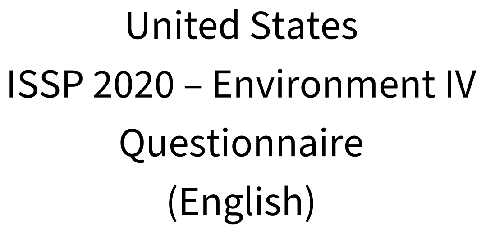

United States
ISSP 2020 – Environment IV
Questionnaire
(English)

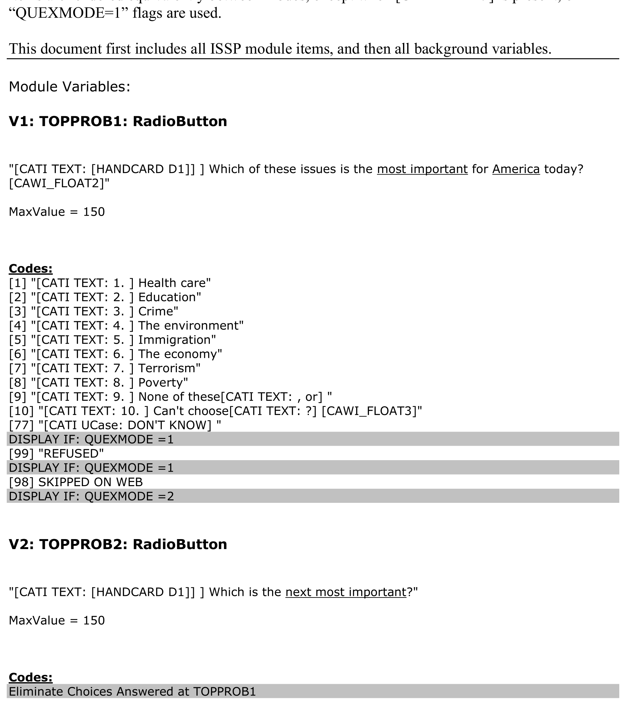

Introductory Note:

In 2020 and 2021, the GSS was conducted using a different web platform than had been used in the past. The 2021 GSS used Voxco A4S instead of the traditional MR Unicom. As a result, the format of these questions look different than previous rounds of the GSS. We encourage users to pay attention to [ ] as a way of denoting text fills and mode specific changes. In particular, all items are rendered equivalently between modes, except when [CATI TEXT: ] is present, or if “QUEXMODE=1” flags are used.

This document first includes all ISSP module items, and then all background variables.

Module Variables:

V1: TOPPROB1: RadioButton

"[CATI TEXT: [HANDCARD D1]] ] Which of these issues is the most important for America today? [CAWI_FLOAT2]"

MaxValue = 150

Codes:
[1] "[CATI TEXT: 1. ] Health care"
[2] "[CATI TEXT: 2. ] Education"
[3] "[CATI TEXT: 3. ] Crime"
[4] "[CATI TEXT: 4. ] The environment"
[5] "[CATI TEXT: 5. ] Immigration"
[6] "[CATI TEXT: 6. ] The economy"
[7] "[CATI TEXT: 7. ] Terrorism"
[8] "[CATI TEXT: 8. ] Poverty"
[9] "[CATI TEXT: 9. ] None of these[CATI TEXT: , or] "
[10] "[CATI TEXT: 10. ] Can't choose[CATI TEXT: ?] [CAWI_FLOAT3]"
[77] "[CATI UCase: DON'T KNOW] "
DISPLAY IF: QUEXMODE =1
[99] "REFUSED"
DISPLAY IF: QUEXMODE =1
[98] SKIPPED ON WEB
DISPLAY IF: QUEXMODE =2

V2: TOPPROB2: RadioButton

"[CATI TEXT: [HANDCARD D1]] ] Which is the next most important?"

MaxValue = 150

Codes:
Eliminate Choices Answered at TOPPROB1

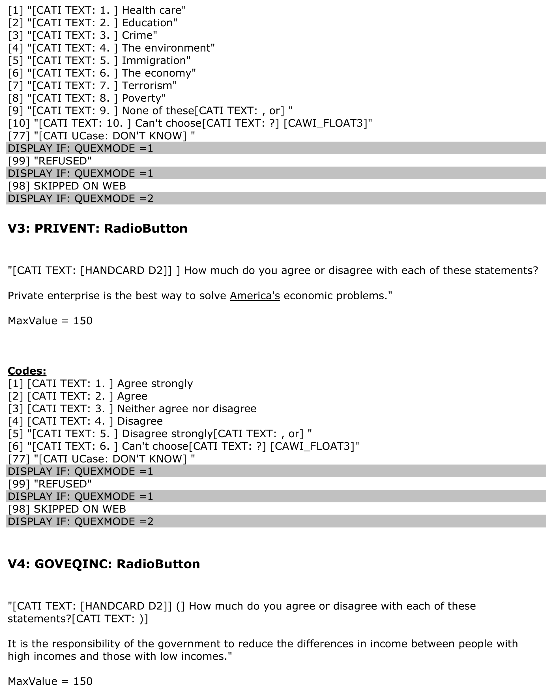

[1] "[CATI TEXT: 1. ] Health care"
[2] "[CATI TEXT: 2. ] Education"
[3] "[CATI TEXT: 3. ] Crime"
[4] "[CATI TEXT: 4. ] The environment"
[5] "[CATI TEXT: 5. ] Immigration"
[6] "[CATI TEXT: 6. ] The economy"
[7] "[CATI TEXT: 7. ] Terrorism"
[8] "[CATI TEXT: 8. ] Poverty"
[9] "[CATI TEXT: 9. ] None of these[CATI TEXT: , or] "
[10] "[CATI TEXT: 10. ] Can't choose[CATI TEXT: ?] [CAWI_FLOAT3]"
[77] "[CATI UCase: DON'T KNOW] "
DISPLAY IF: QUEXMODE =1
[99] "REFUSED"
DISPLAY IF: QUEXMODE =1
[98] SKIPPED ON WEB
DISPLAY IF: QUEXMODE =2

V3: PRIVENT: RadioButton

"[CATI TEXT: [HANDCARD D2]] ] How much do you agree or disagree with each of these statements?

Private enterprise is the best way to solve America's economic problems."

MaxValue = 150

Codes:
[1] [CATI TEXT: 1. ] Agree strongly
[2] [CATI TEXT: 2. ] Agree
[3] [CATI TEXT: 3. ] Neither agree nor disagree
[4] [CATI TEXT: 4. ] Disagree
[5] "[CATI TEXT: 5. ] Disagree strongly[CATI TEXT: , or] "
[6] "[CATI TEXT: 6. ] Can't choose[CATI TEXT: ?] [CAWI_FLOAT3]"
[77] "[CATI UCase: DON'T KNOW] "
DISPLAY IF: QUEXMODE =1
[99] "REFUSED"
DISPLAY IF: QUEXMODE =1
[98] SKIPPED ON WEB
DISPLAY IF: QUEXMODE =2

V4: GOVEQINC: RadioButton

"[CATI TEXT: [HANDCARD D2]] () How much do you agree or disagree with each of these statements?[CATI TEXT: )]"

It is the responsibility of the government to reduce the differences in income between people with high incomes and those with low incomes."

MaxValue = 150

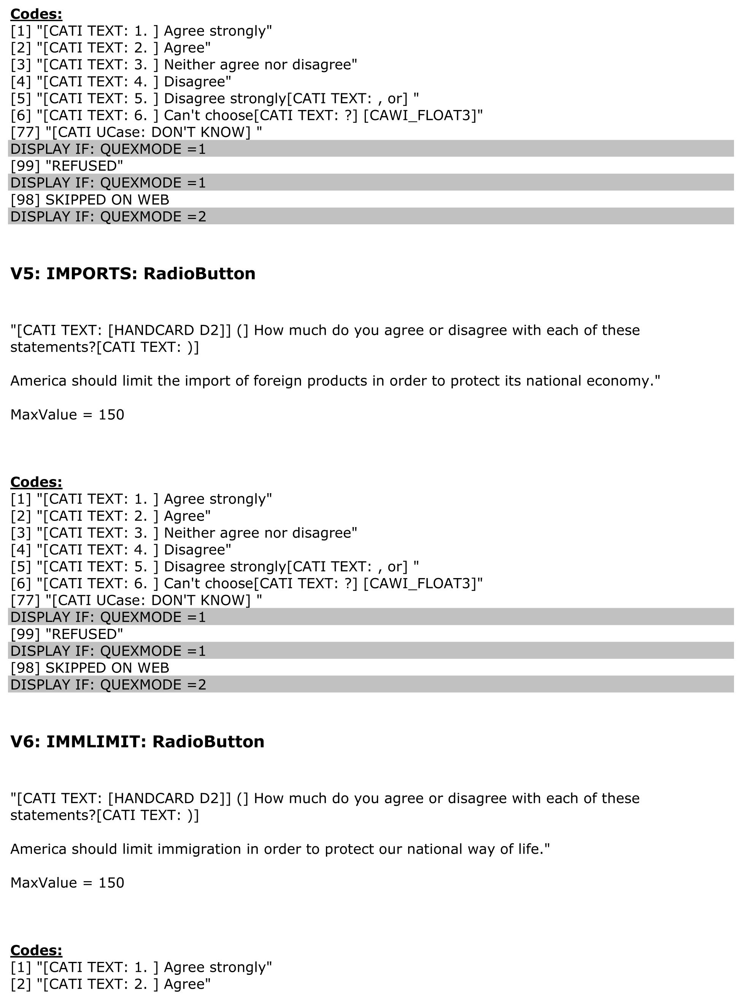

Codes:
[1] "[CATI TEXT: 1. ] Agree strongly"
[2] "[CATI TEXT: 2. ] Agree"
[3] "[CATI TEXT: 3. ] Neither agree nor disagree"
[4] "[CATI TEXT: 4. ] Disagree"
[5] "[CATI TEXT: 5. ] Disagree strongly[CATI TEXT: , or] "
[6] "[CATI TEXT: 6. ] Can't choose[CATI TEXT: ?] [CAWI_FLOAT3]"
[77] "[CATI UCase: DON'T KNOW]"
DISPLAY IF: QUEXMODE =1
[99] "REFUSED"
DISPLAY IF: QUEXMODE =1
[98] SKIPPED ON WEB
DISPLAY IF: QUEXMODE =2

V5: IMPORTS: RadioButton

"[CATI TEXT: [HANDCARD D2]] () How much do you agree or disagree with each of these statements?[CATI TEXT: )]"

America should limit the import of foreign products in order to protect its national economy."

MaxValue = 150

Codes:
[1] "[CATI TEXT: 1. ] Agree strongly"
[2] "[CATI TEXT: 2. ] Agree"
[3] "[CATI TEXT: 3. ] Neither agree nor disagree"
[4] "[CATI TEXT: 4. ] Disagree"
[5] "[CATI TEXT: 5. ] Disagree strongly[CATI TEXT: , or] "
[6] "[CATI TEXT: 6. ] Can't choose[CATI TEXT: ?] [CAWI_FLOAT3]"
[77] "[CATI UCase: DON'T KNOW]"
DISPLAY IF: QUEXMODE =1
[99] "REFUSED"
DISPLAY IF: QUEXMODE =1
[98] SKIPPED ON WEB
DISPLAY IF: QUEXMODE =2

V6: IMMLIMIT: RadioButton

"[CATI TEXT: [HANDCARD D2]] () How much do you agree or disagree with each of these statements?[CATI TEXT: )]"

America should limit immigration in order to protect our national way of life."

MaxValue = 150

Codes:
[1] "[CATI TEXT: 1. ] Agree strongly"
[2] "[CATI TEXT: 2. ] Agree"

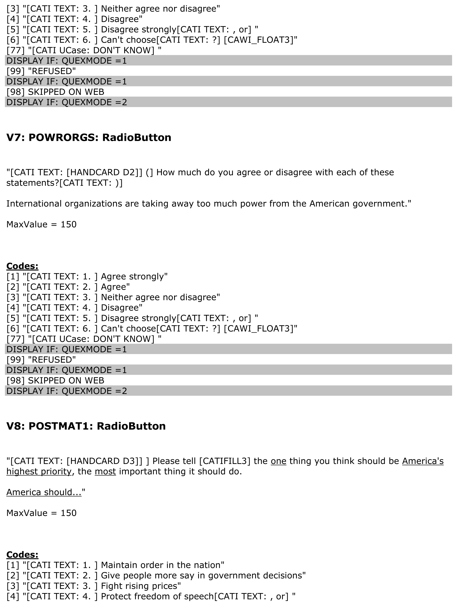

[3] "[CATI TEXT: 3. ] Neither agree nor disagree"
[4] "[CATI TEXT: 4. ] Disagree"
[5] "[CATI TEXT: 5. ] Disagree strongly[CATI TEXT: , or] "
[6] "[CATI TEXT: 6. ] Can't choose[CATI TEXT: ?] [CAWI_FLOAT3]"
[77] "[CATI UCase: DON'T KNOW]"
DISPLAY IF: QUEXMODE =1
[99] "REFUSED"
DISPLAY IF: QUEXMODE =1
[98] SKIPPED ON WEB
DISPLAY IF: QUEXMODE =2

V7: POWRORGS: RadioButton

"[CATI TEXT: [HANDCARD D2]] () How much do you agree or disagree with each of these statements?[CATI TEXT: )]

International organizations are taking away too much power from the American government."

MaxValue = 150

Codes:
[1] "[CATI TEXT: 1. ] Agree strongly"
[2] "[CATI TEXT: 2. ] Agree"
[3] "[CATI TEXT: 3. ] Neither agree nor disagree"
[4] "[CATI TEXT: 4. ] Disagree"
[5] "[CATI TEXT: 5. ] Disagree strongly[CATI TEXT: , or] "
[6] "[CATI TEXT: 6. ] Can't choose[CATI TEXT: ?] [CAWI_FLOAT3]"
[77] "[CATI UCase: DON'T KNOW]"
DISPLAY IF: QUEXMODE =1
[99] "REFUSED"
DISPLAY IF: QUEXMODE =1
[98] SKIPPED ON WEB
DISPLAY IF: QUEXMODE =2

V8: POSTMAT1: RadioButton

"[CATI TEXT: [HANDCARD D3]] ] Please tell [CATIFILL3] the one thing you think should be America's highest priority, the most important thing it should do.

America should..."

MaxValue = 150

Codes:
[1] "[CATI TEXT: 1. ] Maintain order in the nation"
[2] "[CATI TEXT: 2. ] Give people more say in government decisions"
[3] "[CATI TEXT: 3. ] Fight rising prices"
[4] "[CATI TEXT: 4. ] Protect freedom of speech[CATI TEXT: , or] "

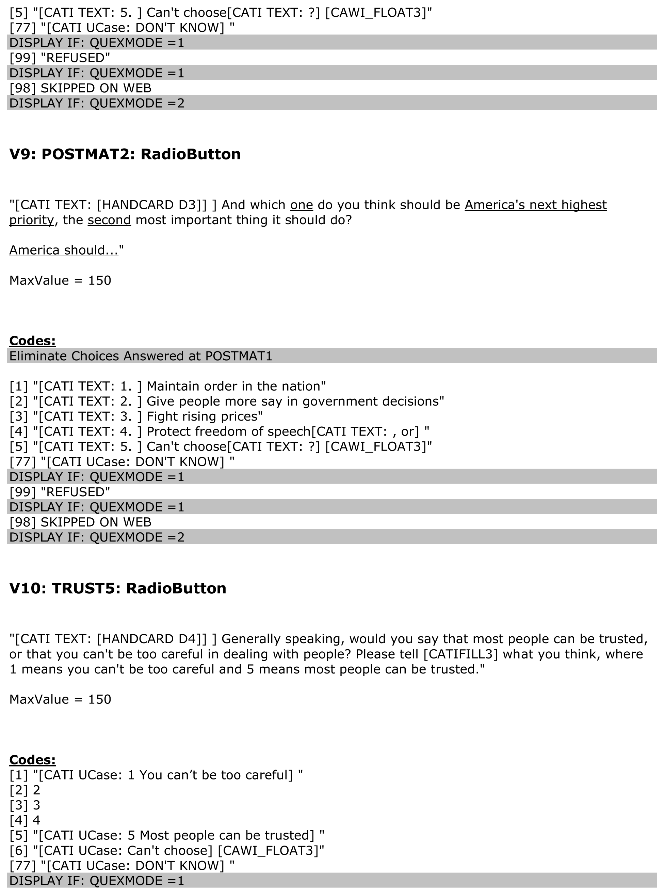

[5] "[CATI TEXT: 5. ] Can't choose[CATI TEXT: ?] [CAWI_FLOAT3]"
[77] "[CATI UCase: DON'T KNOW] "
DISPLAY IF: QUEXMODE =1
[99] "REFUSED"
DISPLAY IF: QUEXMODE =1
[98] SKIPPED ON WEB
DISPLAY IF: QUEXMODE =2

V9: POSTMAT2: RadioButton

"[CATI TEXT: [HANDCARD D3]] ] And which one do you think should be America's next highest priority, the second most important thing it should do?

America should..."

MaxValue = 150

Codes:
Eliminate Choices Answered at POSTMAT1
[1] "[CATI TEXT: 1. ] Maintain order in the nation"
[2] "[CATI TEXT: 2. ] Give people more say in government decisions"
[3] "[CATI TEXT: 3. ] Fight rising prices"
[4] "[CATI TEXT: 4. ] Protect freedom of speech[CATI TEXT: , or] "
[5] "[CATI TEXT: 5. ] Can't choose[CATI TEXT: ?] [CAWI_FLOAT3]"
[77] "[CATI UCase: DON'T KNOW] "
DISPLAY IF: QUEXMODE =1
[99] "REFUSED"
DISPLAY IF: QUEXMODE =1
[98] SKIPPED ON WEB
DISPLAY IF: QUEXMODE =2

V10: TRUST5: RadioButton

"[CATI TEXT: [HANDCARD D4]] ] Generally speaking, would you say that most people can be trusted, or that you can't be too careful in dealing with people? Please tell [CATIFILL3] what you think, where 1 means you can't be too careful and 5 means most people can be trusted."

MaxValue = 150

Codes:
[1] "[CATI UCase: 1 You can't be too careful] "
[2] 2
[3] 3
[4] 4
[5] "[CATI UCase: 5 Most people can be trusted] "
[6] "[CATI UCase: Can't choose] [CAWI_FLOAT3]"
[77] "[CATI UCase: DON'T KNOW] "
DISPLAY IF: QUEXMODE =1

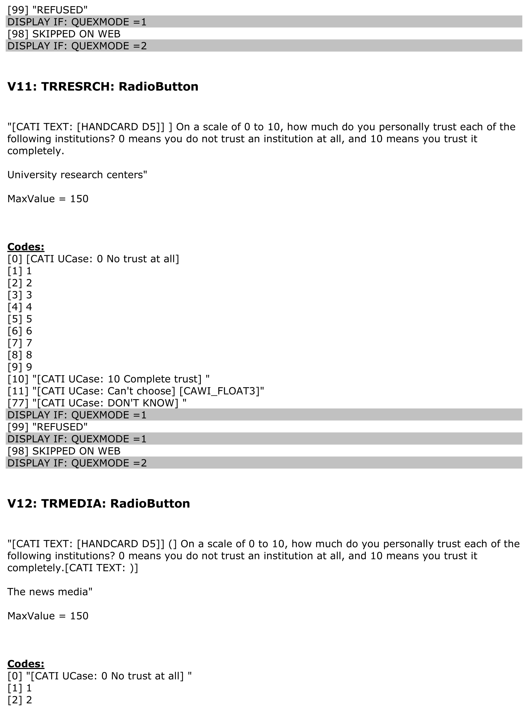

[99] "REFUSED"
DISPLAY IF: QUEXMODE =1
[98] SKIPPED ON WEB
DISPLAY IF: QUEXMODE =2

V11: TRRESRCH: RadioButton

"[CATI TEXT: [HANDCARD D5]] ] On a scale of 0 to 10, how much do you personally trust each of the following institutions? 0 means you do not trust an institution at all, and 10 means you trust it completely.

University research centers"

MaxValue = 150

Codes:
[0] [CATI UCase: 0 No trust at all]
[1] 1
[2] 2
[3] 3
[4] 4
[5] 5
[6] 6
[7] 7
[8] 8
[9] 9
[10] "[CATI UCase: 10 Complete trust] "
[11] "[CATI UCase: Can't choose] [CAWI_FLOAT3]"
[77] "[CATI UCase: DON'T KNOW] "
DISPLAY IF: QUEXMODE =1
[99] "REFUSED"
DISPLAY IF: QUEXMODE =1
[98] SKIPPED ON WEB
DISPLAY IF: QUEXMODE =2

V12: TRMEDIA: RadioButton

"[CATI TEXT: [HANDCARD D5]] () On a scale of 0 to 10, how much do you personally trust each of the following institutions? 0 means you do not trust an institution at all, and 10 means you trust it completely.[CATI TEXT: )]

The news media"

MaxValue = 150

Codes:
[0] "[CATI UCase: 0 No trust at all] "
[1] 1
[2] 2

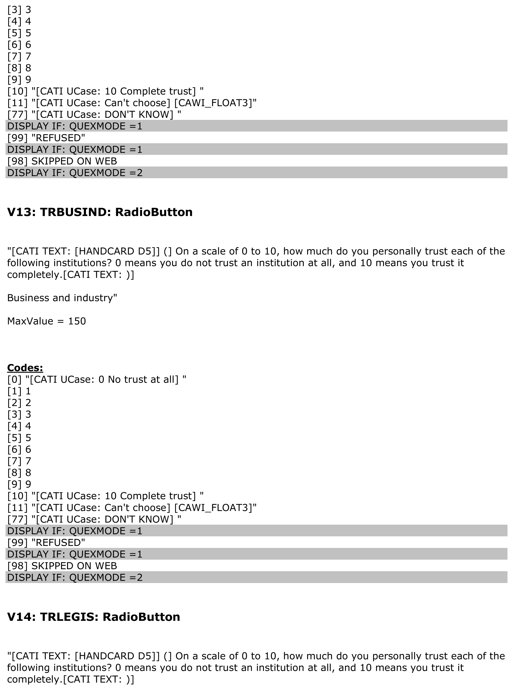

[3] 3
[4] 4
[5] 5
[6] 6
[7] 7
[8] 8
[9] 9
[10] "[CATI UCase: 10 Complete trust] "
[11] "[CATI UCase: Can't choose] [CAWI_FLOAT3]"
[77] "[CATI UCase: DON'T KNOW] "
DISPLAY IF: QUEXMODE =1
[99] "REFUSED"
DISPLAY IF: QUEXMODE =1
[98] SKIPPED ON WEB
DISPLAY IF: QUEXMODE =2

V13: TRBUSIND: RadioButton

"[CATI TEXT: [HANDCARD D5]] [] On a scale of 0 to 10, how much do you personally trust each of the following institutions? 0 means you do not trust an institution at all, and 10 means you trust it completely.[CATI TEXT: ]]

Business and industry"

MaxValue = 150

Codes:
[0] "[CATI UCase: 0 No trust at all] "
[1] 1
[2] 2
[3] 3
[4] 4
[5] 5
[6] 6
[7] 7
[8] 8
[9] 9
[10] "[CATI UCase: 10 Complete trust] "
[11] "[CATI UCase: Can't choose] [CAWI_FLOAT3]"
[77] "[CATI UCase: DON'T KNOW] "
DISPLAY IF: QUEXMODE =1
[99] "REFUSED"
DISPLAY IF: QUEXMODE =1
[98] SKIPPED ON WEB
DISPLAY IF: QUEXMODE =2

V14: TRLEGIS: RadioButton

"[CATI TEXT: [HANDCARD D5]] [] On a scale of 0 to 10, how much do you personally trust each of the following institutions? 0 means you do not trust an institution at all, and 10 means you trust it completely.[CATI TEXT: ]]

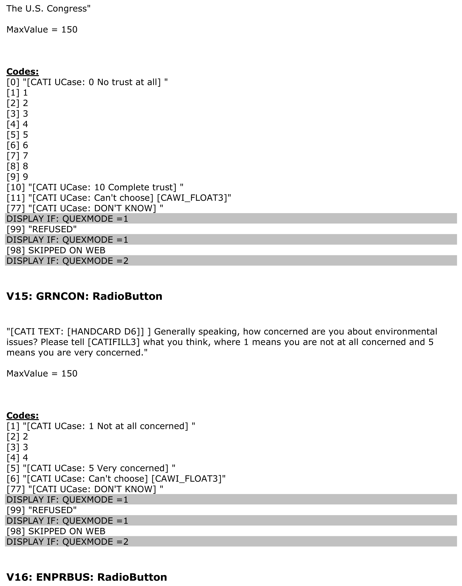

The U.S. Congress"
MaxValue = 150

Codes:
[0] "[CATI UCase: 0 No trust at all] "
[1] 1
[2] 2
[3] 3
[4] 4
[5] 5
[6] 6
[7] 7
[8] 8
[9] 9
[10] "[CATI UCase: 10 Complete trust] "
[11] "[CATI UCase: Can't choose] [CAWI_FLOAT3]"
[77] "[CATI UCase: DON'T KNOW] "
DISPLAY IF: QUEXMODE =1
[99] "REFUSED"
DISPLAY IF: QUEXMODE =1
[98] SKIPPED ON WEB
DISPLAY IF: QUEXMODE =2

V15: GRNCON: RadioButton

"[CATI TEXT: [HANDCARD D6]] ] Generally speaking, how concerned are you about environmental issues? Please tell [CATIFILL3] what you think, where 1 means you are not at all concerned and 5 means you are very concerned."

MaxValue = 150

Codes:
[1] "[CATI UCase: 1 Not at all concerned] "
[2] 2
[3] 3
[4] 4
[5] "[CATI UCase: 5 Very concerned] "
[6] "[CATI UCase: Can't choose] [CAWI_FLOAT3]"
[77] "[CATI UCase: DON'T KNOW] "
DISPLAY IF: QUEXMODE =1
[99] "REFUSED"
DISPLAY IF: QUEXMODE =1
[98] SKIPPED ON WEB
DISPLAY IF: QUEXMODE =2

V16: ENPRBUS: RadioButton

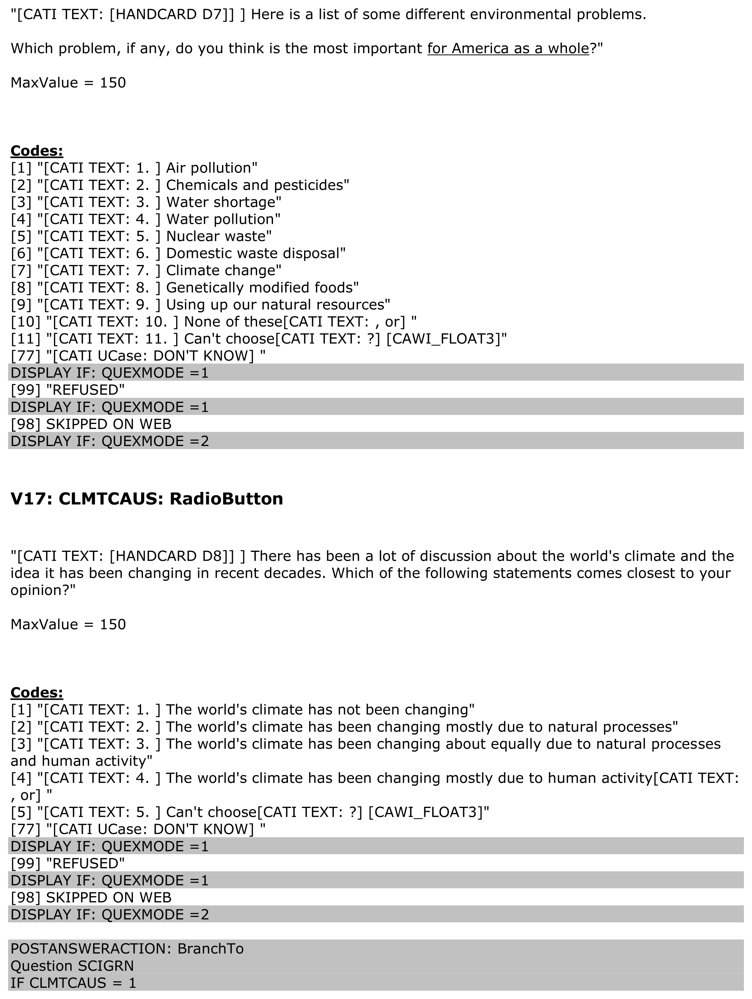

"[CATI TEXT: [HANDCARD D7]] ] Here is a list of some different environmental problems.

Which problem, if any, do you think is the most important for America as a whole?"

MaxValue = 150

Codes:
[1] "[CATI TEXT: 1. ] Air pollution"
[2] "[CATI TEXT: 2. ] Chemicals and pesticides"
[3] "[CATI TEXT: 3. ] Water shortage"
[4] "[CATI TEXT: 4. ] Water pollution"
[5] "[CATI TEXT: 5. ] Nuclear waste"
[6] "[CATI TEXT: 6. ] Domestic waste disposal"
[7] "[CATI TEXT: 7. ] Climate change"
[8] "[CATI TEXT: 8. ] Genetically modified foods"
[9] "[CATI TEXT: 9. ] Using up our natural resources"
[10] "[CATI TEXT: 10. ] None of these[CATI TEXT: , or] "
[11] "[CATI TEXT: 11. ] Can't choose[CATI TEXT: ?] [CAWI_FLOAT3]"
[77] "[CATI UCase: DON'T KNOW] "
DISPLAY IF: QUEXMODE =1
[99] "REFUSED"
DISPLAY IF: QUEXMODE =1
[98] SKIPPED ON WEB
DISPLAY IF: QUEXMODE =2

V17: CLMTCAUS: RadioButton

"[CATI TEXT: [HANDCARD D8]] ] There has been a lot of discussion about the world's climate and the idea it has been changing in recent decades. Which of the following statements comes closest to your opinion?"

MaxValue = 150

Codes:
[1] "[CATI TEXT: 1. ] The world's climate has not been changing"
[2] "[CATI TEXT: 2. ] The world's climate has been changing mostly due to natural processes"
[3] "[CATI TEXT: 3. ] The world's climate has been changing about equally due to natural processes and human activity"
[4] "[CATI TEXT: 4. ] The world's climate has been changing mostly due to human activity[CATI TEXT: , or] "
[5] "[CATI TEXT: 5. ] Can't choose[CATI TEXT: ?] [CAWI_FLOAT3]"
[77] "[CATI UCase: DON'T KNOW] "
DISPLAY IF: QUEXMODE =1
[99] "REFUSED"
DISPLAY IF: QUEXMODE =1
[98] SKIPPED ON WEB
DISPLAY IF: QUEXMODE =2

POSTANSWERACTION: BranchTo
Question SCIGRN
IF CLMTCAUS = 1

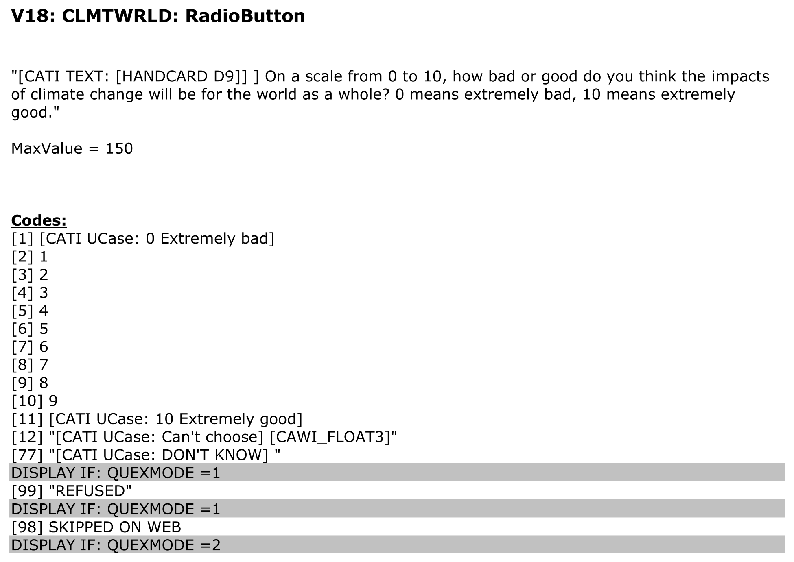

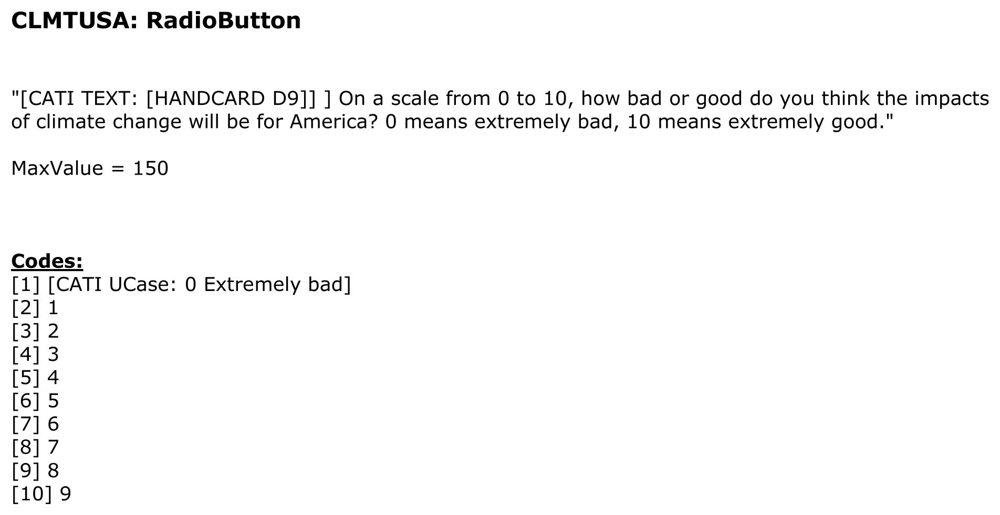

V18: CLMTWRLD: RadioButton

"[CATI TEXT: [HANDCARD D9]] ] On a scale from 0 to 10, how bad or good do you think the impacts of climate change will be for the world as a whole? 0 means extremely bad, 10 means extremely good."

MaxValue = 150

Codes:
[1] [CATI UCase: 0 Extremely bad]
[2] 1
[3] 2
[4] 3
[5] 4
[6] 5
[7] 6
[8] 7
[9] 8
[10] 9
[11] [CATI UCase: 10 Extremely good]
[12] "[CATI UCase: Can't choose] [CAWI_FLOAT3]"
[77] "[CATI UCase: DON'T KNOW]"
DISPLAY IF: QUEXMODE =1
[99] "REFUSED"
DISPLAY IF: QUEXMODE =1
[98] SKIPPED ON WEB
DISPLAY IF: QUEXMODE =2

CLMTUSA: RadioButton

"[CATI TEXT: [HANDCARD D9]] ] On a scale from 0 to 10, how bad or good do you think the impacts of climate change will be for America? 0 means extremely bad, 10 means extremely good."

MaxValue = 150

Codes:
[1] [CATI UCase: 0 Extremely bad]
[2] 1
[3] 2
[4] 3
[5] 4
[6] 5
[7] 6
[8] 7
[9] 8
[10] 9

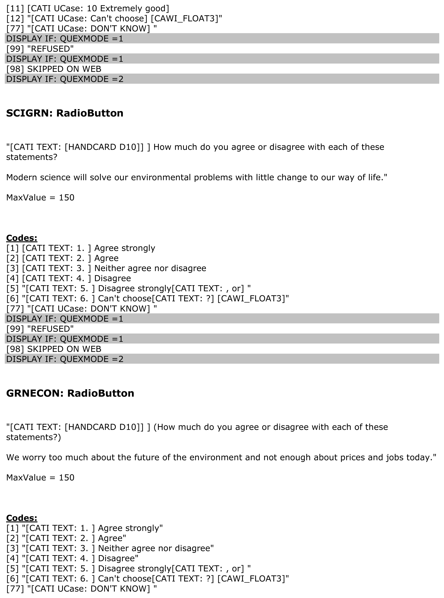

[11] [CATI UCase: 10 Extremely good]
[12] "[CATI UCase: Can't choose] [CAWI_FLOAT3]"
[77] "[CATI UCase: DON'T KNOW]"
DISPLAY IF: QUEXMODE =1
[99] "REFUSED"
DISPLAY IF: QUEXMODE =1
[98] SKIPPED ON WEB
DISPLAY IF: QUEXMODE =2

SCIGRN: RadioButton

"[CATI TEXT: [HANDCARD D10]] ] How much do you agree or disagree with each of these statements?

Modern science will solve our environmental problems with little change to our way of life."

MaxValue = 150

Codes:
[1] [CATI TEXT: 1. ] Agree strongly
[2] [CATI TEXT: 2. ] Agree
[3] [CATI TEXT: 3. ] Neither agree nor disagree
[4] [CATI TEXT: 4. ] Disagree
[5] "[CATI TEXT: 5. ] Disagree strongly[CATI TEXT: , or] "
[6] "[CATI TEXT: 6. ] Can't choose[CATI TEXT: ?] [CAWI_FLOAT3]"
[77] "[CATI UCase: DON'T KNOW]"
DISPLAY IF: QUEXMODE =1
[99] "REFUSED"
DISPLAY IF: QUEXMODE =1
[98] SKIPPED ON WEB
DISPLAY IF: QUEXMODE =2

GRNECON: RadioButton

"[CATI TEXT: [HANDCARD D10]] ] (How much do you agree or disagree with each of these statements?)

We worry too much about the future of the environment and not enough about prices and jobs today."

MaxValue = 150

Codes:
[1] "[CATI TEXT: 1. ] Agree strongly"
[2] "[CATI TEXT: 2. ] Agree"
[3] "[CATI TEXT: 3. ] Neither agree nor disagree"
[4] "[CATI TEXT: 4. ] Disagree"
[5] "[CATI TEXT: 5. ] Disagree strongly[CATI TEXT: , or] "
[6] "[CATI TEXT: 6. ] Can't choose[CATI TEXT: ?] [CAWI_FLOAT3]"
[77] "[CATI UCase: DON'T KNOW]"

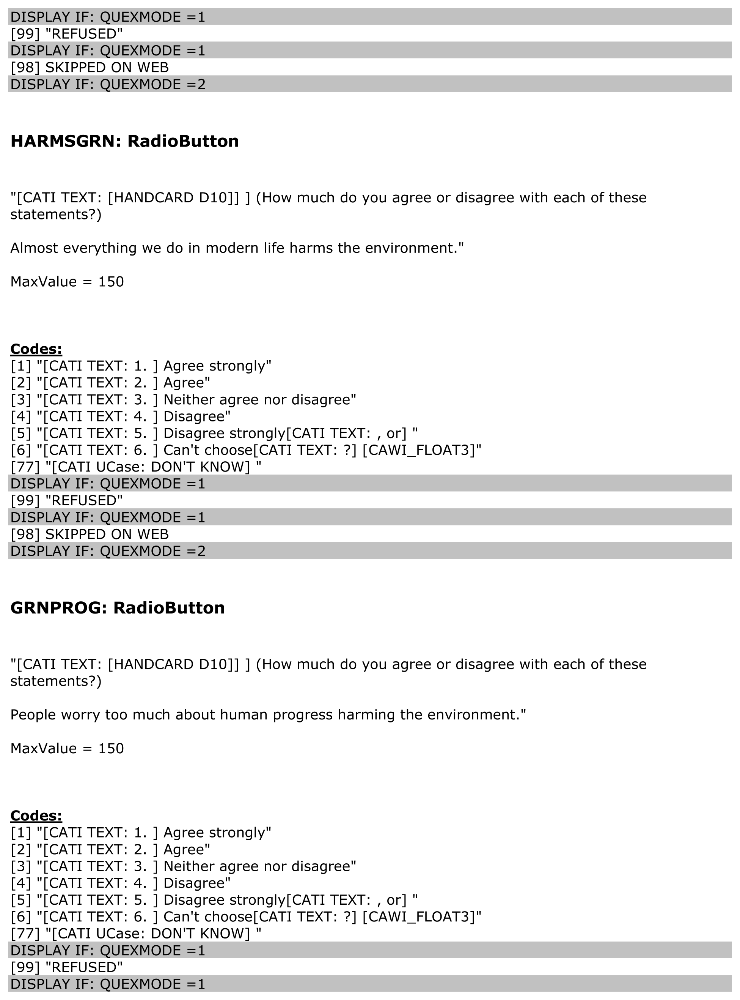

DISPLAY IF: QUEXMODE =1
[99] "REFUSED"
DISPLAY IF: QUEXMODE =1
[98] SKIPPED ON WEB
DISPLAY IF: QUEXMODE =2

HARMSGRN: RadioButton

"[CATI TEXT: [HANDCARD D10]] (How much do you agree or disagree with each of these statements?)

Almost everything we do in modern life harms the environment."

MaxValue = 150

Codes:
[1] "[CATI TEXT: 1. ] Agree strongly"
[2] "[CATI TEXT: 2. ] Agree"
[3] "[CATI TEXT: 3. ] Neither agree nor disagree"
[4] "[CATI TEXT: 4. ] Disagree"
[5] "[CATI TEXT: 5. ] Disagree strongly[CATI TEXT: , or] "
[6] "[CATI TEXT: 6. ] Can't choose[CATI TEXT: ?] [CAWI_FLOAT3]"
[77] "[CATI UCase: DON'T KNOW]"
DISPLAY IF: QUEXMODE =1
[99] "REFUSED"
DISPLAY IF: QUEXMODE =1
[98] SKIPPED ON WEB
DISPLAY IF: QUEXMODE =2

GRNPROG: RadioButton

"[CATI TEXT: [HANDCARD D10]] (How much do you agree or disagree with each of these statements?)

People worry too much about human progress harming the environment."

MaxValue = 150

Codes:
[1] "[CATI TEXT: 1. ] Agree strongly"
[2] "[CATI TEXT: 2. ] Agree"
[3] "[CATI TEXT: 3. ] Neither agree nor disagree"
[4] "[CATI TEXT: 4. ] Disagree"
[5] "[CATI TEXT: 5. ] Disagree strongly[CATI TEXT: , or] "
[6] "[CATI TEXT: 6. ] Can't choose[CATI TEXT: ?] [CAWI_FLOAT3]"
[77] "[CATI UCase: DON'T KNOW]"
DISPLAY IF: QUEXMODE =1
[99] "REFUSED"
DISPLAY IF: QUEXMODE =1

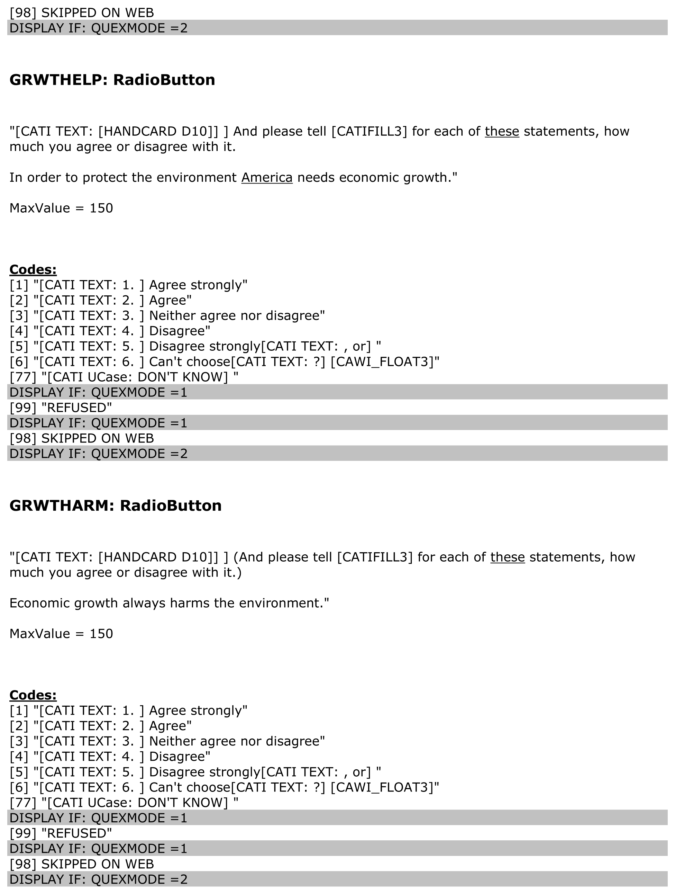

[98] SKIPPED ON WEB
DISPLAY IF: QUEXMODE =2

GRWTHELP: RadioButton

"[CATI TEXT: [HANDCARD D10]] And please tell [CATIFILL3] for each of these statements, how much you agree or disagree with it.

In order to protect the environment America needs economic growth."

MaxValue = 150

Codes:
[1] "[CATI TEXT: 1. ] Agree strongly"
[2] "[CATI TEXT: 2. ] Agree"
[3] "[CATI TEXT: 3. ] Neither agree nor disagree"
[4] "[CATI TEXT: 4. ] Disagree"
[5] "[CATI TEXT: 5. ] Disagree strongly[CATI TEXT: , or] "
[6] "[CATI TEXT: 6. ] Can't choose[CATI TEXT: ?] [CAWI_FLOAT3]"
[77] "[CATI UCase: DON'T KNOW]"
DISPLAY IF: QUEXMODE =1
[99] "REFUSED"
DISPLAY IF: QUEXMODE =1
[98] SKIPPED ON WEB
DISPLAY IF: QUEXMODE =2

GRWTHARM: RadioButton

"[CATI TEXT: [HANDCARD D10]] (And please tell [CATIFILL3] for each of these statements, how much you agree or disagree with it.)

Economic growth always harms the environment."

MaxValue = 150

Codes:
[1] "[CATI TEXT: 1. ] Agree strongly"
[2] "[CATI TEXT: 2. ] Agree"
[3] "[CATI TEXT: 3. ] Neither agree nor disagree"
[4] "[CATI TEXT: 4. ] Disagree"
[5] "[CATI TEXT: 5. ] Disagree strongly[CATI TEXT: , or] "
[6] "[CATI TEXT: 6. ] Can't choose[CATI TEXT: ?] [CAWI_FLOAT3]"
[77] "[CATI UCase: DON'T KNOW]"
DISPLAY IF: QUEXMODE =1
[99] "REFUSED"
DISPLAY IF: QUEXMODE =1
[98] SKIPPED ON WEB
DISPLAY IF: QUEXMODE =2

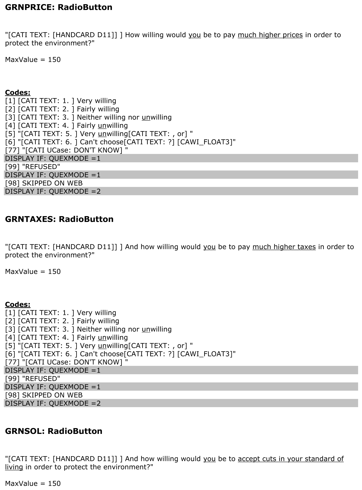

GRNPRICE: RadioButton

"[CATI TEXT: [HANDCARD D11]] ] How willing would you be to pay much higher prices in order to protect the environment?"

MaxValue = 150

Codes:
[1] [CATI TEXT: 1. ] Very willing
[2] [CATI TEXT: 2. ] Fairly willing
[3] [CATI TEXT: 3. ] Neither willing nor unwilling
[4] [CATI TEXT: 4. ] Fairly unwilling
[5] "[CATI TEXT: 5. ] Very unwilling[CATI TEXT: , or] "
[6] "[CATI TEXT: 6. ] Can't choose[CATI TEXT: ?] [CAWI_FLOAT3]"
[77] "[CATI UCase: DON'T KNOW]"
DISPLAY IF: QUEXMODE =1
[99] "REFUSED"
DISPLAY IF: QUEXMODE =1
[98] SKIPPED ON WEB
DISPLAY IF: QUEXMODE =2

GRNTAXES: RadioButton

"[CATI TEXT: [HANDCARD D11]] ] And how willing would you be to pay much higher taxes in order to protect the environment?"

MaxValue = 150

Codes:
[1] [CATI TEXT: 1. ] Very willing
[2] [CATI TEXT: 2. ] Fairly willing
[3] [CATI TEXT: 3. ] Neither willing nor unwilling
[4] [CATI TEXT: 4. ] Fairly unwilling
[5] "[CATI TEXT: 5. ] Very unwilling[CATI TEXT: , or] "
[6] "[CATI TEXT: 6. ] Can't choose[CATI TEXT: ?] [CAWI_FLOAT3]"
[77] "[CATI UCase: DON'T KNOW]"
DISPLAY IF: QUEXMODE =1
[99] "REFUSED"
DISPLAY IF: QUEXMODE =1
[98] SKIPPED ON WEB
DISPLAY IF: QUEXMODE =2

GRNSOL: RadioButton

"[CATI TEXT: [HANDCARD D11]] ] And how willing would you be to accept cuts in your standard of living in order to protect the environment?"

MaxValue = 150

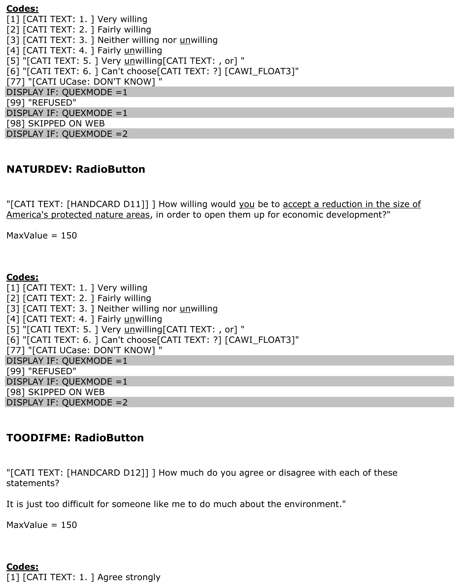

Codes:
[1] [CATI TEXT: 1. ] Very willing
[2] [CATI TEXT: 2. ] Fairly willing
[3] [CATI TEXT: 3. ] Neither willing nor unwilling
[4] [CATI TEXT: 4. ] Fairly unwilling
[5] "[CATI TEXT: 5. ] Very unwilling[CATI TEXT: , or] "
[6] "[CATI TEXT: 6. ] Can't choose[CATI TEXT: ?] [CAWI_FLOAT3]"
[77] "[CATI UCase: DON'T KNOW] "
DISPLAY IF: QUEXMODE =1
[99] "REFUSED"
DISPLAY IF: QUEXMODE =1
[98] SKIPPED ON WEB
DISPLAY IF: QUEXMODE =2

NATUREDEV: RadioButton

"[CATI TEXT: [HANDCARD D11]] How willing would you be to accept a reduction in the size of America's protected nature areas, in order to open them up for economic development?"

MaxValue = 150

Codes:
[1] [CATI TEXT: 1. ] Very willing
[2] [CATI TEXT: 2. ] Fairly willing
[3] [CATI TEXT: 3. ] Neither willing nor unwilling
[4] [CATI TEXT: 4. ] Fairly unwilling
[5] "[CATI TEXT: 5. ] Very unwilling[CATI TEXT: , or] "
[6] "[CATI TEXT: 6. ] Can't choose[CATI TEXT: ?] [CAWI_FLOAT3]"
[77] "[CATI UCase: DON'T KNOW] "
DISPLAY IF: QUEXMODE =1
[99] "REFUSED"
DISPLAY IF: QUEXMODE =1
[98] SKIPPED ON WEB
DISPLAY IF: QUEXMODE =2

TOODIFME: RadioButton

"[CATI TEXT: [HANDCARD D12]] How much do you agree or disagree with each of these statements?

It is just too difficult for someone like me to do much about the environment."

MaxValue = 150

Codes:
[1] [CATI TEXT: 1. ] Agree strongly

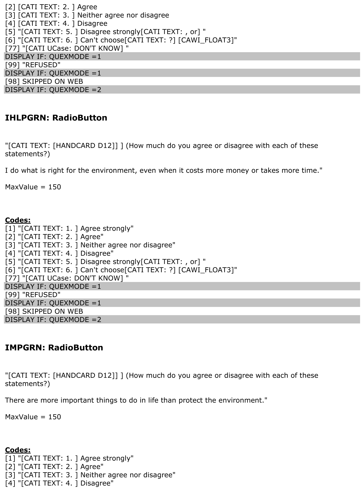

[2] [CATI TEXT: 2. ] Agree
[3] [CATI TEXT: 3. ] Neither agree nor disagree
[4] [CATI TEXT: 4. ] Disagree
[5] "[CATI TEXT: 5. ] Disagree strongly[CATI TEXT: , or] "
[6] "[CATI TEXT: 6. ] Can't choose[CATI TEXT: ?] [CAWI_FLOAT3]"
[77] "[CATI UCase: DON'T KNOW]"
DISPLAY IF: QUEXMODE =1
[99] "REFUSED"
DISPLAY IF: QUEXMODE =1
[98] SKIPPED ON WEB
DISPLAY IF: QUEXMODE =2

IHLPGRN: RadioButton

"[CATI TEXT: [HANDCARD D12]] (How much do you agree or disagree with each of these statements?)

I do what is right for the environment, even when it costs more money or takes more time."

MaxValue = 150

Codes:
[1] "[CATI TEXT: 1. ] Agree strongly"
[2] "[CATI TEXT: 2. ] Agree"
[3] "[CATI TEXT: 3. ] Neither agree nor disagree"
[4] "[CATI TEXT: 4. ] Disagree"
[5] "[CATI TEXT: 5. ] Disagree strongly[CATI TEXT: , or] "
[6] "[CATI TEXT: 6. ] Can't choose[CATI TEXT: ?] [CAWI_FLOAT3]"
[77] "[CATI UCase: DON'T KNOW]"
DISPLAY IF: QUEXMODE =1
[99] "REFUSED"
DISPLAY IF: QUEXMODE =1
[98] SKIPPED ON WEB
DISPLAY IF: QUEXMODE =2

IMPGRN: RadioButton

"[CATI TEXT: [HANDCARD D12]] (How much do you agree or disagree with each of these statements?)

There are more important things to do in life than protect the environment."

MaxValue = 150

Codes:
[1] "[CATI TEXT: 1. ] Agree strongly"
[2] "[CATI TEXT: 2. ] Agree"
[3] "[CATI TEXT: 3. ] Neither agree nor disagree"
[4] "[CATI TEXT: 4. ] Disagree"

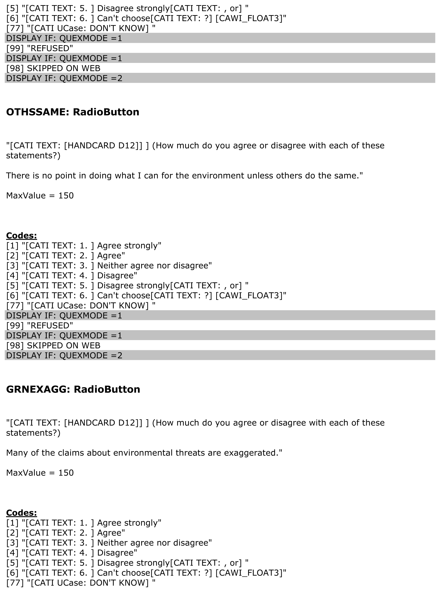

[5] "[CATI TEXT: 5. ] Disagree strongly[CATI TEXT: , or] "
[6] "[CATI TEXT: 6. ] Can't choose[CATI TEXT: ?] [CAWI_FLOAT3]"
[77] "[CATI UCase: DON'T KNOW]"
DISPLAY IF: QUEXMODE =1
[99] "REFUSED"
DISPLAY IF: QUEXMODE =1
[98] SKIPPED ON WEB
DISPLAY IF: QUEXMODE =2

OTHSSAME: RadioButton

"[CATI TEXT: [HANDCARD D12]] ] (How much do you agree or disagree with each of these statements?)

There is no point in doing what I can for the environment unless others do the same."

MaxValue = 150

Codes:
[1] "[CATI TEXT: 1. ] Agree strongly"
[2] "[CATI TEXT: 2. ] Agree"
[3] "[CATI TEXT: 3. ] Neither agree nor disagree"
[4] "[CATI TEXT: 4. ] Disagree"
[5] "[CATI TEXT: 5. ] Disagree strongly[CATI TEXT: , or] "
[6] "[CATI TEXT: 6. ] Can't choose[CATI TEXT: ?] [CAWI_FLOAT3]"
[77] "[CATI UCase: DON'T KNOW]"
DISPLAY IF: QUEXMODE =1
[99] "REFUSED"
DISPLAY IF: QUEXMODE =1
[98] SKIPPED ON WEB
DISPLAY IF: QUEXMODE =2

GRNEXAGG: RadioButton

"[CATI TEXT: [HANDCARD D12]] ] (How much do you agree or disagree with each of these statements?)

Many of the claims about environmental threats are exaggerated."

MaxValue = 150

Codes:
[1] "[CATI TEXT: 1. ] Agree strongly"
[2] "[CATI TEXT: 2. ] Agree"
[3] "[CATI TEXT: 3. ] Neither agree nor disagree"
[4] "[CATI TEXT: 4. ] Disagree"
[5] "[CATI TEXT: 5. ] Disagree strongly[CATI TEXT: , or] "
[6] "[CATI TEXT: 6. ] Can't choose[CATI TEXT: ?] [CAWI_FLOAT3]"
[77] "[CATI UCase: DON'T KNOW]"

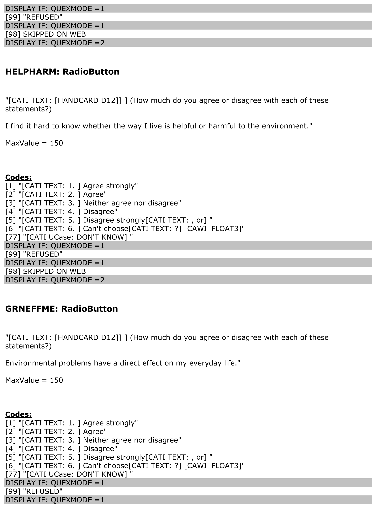

DISPLAY IF: QUEXMODE =1
[99] "REFUSED"
DISPLAY IF: QUEXMODE =1
[98] SKIPPED ON WEB
DISPLAY IF: QUEXMODE =2

HELPHARM: RadioButton

"[CATI TEXT: [HANDCARD D12]] (How much do you agree or disagree with each of these statements?)

I find it hard to know whether the way I live is helpful or harmful to the environment."

MaxValue = 150

Codes:
[1] "[CATI TEXT: 1. ] Agree strongly"
[2] "[CATI TEXT: 2. ] Agree"
[3] "[CATI TEXT: 3. ] Neither agree nor disagree"
[4] "[CATI TEXT: 4. ] Disagree"
[5] "[CATI TEXT: 5. ] Disagree strongly[CATI TEXT: , or] "
[6] "[CATI TEXT: 6. ] Can't choose[CATI TEXT: ?] [CAWI_FLOAT3]"
[77] "[CATI UCase: DON'T KNOW]"
DISPLAY IF: QUEXMODE =1
[99] "REFUSED"
DISPLAY IF: QUEXMODE =1
[98] SKIPPED ON WEB
DISPLAY IF: QUEXMODE =2

GRNEFFME: RadioButton

"[CATI TEXT: [HANDCARD D12]] (How much do you agree or disagree with each of these statements?)

Environmental problems have a direct effect on my everyday life."

MaxValue = 150

Codes:
[1] "[CATI TEXT: 1. ] Agree strongly"
[2] "[CATI TEXT: 2. ] Agree"
[3] "[CATI TEXT: 3. ] Neither agree nor disagree"
[4] "[CATI TEXT: 4. ] Disagree"
[5] "[CATI TEXT: 5. ] Disagree strongly[CATI TEXT: , or] "
[6] "[CATI TEXT: 6. ] Can't choose[CATI TEXT: ?] [CAWI_FLOAT3]"
[77] "[CATI UCase: DON'T KNOW]"
DISPLAY IF: QUEXMODE =1
[99] "REFUSED"
DISPLAY IF: QUEXMODE =1

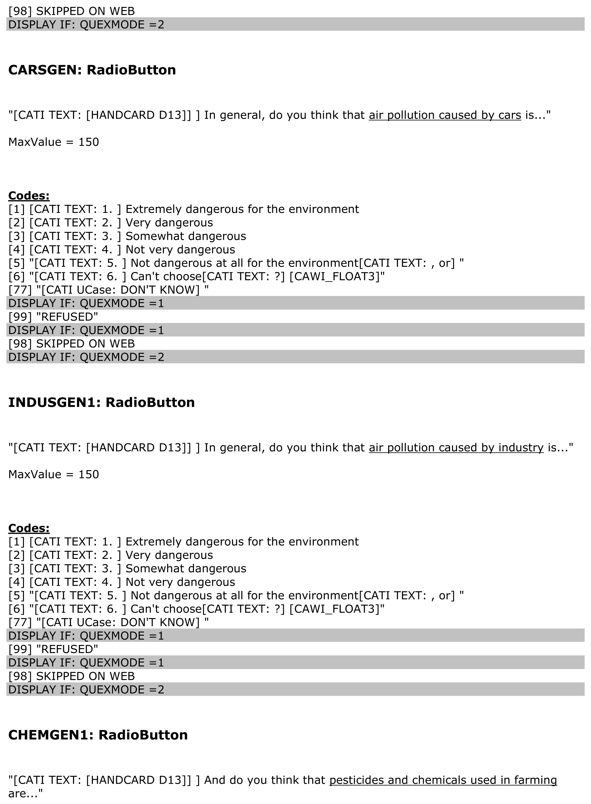

[98] SKIPPED ON WEB
DISPLAY IF: QUEXMODE =2

CARSGEn: RadioButton

"[CATI TEXT: [HANDCARD D13]] ] In general, do you think that air pollution caused by cars is..."

MaxValue = 150

Codes:
[1] [CATI TEXT: 1. ] Extremely dangerous for the environment
[2] [CATI TEXT: 2. ] Very dangerous
[3] [CATI TEXT: 3. ] Somewhat dangerous
[4] [CATI TEXT: 4. ] Not very dangerous
[5] "[CATI TEXT: 5. ] Not dangerous at all for the environment[CATI TEXT: , or] "
[6] "[CATI TEXT: 6. ] Can't choose[CATI TEXT: ?] [CAWI_FLOAT3]"
[77] "[CATI UCase: DON'T KNOW] "
DISPLAY IF: QUEXMODE =1
[99] "REFUSED"
DISPLAY IF: QUEXMODE =1
[98] SKIPPED ON WEB
DISPLAY IF: QUEXMODE =2

INDUSGEN1: RadioButton

"[CATI TEXT: [HANDCARD D13]] ] In general, do you think that air pollution caused by industry is..."

MaxValue = 150

Codes:
[1] [CATI TEXT: 1. ] Extremely dangerous for the environment
[2] [CATI TEXT: 2. ] Very dangerous
[3] [CATI TEXT: 3. ] Somewhat dangerous
[4] [CATI TEXT: 4. ] Not very dangerous
[5] "[CATI TEXT: 5. ] Not dangerous at all for the environment[CATI TEXT: , or] "
[6] "[CATI TEXT: 6. ] Can't choose[CATI TEXT: ?] [CAWI_FLOAT3]"
[77] "[CATI UCase: DON'T KNOW] "
DISPLAY IF: QUEXMODE =1
[99] "REFUSED"
DISPLAY IF: QUEXMODE =1
[98] SKIPPED ON WEB
DISPLAY IF: QUEXMODE =2

CHEMGEN1: RadioButton

"[CATI TEXT: [HANDCARD D13]] ] And do you think that pesticides and chemicals used in farming are..."

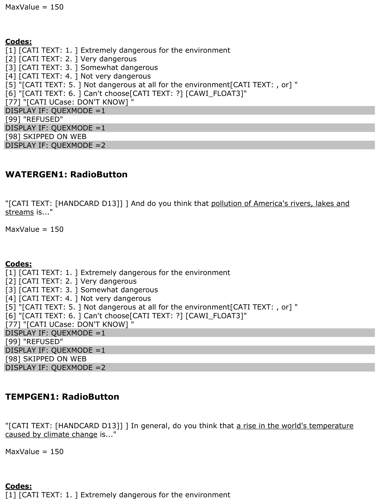

MaxValue = 150

Codes:
[1] [CATI TEXT: 1. ] Extremely dangerous for the environment
[2] [CATI TEXT: 2. ] Very dangerous
[3] [CATI TEXT: 3. ] Somewhat dangerous
[4] [CATI TEXT: 4. ] Not very dangerous
[5] "[CATI TEXT: 5. ] Not dangerous at all for the environment[CATI TEXT: , or] "
[6] "[CATI TEXT: 6. ] Can't choose[CATI TEXT: ?] [CAWI_FLOAT3]"
[77] "[CATI UCase: DON'T KNOW]"
DISPLAY IF: QUEXMODE =1
[99] "REFUSED"
DISPLAY IF: QUEXMODE =1
[98] SKIPPED ON WEB
DISPLAY IF: QUEXMODE =2

WATERGEN1: RadioButton

"[CATI TEXT: [HANDCARD D13]] ] And do you think that pollution of America's rivers, lakes and streams is..."

MaxValue = 150

Codes:
[1] [CATI TEXT: 1. ] Extremely dangerous for the environment
[2] [CATI TEXT: 2. ] Very dangerous
[3] [CATI TEXT: 3. ] Somewhat dangerous
[4] [CATI TEXT: 4. ] Not very dangerous
[5] "[CATI TEXT: 5. ] Not dangerous at all for the environment[CATI TEXT: , or] "
[6] "[CATI TEXT: 6. ] Can't choose[CATI TEXT: ?] [CAWI_FLOAT3]"
[77] "[CATI UCase: DON'T KNOW]"
DISPLAY IF: QUEXMODE =1
[99] "REFUSED"
DISPLAY IF: QUEXMODE =1
[98] SKIPPED ON WEB
DISPLAY IF: QUEXMODE =2

TEMPGEn1: RadioButton

"[CATI TEXT: [HANDCARD D13]] ] In general, do you think that a rise in the world's temperature caused by climate change is..."

MaxValue = 150

Codes:
[1] [CATI TEXT: 1. ] Extremely dangerous for the environment

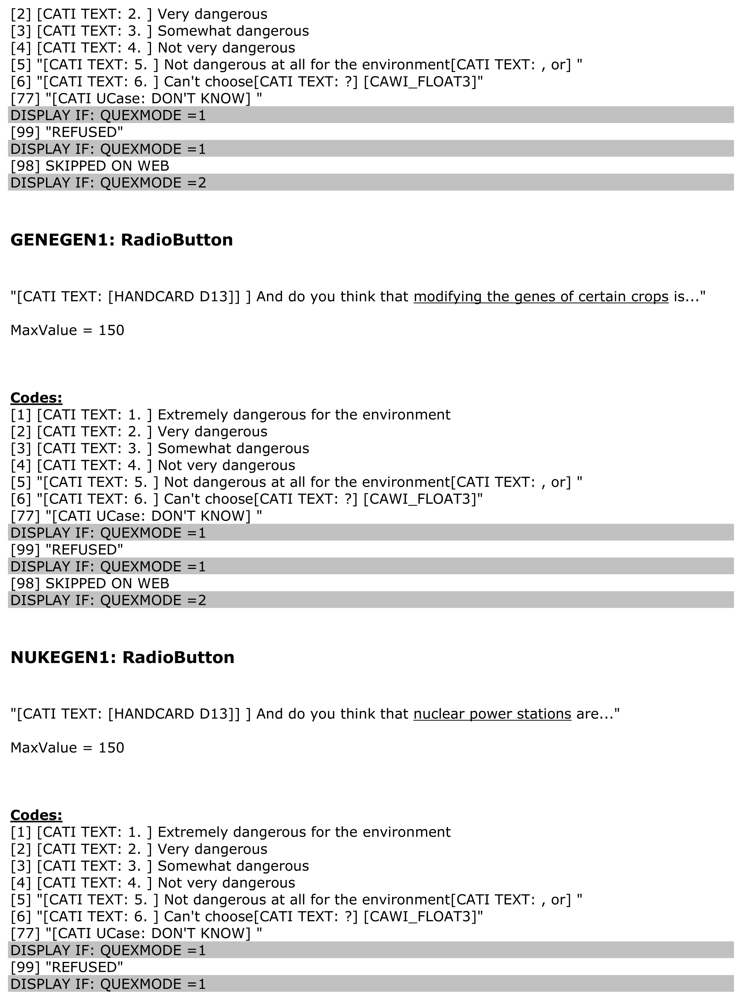

[2] [CATI TEXT: 2. ] Very dangerous
[3] [CATI TEXT: 3. ] Somewhat dangerous
[4] [CATI TEXT: 4. ] Not very dangerous
[5] "[CATI TEXT: 5. ] Not dangerous at all for the environment[CATI TEXT: , or] "
[6] "[CATI TEXT: 6. ] Can't choose[CATI TEXT: ?] [CAWI_FLOAT3]"
[77] "[CATI UCase: DON'T KNOW]"
DISPLAY IF: QUEXMODE =1
[99] "REFUSED"
DISPLAY IF: QUEXMODE =1
[98] SKIPPED ON WEB
DISPLAY IF: QUEXMODE =2

GENEGEN1: RadioButton

"[CATI TEXT: [HANDCARD D13]] ] And do you think that modifying the genes of certain crops is..."

MaxValue = 150

Codes:
[1] [CATI TEXT: 1. ] Extremely dangerous for the environment
[2] [CATI TEXT: 2. ] Very dangerous
[3] [CATI TEXT: 3. ] Somewhat dangerous
[4] [CATI TEXT: 4. ] Not very dangerous
[5] "[CATI TEXT: 5. ] Not dangerous at all for the environment[CATI TEXT: , or] "
[6] "[CATI TEXT: 6. ] Can't choose[CATI TEXT: ?] [CAWI_FLOAT3]"
[77] "[CATI UCase: DON'T KNOW]"
DISPLAY IF: QUEXMODE =1
[99] "REFUSED"
DISPLAY IF: QUEXMODE =1
[98] SKIPPED ON WEB
DISPLAY IF: QUEXMODE =2

NUKEGEN1: RadioButton

"[CATI TEXT: [HANDCARD D13]] ] And do you think that nuclear power stations are..."

MaxValue = 150

Codes:
[1] [CATI TEXT: 1. ] Extremely dangerous for the environment
[2] [CATI TEXT: 2. ] Very dangerous
[3] [CATI TEXT: 3. ] Somewhat dangerous
[4] [CATI TEXT: 4. ] Not very dangerous
[5] "[CATI TEXT: 5. ] Not dangerous at all for the environment[CATI TEXT: , or] "
[6] "[CATI TEXT: 6. ] Can't choose[CATI TEXT: ?] [CAWI_FLOAT3]"
[77] "[CATI UCase: DON'T KNOW]"
DISPLAY IF: QUEXMODE =1
[99] "REFUSED"
DISPLAY IF: QUEXMODE =1

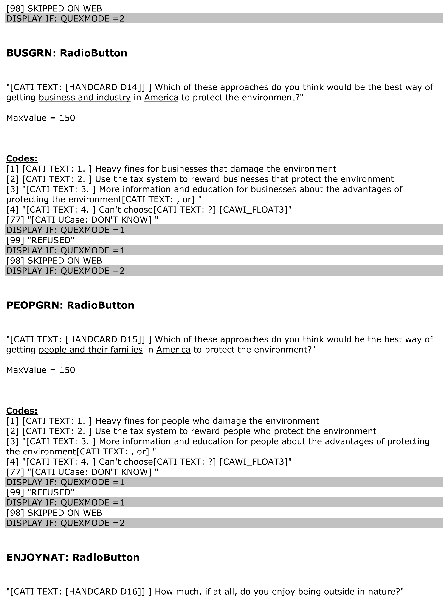

[98] SKIPPED ON WEB
DISPLAY IF: QUEXMODE =2

**BUSGRN: RadioButton**

"[CATI TEXT: [HANDCARD D14]] ] Which of these approaches do you think would be the best way of getting business and industry in America to protect the environment?"

MaxValue = 150

**Codes:**
[1] [CATI TEXT: 1. ] Heavy fines for businesses that damage the environment
[2] [CATI TEXT: 2. ] Use the tax system to reward businesses that protect the environment
[3] "[CATI TEXT: 3. ] More information and education for businesses about the advantages of protecting the environment[CATI TEXT: , or] "
[4] "[CATI TEXT: 4. ] Can't choose[CATI TEXT: ?] [CAWI_FLOAT3]"
[77] "[CATI UCase: DON'T KNOW] "
DISPLAY IF: QUEXMODE =1
[99] "REFUSED"
DISPLAY IF: QUEXMODE =1
[98] SKIPPED ON WEB
DISPLAY IF: QUEXMODE =2

**PEOPGRN: RadioButton**

"[CATI TEXT: [HANDCARD D15]] ] Which of these approaches do you think would be the best way of getting people and their families in America to protect the environment?"

MaxValue = 150

**Codes:**
[1] [CATI TEXT: 1. ] Heavy fines for people who damage the environment
[2] [CATI TEXT: 2. ] Use the tax system to reward people who protect the environment
[3] "[CATI TEXT: 3. ] More information and education for people about the advantages of protecting the environment[CATI TEXT: , or] "
[4] "[CATI TEXT: 4. ] Can't choose[CATI TEXT: ?] [CAWI_FLOAT3]"
[77] "[CATI UCase: DON'T KNOW] "
DISPLAY IF: QUEXMODE =1
[99] "REFUSED"
DISPLAY IF: QUEXMODE =1
[98] SKIPPED ON WEB
DISPLAY IF: QUEXMODE =2

**ENJOYNAT: RadioButton**

"[CATI TEXT: [HANDCARD D16]] ] How much, if at all, do you enjoy being outside in nature?"

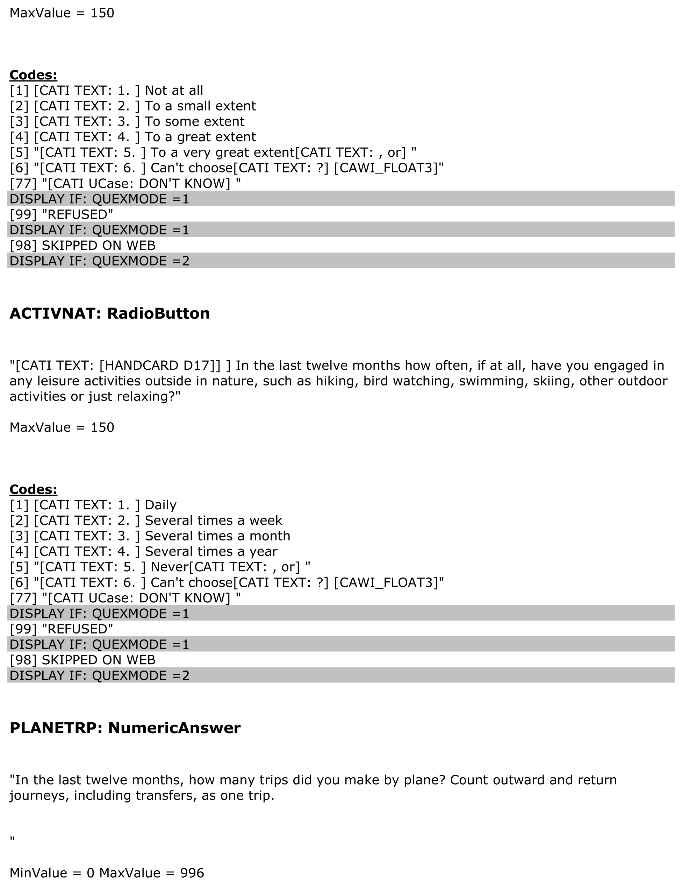

MaxValue = 150

Codes:
[1] [CATI TEXT: 1. ] Not at all
[2] [CATI TEXT: 2. ] To a small extent
[3] [CATI TEXT: 3. ] To some extent
[4] [CATI TEXT: 4. ] To a great extent
[5] "[CATI TEXT: 5. ] To a very great extent[CATI TEXT: , or] "
[6] "[CATI TEXT: 6. ] Can't choose[CATI TEXT: ?] [CAWI_FLOAT3]"
[77] "[CATI UCase: DON'T KNOW]"
DISPLAY IF: QUEXMODE =1
[99] "REFUSED"
DISPLAY IF: QUEXMODE =1
[98] SKIPPED ON WEB
DISPLAY IF: QUEXMODE =2

ACTIVNAT: RadioButton

"[CATI TEXT: [HANDCARD D17]] ] In the last twelve months how often, if at all, have you engaged in any leisure activities outside in nature, such as hiking, bird watching, swimming, skiing, other outdoor activities or just relaxing?"

MaxValue = 150

Codes:
[1] [CATI TEXT: 1. ] Daily
[2] [CATI TEXT: 2. ] Several times a week
[3] [CATI TEXT: 3. ] Several times a month
[4] [CATI TEXT: 4. ] Several times a year
[5] "[CATI TEXT: 5. ] Never[CATI TEXT: , or] "
[6] "[CATI TEXT: 6. ] Can't choose[CATI TEXT: ?] [CAWI_FLOAT3]"
[77] "[CATI UCase: DON'T KNOW]"
DISPLAY IF: QUEXMODE =1
[99] "REFUSED"
DISPLAY IF: QUEXMODE =1
[98] SKIPPED ON WEB
DISPLAY IF: QUEXMODE =2

PLANETRP: NumericAnswer

"In the last twelve months, how many trips did you make by plane? Count outward and return journeys, including transfers, as one trip.

"

MinValue = 0 MaxValue = 996

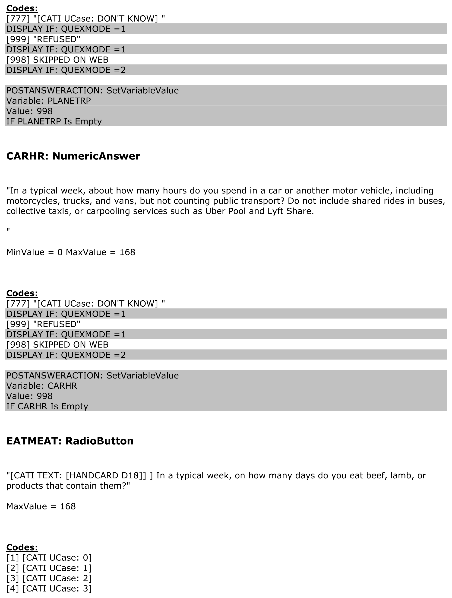

**Codes:**
[777] "[CATI UCase: DON'T KNOW] "
DISPLAY IF: QUEXMODE =1
[999] "REFUSED"
DISPLAY IF: QUEXMODE =1
[998] SKIPPED ON WEB
DISPLAY IF: QUEXMODE =2

POSTANSWERACTION: SetVariableValue
Variable: PLANETRP
Value: 998
IF PLANETRP Is Empty

**CARHR: NumericAnswer**

"In a typical week, about how many hours do you spend in a car or another motor vehicle, including motorcycles, trucks, and vans, but not counting public transport? Do not include shared rides in buses, collective taxis, or carpooling services such as Uber Pool and Lyft Share.

"

MinValue = 0 MaxValue = 168

**Codes:**
[777] "[CATI UCase: DON'T KNOW] "
DISPLAY IF: QUEXMODE =1
[999] "REFUSED"
DISPLAY IF: QUEXMODE =1
[998] SKIPPED ON WEB
DISPLAY IF: QUEXMODE =2

POSTANSWERACTION: SetVariableValue
Variable: CARHR
Value: 998
IF CARHR Is Empty

**EATMEAT: RadioButton**

"[CATI TEXT: [HANDCARD D18]] In a typical week, on how many days do you eat beef, lamb, or products that contain them?"

MaxValue = 168

**Codes:**
[1] [CATI UCase: 0]
[2] [CATI UCase: 1]
[3] [CATI UCase: 2]
[4] [CATI UCase: 3]

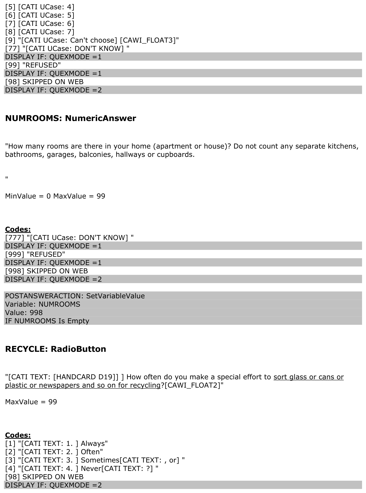

[5] [CATI UCase: 4]
[6] [CATI UCase: 5]
[7] [CATI UCase: 6]
[8] [CATI UCase: 7]
[9] "[CATI UCase: Can't choose] [CAWI_FLOAT3]"
[77] "[CATI UCase: DON'T KNOW] "
DISPLAY IF: QUEXMODE =1
[99] "REFUSED"
DISPLAY IF: QUEXMODE =1
[98] SKIPPED ON WEB
DISPLAY IF: QUEXMODE =2

NUMROOMS: NumericAnswer

"How many rooms are there in your home (apartment or house)? Do not count any separate kitchens, bathrooms, garages, balconies, hallways or cupboards.

"

MinValue = 0 MaxValue = 99

Codes:
[777] "[CATI UCase: DON'T KNOW] "
DISPLAY IF: QUEXMODE =1
[999] "REFUSED"
DISPLAY IF: QUEXMODE =1
[998] SKIPPED ON WEB
DISPLAY IF: QUEXMODE =2

POSTANSWERACTION: SetVariableValue
Variable: NUMROOMS
Value: 998
IF NUMROOMS Is Empty

RECYCLE: RadioButton

"[CATI TEXT: [HANDCARD D19]] How often do you make a special effort to sort glass or cans or plastic or newspapers and so on for recycling?[CAWI_FLOAT2]"

MaxValue = 99

Codes:
[1] "[CATI TEXT: 1. ] Always"
[2] "[CATI TEXT: 2. ] Often"
[3] "[CATI TEXT: 3. ] Sometimes[CATI TEXT: , or] "
[4] "[CATI TEXT: 4. ] Never[CATI TEXT: ?] "
[98] SKIPPED ON WEB
DISPLAY IF: QUEXMODE =2

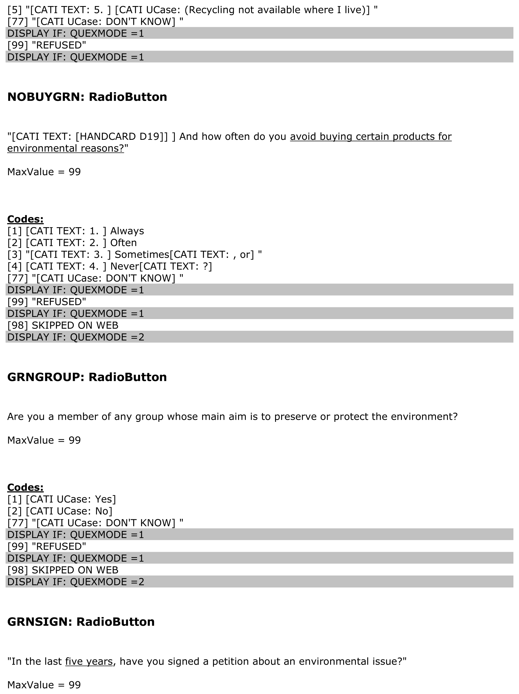

[5] "[CATI TEXT: 5. ] [CATI UCase: (Recycling not available where I live)] "
[77] "[CATI UCase: DON'T KNOW] "
DISPLAY IF: QUEXMODE =1
[99] "REFUSED"
DISPLAY IF: QUEXMODE =1

NOBUYGRN: RadioButton

"[CATI TEXT: [HANDCARD D19]] ] And how often do you avoid buying certain products for environmental reasons?"

MaxValue = 99

Codes:
[1] [CATI TEXT: 1. ] Always
[2] [CATI TEXT: 2. ] Often
[3] "[CATI TEXT: 3. ] Sometimes[CATI TEXT: , or] "
[4] [CATI TEXT: 4. ] Never[CATI TEXT: ?]
[77] "[CATI UCase: DON'T KNOW] "
DISPLAY IF: QUEXMODE =1
[99] "REFUSED"
DISPLAY IF: QUEXMODE =1
[98] SKIPPED ON WEB
DISPLAY IF: QUEXMODE =2

GRNGROUP: RadioButton

Are you a member of any group whose main aim is to preserve or protect the environment?

MaxValue = 99

Codes:
[1] [CATI UCase: Yes]
[2] [CATI UCase: No]
[77] "[CATI UCase: DON'T KNOW] "
DISPLAY IF: QUEXMODE =1
[99] "REFUSED"
DISPLAY IF: QUEXMODE =1
[98] SKIPPED ON WEB
DISPLAY IF: QUEXMODE =2

GRNSIGN: RadioButton

"In the last five years, have you signed a petition about an environmental issue?"

MaxValue = 99

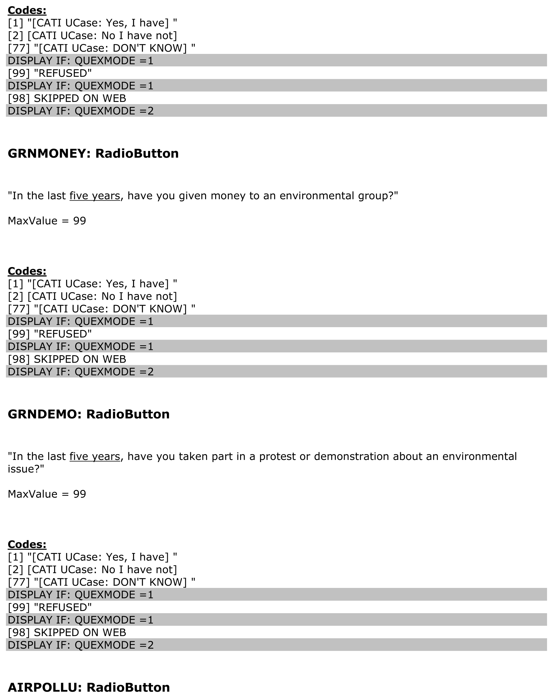

Codes:
[1] "[CATI UCase: Yes, I have] "
[2] [CATI UCase: No I have not]
[77] "[CATI UCase: DON'T KNOW] "
DISPLAY IF: QUEXMODE =1
[99] "REFUSED"
DISPLAY IF: QUEXMODE =1
[98] SKIPPED ON WEB
DISPLAY IF: QUEXMODE =2

GRNMONEY: RadioButton

"In the last five years, have you given money to an environmental group?"

MaxValue = 99

Codes:
[1] "[CATI UCase: Yes, I have] "
[2] [CATI UCase: No I have not]
[77] "[CATI UCase: DON'T KNOW] "
DISPLAY IF: QUEXMODE =1
[99] "REFUSED"
DISPLAY IF: QUEXMODE =1
[98] SKIPPED ON WEB
DISPLAY IF: QUEXMODE =2

GRNDEMO: RadioButton

"In the last five years, have you taken part in a protest or demonstration about an environmental issue?"

MaxValue = 99

Codes:
[1] "[CATI UCase: Yes, I have] "
[2] [CATI UCase: No I have not]
[77] "[CATI UCase: DON'T KNOW] "
DISPLAY IF: QUEXMODE =1
[99] "REFUSED"
DISPLAY IF: QUEXMODE =1
[98] SKIPPED ON WEB
DISPLAY IF: QUEXMODE =2

AIRPOLLU: RadioButton

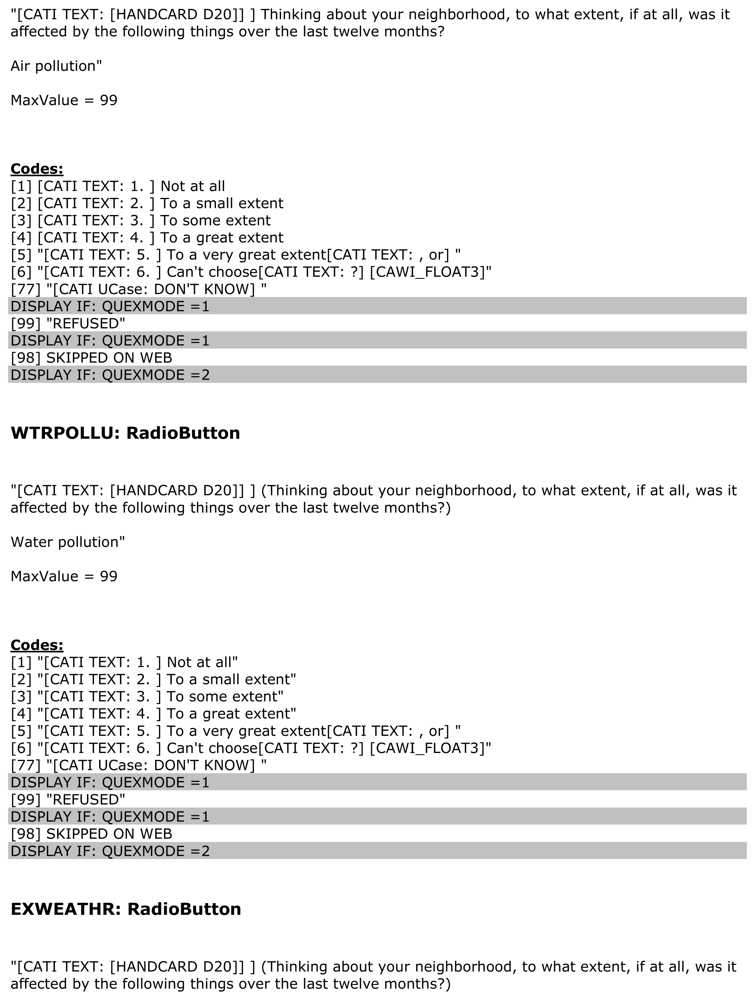

"[CATI TEXT: [HANDCARD D20]] ] Thinking about your neighborhood, to what extent, if at all, was it affected by the following things over the last twelve months?

Air pollution"

MaxValue = 99

Codes:
[1] [CATI TEXT: 1. ] Not at all
[2] [CATI TEXT: 2. ] To a small extent
[3] [CATI TEXT: 3. ] To some extent
[4] [CATI TEXT: 4. ] To a great extent
[5] "[CATI TEXT: 5. ] To a very great extent[CATI TEXT: , or] "
[6] "[CATI TEXT: 6. ] Can't choose[CATI TEXT: ?] [CAWI_FLOAT3]"
[77] "[CATI UCase: DON'T KNOW]"
DISPLAY IF: QUEXMODE =1
[99] "REFUSED"
DISPLAY IF: QUEXMODE =1
[98] SKIPPED ON WEB
DISPLAY IF: QUEXMODE =2

WTRPOLLU: RadioButton

"[CATI TEXT: [HANDCARD D20]] ] (Thinking about your neighborhood, to what extent, if at all, was it affected by the following things over the last twelve months?)

Water pollution"

MaxValue = 99

Codes:
[1] "[CATI TEXT: 1. ] Not at all"
[2] "[CATI TEXT: 2. ] To a small extent"
[3] "[CATI TEXT: 3. ] To some extent"
[4] "[CATI TEXT: 4. ] To a great extent"
[5] "[CATI TEXT: 5. ] To a very great extent[CATI TEXT: , or] "
[6] "[CATI TEXT: 6. ] Can't choose[CATI TEXT: ?] [CAWI_FLOAT3]"
[77] "[CATI UCase: DON'T KNOW]"
DISPLAY IF: QUEXMODE =1
[99] "REFUSED"
DISPLAY IF: QUEXMODE =1
[98] SKIPPED ON WEB
DISPLAY IF: QUEXMODE =2

EXWEATHR: RadioButton

"[CATI TEXT: [HANDCARD D20]] ] (Thinking about your neighborhood, to what extent, if at all, was it affected by the following things over the last twelve months?)

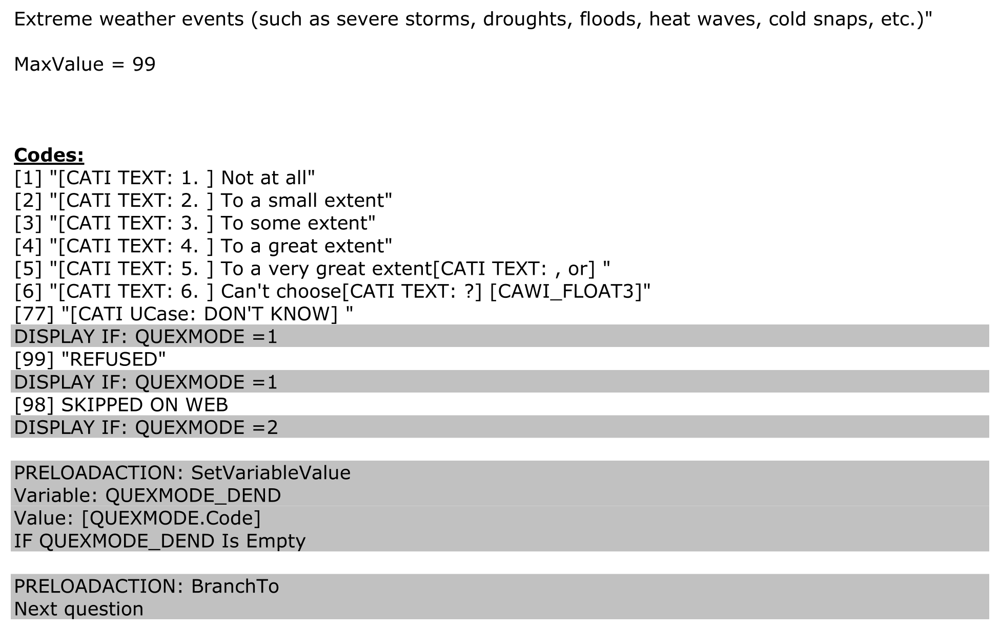

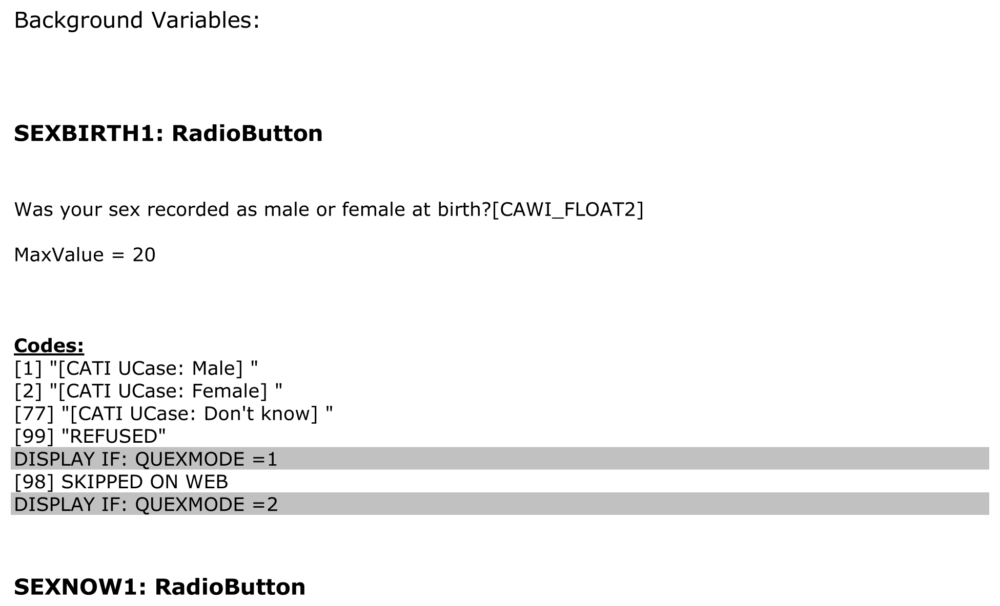

Extreme weather events (such as severe storms, droughts, floods, heat waves, cold snaps, etc.)"
MaxValue = 99

Codes:
[1] "[CATI TEXT: 1. ] Not at all"
[2] "[CATI TEXT: 2. ] To a small extent"
[3] "[CATI TEXT: 3. ] To some extent"
[4] "[CATI TEXT: 4. ] To a great extent"
[5] "[CATI TEXT: 5. ] To a very great extent[CATI TEXT: , or] "
[6] "[CATI TEXT: 6. ] Can't choose[CATI TEXT: ?] [CAWI_FLOAT3]"
[77] "[CATI UCase: DON'T KNOW]"
DISPLAY IF: QUEXMODE =1
[99] "REFUSED"
DISPLAY IF: QUEXMODE =1
[98] SKIPPED ON WEB
DISPLAY IF: QUEXMODE =2

PRELOADACTION: SetVariableValue
Variable: QUEXMODE_DEND
Value: [QUEXMODE.Code]
IF QUEXMODE_DEND Is Empty

PRELOADACTION: BranchTo
Next question

Background Variables:

SEXBIRTH1: RadioButton

Was your sex recorded as male or female at birth?[CAWI_FLOAT2]

MaxValue = 20

Codes:
[1] "[CATI UCase: Male] "
[2] "[CATI UCase: Female] "
[77] "[CATI UCase: Don't know] "
[99] "REFUSED"
DISPLAY IF: QUEXMODE =1
[98] SKIPPED ON WEB
DISPLAY IF: QUEXMODE =2

SEXNOW1: RadioButton

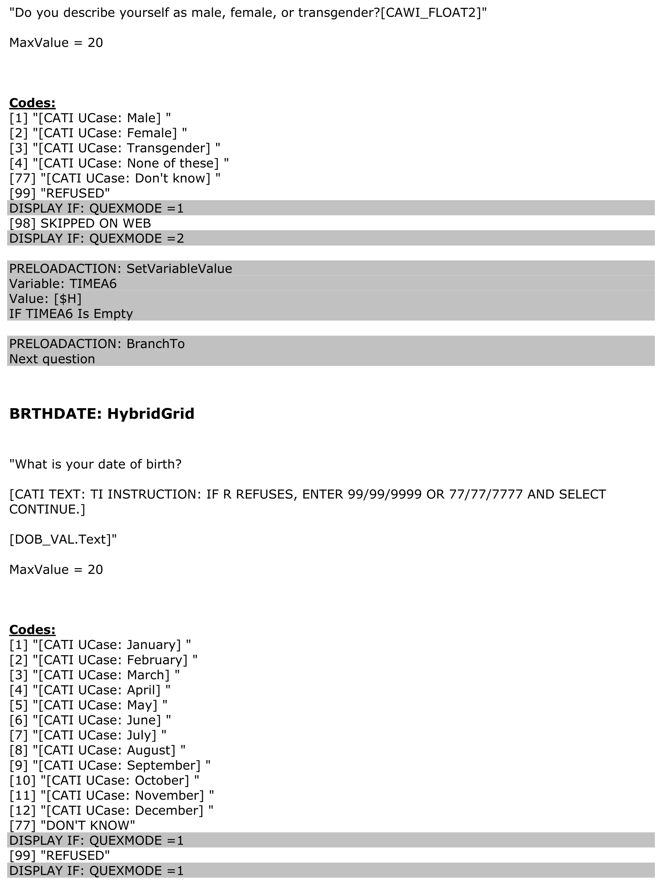

"Do you describe yourself as male, female, or transgender?[CAWI_FLOAT2]"

MaxValue = 20

Codes:
[1] "[CATI UCase: Male] "
[2] "[CATI UCase: Female] "
[3] "[CATI UCase: Transgender] "
[4] "[CATI UCase: None of these] "
[77] "[CATI UCase: Don't know] "
[99] "REFUSED"
DISPLAY IF: QUEXMODE =1
[98] SKIPPED ON WEB
DISPLAY IF: QUEXMODE =2

PRELOADACTION: SetVariableValue
Variable: TIMEA6
Value: [$H]
IF TIMEA6 Is Empty

PRELOADACTION: BranchTo
Next question

BRTHDATE: HybridGrid

"What is your date of birth?

[CATI TEXT: TI INSTRUCTION: IF R REFUSES, ENTER 99/99/9999 OR 77/77/7777 AND SELECT CONTINUE.]

[DOB_VAL.Text]"

MaxValue = 20

Codes:
[1] "[CATI UCase: January] "
[2] "[CATI UCase: February] "
[3] "[CATI UCase: March] "
[4] "[CATI UCase: April] "
[5] "[CATI UCase: May] "
[6] "[CATI UCase: June] "
[7] "[CATI UCase: July] "
[8] "[CATI UCase: August] "
[9] "[CATI UCase: September] "
[10] "[CATI UCase: October] "
[11] "[CATI UCase: November] "
[12] "[CATI UCase: December] "
[77] "DON'T KNOW"
DISPLAY IF: QUEXMODE =1
[99] "REFUSED"
DISPLAY IF: QUEXMODE =1

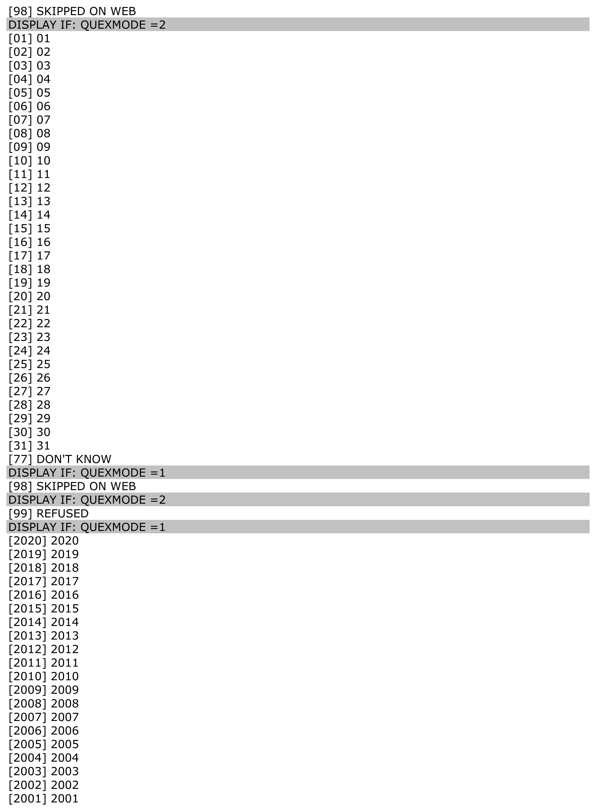

[98] SKIPPED ON WEB
DISPLAY IF: QUEXMODE =2
[01] 01
[02] 02
[03] 03
[04] 04
[05] 05
[06] 06
[07] 07
[08] 08
[09] 09
[10] 10
[11] 11
[12] 12
[13] 13
[14] 14
[15] 15
[16] 16
[17] 17
[18] 18
[19] 19
[20] 20
[21] 21
[22] 22
[23] 23
[24] 24
[25] 25
[26] 26
[27] 27
[28] 28
[29] 29
[30] 30
[31] 31
[77] DON'T KNOW
DISPLAY IF: QUEXMODE =1
[98] SKIPPED ON WEB
DISPLAY IF: QUEXMODE =2
[99] REFUSED
DISPLAY IF: QUEXMODE =1
[2020] 2020
[2019] 2019
[2018] 2018
[2017] 2017
[2016] 2016
[2015] 2015
[2014] 2014
[2013] 2013
[2012] 2012
[2011] 2011
[2010] 2010
[2009] 2009
[2008] 2008
[2007] 2007
[2006] 2006
[2005] 2005
[2004] 2004
[2003] 2003
[2002] 2002
[2001] 2001

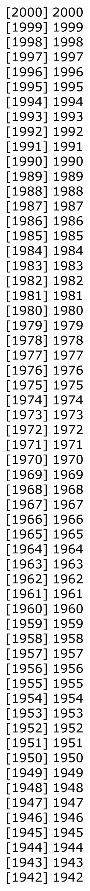

[2000] 2000
[1999] 1999
[1998] 1998
[1997] 1997
[1996] 1996
[1995] 1995
[1994] 1994
[1993] 1993
[1992] 1992
[1991] 1991
[1990] 1990
[1989] 1989
[1988] 1988
[1987] 1987
[1986] 1986
[1985] 1985
[1984] 1984
[1983] 1983
[1982] 1982
[1981] 1981
[1980] 1980
[1979] 1979
[1978] 1978
[1977] 1977
[1976] 1976
[1975] 1975
[1974] 1974
[1973] 1973
[1972] 1972
[1971] 1971
[1970] 1970
[1969] 1969
[1968] 1968
[1967] 1967
[1966] 1966
[1965] 1965
[1964] 1964
[1963] 1963
[1962] 1962
[1961] 1961
[1960] 1960
[1959] 1959
[1958] 1958
[1957] 1957
[1956] 1956
[1955] 1955
[1954] 1954
[1953] 1953
[1952] 1952
[1951] 1951
[1950] 1950
[1949] 1949
[1948] 1948
[1947] 1947
[1946] 1946
[1945] 1945
[1944] 1944
[1943] 1943
[1942] 1942

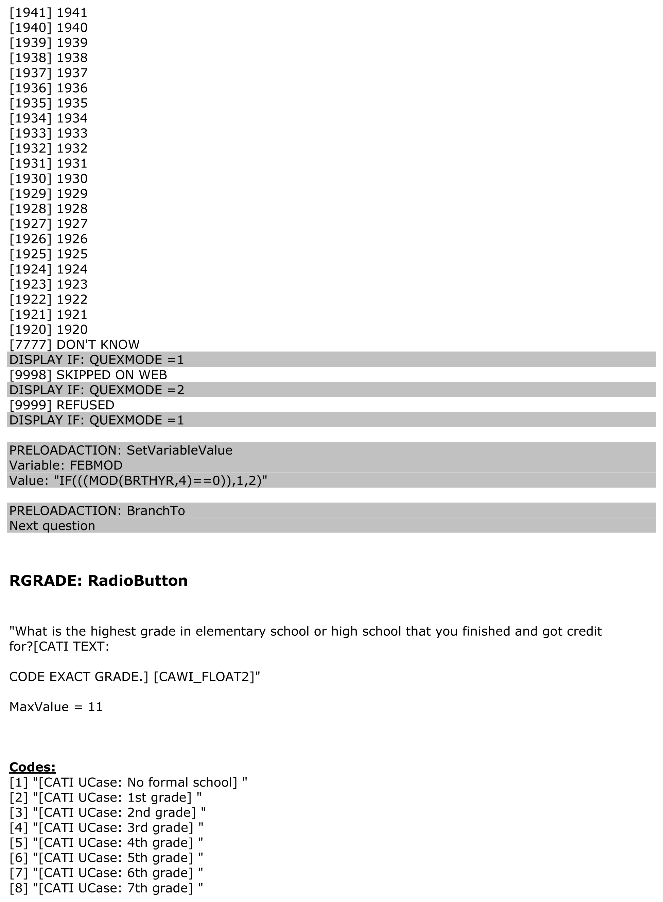

[1941] 1941
[1940] 1940
[1939] 1939
[1938] 1938
[1937] 1937
[1936] 1936
[1935] 1935
[1934] 1934
[1933] 1933
[1932] 1932
[1931] 1931
[1930] 1930
[1929] 1929
[1928] 1928
[1927] 1927
[1926] 1926
[1925] 1925
[1924] 1924
[1923] 1923
[1922] 1922
[1921] 1921
[1920] 1920
[7777] DON'T KNOW
DISPLAY IF: QUEXMODE =1
[9998] SKIPPED ON WEB
DISPLAY IF: QUEXMODE =2
[9999] REFUSED
DISPLAY IF: QUEXMODE =1

PRELOADACTION: SetVariableValue
Variable: FEBMOD
Value: "IF(((MOD(BRTHYR,4)==0)),1,2)"

PRELOADACTION: BranchTo
Next question

R GRADE: RadioButton

"What is the highest grade in elementary school or high school that you finished and got credit for?[CATI TEXT:
CODE EXACT GRADE.] [CAWI_FLOAT2]"

MaxValue = 11

Codes:
[1] "[CATI UCase: No formal school] "
[2] "[CATI UCase: 1st grade] "
[3] "[CATI UCase: 2nd grade] "
[4] "[CATI UCase: 3rd grade] "
[5] "[CATI UCase: 4th grade] "
[6] "[CATI UCase: 5th grade] "
[7] "[CATI UCase: 6th grade] "
[8] "[CATI UCase: 7th grade] "

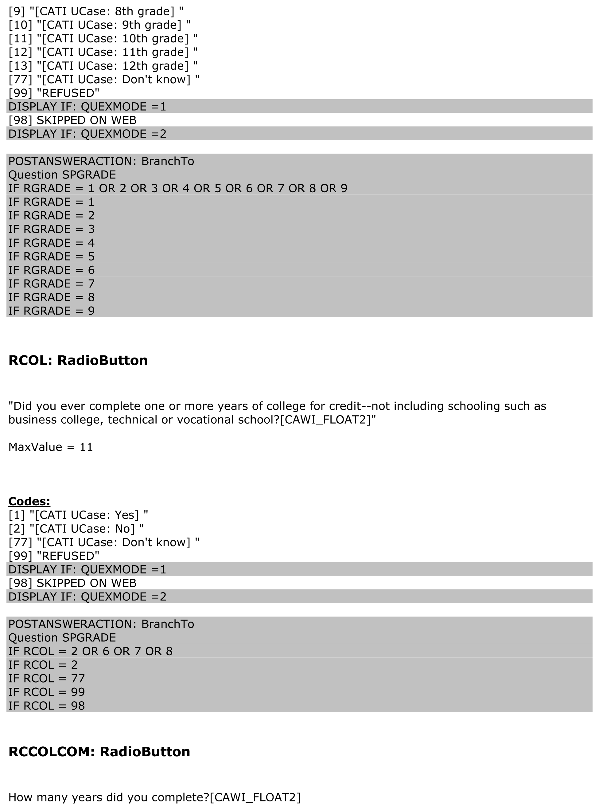

[9] "[CATI UCase: 8th grade] "
[10] "[CATI UCase: 9th grade] "
[11] "[CATI UCase: 10th grade] "
[12] "[CATI UCase: 11th grade] "
[13] "[CATI UCase: 12th grade] "
[77] "[CATI UCase: Don't know] "
[99] "REFUSED"
DISPLAY IF: QUEXMODE =1
[98] SKIPPED ON WEB
DISPLAY IF: QUEXMODE =2

POSTANSWERACTION: BranchTo
Question SPGRADE
IF RGRADE = 1 OR 2 OR 3 OR 4 OR 5 OR 6 OR 7 OR 8 OR 9
IF RGRADE = 1
IF RGRADE = 2
IF RGRADE = 3
IF RGRADE = 4
IF RGRADE = 5
IF RGRADE = 6
IF RGRADE = 7
IF RGRADE = 8
IF RGRADE = 9

RCOL: RadioButton

"Did you ever complete one or more years of college for credit--not including schooling such as business college, technical or vocational school?[CAWI_FLOAT2]"

MaxValue = 11

Codes:
[1] "[CATI UCase: Yes] "
[2] "[CATI UCase: No] "
[77] "[CATI UCase: Don't know] "
[99] "REFUSED"
DISPLAY IF: QUEXMODE =1
[98] SKIPPED ON WEB
DISPLAY IF: QUEXMODE =2

POSTANSWERACTION: BranchTo
Question SPGRADE
IF RCOL = 2 OR 6 OR 7 OR 8
IF RCOL = 2
IF RCOL = 77
IF RCOL = 99
IF RCOL = 98

RCCOLCOM: RadioButton

How many years did you complete?[CAWI_FLOAT2]

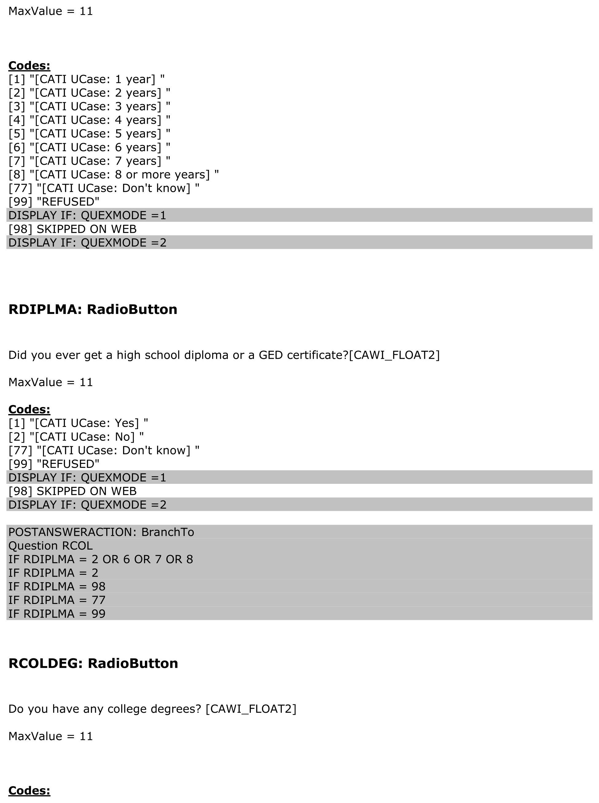

MaxValue = 11

Codes:
[1] "[CATI UCase: 1 year] "
[2] "[CATI UCase: 2 years] "
[3] "[CATI UCase: 3 years] "
[4] "[CATI UCase: 4 years] "
[5] "[CATI UCase: 5 years] "
[6] "[CATI UCase: 6 years] "
[7] "[CATI UCase: 7 years] "
[8] "[CATI UCase: 8 or more years] "
[77] "[CATI UCase: Don't know] "
[99] "REFUSED"
DISPLAY IF: QUEXMODE = 1
[98] SKIPPED ON WEB
DISPLAY IF: QUEXMODE = 2

RDIPLMA: RadioButton

Did you ever get a high school diploma or a GED certificate?[CAWI_FLOAT2]

MaxValue = 11

Codes:
[1] "[CATI UCase: Yes] "
[2] "[CATI UCase: No] "
[77] "[CATI UCase: Don't know] "
[99] "REFUSED"
DISPLAY IF: QUEXMODE = 1
[98] SKIPPED ON WEB
DISPLAY IF: QUEXMODE = 2

POSTANSWERACTION: BranchTo
Question RCOL
IF RDIPLMA = 2 OR 6 OR 7 OR 8
IF RDIPLMA = 2
IF RDIPLMA = 98
IF RDIPLMA = 77
IF RDIPLMA = 99

RCOLDEG: RadioButton

Do you have any college degrees? [CAWI_FLOAT2]

MaxValue = 11

Codes:

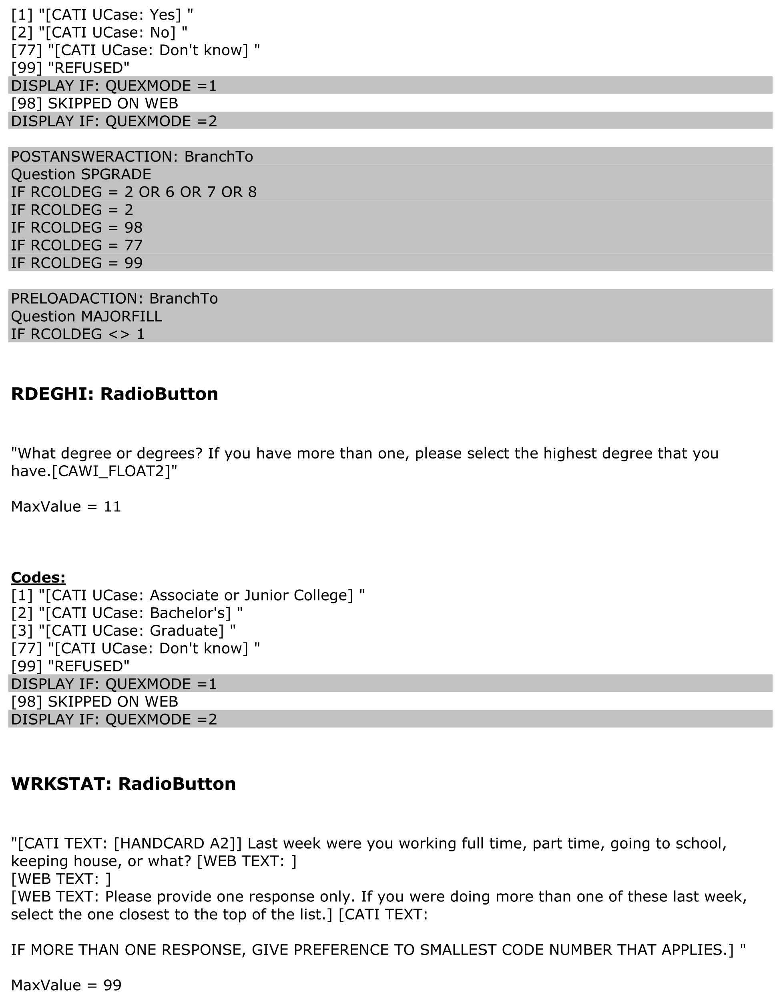

[1] "[CATI UCase: Yes] "
[2] "[CATI UCase: No] "
[77] "[CATI UCase: Don't know] "
[99] "REFUSED"
DISPLAY IF: QUEXMODE =1
[98] SKIPPED ON WEB
DISPLAY IF: QUEXMODE =2

POSTANSWERACTION: BranchTo
Question SPGRADE
IF RCOLDEG = 2 OR 6 OR 7 OR 8
IF RCOLDEG = 2
IF RCOLDEG = 98
IF RCOLDEG = 77
IF RCOLDEG = 99

PRELOADACTION: BranchTo
Question MAJORFILL
IF RCOLDEG <> 1

RDEGHI: RadioButton

"What degree or degrees? If you have more than one, please select the highest degree that you have.[CAWI_FLOAT2]"

MaxValue = 11

Codes:
[1] "[CATI UCase: Associate or Junior College] "
[2] "[CATI UCase: Bachelor's] "
[3] "[CATI UCase: Graduate] "
[77] "[CATI UCase: Don't know] "
[99] "REFUSED"
DISPLAY IF: QUEXMODE =1
[98] SKIPPED ON WEB
DISPLAY IF: QUEXMODE =2

WRKSTAT: RadioButton

"[CATI TEXT: [HANDCARD A2]] Last week were you working full time, part time, going to school, keeping house, or what? [WEB TEXT: ]
[WEB TEXT: ]
[WEB TEXT: Please provide one response only. If you were doing more than one of these last week, select the one closest to the top of the list.] [CATI TEXT:
IF MORE THAN ONE RESPONSE, GIVE PREFERENCE TO SMALLEST CODE NUMBER THAT APPLIES.] "

MaxValue = 99

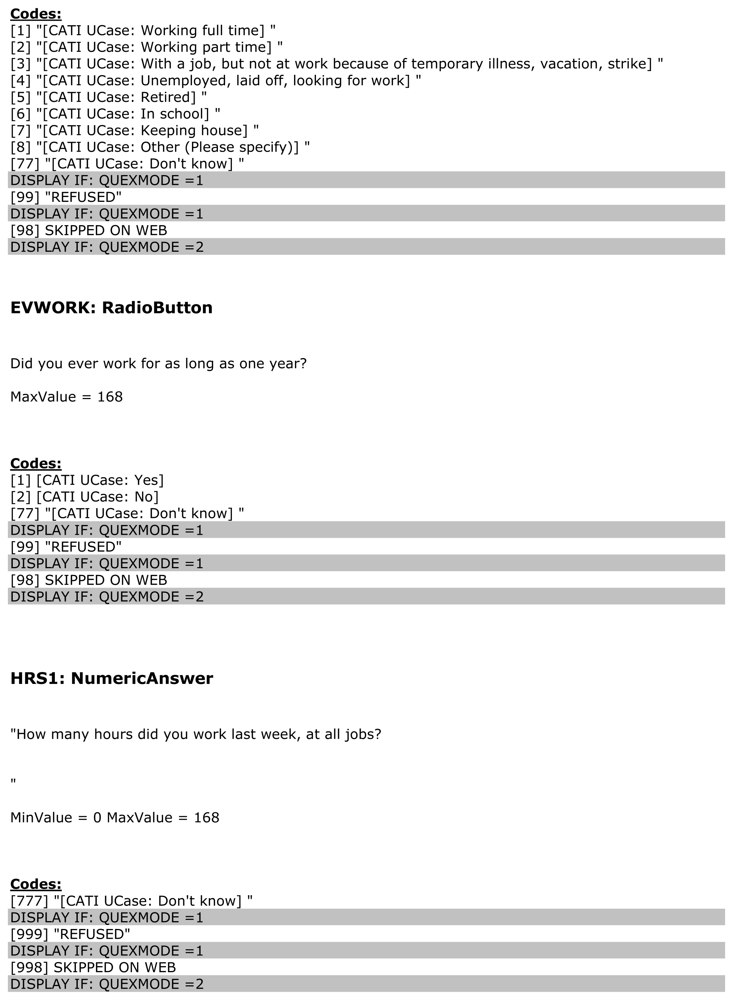

Codes:
[1] "[CATI UCase: Working full time] "
[2] "[CATI UCase: Working part time] "
[3] "[CATI UCase: With a job, but not at work because of temporary illness, vacation, strike] "
[4] "[CATI UCase: Unemployed, laid off, looking for work] "
[5] "[CATI UCase: Retired] "
[6] "[CATI UCase: In school] "
[7] "[CATI UCase: Keeping house] "
[8] "[CATI UCase: Other (Please specify)] "
[77] "[CATI UCase: Don't know] "
DISPLAY IF: QUEXMODE =1
[99] "REFUSED"
DISPLAY IF: QUEXMODE =1
[98] SKIPPED ON WEB
DISPLAY IF: QUEXMODE =2

EVWORK: RadioButton

Did you ever work for as long as one year?

MaxValue = 168

Codes:
[1] [CATI UCase: Yes]
[2] [CATI UCase: No]
[77] "[CATI UCase: Don't know] "
DISPLAY IF: QUEXMODE =1
[99] "REFUSED"
DISPLAY IF: QUEXMODE =1
[98] SKIPPED ON WEB
DISPLAY IF: QUEXMODE =2

HRS1: NumericAnswer

"How many hours did you work last week, at all jobs?

"

MinValue = 0 MaxValue = 168

Codes:
[777] "[CATI UCase: Don't know] "
DISPLAY IF: QUEXMODE =1
[999] "REFUSED"
DISPLAY IF: QUEXMODE =1
[998] SKIPPED ON WEB
DISPLAY IF: QUEXMODE =2

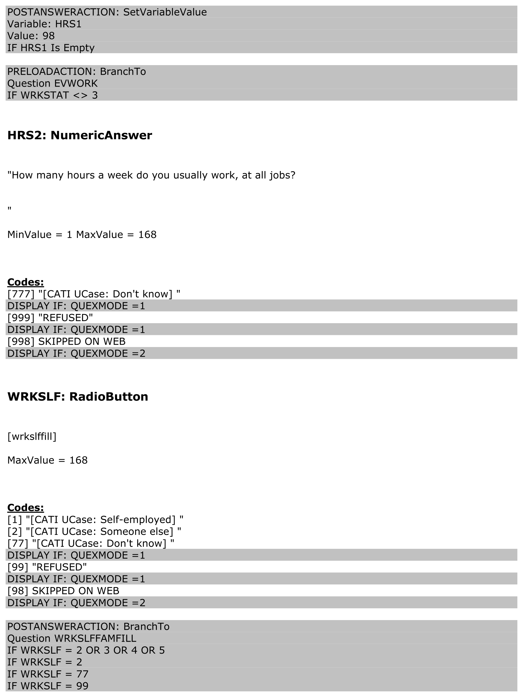

POSTANSWERACTION: SetVariableValue
Variable: HRS1
Value: 98
IF HRS1 Is Empty

PRELOADACTION: BranchTo
Question EVWORK
IF WRKSTAT <> 3

HRS2: NumericAnswer

"How many hours a week do you usually work, at all jobs?

"

MinValue = 1 MaxValue = 168

Codes:
[777] "[CATI UCase: Don't know] "
DISPLAY IF: QUEXMODE =1
[999] "REFUSED"
DISPLAY IF: QUEXMODE =1
[998] SKIPPED ON WEB
DISPLAY IF: QUEXMODE =2

WRKSLF: RadioButton

[wrkslffill]

MaxValue = 168

Codes:
[1] "[CATI UCase: Self-employed] "
[2] "[CATI UCase: Someone else] "
[77] "[CATI UCase: Don't know] "
DISPLAY IF: QUEXMODE =1
[99] "REFUSED"
DISPLAY IF: QUEXMODE =1
[98] SKIPPED ON WEB
DISPLAY IF: QUEXMODE =2

POSTANSWERACTION: BranchTo
Question WRKSLFFAMFILL
IF WRKSLF = 2 OR 3 OR 4 OR 5
IF WRKSLF = 2
IF WRKSLF = 77
IF WRKSLF = 99

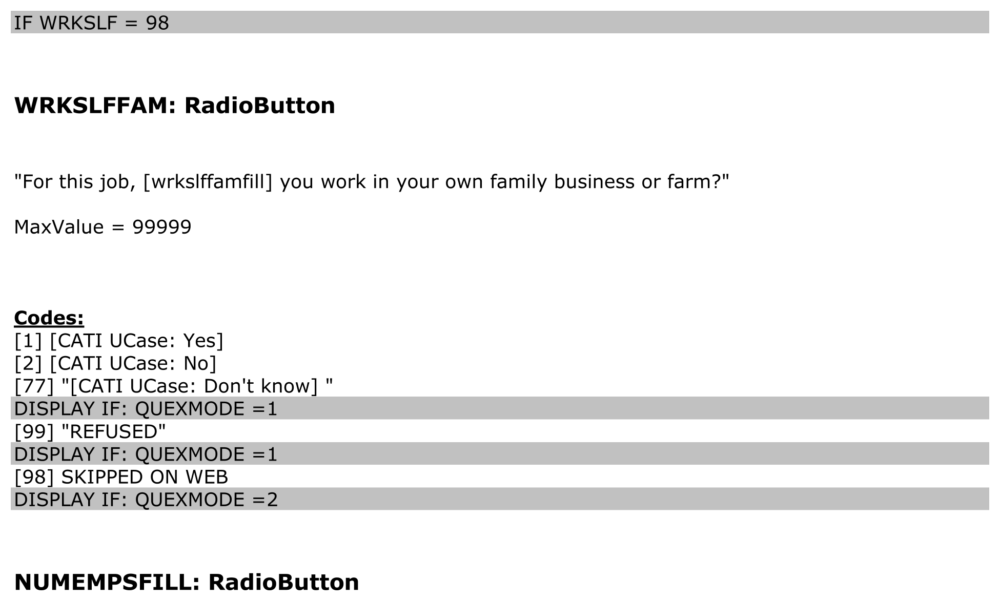

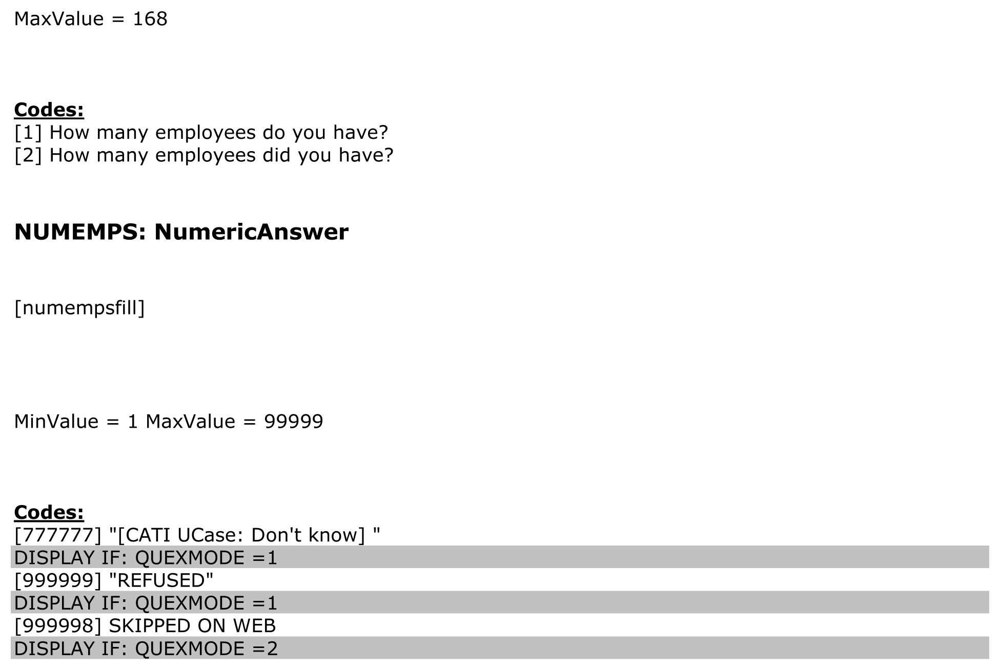

IF WRKSLF = 98

WRKSLFFAM: RadioButton

"For this job, [wrkslffamfill] you work in your own family business or farm?"

MaxValue = 99999

Codes:
[1] [CATI UCase: Yes]
[2] [CATI UCase: No]
[77] "[CATI UCase: Don't know] "
DISPLAY IF: QUEXMODE =1
[99] "REFUSED"
DISPLAY IF: QUEXMODE =1
[98] SKIPPED ON WEB
DISPLAY IF: QUEXMODE =2

NUMEMPSFILL: RadioButton

MaxValue = 168

Codes:
[1] How many employees do you have?
[2] How many employees did you have?

NUMEMPS: NumericAnswer

[numempsfill]

MinValue = 1 MaxValue = 99999

Codes:
[777777] "[CATI UCase: Don't know] "
DISPLAY IF: QUEXMODE =1
[999999] "REFUSED"
DISPLAY IF: QUEXMODE =1
[999998] SKIPPED ON WEB
DISPLAY IF: QUEXMODE =2

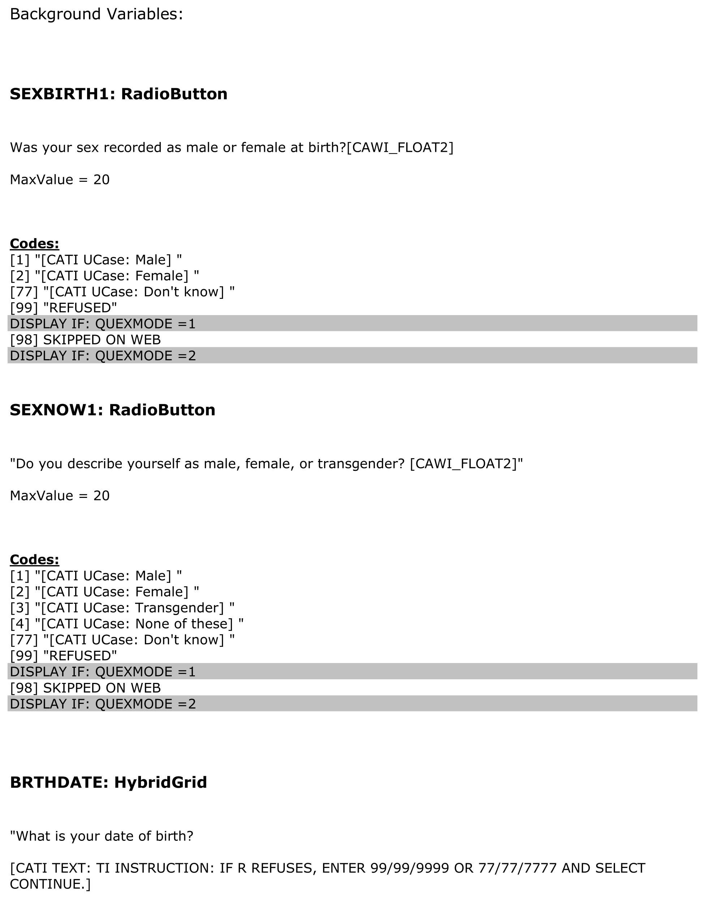

Background Variables:

SEXBIRTH1: RadioButton

Was your sex recorded as male or female at birth?[CAWI_FLOAT2]

MaxValue = 20

Codes:
[1] "[CATI UCase: Male] "
[2] "[CATI UCase: Female] "
[77] "[CATI UCase: Don't know] "
[99] "REFUSED"
DISPLAY IF: QUEXMODE =1
[98] SKIPPED ON WEB
DISPLAY IF: QUEXMODE =2

SEXNOW1: RadioButton

"Do you describe yourself as male, female, or transgender? [CAWI_FLOAT2]"

MaxValue = 20

Codes:
[1] "[CATI UCase: Male] "
[2] "[CATI UCase: Female] "
[3] "[CATI UCase: Transgender] "
[4] "[CATI UCase: None of these] "
[77] "[CATI UCase: Don't know] "
[99] "REFUSED"
DISPLAY IF: QUEXMODE =1
[98] SKIPPED ON WEB
DISPLAY IF: QUEXMODE =2

BRTHDATE: HybridGrid

"What is your date of birth?

[CATI TEXT: TI INSTRUCTION: IF R REFUSES, ENTER 99/99/9999 OR 77/77/7777 AND SELECT CONTINUE.]

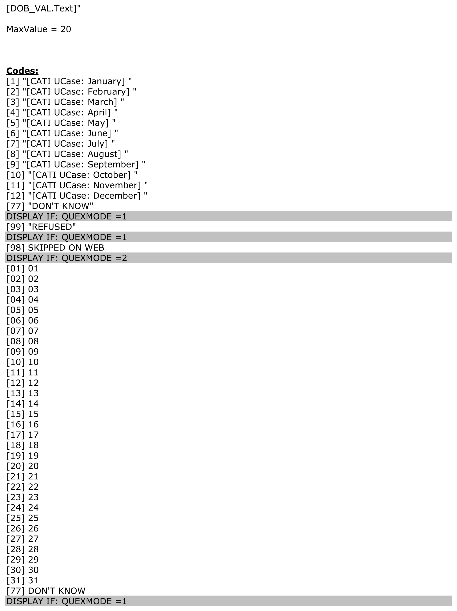

[DOB_VAL.Text]"
MaxValue = 20

Codes:
[1] "[CATI UCase: January] "
[2] "[CATI UCase: February] "
[3] "[CATI UCase: March] "
[4] "[CATI UCase: April] "
[5] "[CATI UCase: May] "
[6] "[CATI UCase: June] "
[7] "[CATI UCase: July] "
[8] "[CATI UCase: August] "
[9] "[CATI UCase: September] "
[10] "[CATI UCase: October] "
[11] "[CATI UCase: November] "
[12] "[CATI UCase: December] "
[77] "DON'T KNOW"
DISPLAY IF: QUEXMODE =1
[99] "REFUSED"
DISPLAY IF: QUEXMODE =1
[98] SKIPPED ON WEB
DISPLAY IF: QUEXMODE =2
[01] 01
[02] 02
[03] 03
[04] 04
[05] 05
[06] 06
[07] 07
[08] 08
[09] 09
[10] 10
[11] 11
[12] 12
[13] 13
[14] 14
[15] 15
[16] 16
[17] 17
[18] 18
[19] 19
[20] 20
[21] 21
[22] 22
[23] 23
[24] 24
[25] 25
[26] 26
[27] 27
[28] 28
[29] 29
[30] 30
[31] 31
[77] DON'T KNOW
DISPLAY IF: QUEXMODE =1

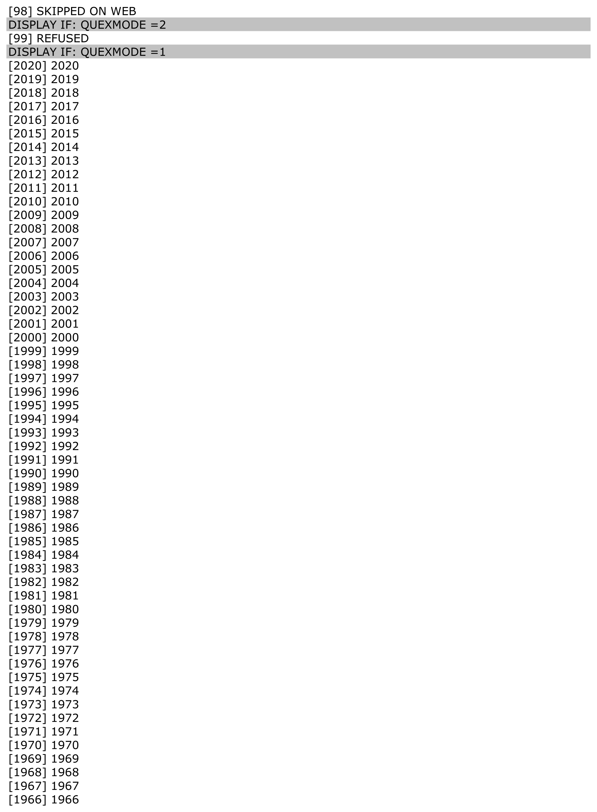

[98] SKIPPED ON WEB
DISPLAY IF: QUEXMODE =2
[99] REFUSED
DISPLAY IF: QUEXMODE =1
[2020] 2020
[2019] 2019
[2018] 2018
[2017] 2017
[2016] 2016
[2015] 2015
[2014] 2014
[2013] 2013
[2012] 2012
[2011] 2011
[2010] 2010
[2009] 2009
[2008] 2008
[2007] 2007
[2006] 2006
[2005] 2005
[2004] 2004
[2003] 2003
[2002] 2002
[2001] 2001
[2000] 2000
[1999] 1999
[1998] 1998
[1997] 1997
[1996] 1996
[1995] 1995
[1994] 1994
[1993] 1993
[1992] 1992
[1991] 1991
[1990] 1990
[1989] 1989
[1988] 1988
[1987] 1987
[1986] 1986
[1985] 1985
[1984] 1984
[1983] 1983
[1982] 1982
[1981] 1981
[1980] 1980
[1979] 1979
[1978] 1978
[1977] 1977
[1976] 1976
[1975] 1975
[1974] 1974
[1973] 1973
[1972] 1972
[1971] 1971
[1970] 1970
[1969] 1969
[1968] 1968
[1967] 1967
[1966] 1966

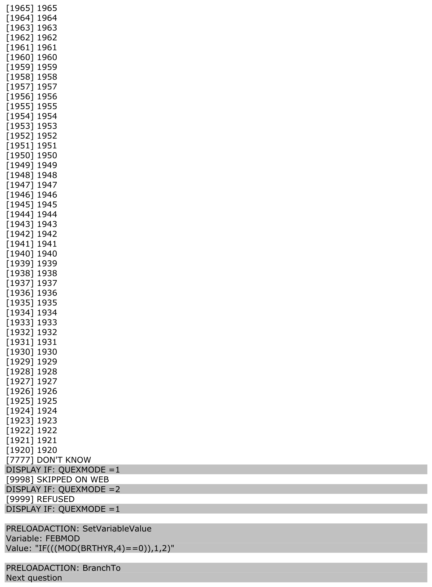

[1965] 1965
[1964] 1964
[1963] 1963
[1962] 1962
[1961] 1961
[1960] 1960
[1959] 1959
[1958] 1958
[1957] 1957
[1956] 1956
[1955] 1955
[1954] 1954
[1953] 1953
[1952] 1952
[1951] 1951
[1950] 1950
[1949] 1949
[1948] 1948
[1947] 1947
[1946] 1946
[1945] 1945
[1944] 1944
[1943] 1943
[1942] 1942
[1941] 1941
[1940] 1940
[1939] 1939
[1938] 1938
[1937] 1937
[1936] 1936
[1935] 1935
[1934] 1934
[1933] 1933
[1932] 1932
[1931] 1931
[1930] 1930
[1929] 1929
[1928] 1928
[1927] 1927
[1926] 1926
[1925] 1925
[1924] 1924
[1923] 1923
[1922] 1922
[1921] 1921
[1920] 1920
[7777] DON'T KNOW
DISPLAY IF: QUEXMODE =1
[9998] SKIPPED ON WEB
DISPLAY IF: QUEXMODE =2
[9999] REFUSED
DISPLAY IF: QUEXMODE =1

PRELOADACTION: SetVariableValue
Variable: FEBMOD
Value: "IF(((MOD(BRTHYR,4)==0)),1,2)"

PRELOADACTION: BranchTo
Next question

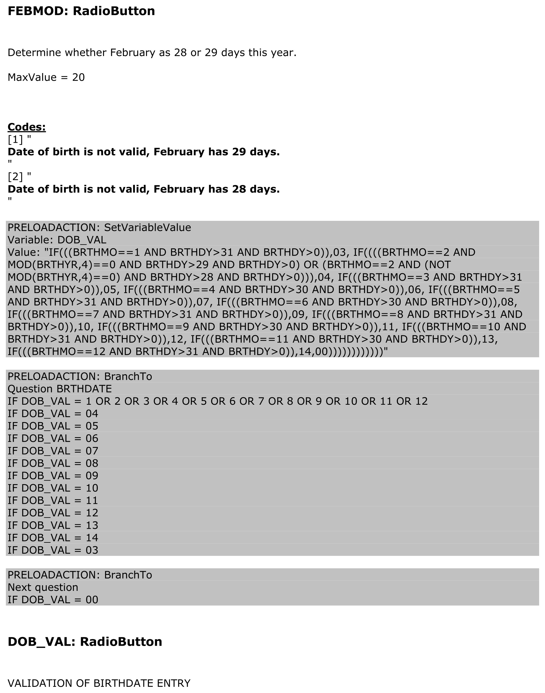

FEBMOD: RadioButton

Determine whether February as 28 or 29 days this year.

MaxValue = 20

Codes:
[1] "
Date of birth is not valid, February has 29 days.
"
[2] "
Date of birth is not valid, February has 28 days.
"

PRELOADACTION: SetVariableValue
Variable: DOB_VAL
Value: "IF(((BRTHMO==1 AND BRTHDY>31 AND BRTHDY>0)),03, IF(((((BRTHMO==2 AND MOD(BRTHYR,4))==0 AND BRTHDY>29 AND BRTHDY>0) OR (BRTHMO==2 AND (NOT MOD(BRTHYR,4))==0) AND BRTHDY>28 AND BRTHDY>0))),04, IF(((BRTHMO==3 AND BRTHDY>31 AND BRTHDY>0)),05, IF(((BRTHMO==4 AND BRTHDY>30 AND BRTHDY>0)),06, IF(((BRTHMO==5 AND BRTHDY>31 AND BRTHDY>0)),07, IF(((BRTHMO==6 AND BRTHDY>30 AND BRTHDY>0)),08, IF(((BRTHMO==7 AND BRTHDY>31 AND BRTHDY>0)),09, IF(((BRTHMO==8 AND BRTHDY>31 AND BRTHDY>0)),10, IF(((BRTHMO==9 AND BRTHDY>30 AND BRTHDY>0)),11, IF(((BRTHMO==10 AND BRTHDY>31 AND BRTHDY>0)),12, IF(((BRTHMO==11 AND BRTHDY>30 AND BRTHDY>0)),13, IF(((BRTHMO==12 AND BRTHDY>31 AND BRTHDY>0)),14,00)))))))))))"

PRELOADACTION: BranchTo
Question BRTHDATE
IF DOB_VAL = 1 OR 2 OR 3 OR 4 OR 5 OR 6 OR 7 OR 8 OR 9 OR 10 OR 11 OR 12
IF DOB_VAL = 04
IF DOB_VAL = 05
IF DOB_VAL = 06
IF DOB_VAL = 07
IF DOB_VAL = 08
IF DOB_VAL = 09
IF DOB_VAL = 10
IF DOB_VAL = 11
IF DOB_VAL = 12
IF DOB_VAL = 13
IF DOB_VAL = 14
IF DOB_VAL = 03

PRELOADACTION: BranchTo
Next question
IF DOB_VAL = 00

DOB_VAL: RadioButton

VALIDATION OF BIRTHDATE ENTRY

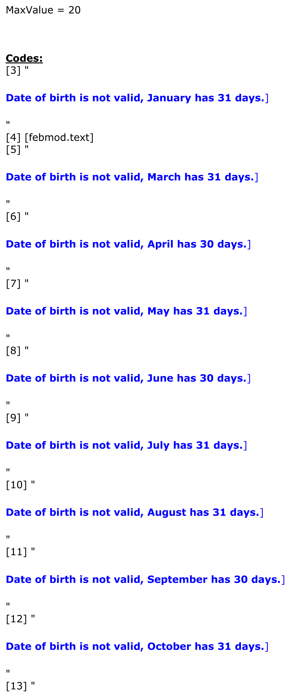

MaxValue = 20

Codes:
[3] "
Date of birth is not valid, January has 31 days.]
"
[4] [febmod.text]
[5] "
Date of birth is not valid, March has 31 days.]
"
[6] "
Date of birth is not valid, April has 30 days.]
"
[7] "
Date of birth is not valid, May has 31 days.]
"
[8] "
Date of birth is not valid, June has 30 days.]
"
[9] "
Date of birth is not valid, July has 31 days.]
"
[10] "
Date of birth is not valid, August has 31 days.]
"
[11] "
Date of birth is not valid, September has 30 days.]
"
[12] "
Date of birth is not valid, October has 31 days.]
"
[13] "

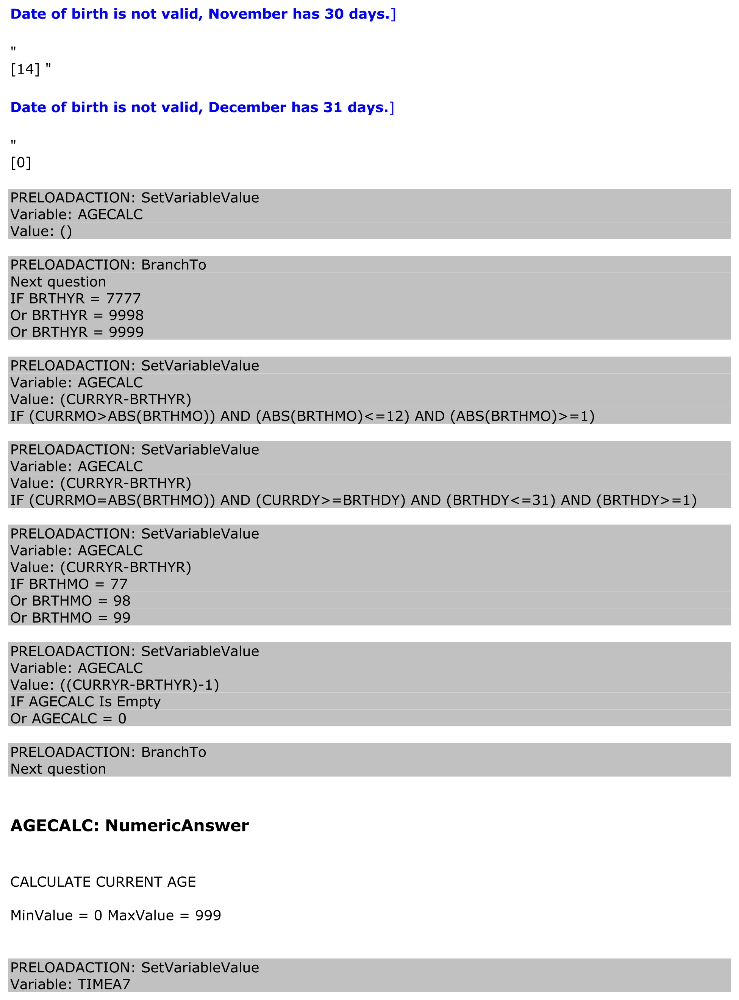

Date of birth is not valid, November has 30 days.]

"
[14] "

Date of birth is not valid, December has 31 days.]

"
[0]

PRELOADACTION: SetVariableValue
Variable: AGECALC
Value: ()

PRELOADACTION: BranchTo
Next question
IF BRTHYR = 7777
Or BRTHYR = 9998
Or BRTHYR = 9999

PRELOADACTION: SetVariableValue
Variable: AGECALC
Value: (CURRYR-BRTHYR)
IF (CURRMO>ABS(BRTHMO)) AND (ABS(BRTHMO)<=12) AND (ABS(BRTHMO)>=1)

PRELOADACTION: SetVariableValue
Variable: AGECALC
Value: (CURRYR-BRTHYR)
IF (CURRMO=ABS(BRTHMO)) AND (CURRDY>=BRTHDY) AND (BRTHDY<=31) AND (BRTHDY>=1)

PRELOADACTION: SetVariableValue
Variable: AGECALC
Value: (CURRYR-BRTHYR)
IF BRTHMO = 77
Or BRTHMO = 98
Or BRTHMO = 99

PRELOADACTION: SetVariableValue
Variable: AGECALC
Value: ((CURRYR-BRTHYR)-1)
IF AGECALC Is Empty
Or AGECALC = 0

PRELOADACTION: BranchTo
Next question

AGECALC: NumericAnswer

CALCULATE CURRENT AGE

MinValue = 0 MaxValue = 999

PRELOADACTION: SetVariableValue
Variable: TIMEA7

Value: [$H]

PRELOADACTION: BranchTo
Next question

RGRADE: RadioButton

"What is the highest grade in elementary school or high school that you finished and got credit for?[CATI TEXT: [CAWI_FLOAT2]

CODE EXACT GRADE.] "

MaxValue = 97

Codes:
[1] "[CATI UCase: No formal school] "
[2] "[CATI UCase: 1st grade] "
[3] "[CATI UCase: 2nd grade] "
[4] "[CATI UCase: 3rd grade] "
[5] "[CATI UCase: 4th grade] "
[6] "[CATI UCase: 5th grade] "
[7] "[CATI UCase: 6th grade] "
[8] "[CATI UCase: 7th grade] "
[9] "[CATI UCase: 8th grade] "
[10] "[CATI UCase: 9th grade] "
[11] "[CATI UCase: 10th grade] "
[12] "[CATI UCase: 11th grade] "
[13] "[CATI UCase: 12th grade] "
[77] "[CATI UCase: Don't know] "
[99] "REFUSED"
DISPLAY IF: QUEXMODE =1
[98] SKIPPED ON WEB
DISPLAY IF: QUEXMODE =2

POSTANSWERACTION: BranchTo
Question SPGRADE
IF RGRADE = 1 OR 2 OR 3 OR 4 OR 5 OR 6 OR 7 OR 8 OR 9
IF RGRADE = 1
IF RGRADE = 2
IF RGRADE = 3
IF RGRADE = 4
IF RGRADE = 5
IF RGRADE = 6
IF RGRADE = 7
IF RGRADE = 8
IF RGRADE = 9

RDIPLMA: RadioButton

Did you ever get a high school diploma or a GED certificate?[CAWI_FLOAT2]

MaxValue = 97

Codes:
[1] "[CATI UCase: Yes] "
[2] "[CATI UCase: No] "
[77] "[CATI UCase: Don't know] "
[99] "REFUSED"
DISPLAY IF: QUEXMODE =1
[98] SKIPPED ON WEB
DISPLAY IF: QUEXMODE =2

POSTANSWERACTION: BranchTo
Question RCOL
IF RDIPLMA = 2 OR 6 OR 7 OR 8
IF RDIPLMA = 2
IF RDIPLMA = 98
IF RDIPLMA = 77
IF RDIPLMA = 99

DIPGED: RadioButton

"Was that a diploma awarded by your high school at graduation at the end of 12th grade, a GED awarded after you took a test, or something else?[CAWI_FLOAT2]"

MaxValue = 97

Codes:
[1] "[CATI UCase: High school diploma] "
[2] "[CATI UCase: GED] "
[3] "[CATI UCase: Other (Specify)] "
[77] "[CATI UCase: Don't know] "
[99] "REFUSED"
DISPLAY IF: QUEXMODE =1
[98] SKIPPED ON WEB
DISPLAY IF: QUEXMODE =2

PRELOADACTION: BranchTo
Next question
IF DIPGED <> 3

DIPGEDSP: TextAnswer

Please specify

MaxAnswerLength = 250

MaxValue = 97

Codes:
[77] "[CATI UCase: DON'T KNOW] "
DISPLAY IF: QUEXMODE =1
[99] "REFUSED"
DISPLAY IF: QUEXMODE =1
[98] SKIPPED ON WEB
DISPLAY IF: QUEXMODE =2

POSTANSWERACTION: SetVariableValue
Variable: DIPGEDSP
Value: 98
IF DIPGEDSP Is Empty

PRELOADACTION: SetVariableValue
Variable: DIPGEDFILL
Value: [DIPGED]
IF DIPGED = 1
Or DIPGED = 2

PRELOADACTION: SetVariableValue
Variable: DIPGEDFILL
Value: 3
IF DIPGED <> 1
And DIPGED <> 2

PRELOADACTION: BranchTo
Next question

DIPGEDFILL: RadioButton

MaxValue = 97

Codes:
[1] high School diploma
[2] GED
[3] high school diploma or GED

RCOL: RadioButton

"Did you ever complete one or more years of college for credit--not including schooling such as business college, technical or vocational school?[CAWI_FLOAT2]"

MaxValue = 97

Codes:
[1] "[CATI UCase: Yes] "

[2] "[CATI UCase: No] "
[77] "[CATI UCase: Don't know] "
[99] "REFUSED"
DISPLAY IF: QUEXMODE =1
[98] SKIPPED ON WEB
DISPLAY IF: QUEXMODE =2

POSTANSWERACTION: BranchTo
Question SPGRADE
IF RCOL = 2 OR 6 OR 7 OR 8
IF RCOL = 2
IF RCOL = 77
IF RCOL = 99
IF RCOL = 98

RCCOLCOM: RadioButton

How many years did you complete?[CAWI_FLOAT2]

MaxValue = 97

Codes:
[1] "[CATI UCase: 1 year] "
[2] "[CATI UCase: 2 years] "
[3] "[CATI UCase: 3 years] "
[4] "[CATI UCase: 4 years] "
[5] "[CATI UCase: 5 years] "
[6] "[CATI UCase: 6 years] "
[7] "[CATI UCase: 7 years] "
[8] "[CATI UCase: 8 or more years] "
[77] "[CATI UCase: Don't know] "
[99] "REFUSED"
DISPLAY IF: QUEXMODE =1
[98] SKIPPED ON WEB
DISPLAY IF: QUEXMODE =2

RCOLDEG: RadioButton

Do you have any college degrees? [CAWI_FLOAT2]

MaxValue = 97

Codes:
[1] "[CATI UCase: Yes] "
[2] "[CATI UCase: No] "
[77] "[CATI UCase: Don't know] "
[99] "REFUSED"
DISPLAY IF: QUEXMODE =1
[98] SKIPPED ON WEB

DISPLAY IF: QUEXMODE =2

POSTANSWERACTION: BranchTo
Question SPGRADE
IF RCOLDEG = 2 OR 6 OR 7 OR 8
IF RCOLDEG = 2
IF RCOLDEG = 98
IF RCOLDEG = 77
IF RCOLDEG = 99

PRELOADACTION: BranchTo
Question MAJORFILL
IF RCOLDEG <> 1

RDEGHI: RadioButton

"What degree or degrees? If you have more than one, please select the highest degree that you have.[CAWI_FLOAT2]"

MaxValue = 97

Codes:
[1] "[CATI UCase: Associate or Junior College] "
[2] "[CATI UCase: Bachelor's] "
[3] "[CATI UCase: Graduate] "
[77] "[CATI UCase: Don't know] "
[99] "REFUSED"
DISPLAY IF: QUEXMODE =1
[98] SKIPPED ON WEB
DISPLAY IF: QUEXMODE =2

PRELOADACTION: SetVariableValue
Variable: RDEGHIFILL
Value: [RDEGHI]
IF RDEGHI = 1
Or RDEGHI = 2
Or RDEGHI = 3

PRELOADACTION: SetVariableValue
Variable: RDEGHIFILL
Value: 4
IF RDEGHI <> 1
And RDEGHI <> 2
And RDEGHI <> 3

PRELOADACTION: BranchTo
Next question

WRKSTAT: RadioButton

"[CATI TEXT: [HANDCARD A2]] Last week were you working full time, part time, going to school,

keeping house, or what? [WEB TEXT: ]
[WEB TEXT: ]
[WEB TEXT: Please provide one response only. If you were doing more than one of these last week, select the one closest to the top of the list.] [CATI TEXT:

IF MORE THAN ONE RESPONSE, GIVE PREFERENCE TO SMALLEST CODE NUMBER THAT APPLIES.] "

MaxValue = 99

Codes:
[1] "[CATI UCase: Working full time] "
[2] "[CATI UCase: Working part time] "
[3] "[CATI UCase: With a job, but not at work because of temporary illness, vacation, strike] "
[4] "[CATI UCase: Unemployed, laid off, looking for work] "
[5] "[CATI UCase: Retired] "
[6] "[CATI UCase: In school] "
[7] "[CATI UCase: Keeping house] "
[8] "[CATI UCase: Other (Please specify)] "
[77] "[CATI UCase: Don't know] "
DISPLAY IF: QUEXMODE =1
[99] "REFUSED"
DISPLAY IF: QUEXMODE =1
[98] SKIPPED ON WEB
DISPLAY IF: QUEXMODE =2

WRKSPEC: TextAnswer

Please specify other activity.

MaxAnswerLength = 30

MaxValue = 99

Codes:
[77] "[CATI UCase: Don't know] "
DISPLAY IF: QUEXMODE =1
[99] "REFUSED"
DISPLAY IF: QUEXMODE =1
[98] SKIPPED ON WEB
DISPLAY IF: QUEXMODE =2

POSTANSREACTION: SetVariableValue
Variable: WRKSPEC
Value: 98
IF WRKSPEC Is Empty

PRELOADACTION: BranchTo
Question HRS2
IF WRKSTAT <> 1
And WRKSTAT <> 2

**HRS1: NumericAnswer**

"How many hours did you work last week, at all jobs?

"

MinValue = 0 MaxValue = 168

**Codes:**
[777] "[CATI UCase: Don't know] "
DISPLAY IF: QUEXMODE =1
[999] "REFUSED"
DISPLAY IF: QUEXMODE =1
[998] SKIPPED ON WEB
DISPLAY IF: QUEXMODE =2

POSTANSWERACTION: SetVariableValue
Variable: HRS1
Value: 998
IF HRS1 Is Empty

PRELOADACTION: BranchTo
Question EVWORK
IF WRKSTAT <> 3

**HRS2: NumericAnswer**

"How many hours a week do you usually work, at all jobs?

"

MinValue = 1 MaxValue = 168

**Codes:**
[777] "[CATI UCase: Don't know] "
DISPLAY IF: QUEXMODE =1
[999] "REFUSED"
DISPLAY IF: QUEXMODE =1
[998] SKIPPED ON WEB
DISPLAY IF: QUEXMODE =2

POSTANSWERACTION: SetVariableValue
Variable: HRS2
Value: 998
IF HRS2 Is Empty

PRELOADACTION: BranchTo
Question OCCSLFFILL
IF WRKSTAT <> 5

And WRKSTAT <> 6
And WRKSTAT <> 7
And WRKSTAT <> 8

EVWORK: RadioButton

Did you ever work for as long as one year?

MaxValue = 168

Codes:
[1] [CATI UCase: Yes]
[2] [CATI UCase: No]
[77] "[CATI UCase: Don't know] "
DISPLAY IF: QUEXMODE =1
[99] "REFUSED"
DISPLAY IF: QUEXMODE =1
[98] SKIPPED ON WEB
DISPLAY IF: QUEXMODE =2

PRELOADACTION: BranchTo
Question LOCALNUM
IF "WRKSTAT=5,6,7,8 AND EVWORK=2"

PRELOADACTION: SetVariableValue
Variable: OCCSLFFILL
Value: 1
IF WRKSTAT = 1
Or WRKSTAT = 2
Or WRKSTAT = 3

PRELOADACTION: SetVariableValue
Variable: OCCSLFFILL
Value: 2
IF WRKSTAT <> 1
And WRKSTAT <> 2
And WRKSTAT <> 3

PRELOADACTION: BranchTo
Next question

OCCSLFFILL: RadioButton

MaxValue = 168

Codes:
[1] "What kind of work do you normally do? [WEB TEXT:

*(What is your occupation called?)] [CATI TEXT: That is, what is your occupation called?] "
[2] "What kind of work did you normally do? [WEB TEXT:
(What was your occupation called?)] [CATI TEXT: That is, what was your occupation called?] "

PRELOADACTION: SetVariableValue
Variable: MAINSLFFILL
Value: 1
IF WRKSTAT = 1
Or WRKSTAT = 2
Or WRKSTAT = 3

PRELOADACTION: SetVariableValue
Variable: MAINSLFFILL
Value: 2
IF WRKSTAT <> 1
And WRKSTAT <> 2
And WRKSTAT <> 3

PRELOADACTION: BranchTo
Next question

MAINS LFFILL: RadioButton

MaxValue = 168

Codes:
[1] "What do you actually do in that job? [WEB TEXT:
(What are some of your main duties?)] [CATI TEXT: Tell me, what are some of your main duties?] "
[2] "What did you actually do in that job? [WEB TEXT:
(What were some of your main duties?)] [CATI TEXT: Tell me, what were some of your main duties?]
"

OCCSLF: TextAnswer

[occs lffill][OCCINST]

MaxValue = 168

Codes:
[77] "[CATI UCase: Don't know] "
DISPLAY IF: QUEXMODE =1
[99] "REFUSED"
DISPLAY IF: QUEXMODE =1
[98] SKIPPED ON WEB
DISPLAY IF: QUEXMODE =2

MAINS LF: TextAnswer

[mainslffill]

MaxValue = 168

Codes:
[77] "[CATI UCase: Don't know] "
DISPLAY IF: QUE XMODE =1
[99] "REFUSED"
DISPLAY IF: QUE XMODE =1
[98] SKIPPED ON WEB
DISPLAY IF: QUE XMODE =2

POSTANSWERACTION: SetVariableValue
Variable: OCCSLF
Value: 98
IF OCCSLF Is Empty

POSTANSWERACTION: SetVariableValue
Variable: MAINSLF
Value: 98
IF MAINSLF Is Empty

PRELOADACTION: SetVariableValue
Variable: INSTFILL
Value: [QUE XMODE]

PRELOADACTION: BranchTo
Next question

INSTFILL: RadioButton

Single answer question using Radio Buttons

MaxValue = 168

Codes:
[1] "PROMPT, IF NEEDED: ] "
[2]

PRELOADACTION: SetVariableValue
Variable: INDSLFFILL
Value: 1
IF WRKSTAT = 1
Or WRKSTAT = 2
Or WRKSTAT = 3

PRELOADACTION: SetVariableValue
Variable: INDSLFFILL
Value: 2
IF WRKSTAT <> 1
And WRKSTAT <> 2

And WRKSTAT <> 3

PRELOADACTION: BranchTo
Next question

**INDS LFFILL: RadioButton**

MaxValue = 168

**Codes:**
[1] What kind of place do you work for?
[2] What kind of place did you work for?

PRELOADACTION: SetVariableValue
Variable: WHATSLFFILL
Value: 1
IF WRKSTAT = 1
Or WRKSTAT = 2
Or WRKSTAT = 3

PRELOADACTION: SetVariableValue
Variable: WHATSLFFILL
Value: 2
IF WRKSTAT <> 1
And WRKSTAT <> 2
And WRKSTAT <> 3

PRELOADACTION: BranchTo
Next question

**WHATSLFFILL: RadioButton**

MaxValue = 168

**Codes:**
[1] "What do they make or do? [WEB TEXT:
(What they mainly do)] [CATI TEXT: What do they mainly do?]"
[2] "What did they make or do? [WEB TEXT:
(What they mainly did)] [CATI TEXT: What did they mainly do?]"

**INDSLF: TextAnswer**

"[indsIfill] [WEB TEXT:
(What would you call that business or industry?)] [CATI TEXT: What would you call that business or industry?] [OCCINST]"

MaxValue = 168

Codes:
[77] "[CATI UCase: Don't know] "
DISPLAY IF: QUEXMODE =1
[99] "REFUSED"
DISPLAY IF: QUEXMODE =1
[98] SKIPPED ON WEB
DISPLAY IF: QUEXMODE =2

WHATSLF: TextAnswer

[whatsIfill]

MaxValue = 168

Codes:
[77] "[CATI UCase: Don't know] "
DISPLAY IF: QUEXMODE =1
[99] "REFUSED"
DISPLAY IF: QUEXMODE =1
[98] SKIPPED ON WEB
DISPLAY IF: QUEXMODE =2

POSTANSWERACTION: SetVariableValue
Variable: WHATSLF
Value: 98
IF WHATSLF Is Empty

POSTANSWERACTION: SetVariableValue
Variable: INDSLF
Value: 98
IF INDSLF Is Empty

PRELOADACTION: SetVariableValue
Variable: WHATSLF2FILL
Value: 1
IF WRKSTAT = 1
Or WRKSTAT = 2
Or WRKSTAT = 3

PRELOADACTION: SetVariableValue
Variable: WHATSLF2FILL
Value: 2
IF WRKSTAT <> 1
And WRKSTAT <> 2
And WRKSTAT <> 3

PRELOADACTION: BranchTo
Next question

WHATSLF2FILL: RadioButton

MaxValue = 168

Codes:
[1] work
[2] worked

WHATSLF2: RadioButton

How would you classify the place where you [whatslf2fill]? Was this mainly...?

MaxValue = 168

Codes:
[1] Manufacturing
[2] Wholesale trade
[3] Retail trade
[4] " Other (Agriculture, Construction, Service, Government, Etc.) "
[77] "[CATI UCase: Don't know] "
DISPLAY IF: QUEXMODE =1
[99] "REFUSED"
DISPLAY IF: QUEXMODE =1
[98] SKIPPED ON WEB
DISPLAY IF: QUEXMODE =2

PRELOADACTION: SetVariableValue
Variable: WRKSLFFILL
Value: 1
IF WRKSTAT = 1
Or WRKSTAT = 2
Or WRKSTAT = 3

PRELOADACTION: SetVariableValue
Variable: WRKSLFFILL
Value: 2
IF WRKSTAT <> 1
And WRKSTAT <> 2
And WRKSTAT <> 3

PRELOADACTION: BranchTo
Next question

WRKSLFFILL: RadioButton

MaxValue = 168

Codes:
[1] Are you self-employed or do you work for someone else?
[2] Were you self-employed or did you work for someone else?

WRKSLF: RadioButton

[wrkslffill]

MaxValue = 168

Codes:
[1] "[CATI UCase: Self-employed] "
[2] "[CATI UCase: Someone else] "
[77] "[CATI UCase: Don't know] "
DISPLAY IF: QUEXMODE =1
[99] "REFUSED"
DISPLAY IF: QUEXMODE =1
[98] SKIPPED ON WEB
DISPLAY IF: QUEXMODE =2

POSTANSWERACTION: BranchTo
Question WRKSLFFAMFILL
IF WRKSLF = 2 OR 3 OR 4 OR 5
IF WRKSLF = 2
IF WRKSLF = 77
IF WRKSLF = 99
IF WRKSLF = 98

PRELOADACTION: SetVariableValue
Variable: SELFEMS FILL
Value: 1
IF WRKSTAT = 1
Or WRKSTAT = 2
Or WRKSTAT = 3

PRELOADACTION: SetVariableValue
Variable: SELFEMS FILL
Value: 2
IF WRKSTAT <> 1
And WRKSTAT <> 2
And WRKSTAT <> 3

PRELOADACTION: BranchTo
Next question

SELFEMSFILL: RadioButton

MaxValue = 168

Codes:
[1] Do you have any employees?
[2] Did you have any employees?

SELFEMS: RadioButton

[selfemsfill]

MaxValue = 168

Codes:
[1] "[CATI UCase: Yes] "
[2] "[CATI UCase: No] "
[77] "[CATI UCase: Don't know] "
DISPLAY IF: QUEXMODE =1
[99] "REFUSED"
DISPLAY IF: QUEXMODE =1
[98] SKIPPED ON WEB
DISPLAY IF: QUEXMODE =2

POSTANSWERACTION: BranchTo
Question WRKSLFFAMFILL
IF SELFEMS = 2 OR 3 OR 4 OR 5
IF SELFEMS = 2
IF SELFEMS = 77
IF SELFEMS = 99
IF SELFEMS = 98

PRELOADACTION: SetVariableValue
Variable: NUMEMPSFILL
Value: 1
IF WRKSTAT = 1
Or WRKSTAT = 2
Or WRKSTAT = 3

PRELOADACTION: SetVariableValue
Variable: NUMEMPSFILL
Value: 2
IF WRKSTAT <> 1
And WRKSTAT <> 2

And WRKSTAT <> 3

PRELOADACTION: BranchTo
Next question

NUMEMPSFILL: RadioButton

MaxValue = 168

Codes:
[1] How many employees do you have?
[2] How many employees did you have?

NUMEMPS: NumericAnswer

[numempsfill]

MinValue = 1 MaxValue = 99999

Codes:
[777777] "[CATI UCase: Don't know] "
DISPLAY IF: QUEXMODE =1
[999999] "REFUSED"
DISPLAY IF: QUEXMODE =1
[999998] SKIPPED ON WEB
DISPLAY IF: QUEXMODE =2

POSTANSWERACTION: SetVariableValue
Variable: NUMEMPS
Value: 999998
IF NUMEMPS Is Empty

PRELOADACTION: SetVariableValue
Variable: WRKSLFFAMFILL
Value: 1
IF WRKSTAT = 1
Or WRKSTAT = 2
Or WRKSTAT = 3

PRELOADACTION: SetVariableValue
Variable: WRKSLFFAMFILL
Value: 2
IF WRKSTAT <> 1
And WRKSTAT <> 2

And WRKSTAT <> 3

PRELOADACTION: BranchTo
Next question

WRKSLFFAMFILL: RadioButton

MaxValue = 99999

Codes:
[1] do
[2] did

WRKSLFFAM: RadioButton

"For this job, [wrkslffamfill] you work in your own family business or farm?"

MaxValue = 99999

Codes:
[1] [CATI UCase: Yes]
[2] [CATI UCase: No]
[77] "[CATI UCase: Don't know] "
DISPLAY IF: QUEXMODE =1
[99] "REFUSED"
DISPLAY IF: QUEXMODE =1
[98] SKIPPED ON WEB
DISPLAY IF: QUEXMODE =2

PRELOADACTION: SetVariableValue
Variable: AREWERE
Value: 1
IF WRKSTAT = 1
Or WRKSTAT = 2
Or WRKSTAT = 3

PRELOADACTION: SetVariableValue
Variable: AREWERE
Value: 2
IF WRKSTAT <> 1
And WRKSTAT <> 2
And WRKSTAT <> 3

PRELOADACTION: BranchTo
Next question

AREWERE: RadioButton

MaxValue = 99999

Codes:
[1] Are
[2] Were

WRKGOVT1: RadioButton

"[arewere] you employed by the government? (Please consider federal, state, or local government.)"

MaxValue = 99999

Codes:
[1] "[CATI UCase: Yes] "
[2] "[CATI UCase: No] "
[77] "[CATI UCase: Don't know] "
DISPLAY IF: QUEXMODE =1
[99] "REFUSED"
DISPLAY IF: QUEXMODE =1
[98] SKIPPED ON WEB
DISPLAY IF: QUEXMODE =2

WRKGOVT2: RadioButton

[arewere] you employed by a private employer (including non-profit organizations)?

MaxValue = 99999

Codes:
[1] "[CATI UCase: Yes] "
[2] "[CATI UCase: No] "
[77] "[CATI UCase: Don't know] "
DISPLAY IF: QUEXMODE =1
[99] "REFUSED"
DISPLAY IF: QUEXMODE =1
[98] SKIPPED ON WEB
DISPLAY IF: QUEXMODE =2

Question POSSLQY
IF VERXY = Y

POSSLQ: RadioButton

"[CATI TEXT: [HANDCARD A1.2a]] Which of these statements applies to you?"

MaxValue = 99

Codes:
[1] I am married and living in the same household as my husband or wife.
[2] I am living as married and my partner and I together live in the same household.
[3] "I have a husband or wife or steady partner, but we don't live in the same household."
[4] I don't have a steady partner.
[77] "[CATI UCase: Don't know] "
DISPLAY IF: QUEXMODE =1
[99] "REFUSED"
DISPLAY IF: QUEXMODE =1
[98] SKIPPED ON WEB
DISPLAY IF: QUEXMODE =2

PRELOADACTION: BranchTo
Next question
IF VERXY = X

POSSLQY: RadioButton

"[CATI TEXT: [HANDCARD A1.2b]] Which of these statements applies to you?"

MaxValue = 99

Codes:
[1] I am married and living in the same household as my husband or wife.
[2] "I have a steady partner, and we live in the same household."
[3] "I have a husband or wife or steady partner, but we don't live in the same household."
[4] I don't have a steady partner.
[77] "[CATI UCase: Don't know] "
DISPLAY IF: QUEXMODE =1
[99] "REFUSED"
DISPLAY IF: QUEXMODE =1
[98] SKIPPED ON WEB
DISPLAY IF: QUEXMODE =2

PRELOADACTION: SetVariableValue
Variable: _SPFILL1
Value: 3

PRELOADACTION: SetVariableValue
Variable: _SPFILL1
Value: 4
IF "MARITAL<>1 AND (POSSLQ=2,3 OR POSSLQY=2,3)"

PRELOADACTION: BranchTo
Next question

SPWRKSTA: RadioButton

"[CATI TEXT: [HANDCARD A4]] Last week was your [_spfill1] working full time, part time, going to school, keeping house, or what?

Please provide one response only. If your [_spfill1] was doing more than one of these last week, select the one closest to the top of the list.[CATI TEXT:

IF MORE THAN ONE RESPONSE, GIVE PREFERENCE TO SMALLEST CODE NUMBER THAT APPLIES.] "

MaxValue = 52

Codes:
[1] "[CATI UCase: Working full time] "
[2] "[CATI UCase: Working part time] "
[3] "[CATI UCase: With a job, but not at work because of temporary illness, vacation, strike] "
[4] "[CATI UCase: Unemployed, laid off, looking for work] "
[5] "[CATI UCase: Retired] "
[6] "[CATI UCase: In school] "
[7] "[CATI UCase: Keeping house] "
[8] "[CATI UCase: Other (Please specify)] "
[77] "[CATI UCase: Don't know] "
DISPLAY IF: QUEXMODE =1
[99] "REFUSED"
DISPLAY IF: QUEXMODE =1
[98] SKIPPED ON WEB
DISPLAY IF: QUEXMODE =2

SWRKSPEC: TextAnswer

Please specify other activity:

MaxAnswerLength = 30

MaxValue = 52

Codes:
[77] "[CATI UCase: Don't know] "
DISPLAY IF: QUEXMODE =1
[99] "REFUSED"
DISPLAY IF: QUEXMODE =1
[98] SKIPPED ON WEB
DISPLAY IF: QUEXMODE =2

POSTANSWERACTION: SetVariableValue
Variable: SWRKSPEC
Value: 98
IF SWRKSPEC Is Empty

PRELOADACTION: BranchTo
Question SPHRS2
IF SPWRKSTA <> 1
And SPWRKSTA <> 2

SPHRS1: NumericAnswer

"How many hours did your [_spf ill1] work last week, at all jobs?

"

MinValue = 0 MaxValue = 168

Codes:
[777] "[CATI UCase: Don't know] "
DISPLAY IF: QUEXMODE =1
[999] "REFUSED"
DISPLAY IF: QUEXMODE =1
[998] SKIPPED ON WEB
DISPLAY IF: QUEXMODE =2

POSTANSWERACTION: SetVariableValue
Variable: SPHRS1
Value: 998
IF SPHRS1 Is Empty

PRELOADACTION: BranchTo
Question SPEVWORK
IF SPWRKSTA <> 3

SPHRS2: NumericAnswer

"How many hours a week does your [_spf ill1] usually work, at all jobs?

"

MinValue = 1 MaxValue = 168

Codes:
[777] "[CATI UCase: Don't know] "
DISPLAY IF: QUEXMODE =1
[999] "REFUSED"
DISPLAY IF: QUEXMODE =1
[998] SKIPPED ON WEB
DISPLAY IF: QUEXMODE =2

POSTANSWERACTION: SetVariableValue
Variable: SPHRS2
Value: 998
IF SPHRS2 Is Empty

PRELOADACTION: BranchTo
Question OCCSPFILL
IF SPWRKSTA <> 5
And SPWRKSTA <> 6
And SPWRKSTA <> 7
And SPWRKSTA <> 8

SPEVWORK: RadioButton

Did your [_spfill1] ever work for as long as one year?[CAWI_FLOAT2]

MaxValue = 168

Codes:
[1] "[CATI UCase: Yes] "
[2] "[CATI UCase: No] "
[77] "[CATI UCase: Don't know] "
[99] "REFUSED"
DISPLAY IF: QUEXMODE =1
[98] SKIPPED ON WEB
DISPLAY IF: QUEXMODE =2

POSTANSWERACTION: BranchTo
Question WKSUBFILL
IF SPEVWORK = 2 OR 3 OR 4 OR 5
IF SPEVWORK = 2
IF SPEVWORK = 77
IF SPEVWORK = 99
IF SPEVWORK = 98

PRELOADACTION: SetVariableValue
Variable: OCCSPFILL
Value: 1
IF SPWRKSTA = 1
Or SPWRKSTA = 2
Or SPWRKSTA = 3

PRELOADACTION: SetVariableValue
Variable: OCCSPFILL
Value: 2
IF SPWRKSTA <> 1
And SPWRKSTA <> 2
And SPWRKSTA <> 3

PRELOADACTION: BranchTo
Next question

OCCSPFILL: RadioButton

Single answer question using Radio Buttons

MaxValue = 168

**Codes:**
[1] "What kind of work does your [_spfll1] normally do? [WEB TEXT:
(What is their occupation called?)] [CATI TEXT: That is, what is their occupation called?] "
[2] "What kind of work did your [_spfll1] normally do? [WEB TEXT:
(What was their occupation called?)] [CATI TEXT: That is, what was their occupation called?] "

PRELOADACTION: SetVariableValue
Variable: MAINSPFILL
Value: 1
IF SPWRKSTA = 1
Or SPWRKSTA = 2
Or SPWRKSTA = 3

PRELOADACTION: SetVariableValue
Variable: MAINSPFILL
Value: 2
IF SPWRKSTA <> 1
And SPWRKSTA <> 2
And SPWRKSTA <> 3

PRELOADACTION: BranchTo
Next question

**MAINSPFILL: RadioButton**

MaxValue = 168

**Codes:**
[1] "What does your [_spfll1] actually do in that job? [WEB TEXT:
(What are some of their main duties?)] [CATI TEXT: Tell me, what are some of their main duties?] "
[2] "What did your [_spfll1] actually do in that job? [WEB TEXT:
(What] [CATI TEXT: Tell me, what] were some of their main duties?[WEB TEXT: )] "

**OCCSP: TextAnswer**

[occspfill][OCCINST]

MaxValue = 168

**Codes:**
[77] "[CATI UCase: Don't know] "
DISPLAY IF: QUEXMODE =1
[99] "REFUSED"
DISPLAY IF: QUEXMODE =1
[98] SKIPPED ON WEB
DISPLAY IF: QUEXMODE =2

**MAINSP: TextAnswer**

[mainspfill]

MaxValue = 168

**Codes:**
[77] "[CATI UCase: Don't know] "
DISPLAY IF: QUEXMODE =1
[99] "REFUSED"
DISPLAY IF: QUEXMODE =1
[98] SKIPPED ON WEB
DISPLAY IF: QUEXMODE =2

POSTANSWERACTION: SetVariableValue
Variable: OCCSP
Value: 98
IF OCCSP Is Empty

POSTANSWERACTION: SetVariableValue
Variable: MAINSP
Value: 98
IF MAINSP Is Empty

PRELOADACTION: SetVariableValue
Variable: INDSPFILL
Value: 1
IF SPWRKSTA = 1
Or SPWRKSTA = 2
Or SPWRKSTA = 3

PRELOADACTION: SetVariableValue
Variable: INDSPFILL
Value: 2
IF SPWRKSTA <> 1
And SPWRKSTA <> 2
And SPWRKSTA <> 3

PRELOADACTION: BranchTo
Next question

**INDSPFILL: RadioButton**

MaxValue = 168

Codes:
[1] "What kind of place does your [_spfill1] work for? [WEB TEXT:
(What would you call that business or industry?)] [CATI TEXT: What would you call that business or industry?] [OCCINST]"
[2] "What kind of place did your [_spfill1] work for? [WEB TEXT:
(What would you call that business or industry?)] [CATI TEXT: What would you call that business or industry?] [OCCINST]"

PRELOADACTION: SetVariableValue
Variable: WHATSPFILL
Value: 1
IF SPWRKSTA = 1
Or SPWRKSTA = 2
Or SPWRKSTA = 3

PRELOADACTION: SetVariableValue
Variable: WHATSPFILL
Value: 2
IF SPWRKSTA <> 1
And SPWRKSTA <> 2
And SPWRKSTA <> 3

PRELOADACTION: BranchTo
Next question

WHATSPFILL: RadioButton

MaxValue = 168

Codes:
[1] "What do they make or do? [WEB TEXT:
(What they mainly do)] [CATI TEXT: What do they mainly do?] "
[2] "What did they make or do? [WEB TEXT:
(What they mainly did)] [CATI TEXT: What did they mainly do?] "

INDSP: TextAnswer

[indspfill]

MaxValue = 168

Codes:
[77] "[CATI UCase: Don't know] "
DISPLAY IF: QUEXMODE =1
[99] "REFUSED"
DISPLAY IF: QUEXMODE =1
[98] SKIPPED ON WEB
DISPLAY IF: QUEXMODE =2

WHATSP: TextAnswer

[whatspfill]

MaxValue = 168

Codes:
[77] "[CATI UCase: Don't know] "
DISPLAY IF: QUEXMODE =1
[99] "REFUSED"
DISPLAY IF: QUEXMODE =1
[98] SKIPPED ON WEB
DISPLAY IF: QUEXMODE =2

POSTANSWERACTION: SetVariableValue
Variable: INDSP
Value: 98
IF INDSP Is Empty

POSTANSWERACTION: SetVariableValue
Variable: WHATSP
Value: 98
IF WHATSP Is Empty

PRELOADACTION: SetVariableValue
Variable: WHATSP2FILL
Value: 1
IF SPWRKSTA = 1
Or SPWRKSTA = 2
Or SPWRKSTA = 3

PRELOADACTION: SetVariableValue
Variable: WHATSP2FILL
Value: 2
IF SPWRKSTA <> 1
And SPWRKSTA <> 2
And SPWRKSTA <> 3

PRELOADACTION: BranchTo
Next question

WHATSP2FILL: RadioButton

MaxValue = 168

Codes:
[1] works
[2] worked

WHATSP2: RadioButton

How would you classify the place where your [_spfill1] [whatsp2fill]? Was this mainly...?

MaxValue = 168

Codes:
[1] Manufacturing
[2] Wholesale trade
[3] Retail trade
[4] " Other (Agriculture, Construction, Service, Government, Etc.) "
[77] "[CATI UCase: Don't know] "
DISPLAY IF: QUEXMODE =1
[99] "REFUSED"
DISPLAY IF: QUEXMODE =1
[98] SKIPPED ON WEB
DISPLAY IF: QUEXMODE =2

PRELOADACTION: SetVariableValue
Variable: SPWRKSLFFILL
Value: 1
IF SPWRKSTA = 1
Or SPWRKSTA = 2
Or SPWRKSTA = 3

PRELOADACTION: SetVariableValue
Variable: SPWRKSLFFILL
Value: 2
IF SPWRKSTA <> 1
And SPWRKSTA <> 2
And SPWRKSTA <> 3

PRELOADACTION: BranchTo
Next question

SPWRKSLFFILL: RadioButton

MaxValue = 168

Codes:
[1] "At this job, is your [_spfill1] self-employed or does your [_spfill1] work for someone else?"
[2] "At this job, was your [_spfill1] self-employed or did your [_spfill1] work for someone else?"

SPWRKSLF: RadioButton

[spwrkslffill][CAWI_FLOAT2]

MaxValue = 168

Codes:
[1] "[CATI UCase: Self-employed] "
[2] "[CATI UCase: Someone else] "
[77] "[CATI UCase: Don't know] "
DISPLAY IF: QUEXMODE =1
[99] "REFUSED"
DISPLAY IF: QUEXMODE =1
[98] SKIPPED ON WEB
DISPLAY IF: QUEXMODE =2

POSTANSWERACTION: BranchTo
Question WKSUBFILL
IF SPWRKSLF = 2 OR 3 OR 4 OR 5
IF SPWRKSLF = 2
IF SPWRKSLF = 77
IF SPWRKSLF = 99
IF SPWRKSLF = 98

PRELOADACTION: SetVariableValue
Variable: SPWRKSLF1FILL
Value: 1
IF SPWRKSTA = 1
Or SPWRKSTA = 2
Or SPWRKSTA = 3

PRELOADACTION: SetVariableValue
Variable: SPWRKSLF1FILL
Value: 2
IF SPWRKSTA <> 1
And SPWRKSTA <> 2
And SPWRKSTA <> 3

PRELOADACTION: BranchTo
Next question

SPWRKSLF1FILL: RadioButton

MaxValue = 168

Codes:
[1] Does your [_spfill1] work without employees or do they have employees?
[2] Did your [_spfill1] work without employees or did they have employees?

SPWRKSLF1: RadioButton

[spwrkslf1fill][CAWI_FLOAT2]

MaxValue = 168

Codes:
[1] "[CATI UCase: Yes, employees] "
[2] "[CATI UCase: No, no employees] "
[77] "[CATI UCase: Don't know] "
[99] "REFUSED"
DISPLAY IF: QUEXMODE =1
[98] SKIPPED ON WEB
DISPLAY IF: QUEXMODE =2

PRELOADACTION: SetVariableValue
Variable: SPWRKSLF2FILL
Value: 1
IF SPWRKSTA = 1
Or SPWRKSTA = 2
Or SPWRKSTA = 3

PRELOADACTION: SetVariableValue
Variable: SPWRKSLF2FILL
Value: 2
IF SPWRKSTA <> 1
And SPWRKSTA <> 2
And SPWRKSTA <> 3

PRELOADACTION: BranchTo
Next question

SPWRKSLF2FILL: RadioButton

MaxValue = 168

Codes:
[1] Does your [_spfill1] work in their own family business or farm?

[2] Did your [_spfill1] work in their own family business or farm?

SPWRKSLF2: RadioButton

[spwrkslf2fill][CAWI_FLOAT2]

MaxValue = 168

Codes:
[1] "[CATI UCase: Yes] "
[2] "[CATI UCase: No] "
[77] "[CATI UCase: Don't know] "
[99] "REFUSED"
DISPLAY IF: QUEXMODE =1
[98] SKIPPED ON WEB
DISPLAY IF: QUEXMODE =2

PRELOADACTION: BranchTo
Question TIMEA2
IF "V01(WRKSTAT=1,2,3 OR SPWRKSTA=1,2,3)==0"

PRELOADACTION: SetVariableValue
Variable: WKSUBFILL
Value: 2
IF SPWRKSTA = 1
Or SPWRKSTA = 2
Or SPWRKSTA = 3

PRELOADACTION: SetVariableValue
Variable: WKSUBFILL
Value: 1
IF WRKSTAT = 1
Or WRKSTAT = 2
Or WRKSTAT = 3

PRELOADACTION: BranchTo
Next question

UNIONTXT: RadioButton

MaxValue = 97

Codes:
[1] Do you
[2] Do you or your [_spfill1]

PRELOADACTION: SetVariableValue
Variable: UNIONTXT3
Value: [UNIONTXT]

PRELOADACTION: BranchTo
Next question

UNIONTXT3: RadioButton

MaxValue = 97

Codes:
[1] "[CATI UCase: I do not belong] "
[2] "[CATI UCase: neither of us belong] "

UNION: RadioButton

[uniontxt] belong to a labor union?

MaxValue = 97

Codes:
[1] "[CATI UCase: Yes, I belong] "
[2] "[CATI UCase: Yes, my [_spflll] belongs] "
DISPLAY IF: UNIONTXT =2
[3] "[CATI UCase: Yes, we both belong] "
DISPLAY IF: UNIONTXT =2
[4] "[CATI UCase: No, [uniontxt3] ]"
[77] "[CATI UCase: DON'T KNOW] "
DISPLAY IF: QUEXMODE =1
[99] "REFUSED"
DISPLAY IF: QUEXMODE =1
[98] SKIPPED ON WEB
DISPLAY IF: QUEXMODE =2

BORN: RadioButton

Were you born in this country? [CAWI_FLOAT2]

MaxValue = 97

Codes:
[1] "[CATI UCase: Yes] "

[2] "[CATI UCase: No] "
[77] "[CATI UCase: Don't know] "
[99] "REFUSED"
DISPLAY IF: QUEXMODE =1
[98] SKIPPED ON WEB
DISPLAY IF: QUEXMODE =2

MABORN: RadioButton

"Was [MOMFILL] born in this country? [CATI TEXT:

(IF THE RESPONDENT IS UNCERTAIN OF PARENT, REFER TO MOTHER FIGURE R WAS LIVING WITH AT AGE 16).] [CAWI_FLOAT2]"

MaxValue = 97

Codes:
[1] "[CATI UCase: Yes] "
[2] "[CATI UCase: No] "
[77] "[CATI UCase: Don't know] "
[99] "REFUSED"
DISPLAY IF: QUEXMODE =1
[98] SKIPPED ON WEB
DISPLAY IF: QUEXMODE =2

PABORN: RadioButton

"Was [DADFILL] born in this country?[CATI TEXT:

(IF THE RESPONDENT IS UNCERTAIN OF PARENT, REFER TO FATHER FIGURE R WAS LIVING WITH AT AGE 16).] [CAWI_FLOAT2]"

MaxValue = 97

Codes:
[1] "[CATI UCase: Yes] "
[2] "[CATI UCase: No] "
[77] "[CATI UCase: Don't know] "
[99] "REFUSED"
DISPLAY IF: QUEXMODE =1
[98] SKIPPED ON WEB
DISPLAY IF: QUEXMODE =2

RELIG: RadioButton

What is your religious preference?

MaxValue = 97

**Codes:**
[1] "[CATI UCase: Protestant] "
[2] "[CATI UCase: Catholic] "
[5] "[CATI UCase: Eastern Orthodox, such as Greek or Russian Orthodox] "
[3] "[CATI UCase: Jewish] "
[6] "[CATI UCase: Buddhist] "
[7] "[CATI UCase: Hindu] "
[8] "[CATI UCase: Muslim, Islam, Sufi, Sunni, or Shia] "
[9] "[CATI UCase: Some other religion] "
[4] "[CATI UCase: No religion] "
[77] "[CATI UCase: DON'T KNOW] "
DISPLAY IF: QUEXMODE =1
[99] "REFUSED"
DISPLAY IF: QUEXMODE =1
[98] SKIPPED ON WEB
DISPLAY IF: QUEXMODE =2

ATTEND: RadioButton

How often do you attend religious services?

MaxValue = 97

**Codes:**
[1] [CATI UCase: Never]
[2] [CATI UCase: Less than once a year]
[3] [CATI UCase: About once or twice a year]
[4] [CATI UCase: Several times a year]
[5] [CATI UCase: About once a month]
[6] [CATI UCase: 2-3 times a month]
[7] [CATI UCase: Nearly every week]
[8] [CATI UCase: Every week]
[9] [CATI UCase: Several times a week]
[77] "[CATI UCase: DON'T KNOW] "
DISPLAY IF: QUEXMODE =1
[99] "REFUSED"
DISPLAY IF: QUEXMODE =1
[98] SKIPPED ON WEB
DISPLAY IF: QUEXMODE =2

VOTE16: RadioButton

"In 2016, Hillary Clinton ran for President on the Democratic ticket against Donald Trump for the Republicans. Do you remember for sure whether or not you voted in that election?[CAWI_FLOAT2]"

MaxValue = 97

Codes:
[1] "[CATI UCase: Voted] "
[2] "[CATI UCase: Did not vote] "
[3] "[CATI UCase: Ineligible] "
[4] "[CATI UCase: Prefer not to answer] "
[8] "[CATI UCase: Don't know/Can't remember] "
[99] "REFUSED"
DISPLAY IF: QUEXMODE =1
[98] SKIPPED ON WEB
DISPLAY IF: QUEXMODE =2

PRES16: RadioButton

Did you vote for Hillary Clinton or Donald Trump? [CAWI_FLOAT2]

MaxValue = 97

Codes:
[1] "[CATI UCase: Hillary Clinton] "
[2] "[CATI UCase: Donald Trump] "
[3] "[CATI UCase: Other candidate (please specify)] "
[5] "[CATI UCase: Didn't vote for president] "
[8] "[CATI UCase: Don't know/Can't remember] "
[99] "REFUSED"
DISPLAY IF: QUEXMODE =1
[98] SKIPPED ON WEB
DISPLAY IF: QUEXMODE =2

PR16SPEC: TextAnswer

Who did you vote for in the 2016 election?

MaxAnswerLength = 30

MaxValue = 97

Codes:
[77] "[CATI UCase: DON'T KNOW] "
DISPLAY IF: QUEXMODE =1
[99] "REFUSED"
DISPLAY IF: QUEXMODE =1
[98] SKIPPED ON WEB
DISPLAY IF: QUEXMODE =2

POSTANSWERACTION: SetVariableValue
Variable: PR16SPEC
Value: 98
IF PR16SPEC Is Empty

PRELOADACTION: BranchTo
Next question
IF "V01(VOTE16=2,3 OR PRES16=5)==0"

IF16WHO: RadioButton

"Who would you have voted for, for President, if you had voted?[CAWI_FLOAT2]"

MaxValue = 97

Codes:
[1] "[CATI UCASE: Hillary Clinton] "
[2] "[CATI UCASE: Donald Trump] "
[3] "[CATI UCASE: Other] "
[8] "[CATI UCASE: Don't know/Can't remember] "
[99] "REFUSED"
DISPLAY IF: QUEXMODE =1
[98] SKIPPED ON WEB
DISPLAY IF: QUEXMODE =2

PRELOADACTION: SetVariableValue
Variable: TIMEA4
Value: [$H]

PRELOADACTION: BranchTo
Next question

PRTYPREF: RadioButton

"Generally speaking, do you usually think of yourself as a Republican, Democrat, Independent, or what?"

MaxValue = 97

Codes:
[1] [CATI UCASE: Republican]
[2] [CATI UCASE: Democrat]
[3] [CATI UCASE: Independent]
[4] [CATI UCASE: Other (please specify)]
[5] [CATI UCASE: No preference]
[77] "[CATI UCASE: DON'T KNOW] "
DISPLAY IF: QUEXMODE =1
[99] "REFUSED"

DISPLAY IF: QUEXMODE =1
[98] SKIPPED ON WEB
DISPLAY IF: QUEXMODE =2

PRTYSPEC: TextAnswer

Specify other party:

MaxAnswerLength = 30

MaxValue = 97

Codes:
[77] "[CATI UCase: DON'T KNOW] "
DISPLAY IF: QUEXMODE =1
[99] "REFUSED"
DISPLAY IF: QUEXMODE =1
[98] SKIPPED ON WEB
DISPLAY IF: QUEXMODE =2

POSTANSWE RACTION: SetVariableValue
Variable: PRTYSPEC
Value: 98
IF PRTYSPEC Is Empty

PRELOADACTION: BranchTo
Next question
IF PRTYPREF <> 1
And PRTYPREF <> 2

PRTYSTRG: RadioButton

Would you call yourself a strong [PRTYPREF] or not a very strong [PRTYPREF]?

MaxValue = 97

Codes:
[1] [CATI UCase: Strong]
[2] [CATI UCase: Not very strong]
[77] "[CATI UCase: DON'T KNOW] "
DISPLAY IF: QUEXMODE =1
[99] "REFUSED"
DISPLAY IF: QUEXMODE =1
[98] SKIPPED ON WEB
DISPLAY IF: QUEXMODE =2

PRELOADACTION: BranchTo
Next question
IF PRTYPREF = 1

Or PRTYPREF = 2

PRTYIND: RadioButton

Do you think of yourself as closer to the Republican or Democratic Party?

MaxValue = 97

Codes:
[1] [CATI UCase: Republican]
[2] [CATI UCase: Democrat]
[3] [CATI UCase: Neither]
[77] "[CATI UCase: DON'T KNOW] "
DISPLAY IF: QUEXMODE =1
[99] "REFUSED"
DISPLAY IF: QUEXMODE =1
[98] SKIPPED ON WEB
DISPLAY IF: QUEXMODE =2

ETHWORLD: CheckBox

"From what part of the world did your ancestors come? [CATI TEXT: (CHECK ALL THAT APPLY)] [WEB TEXT: (Check all that apply)] [CAWI_FLOAT2]"

MaxValue = 99

Codes:
[1] "[CATI UCase: Europe] "
[2] "[CATI UCase: Africa] "
[3] "[CATI UCase: Asia] "
[4] "[CATI UCase: Middle East] "
[5] "[CATI UCase: South America] "
[6] "[CATI UCase: Central America] "
[7] "[CATI UCase: North America] "
[8] "[CATI UCase: Caribbean] "
[9] "[CATI UCase: Oceania] "
[77] "[CATI UCase: Don't know] "
[99] "REFUSED"
DISPLAY IF: QUEXMODE =1
[98] SKIPPED ON WEB
DISPLAY IF: QUEXMODE =2

POSTANSWERACTION: BranchTo
Question WRKSTAT
IF ETHWORLD = 11 OR 12
IF ETHWORLD = 99
IF ETHWORLD = 98

ETHREGION: CheckBox

"From what country or countries did your ancestors come? [CATI TEXT: (CHECK ALL THAT APPLY)] [WEB TEXT: (Check all that apply)] [CATI TEXT:
DO NOT READ RESPONSE CATEGORIES] "

MaxValue = 99

Codes:

Header: "[CATI UCase: Europe] "
DISPLAY IF: "V01(ETHWORLD=1,77)==1"
[1] "[CATI UCase: Austria] "
DISPLAY IF: "V01(ETHWORLD=1,77)==1"
[2] "[CATI UCase: Belgium] "
DISPLAY IF: "V01(ETHWORLD=1,77)==1"
[3] "[CATI UCase: Czechoslovakia] "
DISPLAY IF: "V01(ETHWORLD=1,77)==1"
[4] "[CATI UCase: Denmark] "
DISPLAY IF: "V01(ETHWORLD=1,77)==1"
[5] "[CATI UCase: England and Wales] "
DISPLAY IF: "V01(ETHWORLD=1,77)==1"
[6] "[CATI UCase: Finland] "
DISPLAY IF: "V01(ETHWORLD=1,77)==1"
[7] "[CATI UCase: France] "
DISPLAY IF: "V01(ETHWORLD=1,77)==1"
[8] "[CATI UCase: Germany] "
DISPLAY IF: "V01(ETHWORLD=1,77)==1"
[9] "[CATI UCase: Greece] "
DISPLAY IF: "V01(ETHWORLD=1,77)==1"
[10] "[CATI UCase: Hungary] "
DISPLAY IF: "V01(ETHWORLD=1,77)==1"
[11] "[CATI UCase: Ireland] "
DISPLAY IF: "V01(ETHWORLD=1,77)==1"
[12] "[CATI UCase: Italy] "
DISPLAY IF: "V01(ETHWORLD=1,77)==1"
[13] "[CATI UCase: Lithuania] "
DISPLAY IF: "V01(ETHWORLD=1,77)==1"
[14] "[CATI UCase: Netherlands (Dutch/Holland)] "
DISPLAY IF: "V01(ETHWORLD=1,77)==1"
[15] "[CATI UCase: Norway] "
DISPLAY IF: "V01(ETHWORLD=1,77)==1"
[16] "[CATI UCase: Poland] "
DISPLAY IF: "V01(ETHWORLD=1,77)==1"
[17] "[CATI UCase: Portugal] "
DISPLAY IF: "V01(ETHWORLD=1,77)==1"
[18] "[CATI UCase: Romania] "
DISPLAY IF: ETHWORLD =1
[19] "[CATI UCase: Russia (USSR)] "
DISPLAY IF: "V01(ETHWORLD=1,77)==1"
[20] "[CATI UCase: Scotland] "
DISPLAY IF: "V01(ETHWORLD=1,77)==1"

[21] "[CATI UCase: Spain] "
DISPLAY IF: ETHWORLD =1
[22] "[CATI UCase: Sweden] "
DISPLAY IF: "V01(ETHWORLD=1,77)==1"
[23] "[CATI UCase: Switzerland] "
DISPLAY IF: ETHWORLD = 1
[24] "[CATI UCase: Turkey] "
DISPLAY IF: "V01(ETHWORLD=1,77)==1"
[25] "[CATI UCase: Yugoslavia] "
DISPLAY IF: "V01(ETHWORLD=1,77)==1"
[26] "[CATI UCase: Other] "
DISPLAY IF: "V01(ETHWORLD=1,77)==1"

Header: "
[CATI UCase: Africa]
"
DISPLAY IF: "V01(ETHWORLD=2,77)==1"
[27] "[CATI UCase: Algeria] "
DISPLAY IF: "V01(ETHWORLD=2,77)==1"
[28] "[CATI UCase: Democratic Republic of the Congo] "
DISPLAY IF: "V01(ETHWORLD=2,77)==1"
[29] "[CATI UCase: Egypt] "
DISPLAY IF: "V01(ETHWORLD=2,77)==1"
[30] "[CATI UCase: Ethiopia] "
DISPLAY IF: "V01(ETHWORLD=2,77)==1"
[31] "[CATI UCase: Kenya] "
DISPLAY IF: "V01(ETHWORLD=2,77)==1"
[32] "[CATI UCase: Nigeria] "
DISPLAY IF: "V01(ETHWORLD=2,77)==1"
[33] "[CATI UCase: South Africa] "
DISPLAY IF: "V01(ETHWORLD=2,77)==1"
[34] "[CATI UCase: Sudan] "
DISPLAY IF: "V01(ETHWORLD=2,77)==1"
[35] "[CATI UCase: Tanzania] "
DISPLAY IF: "V01(ETHWORLD=2,77)==1"
[36] "[CATI UCase: Uganda] "
DISPLAY IF: "V01(ETHWORLD=2,77)==1"
[37] "[CATI UCase: Other] "
DISPLAY IF: "V01(ETHWORLD=2,77)==1"

Header: "[CATI UCase: Asia] "
DISPLAY IF: "V01(ETHWORLD=3,77)==1"
[38] "[CATI UCase: Bangladesh] "
DISPLAY IF: "V01(ETHWORLD=3,77)==1"
[39] "[CATI UCase: China] "
DISPLAY IF: "V01(ETHWORLD=3,77)==1"
[40] "[CATI UCase: India] "
DISPLAY IF: "V01(ETHWORLD=3,77)==1"
[41] "[CATI UCase: Indonesia] "
DISPLAY IF: ETHWORLD =3
[42] "[CATI UCase: Japan] "
DISPLAY IF: "V01(ETHWORLD=3,77)==1"
[43] "[CATI UCase: Pakistan] "
DISPLAY IF: "V01(ETHWORLD=3,77)==1"
[44] "[CATI UCase: Philippines] "
DISPLAY IF: "V01(ETHWORLD=3,77)==1"
[45] "[CATI UCase: South Korea] "
DISPLAY IF: "V01(ETHWORLD=3,77)==1"
[46] "[CATI UCase: Thailand] "

DISPLAY IF: "V01(ETHWORLD=3,77)==1"
[47] "[CATI UCase: Vietnam] "
DISPLAY IF: "V01(ETHWORLD=3,77)==1"
[48] "[CATI UCase: Other] "
DISPLAY IF: "V01(ETHWORLD=3,77)==1"

Header: "[CATI UCase: Middle East] "
DISPLAY IF: "V01(ETHWORLD=4,77)==1"
[129] "[CATI UCase: Egypt] "
DISPLAY IF: "V01(ETHWORLD=4,77)==1"
[49] "[CATI UCase: Iran] "
DISPLAY IF: "V01(ETHWORLD=4,77)==1"
[50] "[CATI UCase: Iraq] "
DISPLAY IF: "V01(ETHWORLD=4,77)==1"
[51] "[CATI UCase: Israel] "
DISPLAY IF: "V01(ETHWORLD=4,77)==1"
[52] "[CATI UCase: Jordan] "
DISPLAY IF: "V01(ETHWORLD=4,77)==1"
[53] "[CATI UCase: Saudi Arabia] "
DISPLAY IF: "V01(ETHWORLD=4,77)==1"
[54] "[CATI UCase: Syria] "
DISPLAY IF: "V01(ETHWORLD=4,77)==1"
[124] "[CATI UCase: Turkey] "
DISPLAY IF: "V01(ETHWORLD=4,77)==1"
[55] "[CATI UCase: United Arab Emirates] "
DISPLAY IF: "V01(ETHWORLD=4,77)==1"
[56] "[CATI UCase: Yemen] "
DISPLAY IF: "V01(ETHWORLD=4,77)==1"
[57] "[CATI UCase: Other] "
DISPLAY IF: "V01(ETHWORLD=4,77)==1"

Header: "[CATI UCase: South America] "
DISPLAY IF: "V01(ETHWORLD=5,77)==1"
[58] "[CATI UCase: Argentina] "
DISPLAY IF: "V01(ETHWORLD=5,77)==1"
[59] "[CATI UCase: Bolivia] "
DISPLAY IF: "V01(ETHWORLD=5,77)==1"
[60] "[CATI UCase: Brazil] "
DISPLAY IF: "V01(ETHWORLD=5,77)==1"
[61] "[CATI UCase: Chile] "
DISPLAY IF: "V01(ETHWORLD=5,77)==1"
[62] "[CATI UCase: Colombia] "
DISPLAY IF: "V01(ETHWORLD=5,77)==1"
[63] "[CATI UCase: Ecuador] "
DISPLAY IF: "V01(ETHWORLD=5,77)==1"
[64] "[CATI UCase: French Guiana] "
DISPLAY IF: "V01(ETHWORLD=5,77)==1"
[65] "[CATI UCase: Guyana] "
DISPLAY IF: "V01(ETHWORLD=5,77)==1"
[66] "[CATI UCase: Paraguay] "
DISPLAY IF: "V01(ETHWORLD=5,77)==1"
[67] "[CATI UCase: Peru] "
DISPLAY IF: "V01(ETHWORLD=5,77)==1"
[68] "[CATI UCase: Suriname] "
DISPLAY IF: "V01(ETHWORLD=5,77)==1"
[69] "[CATI UCase: Uruguay] "
DISPLAY IF: "V01(ETHWORLD=5,77)==1"
[70] "[CATI UCase: Venezuela] "
DISPLAY IF: "V01(ETHWORLD=5,77)==1"

[71] "[CATI UCase: Other] "
DISPLAY IF: "V01(ETHWORLD=5,77)==1"
Header: "[CATI UCase: Central America] "
DISPLAY IF: "V01(ETHWORLD=6,77)==1"
[72] "[CATI UCase: Belize] "
DISPLAY IF: "V01(ETHWORLD=6,77)==1"
[73] "[CATI UCase: Costa Rica] "
DISPLAY IF: "V01(ETHWORLD=6,77)==1"
[74] "[CATI UCase: El Salvador] "
DISPLAY IF: "V01(ETHWORLD=6,77)==1"
[75] "[CATI UCase: Guatemala] "
DISPLAY IF: "V01(ETHWORLD=6,77)==1"
[76] "[CATI UCase: Honduras] "
DISPLAY IF: "V01(ETHWORLD=6,77)==1"
[77] "[CATI UCase: Mexico] "
DISPLAY IF: "V01(ETHWORLD=6,77)==1"
[78] "[CATI UCase: Nicaragua] "
DISPLAY IF: "V01(ETHWORLD=6,77)==1"
[79] "[CATI UCase: Panama] "
DISPLAY IF: "V01(ETHWORLD=6,77)==1"
[80] "[CATI UCase: Other] "
DISPLAY IF: "V01(ETHWORLD=6,77)==1"
Header: "[CATI UCase: North America] "
DISPLAY IF: "V01(ETHWORLD=7,77)==1"
[81] "[CATI UCase: American Indian] "
DISPLAY IF: "V01(ETHWORLD=7,77)==1"
[82] "[CATI UCase: Canada] "
DISPLAY IF: "V01(ETHWORLD=7,77)==1"
[83] "[CATI UCase: Canada (French)] "
DISPLAY IF: "V01(ETHWORLD=7,77)==1"
[177] "[CATI UCase: Mexico] "
DISPLAY IF: "V01(ETHWORLD=7,77)==1"
[84] "[CATI UCase: Puerto Rico] "
DISPLAY IF: "V01(ETHWORLD=7,77)==1"
[85] "[CATI UCase: Other] "
DISPLAY IF: "V01(ETHWORLD=7,77)==1"
Header: "[CATI UCase: Caribbean] "
DISPLAY IF: "V01(ETHWORLD=8,77)==1"
[86] "[CATI UCase: Cuba] "
DISPLAY IF: "V01(ETHWORLD=8,77)==1"
[87] "[CATI UCase: Haiti] "
DISPLAY IF: "V01(ETHWORLD=8,77)==1"
[88] "[CATI UCase: Dominican Republic] "
DISPLAY IF: "V01(ETHWORLD=8,77)==1"
[184] "[CATI UCase: Puerto Rico] "
DISPLAY IF: "V01(ETHWORLD=8,77)==1"
[89] "[CATI UCase: Jamaica] "
DISPLAY IF: "V01(ETHWORLD=8,77)==1"
[90] "[CATI UCase: Other] "
DISPLAY IF: "V01(ETHWORLD=8,77)==1"
Header: "[CATI UCase: Oceania] "
DISPLAY IF: "V01(ETHWORLD=9,77)==1"
[91] "[CATI UCase: Australia] "
DISPLAY IF: "V01(ETHWORLD=9,77)==1"
[92] "[CATI UCase: Papua New Guinea] "

DISPLAY IF: "V01(ETHWORLD=9,77)==1"
[93] "[CATI UCase: New Zealand] "
DISPLAY IF: "V01(ETHWORLD=9,77)==1"
[94] "[CATI UCase: Samoa] "
DISPLAY IF: "V01(ETHWORLD=9,77)==1"
[95] "[CATI UCase: Jamaica] "
DISPLAY IF: "V01(ETHWORLD=9,77)==1"
[96] "[CATI UCase: Other] "
DISPLAY IF: "V01(ETHWORLD=9,77)==1"
[777] "[CATI UCase: Don't know] "
[999] "REFUSED"
DISPLAY IF: QUEXMODE =1
[998] SKIPPED ON WEB
DISPLAY IF: QUEXMODE =2

PRELOADACTION: BranchTo
Next question
IF NBR(ETHREGION)==1

ETHPICK: RadioButton

Which one of these countries do you feel closer to?

MaxValue = 99

Codes:
Eliminate Choices Not Answered at ETHREGION

Header: "[CATI UCase: Europe] "
[1] "[CATI UCase: Austria] "
[2] "[CATI UCase: Belgium] "
[3] "[CATI UCase: Czechoslovakia] "
[4] "[CATI UCase: Denmark] "
[5] "[CATI UCase: England and Wales] "
[6] "[CATI UCase: Finland] "
[7] "[CATI UCase: France] "
[8] "[CATI UCase: Germany] "
[9] "[CATI UCase: Greece] "
[10] "[CATI UCase: Hungary] "
[11] "[CATI UCase: Ireland] "
[12] "[CATI UCase: Italy] "
[13] "[CATI UCase: Lithuania] "
[14] "[CATI UCase: Netherlands (Dutch/Holland)] "
[15] "[CATI UCase: Norway] "
[16] "[CATI UCase: Poland] "
[17] "[CATI UCase: Portugal] "
[18] "[CATI UCase: Romania] "
[19] "[CATI UCase: Russia (USSR)] "
[20] "[CATI UCase: Scotland] "
[21] "[CATI UCase: Spain] "
[22] "[CATI UCase: Sweden] "
[23] "[CATI UCase: Switzerland] "
[24] "[CATI UCase: Turkey] "

[25] "[CATI UCase: Yugoslavia] "
[26] [ETHREGION.Choices(26).OpenEnd]

Header: "
[CATI UCase: Africa]
"
[27] "[CATI UCase: Algeria] "
[28] "[CATI UCase: Democratic Republic of the Congo] "
[29] "[CATI UCase: Egypt] "
[30] "[CATI UCase: Ethiopia] "
[31] "[CATI UCase: Kenya] "
[32] "[CATI UCase: Nigeria] "
[33] "[CATI UCase: South Africa] "
[34] "[CATI UCase: Sudan] "
[35] "[CATI UCase: Tanzania] "
[36] "[CATI UCase: Uganda] "
[37] [ETHREGION.Choices(37).OpenEnd]

Header: "[CATI UCase: Asia] "
[38] "[CATI UCase: Bangladesh] "
[39] "[CATI UCase: China] "
[40] "[CATI UCase: India] "
[41] "[CATI UCase: Indonesia] "
[42] "[CATI UCase: Japan] "
[43] "[CATI UCase: Pakistan] "
[44] "[CATI UCase: Philippines] "
[45] "[CATI UCase: South Korea] "
[46] "[CATI UCase: Thailand] "
[47] "[CATI UCase: Vietnam] "
[48] [ETHREGION.Choices(48).OpenEnd]

Header: "[CATI UCase: Middle East] "
[129] "[CATI UCase: Egypt] "
[49] "[CATI UCase: Iran] "
[50] "[CATI UCase: Iraq] "
[51] "[CATI UCase: Israel] "
[52] "[CATI UCase: Jordan] "
[53] "[CATI UCase: Saudi Arabia] "
[54] "[CATI UCase: Syria] "
[124] "[CATI UCase: Turkey] "
[55] "[CATI UCase: United Arab Emirates] "
[56] "[CATI UCase: Yemen] "
[57] [ETHREGION.Choices(57).OpenEnd]

Header: "[CATI UCase: South America] "
[58] "[CATI UCase: Argentina] "
[59] "[CATI UCase: Bolivia] "
[60] "[CATI UCase: Brazil] "
[61] "[CATI UCase: Chile] "
[62] "[CATI UCase: Colombia] "
[63] "[CATI UCase: Ecuador] "
[64] "[CATI UCase: French Guiana] "
[65] "[CATI UCase: Guyana] "
[66] "[CATI UCase: Paraguay] "
[67] "[CATI UCase: Peru] "
[68] "[CATI UCase: Suriname] "
[69] "[CATI UCase: Uruguay] "
[70] "[CATI UCase: Venezuela] "
[71] [ETHREGION.Choices(71).OpenEnd]

Header: "[CATI UCase: Central America] "
[72] "[CATI UCase: Belize] "
[73] "[CATI UCase: Costa Rica] "
[74] "[CATI UCase: El Salvador] "
[75] "[CATI UCase: Guatemala] "
[76] "[CATI UCase: Honduras] "
[77] "[CATI UCase: Mexico] "
[78] "[CATI UCase: Nicaragua] "
[79] "[CATI UCase: Panama] "
[80] [ETHREGION.Choices(80).OpenEnd]

Header: "[CATI UCase: North America] "
[81] "[CATI UCase: American Indian] "
[82] "[CATI UCase: Canada] "
[83] "[CATI UCase: Canada (French)] "
[177] "[CATI UCase: Mexico] "
[84] "[CATI UCase: Puerto Rico] "
[85] [ETHREGION.Choices(85).OpenEnd]

Header: "[CATI UCase: Caribbean] "
[86] "[CATI UCase: Cuba] "
[87] "[CATI UCase: Haiti] "
[88] "[CATI UCase: Dominican Republic] "
[184] "[CATI UCase: Puerto Rico] "
[89] "[CATI UCase: Jamaica] "
[90] [ETHREGION.Choices(90).OpenEnd]

Header: "[CATI UCase: Oceania] "
[91] "[CATI UCase: Australia] "
[92] "[CATI UCase: Papua New Guinea] "
[93] "[CATI UCase: New Zealand] "
[94] "[CATI UCase: Samoa] "
[95] "[CATI UCase: Jamaica] "
[96] [ETHREGION.Choices(96).OpenEnd]
[777] "[CATI UCase: Don't know] "
[999] "REFUSED"
DISPLAY IF: QUEXMODE =1
[998] SKIPPED ON WEB
DISPLAY IF: QUEXMODE =2

INCOME16: RadioButton

"[CATI TEXT: [HANDCARD A25]] In which of these groups did your total family income, from all sources, fall in 2019 before taxes, that is.

Your total income includes interest or dividends, rent, Social Security, other pensions, alimony or child support, unemployment compensation, public aid (welfare), armed forces or veteran's allotment.[CAWI_FLOAT2]

"

MaxValue = 20

Codes:
[1] "[CATI TEXT: A. ] Under $1,000"
[2] "[CATI TEXT: B. ] $1,000 to 2,999"
[3] "[CATI TEXT: C. ] $3,000 to 3,999"
[4] "[CATI TEXT: D. ] $4,000 to 4,999"
[5] "[CATI TEXT: E. ] $5,000 to 5,999"
[6] "[CATI TEXT: F. ] $6,000 to 6,999"
[7] "[CATI TEXT: G. ] $7,000 to 7,999"
[8] "[CATI TEXT: H. ] $8,000 to 9,999"
[9] "[CATI TEXT: I. ] $10,000 to 12,499"
[10] "[CATI TEXT: J. ] $12,500 to 14,999"
[11] "[CATI TEXT: K. ] $15,000 to 17,499"
[12] "[CATI TEXT: L. ] $17,500 to 19,999"
[13] "[CATI TEXT: M. ] $20,000 to 22,499"
[14] "[CATI TEXT: N. ] $22,500 to 24,999"
[15] "[CATI TEXT: O. ] $25,000 to 29,999"
[16] "[CATI TEXT: P. ] $30,000 to 34,999"
[17] "[CATI TEXT: Q. ] $35,000 to 39,999"
[18] "[CATI TEXT: R. ] $40,000 to 49,999"
[19] "[CATI TEXT: S. ] $50,000 to 59,999"
[20] "[CATI TEXT: T. ] $60,000 to 74,999"
[21] "[CATI TEXT: U. ] $75,000 to $89,999"
[22] "[CATI TEXT: V. ] $90,000 to $109,999"
[23] "[CATI TEXT: W. ] $110,000 to $129,999"
[24] "[CATI TEXT: X. ] $130,000 to $149,999"
[25] "[CATI TEXT: Y. ] $150,000 to $169,999"
[26] "[CATI TEXT: Z. ] $170,000 or over"
[77] "[CATI UCase: Don't know] "
[99] "REFUSED"
DISPLAY IF: QUEXMODE =1
[98] SKIPPED ON WEB
DISPLAY IF: QUEXMODE =2

PRELOADACTION: SetVariableValue
Variable: RINCTEXT
Value: 3
IF QUEXMODE = 2

PRELOADACTION: BranchTo
Next question
IF QUEXMODE = 2

PRELOADACTION: SetVariableValue
Variable: RINCTEXT
Value: 2
IF OCCSLF Is Not Empty
Or OCCSLF <> 77
Or OCCSLF <> 99
Or OCCSLF <> 98

PRELOADACTION: SetVariableValue
Variable: RINCTEXT
Value: 1
IF RINCTEXT Is Empty

PRELOADACTION: BranchTo
Next question

RINCTEXT: RadioButton

Single answer question using Radio Buttons

MaxValue = 20

Codes:
[1] [CATI UCase: the job you worked]
[2] [OCCSLF]
[3] [CATI UCase: your job or jobs]

PRELOADACTION: BranchTo
Question INCOM16
IF OCCSLF Is Empty
Or OCCSLF = 77
Or OCCSLF = 99
Or OCCSLF = 98

RINCOME1: RadioButton

Did you earn any income from [rinctext] in 2019?

MaxValue = 20

Codes:
[1] [CATI UCase: Yes]
[2] [CATI UCase: No]
[77] "[CATI UCase: DON'T KNOW] "
DISPLAY IF: QUEXMODE =1
[99] "REFUSED"
DISPLAY IF: QUEXMODE =1
[98] SKIPPED ON WEB
DISPLAY IF: QUEXMODE =2

POSTANSWERACTION: BranchTo
Question INCOM16
IF RINCOME1 = 2 OR 3 OR 4 OR 5
IF RINCOME1 = 2
IF RINCOME1 = 98
IF RINCOME1 = 77
IF RINCOME1 = 99

RINCOM16: RadioButton

"[CATI TEXT: [HANDCARD A25]] In which of these groups did your earnings from [rinctext] for 2019

fall? That is, before taxes or other deductions. [CATI TEXT:  Just tell me the letter.[CAWI_FLOAT2]] "

MaxValue = 20

Codes:
[1] "[CATI TEXT: A. ] Under \$1,000"
[2] "[CATI TEXT: B. ] \$1,000 to 2,999"
[3] "[CATI TEXT: C. ] \$3,000 to 3,999"
[4] "[CATI TEXT: D. ] \$4,000 to 4,999"
[5] "[CATI TEXT: E. ] \$5,000 to 5,999"
[6] "[CATI TEXT: F. ] \$6,000 to 6,999"
[7] "[CATI TEXT: G. ] \$7,000 to 7,999"
[8] "[CATI TEXT: H. ] \$8,000 to 9,999"
[9] "[CATI TEXT: I. ] \$10,000 to 12,499"
[10] "[CATI TEXT: J. ] \$12,500 to 14,999"
[11] "[CATI TEXT: K. ] \$15,000 to 17,499"
[12] "[CATI TEXT: L. ] \$17,500 to 19,999"
[13] "[CATI TEXT: M. ] \$20,000 to 22,499"
[14] "[CATI TEXT: N. ] \$22,500 to 24,999"
[15] "[CATI TEXT: O. ] \$25,000 to 29,999"
[16] "[CATI TEXT: P. ] \$30,000 to 34,999"
[17] "[CATI TEXT: Q. ] \$35,000 to 39,999"
[18] "[CATI TEXT: R. ] \$40,000 to 49,999"
[19] "[CATI TEXT: S. ] \$50,000 to 59,999"
[20] "[CATI TEXT: T. ] \$60,000 to 74,999"
[21] "[CATI TEXT: U. ] \$75,000 to \$89,999"
[22] "[CATI TEXT: V. ] \$90,000 to \$109,999"
[23] "[CATI TEXT: W. ] \$110,000 to \$129,999"
[24] "[CATI TEXT: X. ] \$130,000 to \$149,999"
[25] "[CATI TEXT: Y. ] \$150,000 to \$169,999"
[26] "[CATI TEXT: Z. ] \$170,000 or over"
[77] "[CATI UCase: Don't know] "
[99] "REFUSED"
DISPLAY IF: QUEXMODE =1
[98] SKIPPED ON WEB
DISPLAY IF: QUEXMODE =2

MARITAL: RadioButton

"Are you currently married, widowed, divorced, separated, or have you never been married?"

MaxValue = 99

Codes:
[1] "[CATI UCase: Married] "
[2] "[CATI UCase: Widowed] "
[3] "[CATI UCase: Divorced] "
[4] "[CATI UCase: Separated] "
[5] "[CATI UCase: Never married] "
[77] "[CATI UCase: Don't know] "

DISPLAY IF: QUEXMODE =1
[99] "REFUSED"
DISPLAY IF: QUEXMODE =1
[98] SKIPPED ON WEB
DISPLAY IF: QUEXMODE =2

