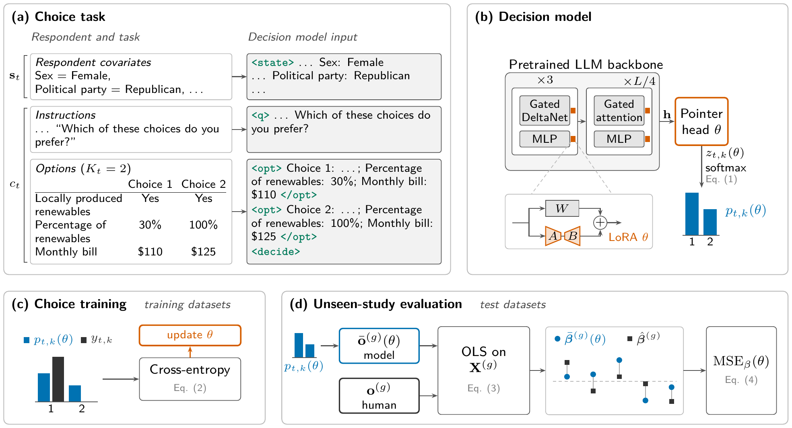

<!-- To submit to Marketing Science: Frontiers track -->

<!-- **** Strictly 6,000 words total (including references, tables, figures; online appendix excluded). -->

<!--
TERMINOLOGY GUIDE (enforce strictly across all sections, tables, figures, and notes; do not bounce between synonyms):
1. Weight updates on human choice data -> "training" and "choice training" (verb: "train"; adjective: "trained" or "choice-trained"). Use "training" aggressively to distinguish our pre-inference weight updates from post-inference adjustment/reweighting methods (Wang et al. 2026; Leng et al. 2026). Never use "fine-tuning" or "fine-tune" (marketing readers conflate it with tuning prompts or sampling parameters). Avoid "post-training" (collides with "post-inference") and avoid "calibration" for weight updates (associated in marketing with post-inference reweighting). Clarify on first use that training updates neural network weights (LoRA backbone adapters and decision head) via respondent-level cross-entropy, equivalent to conditional maximum likelihood estimation (MLE).
2. Models prior to choice training (both generative LLMs and released KEV checkpoints) -> "off-the-shelf" (e.g., "off-the-shelf generative LLMs", "off-the-shelf decision models", "off-the-shelf baseline"; table/figure label: "Off-the-shelf"). Never use "untrained" or bare "base" as the baseline regime label.
3. Evaluation on held-out studies excluded from training -> "unseen-study" (e.g., "unseen-study transfer", "unseen-study evaluation", "transfer to unseen studies"). Avoid bare "zero-shot" (marketing readers associate it with zero-shot prompting); state explicitly that no target-study training data is used.
4. Pre-inference intervention verb -> "train" (e.g., "we train decision models before inference"). Never use "align" or "alignment" for econometric choice training.
5. Generative LLM thinking/reasoning knobs -> "reasoning effort" (e.g., "higher reasoning effort", "lower (off, min, low) and higher (on, high) reasoning effort"). Avoid "reasoning settings" or "reasoning budgets".
6. Contrast with Wang et al. (2026) and Leng et al. (2026) -> describe their methods as "post-inference adjustment" or "post-inference reweighting" of fixed model outputs using target-study human data, contrasted directly with our pre-inference "training" / "choice training" of model weights on historical studies.
7. Field and data naming -> use "synthetic respondents" for general use and "synthetic choice data" for choice experiments in particular. Never use "silicon sampling" or "silicon samples" (non-Marketing Science terminology).
8. Our seven empirical data collections -> use "dataset" / "datasets" consistently ("training datasets", "validation dataset", "test datasets" / "held-out test datasets"), matching @tbl-datasets. Never call test datasets "test benchmarks", "benchmark studies", or "benchmark designs", and never call the validation dataset a "validation set". Reserve "benchmark" for the full-sample human slope benchmark and pretrained objective single-label benchmarks, and reserve "study" for published papers or general conceptual framing (e.g., "choice study", "unseen-study transfer").
-->

**Abstract**  
[TODO]

**Keywords.** Decision models, Large Language Models, Synthetic respondents, Econometric inference, Marketing research

# Introduction {#sec-intro}

Using foundation models as synthetic respondents to simulate consumer choices has attracted growing interest in marketing and behavioral research.
In marketing, the primary goal is downstream econometric inference, such as estimating attribute slopes in conjoint analysis or recovering causal treatment effects in randomized experiments.
Most studies generate synthetic choice data with off-the-shelf generative large language models (LLMs), yet substituting these outputs for human responses severely biases downstream regressions [@goli2024frontiers; @leng2026reducing; @wang2026large].
This bias arises because off-the-shelf LLMs are optimized for deterministic text generation and safety compliance, which collapses choice uncertainty and triggers refusals.
<!-- the sentence above should emphasize the nature of the tasks foundations models are trained to optimized: code, math require single correct responses. whereas human simulation requires stochastic distribution over possible responses. -->
For instance, on a vaccines conjoint subsample [@kreps2020factors], off-the-shelf models incur large ordinary least squares (OLS) treatment-effect error relative to human respondents [@wang2026large]. 
Contrary to common expectation, using proprietary models or increasing reasoning effort can even increase this error (@fig-intro-off-the-shelf).
Additionally, generative LLMs are slow and computationally expensive.
Since they produce responses as tokens, approximating their choice probabilities requires costly Monte-Carlo sampling.

To overcome the time and computation costs of text generation, we investigate system one decision models [@deusser2026evaluatingbenchmarkingmodeljev; @geuter2026releasinginnerjevsimple; @palmer2026kev].
Unlike generative LLMs, a decision model replaces the text-generation head with a scoring layer over candidate options.
Given a respondent persona and choice task, it outputs normalized choice probabilities in a single forward pass.
This single-pass directly generates the probability distribution of choices, eliminates Monte Carlo sampling cost and noise, and yields exact expected OLS treatment effects directly from predicted probabilities.
Despite their architectural advantage, off-the-shelf decision models still suffer from high error in their OLS estimates (@fig-intro-off-the-shelf).
Because these models are pretrained on single-label objective benchmarks rather than human choice behavior, they treat disagreement among respondents with the same persona as classification error [@gao2026choicesfewerdecisionsordinalscale].

In this research, we train decision models by updating their weights on historical human choice microdata, a procedure we call choice training.
Specifically, we minimize respondent-level cross-entropy (CE), which is equivalent to conditional maximum likelihood estimation, and test whether choice training transfers to unseen marketing and behavioral studies.

{#fig-intro-off-the-shelf width=90%}

::: {custom-style="Table Note"}
*Note.* Bars report OLS $\mathrm{MSE}_\beta \times 10^3$ (@eq-eval-mse) across 11 vaccine attribute levels on the 200-respondent Vaccines conjoint subsample [*n* = 1,000 choice tasks\; @wang2026large]. 
Errors are measured relative to full-sample human estimates (*N* = 1,971 respondents; 9,855 choice tasks). 
:::

Empirically, we evaluate choice training across three open-weight decision-model scales [0.8B, 4B, and 9B parameters\; @palmer2026kev].
We evaluate generalizability of our training on four unseen held-out studies: a nutrition-labeling trial [@grummon2025nutrition], a vaccine conjoint [@kreps2020factors], a consumer-rights conjoint [@kantorowicz2026consumers], and an AI smartphone conjoint [@magistro2026attitudes].
We show that although scaling to proprietary models or increasing reasoning effort can worsens OLS MSE, choice training with respondent-level CE substantially lowers this error on unseen studies, across model scales.

# Literature review {#sec-lit}

Early work in silicon sampling prompted generative LLMs with demographic profiles to simulate human responses in political, economic, and marketing surveys [@argyle2023out; @horton2023large; @brand2023using; @goli2024frontiers; @sarstedt2024using; @pmlr-v202-santurkar23a; @durmus2024towards].
Although generative LLMs often capture the direction of average preferences, prior studies document systematic discrepancies from human populations, including mode collapse onto a single option, attenuated within-group variance, demographic stereotyping, and prompt sensitivity [@pmlr-v202-santurkar23a; @shu-etal-2024-dont; @koo2024benchmarking; @kabir-etal-2025-break; @deas-mckeown-2025-artificial; @jung-etal-2026-psychometric; @wadi2025monte; @zahradnickova2026ai].
In marketing applications, these distortions severely bias downstream econometric estimation [@goli2024frontiers; @leng2026reducing; @wang2026large].
In choice-based conjoint analysis, relying on simulated choices or naively pooling them with human data biases preference estimates, while scaling model capability or chain-of-thought reasoning worsens error by inducing overly deterministic choices [@wang2026large].
Recent marketing studies address these discrepancies after inference by treating the language model as a fixed generator, using target-study human benchmark data to statistically debias downstream regression parameters [@wang2026large; @angelopoulos2023prediction\; AAE] or optimally reweight ensembles of candidate prompts, personas, and model checkpoints [@leng2026reducing\; HuMCal].
Complementing these post-inference methods, we align predictions inside the model before inference through both output architecture and training supervision.

Architecturally, several studies avoid the cost and sampling variance of repeated Monte Carlo text generation by extracting next-token probabilities over option symbols (e.g., A, B, and C) from causal LLMs [@kadavath2022language; @kuribayashi-etal-2024-psychometric; @bentegeac2025token; @wadi2026every].
Yet symbol-level readouts remain sensitive to vocabulary and token-frequency priors.
Decision models, also known as System One architectures, resolve this sensitivity via a single-pass scoring head [@palmer2026kev; @deusser2026evaluatingbenchmarkingmodeljev; @geuter2026releasinginnerjevsimple; @li2026llmasjevllmsjevstyledecision; @asseri2026calibratedwhompersonalanguage; @li2026kitescalingjevpopulation].
This head evaluates each supplied option directly in representation space and restricts probability mass strictly to the valid options without open-ended generation or safety refusals.
Crucially for econometric training, outputting exact choice probabilities in a single forward pass makes linear regression operators over experimental designs directly differentiable with respect to model parameters.
However, existing decision models are pretrained on single-label objective benchmarks such as mathematics, code verification, and factual question answering, causing severe probability miscalibration on subjective choice tasks [@gao2026choicesfewerdecisionsordinalscale].

On the training dimension, existing fine-tuning approaches for silicon sampling require access to unreleased response data.
At the token level, @wang2026large fine-tuned GPT-4o on 50 target-study conjoint tasks under a generic persona to emit a single choice letter, finding that small-sample single-token supervision worsened standalone parameter error relative to the human benchmark.
Recent studies improve calibration by supervising causal language models or decision heads on large-scale survey microdata and subgroup response histograms [@suh-etal-2025-language; @huang-etal-2026-distribution; @ku2026siliconsamplingcrosssurveytransfer].
When respondent-level choice microdata is available, minimizing CE on a probabilistic decision head effectively calibrates conditional choice probabilities across personas.
Yet across conjoint analysis, discrete-choice modeling, and randomized online or field trials, published articles and archival industry reports rarely disclose raw respondent choices, reporting instead experimental designs and estimated regression tables.
We bridge this data gap by supervising decision models directly on published population OLS coefficients via an unbiased split-sample moment loss, deployed either standalone with a base-distribution KL anchor when no microdata exists or jointly alongside respondent-level CE when augmenting in-house microdata with external literature tables.

# Methodology {#sec-methodology}

{#fig-pipeline width=100%}

**Decision model parameterization.**
Consider a choice study composed of discrete-choice tasks indexed by $t$ (@fig-pipeline, panel a).
Each task pairs observed respondent covariates $\mathbf{s}_t$ (e.g., sex, age, education, income, political affiliation, and race) with a task context $c_t$ specifying the instructions and $K_t \ge 2$ discrete options.
Let $y_{t,k} \in \{0, 1\}$ indicate whether the human respondent selects option $k \in \{1, \dots, K_t\}$ on task $t$, with $\sum_{k=1}^{K_t} y_{t,k} = 1$.

Rather than generating text tokens autoregressively, a single-pass decision model replaces the vocabulary head of a pretrained language model with a pointer head that scores all $K_t$ options in one forward pass (@fig-pipeline, panel b).
For each option $k$, the model computes a real-valued score $z_{t,k}(\theta)$ from $(\mathbf{s}_t, c_t)$, where $\theta$ collects trainable low-rank adaptation (LoRA) weights [@hu2021lora] on the backbone together with the pointer-head parameters (token serialization and query-key readout equations appear in the Web Appendix).
Applying a softmax transformation with unit temperature produces the conditional choice probabilities:
$$
p_{t,k}(\theta) = P\big(y_{t,k} = 1 \mid \mathbf{s}_t, c_t; \theta\big) = \frac{\exp\!\big(z_{t,k}(\theta)\big)}{\sum_{m=1}^{K_t} \exp\!\big(z_{t,m}(\theta)\big)}.
$$ {#eq-model-pmf}
Formally, @eq-model-pmf takes the conditional multinomial logit form [@mcfadden1972conditional; @train2009discrete] with $z_{t,k}(\theta)$ acting as systematic utility.
Because @eq-model-pmf normalizes directly over $\{1, \dots, K_t\}$ without text decoding, refusals and out-of-set outputs have zero probability by construction.

**Choice training.**
Off-the-shelf decision models are pretrained on objective single-label benchmarks where each task has a single correct answer [@palmer2026kev; @gao2026choicesfewerdecisionsordinalscale].
Training on deterministic labels widens score gaps across options and pushes predicted probabilities $p_{t,k}(\theta)$ toward zero and one.
In human choice studies, however, respondents with identical observed covariates $\mathbf{s}_t$ still differ in unobserved preferences.
Therefore, the true conditional choice distribution spreads probability mass across options rather than collapsing onto a single mode.

Whereas post-inference adjustment and reweighting methods keep model parameters fixed and require human data from the target study [@wang2026large; @leng2026reducing], choice training updates $\theta$ before inference on historical respondent-level choice microdata (@fig-pipeline, panel c).
Starting from the off-the-shelf model checkpoint, we treat repeated tasks per respondent marginally under a pooled conditional log-likelihood and minimize empirical cross-entropy over mini-batches $S$ of historical tasks:
$$
\mathcal{L}_{\mathrm{CE}}(\theta; S) = -\frac{1}{|S|} \sum_{t \in S} \sum_{k=1}^{K_t} y_{t,k} \log p_{t,k}(\theta).
$$ {#eq-resp-ce}
Minimizing @eq-resp-ce is equivalent to pooled conditional maximum likelihood estimation of @eq-model-pmf [@mcfadden1972conditional; @train2009discrete].
Because cross-entropy is a strictly proper scoring rule, its population minimizer recovers true conditional choice probabilities rather than a deterministic mode.
Importantly, no target-study data enters @eq-resp-ce, so downstream evaluation measures unseen-study transfer.

**Econometric evaluation.**
On an unseen evaluation study, we hold $\theta$ fixed and evaluate treatment-effect recovery using ordinary least squares (OLS) regressions defined by the study's experimental design (@fig-pipeline, panel d).
Applying the same linear specification symmetrically to both human responses and model-implied expected outcomes places the human benchmark and synthetic choice data on a common estimator.
Consider each regression $g \in \{1, \dots, G\}$ in the study, with full-column-rank design matrix $\mathbf{X}^{(g)}$ and human outcome vector $\mathbf{o}^{(g)}$.
The matrix $\mathbf{X}^{(g)}$ contains an intercept and $d_g$ treatment or attribute indicators from the randomized design.
Across all evaluation designs, each entry of $\mathbf{o}^{(g)}$ is a linear function of the choice indicators $y_{t,k}$.
Specifically, it records a profile-selection indicator in paired conjoints (zero across profiles when an opt-out is chosen), a target-option indicator in binary-endpoint trials, or the numeric score $\sum_{k=1}^{K_t} k\,y_{t,k}$ in ordinal rating tasks.
Replacing each realized indicator $y_{t,k}$ with its predicted probability $p_{t,k}(\theta)$ from @eq-model-pmf therefore yields the exact expected outcome vector $\bar{\mathbf{o}}^{(g)}(\theta)$ under synthetic choice draws.

Applying the OLS operator $\mathbf{A}^{(g)} = (\mathbf{X}^{(g)\top}\mathbf{X}^{(g)})^{-1}\mathbf{X}^{(g)\top}$ to the human and model-implied outcome vectors defines the intercepts and slopes:
$$
\begin{pmatrix}
\hat{\alpha}^{(g)} \\
\hat{\boldsymbol{\beta}}^{(g)}
\end{pmatrix}
= \mathbf{A}^{(g)}\mathbf{o}^{(g)},
\qquad
\begin{pmatrix}
\bar{\alpha}^{(g)}(\theta) \\
\bar{\boldsymbol{\beta}}^{(g)}(\theta)
\end{pmatrix}
= \mathbf{A}^{(g)}\bar{\mathbf{o}}^{(g)}(\theta),
$$ {#eq-pop-ols}
where $\hat{\alpha}^{(g)}$ and $\bar{\alpha}^{(g)}(\theta)$ are the intercepts, $\hat{\boldsymbol{\beta}}^{(g)}$ is the full-sample human slope benchmark, and $\bar{\boldsymbol{\beta}}^{(g)}(\theta)$ collects the $d_g$ model-implied treatment or attribute slopes.
Because $\mathbf{X}^{(g)}$ is fixed and OLS is linear in the outcome vector, $\bar{\boldsymbol{\beta}}^{(g)}(\theta)$ equals the exact expectation of the OLS slope estimator over synthetic choices drawn from $p_{t,k}(\theta)$, with zero Monte Carlo variance.
Note that @eq-pop-ols targets point-estimate recovery rather than plug-in standard errors, because regressing deterministic expectations $\bar{\mathbf{o}}^{(g)}(\theta)$ omits realization-level sampling variance.

Because all $G$ regressions within each study share identical outcome units, we measure aggregate slope recovery across all $d = \sum_{g=1}^G d_g$ slopes via mean squared error [@wang2026large]:
$$
\mathrm{MSE}_{\beta}(\theta) = \frac{1}{d} \sum_{g=1}^G \left\lVert \bar{\boldsymbol{\beta}}^{(g)}(\theta) - \hat{\boldsymbol{\beta}}^{(g)} \right\rVert_2^2.
$$ {#eq-eval-mse}
As a complementary individual-level diagnostic, we also report held-out empirical cross-entropy in nats by evaluating @eq-resp-ce over all tasks in each unseen study alongside @eq-eval-mse in @tbl-results-mse.

# Experimental setup {#sec-setup}

<!-- create a figure diagram showing sample Kev state/instructions with personas questions and options. use examples from both training and test datasets -->

## Datasets and transfer design

We evaluate choice training across seven choice datasets spanning various product and policy domains, with no overlap between training, validation, and testing (@tbl-datasets).
Two datasets provide respondent-level training microdata: a paired electricity-plan conjoint [`Electricity`\; @wu2025partisan], and a discrete-choice experiment on drone versus ground delivery across four vendor contexts [`Drones`\; @berke2023drone].
Both training datasets vary price (monthly bill or delivery fee) alongside non-price attributes.
To prevent held-out test datasets from informing model selection, we designate the `Flights` dataset [@goldfarb2026comfort] as a dedicated validation dataset that selects every training run's checkpoint.

Our four held-out test datasets never enter training, hyperparameter tuning, or checkpoint selection.
Two include price over wider ranges than training (`Consumer rights` and `AI & offshoring`), whereas the other two share no attributes with training (`Food labels` and `Vaccines`).
Together, these test datasets span paired conjoints, a three-option conjoint with an opt-out (`Vaccines`), a five-point ordinal rating conjoint (`AI & offshoring`), and a six-arm randomized trial (`Food labels`).
Across all seven datasets, each choice task conditions on the respondent's observed covariates $\mathbf{s}_t$ in a standardized text format (@fig-pipeline, panel a; mappings appear in the Web Appendix).



: Summary of training, validation, and held-out test datasets {#tbl-datasets}

::: {custom-style="Table Note"}
*Note.* Shorthand dataset labels in the Dataset column are used throughout all tables and figures. The column $d$ reports the total number of non-reference treatment or attribute slopes across each dataset's experimental design (@sec-methodology): `Drones` spans four vendor contexts of 7 slopes each (28 total), `Consumer rights` spans two product conjoints of 19 slopes each (38 total), and `AI & offshoring` spans four country-by-arm regressions of 8 slopes each (32 total) on a five-point support scale (1 to 5). Training datasets (`Electricity` and `Drones`) enter exclusively as respondent-level choice microdata via @eq-resp-ce, whereas validation and test datasets are evaluated via @eq-pop-ols and @eq-eval-mse.
:::

## Choice-training regimes

Across every model scale, we evaluate a $2 \times 2$ choice-training design toggling inclusion of `Electricity` and `Drones` across four regimes.
`Off-the-shelf` evaluates the unmodified decision model without choice training ($0$ steps).
`Electricity` trains on the 18,591 choice tasks from @wu2025partisan (1,395 steps over $3$ epochs), whereas `Drones` trains on the 36,297 choice tasks from @berke2023drone (2,730 steps over $3$ epochs).
Finally, `Drones + Electricity` pools all 54,888 choice tasks from both datasets under @eq-resp-ce (4,125 steps over $3$ epochs).
This factorial design isolates whether single-dataset training already transfers to unseen datasets, whether training-domain composition matters, and whether pooling distinct choice datasets compounds unseen-study gains.

## Models, training protocol, and evaluation

We evaluate the `KEV-0.8B`, `KEV-4B`, and `KEV-9B` open-weight decision models [@palmer2026kev], each loaded in `bfloat16` precision with unit temperature.
Choice training updates LoRA adapters (rank $r = 64$, scaling $\alpha_{\mathrm{LoRA}} = 128$, dropout $0.05$) across all linear backbone projections jointly with the trainable pointer head via @eq-resp-ce.
Every trained run uses AdamW with a $5 \times 10^{-6}$ peak learning rate, a OneCycle schedule ($10\%$ warmup and cosine decay), weight decay $0.01$, and gradient-norm clipping at $1.0$.
Training runs for $3$ epochs with mini-batch size $|S| = 40$ and random seed $42$.
Within each epoch, tasks are shuffled independently within each dataset (and within each vendor context in `Drones`), partitioned into single-dataset mini-batches, and interleaved randomly.
We validate each run on `Flights` at step $0$, every $32$ steps ($1,280$ tasks), and the final step, selecting the checkpoint with the lowest validation $\mathrm{MSE}_\beta$ (@eq-eval-mse).
Main-text results in @tbl-results-mse report $\mathrm{MSE}_\beta$ (@eq-eval-mse) multiplied by $10^3$ alongside held-out empirical cross-entropy in nats (@eq-resp-ce).
The Web Appendix reports the off-the-shelf generative LLM protocol used in @fig-intro-off-the-shelf (@apptbl-llm-baseline) and full attribute-level slope tables and subset diagnostics (@appfig-flights-slopes; @apptbl-vaccines-slopes through @apptbl-magistro-subsets).

# Results {#sec-results}

## Unseen-study transfer across domains and model scales

@tbl-results-mse and @fig-results-overall report unseen-study treatment-effect error ($\mathrm{MSE}_\beta$) and held-out empirical cross-entropy (CE) across all three model scales, four choice-training regimes, and five evaluation datasets.
Pooled choice training (`Drones + Electricity`) lowers $\mathrm{MSE}_\beta$ relative to the off-the-shelf checkpoint in all 15 model-dataset cells, including all 12 held-out test cells, and achieves the lowest CE in every cell.
Across held-out test datasets, $\mathrm{MSE}_\beta$ falls by 22% to 89%.
These gains extend well beyond `Flights` and the two held-out price datasets (`Consumer rights` and `AI & offshoring`).
Some of the sharpest improvements occur on non-price test datasets that share no attributes with training, cutting $\mathrm{MSE}_\beta$ by 79% to 88% on `Vaccines` and by 35% to 89% on `Food labels` across scales.
Choice training also transfers across response formats, moving from binary paired choices in training to three-option opt-out conjoints (`Vaccines`), a six-arm randomized trial (`Food labels`), and five-point ordinal ratings (`AI & offshoring`, where larger raw $\mathrm{MSE}_\beta$ values reflect the 1 to 5 outcome scale; see @apptbl-magistro-subsets).

Comparing single-dataset regimes against `Drones + Electricity` shows why pooling distinct choice datasets matters (@tbl-results-mse and @fig-results-overall).
Training on `Electricity` or `Drones` alone already improves $\mathrm{MSE}_\beta$ substantially on binary and three-option tasks, yet both single-dataset regimes prove brittle under the format shift to five-point ordinal ratings on `AI & offshoring`.
Each single-dataset regime worsens `AI & offshoring` $\mathrm{MSE}_\beta$ on two of the three model scales relative to the off-the-shelf checkpoint.
Pooling `Drones + Electricity` reverses every single-dataset regression, lowering `AI & offshoring` $\mathrm{MSE}_\beta$ by 22% to 35% across scales.
Overall, pooled choice training attains the lowest $\mathrm{MSE}_\beta$ among all four regimes in 13 of 15 cells, trailing a single-dataset model only on `KEV-9B` for `Consumer rights` and `Food labels`, while still recording the lowest CE in both cells.

Across model scales, choice training dominates off-the-shelf parameter scaling.
Echoing the off-the-shelf generative LLM pattern in @fig-intro-off-the-shelf, scaling off-the-shelf decision models from `KEV-0.8B` to `KEV-9B` does not reliably improve treatment-effect recovery.
Off-the-shelf `KEV-9B` incurs higher $\mathrm{MSE}_\beta$ than off-the-shelf `KEV-0.8B` on three of the four held-out test datasets (`AI & offshoring`, `Food labels`, and `Vaccines`), improving monotonically with scale only on `Consumer rights`.
By contrast, pooled choice training overturns an order-of-magnitude gap in parameter count.
Choice-trained `KEV-0.8B` outperforms off-the-shelf `KEV-9B` on four of five datasets, trailing only on `Consumer rights`.
At the middle scale, choice-trained `KEV-4B` achieves the lowest $\mathrm{MSE}_\beta$ overall on `Flights`, `Food labels`, and `Vaccines`, and virtually matches choice-trained `KEV-9B` on `AI & offshoring`.

The CE columns in @tbl-results-mse clarify why off-the-shelf scaling breaks down and confirm that aggregate OLS slope gains reflect genuine individual-level probability improvements.
Consistent with the objective-pretraining mechanism in @sec-methodology, off-the-shelf decision models exhibit severe overconfidence, with held-out CE (@eq-resp-ce) exceeding uniform random guessing ($\ln K$, for option counts $K \in \{2, 3, 5\}$ in @tbl-datasets) in 14 of 15 cells.
Moreover, off-the-shelf CE rises with parameter scale on `Food labels`, `Vaccines`, and `AI & offshoring`, showing that larger off-the-shelf models concentrate probability mass even more sharply onto extreme options and amplify OLS slope distortion.
Pooled choice training reverses this collapse across every scale and dataset, reducing CE strictly below $\ln K$ in 11 of 15 cells and bringing the remaining cells close to or effectively at that threshold, including a drop of roughly 0.7 to 0.8 nats across scales on five-point `AI & offshoring`.
Because @eq-resp-ce penalizes misallocated respondent-level probabilities directly, these parallel drops in CE and $\mathrm{MSE}_\beta$ (@eq-eval-mse) rule out slope-level error cancellation across respondents or attributes.

::: {#tbl-results-mse size="scriptsize"}



OLS treatment-effect error and empirical cross-entropy across datasets and choice-training regimes

:::

::: {custom-style="Table Note"}
*Note.* MSE reports population OLS treatment-effect error $\mathrm{MSE}_\beta \times 10^3$ (@eq-eval-mse) and CE reports mean empirical cross-entropy (negative log-likelihood per choice task, in nats; @eq-resp-ce); lower is better for both metrics. Uniform random guessing yields $\mathrm{CE} = \ln 2 = 0.693$ on `Flights` and `Consumer rights`, $\ln 3 = 1.099$ on `Food labels` and `Vaccines`, and $\ln 5 = 1.609$ on `AI & offshoring`. Bold marks the lowest value per model, dataset, and metric. `Flights` is the validation dataset that selects each run's checkpoint; `Consumer rights` and `AI & offshoring` are held-out test price datasets; `Food labels` and `Vaccines` are held-out test non-price datasets.
:::

{#fig-results-overall width=100%}

## Attribute-level transfer across shared and unseen attributes

Because both training datasets include a price attribute, aggregate $\mathrm{MSE}_\beta$ reductions could in principle stem from price sensitivity transferring alone while unseen non-price attributes remain distorted.
Attribute-level estimates on held-out `Consumer rights` rule out that explanation (@fig-results-laptops-slopes; full laptop and laundry estimates in @apptbl-consumer-rights-slopes).
Across all 34 unseen non-price slopes, pooled choice training lowers non-price $\mathrm{MSE}_\beta$ at every model scale, by 24% to 41%.
On `KEV-9B`, where pooled training slightly overshoots price slopes relative to the off-the-shelf model, the entire net improvement on `Consumer rights` comes from unseen non-price attributes.
In the laptop conjoint (@fig-results-laptops-slopes), off-the-shelf `KEV-0.8B` and `KEV-4B` compress hardware, warranty, and price slopes toward zero while inverting brand and consumer-rights signs.
Pooled choice training lifts price, RAM, storage, and ten-year warranty slopes toward the human benchmark and corrects inverted signs on Apple MacBook, full privacy, and conflict resolution, although brand premia and ten-year warranty effects remain attenuated relative to human choices.

The non-price `Vaccines` conjoint provides an even cleaner test because it shares no attributes with either training dataset (@fig-results-vaccines-slopes and @apptbl-vaccines-slopes).
Here, choice training corrects two opposite off-the-shelf distortions at once.
First, off-the-shelf models sharply exaggerate socially and politically salient cues, overstating CDC and WHO endorsement effects across all three scales and overshooting high vaccine efficacy and China-origin penalties at `KEV-4B` and `KEV-9B`.
Pooled choice training cuts those endorsement overshoots by more than half across scales and pulls efficacy and origin slopes back toward human estimates.
Second, choice training simultaneously lifts underweighted clinical and regulatory slopes rather than shrinking all effects toward zero.
Across scales, it raises five-year duration and severe side-effect slopes toward human magnitudes and moderates the `KEV-4B` emergency-authorization distortion.
Because choice training pulls exaggerated slopes downward while lifting suppressed slopes upward within the same task, unseen-study transfer cannot be explained by simple temperature rescaling or uniform shrinkage.

The remaining Web Appendix breakdowns reinforce both the breadth and the limits of attribute-level transfer.
On held-out `Food labels` (@apptbl-food-slopes), off-the-shelf `KEV-4B` and `KEV-9B` invert the `HighIn` warning label into a large negative slope while exaggerating nutrition-information arms.
Pooled choice training nearly eliminates that sign inversion and brings `KEV-4B` close to human estimates across arms.
On held-out `AI & offshoring` (@apptbl-ai-offshoring-slopes and @apptbl-magistro-subsets), pooled training cuts non-price job-change $\mathrm{MSE}_\beta$ by 33% to 34% across all three scales and moderates extreme off-the-shelf overreactions to factory-job gains.
However, factory-job slopes remain inflated at `KEV-4B` and `KEV-9B`, and `KEV-9B` overshoots price slopes under the five-point ordinal scale, underscoring that transfer across response formats remains harder than transfer within binary or three-option designs.
Finally, the `Flights` validation breakdown (@appfig-flights-slopes and @apptbl-flights-slopes) exhibits the same dual improvement across shared price levels and unseen airline, baggage, and sustainable-fuel attributes.

{#fig-results-laptops-slopes width=100%}

{#fig-results-vaccines-slopes width=100%}

# Conclusion {#sec-conclusion}

<!-- Note explaining the limitations of training only on the CE loss. For Food Labels 9B has the lowest CE loss but the highest MSE_beta. Motivation for future research to address training both CE loss and a beta loss -->

# Declarations {.unnumbered}

## Funding and Competing Interests {.unnumbered}

All authors certify that they have no affiliations with or involvement in any organization or entity with any financial interest or non-financial interest in the subject matter or materials discussed in this manuscript. The authors have no funding to report.

# References {.unnumbered}

::: {#refs}
:::



# Web Appendix {.unnumbered}

## Token serialization, query-key readout, and covariate mappings {.unnumbered}

::: {.callout-note}
**TODO.** Add token serialization equations, query-key readout equations, and respondent-covariate mapping tables across all seven datasets alongside @appfig-input-vaccines.
:::

::: {#appfig-input-vaccines}

{width=100%}

Full decision model input for one unseen-study task (Vaccines)

:::

## Off-the-shelf generative LLM baseline protocol {.unnumbered}

::: {.callout-note}
**TODO.** Add the generative LLM prompting protocol backing @fig-intro-off-the-shelf and @apptbl-llm-baseline.
:::

::: {#apptbl-llm-baseline size="footnotesize"}



Off-the-shelf generative LLMs and decision models on the 200-respondent Vaccines subsample

:::

::: {custom-style="Table Note"}
*Note.* All models condition on respondent demographics over the same 200-respondent, 1,000-task subsample of `Vaccines` [@kreps2020factors], evaluated against the full-sample human OLS benchmark ($N = 1,971$). Refusals count tasks where a generative LLM failed to return a valid choice option. Opt-out reports the share (or expected probability for decision models) of selecting neither vaccine. Values back @fig-intro-off-the-shelf.
:::

## Attribute-level treatment-effect tables and diagnostics {.unnumbered}

::: {#appfig-flights-slopes}

{width=100%}

Flights (validation) OLS treatment effects by attribute for off-the-shelf and pooled choice-trained models

:::

::: {#apptbl-vaccines-slopes size="scriptsize"}



Vaccines (held-out test) OLS treatment effects by attribute

:::

::: {custom-style="Table Note"}
*Note.* Human reports full-sample OLS slopes on observed respondent choices in `Vaccines` [@kreps2020factors]. Base denotes the off-the-shelf decision model; Pooled denotes choice training on `Drones + Electricity`. Values back @fig-results-vaccines-slopes.
:::

::: {#apptbl-food-slopes size="scriptsize"}



Food labels (held-out test) OLS treatment effects by arm

:::

::: {custom-style="Table Note"}
*Note.* Human reports full-sample OLS slopes on observed choices in `Food labels` [@grummon2025nutrition]. Base denotes the off-the-shelf decision model; Pooled denotes choice training on `Drones + Electricity`.
:::

::: {#apptbl-consumer-rights-slopes size="scriptsize"}



Consumer rights (held-out test) OLS treatment effects by attribute

:::

::: {custom-style="Table Note"}
*Note.* Human reports full-sample OLS slopes across the 19 laptop (`Computers`) and 19 laundry-machine (`Laundry`) attribute levels in `Consumer rights` [@kantorowicz2026consumers]. Base denotes the off-the-shelf decision model; Pooled denotes choice training on `Drones + Electricity`. Laptop slopes back @fig-results-laptops-slopes.
:::

::: {#apptbl-ai-offshoring-slopes size="scriptsize"}



AI & offshoring (held-out test) OLS treatment effects by attribute

:::

::: {custom-style="Table Note"}
*Note.* Human reports full-sample OLS slopes on the five-point ordinal support scale across four country-by-arm regressions (8 slopes each, 32 total) in `AI & offshoring` [@magistro2026attitudes]. Base denotes the off-the-shelf decision model; Pooled denotes choice training on `Drones + Electricity`.
:::

::: {#apptbl-flights-slopes size="scriptsize"}



Flights (validation) OLS treatment effects by attribute

:::

::: {custom-style="Table Note"}
*Note.* Human reports full-sample OLS slopes on observed respondent choices in `Flights` [@goldfarb2026comfort], the validation dataset used to select each run's checkpoint. Base denotes the off-the-shelf decision model; Pooled denotes choice training on `Drones + Electricity`. Values back @appfig-flights-slopes.
:::

::: {#apptbl-magistro-subsets size="scriptsize"}



AI & offshoring OLS treatment-effect error by country, arm, and attribute type

:::

::: {custom-style="Table Note"}
*Note.* Values report $\mathrm{MSE}_\beta \times 10^3$ on `AI & offshoring` [@magistro2026attitudes]; lower is better. Bold marks the lowest value per model and subset. Pooled choice training (`Drones + Electricity`) improves every country and arm subset across all three models, whereas single-dataset training on `Electricity` degrades both US and Canada subsets on `KEV-4B` and `KEV-9B`.
:::
