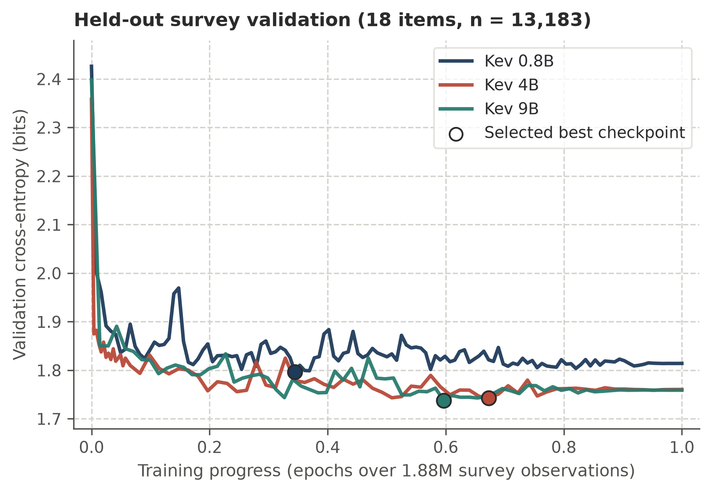

<!-- To submit to Marketing Science: Frontiers track -->

<!-- **** Strictly 6,000 words total (including references, tables, figures; online appendix excluded). -->

<!--  -->

**Abstract**

Replacing human respondents with generative large language models (LLMs) in silicon sampling severely biases downstream econometric inference because autoregressive post-training collapses choice uncertainty, inflates regression coefficients, and triggers safety refusals. We propose distributional silicon sampling using single-pass decision models that score valid options directly in representation space and output normalized choice probabilities without text generation. Because off-the-shelf decision models are trained on single-label objective benchmarks and remain overconfident on subjective choices, we fine-tune open-weight decision models (`Kev 0.8B`, `4B`, and `9B`) on 1.88 million persona-linked survey responses from US social and behavioral surveys (`US ISSP` and `Twin-2K-500`) across 17 harmonized attributes. Minimizing distributional cross-entropy calibrates conditional choice distributions at unit temperature without target-study human data. Fine-tuning reduces held-out survey cross-entropy by up to $27.5\%$ and generalizes zero-shot to two held-out marketing studies. In COVID-19 vaccine conjoint analysis, `Kev 9B (FT)` eliminates safety refusals, outperforms generative LLMs by orders of magnitude, and reduces Multinomial Logit part-worth MSE by $64\%$ to $67\%$ over `Kev 9B (base)`. In a six-arm nutrition labeling randomized trial, `Kev 9B (FT)` halves OLS treatment-effect MSE relative to `Kev 9B (base)`, improves calibration across seen and unseen shopper covariates, and recovers causal OLS effects on interpretive labels while delineating modality limits on visual warnings.

**Keywords.** Decision models, Silicon sampling, Econometric inference, Conjoint analysis, Marketing research

# Introduction {#sec-intro}

Simulating consumer choices, attitudes, and survey responses with foundation models, commonly referred to as silicon sampling, has attracted growing interest in marketing and behavioral research. 
In marketing research, the primary goal is downstream econometric inference, such as estimating part-worth utilities in conjoint analysis or causal treatment effects in randomized experiments. 
Currently, research relies on off-the-shelf generative large language models (LLMs) that generate text autoregressively. 
However, replacing human respondents with off-the-shelf generative LLM outputs severely biases measurements and downstream regressions because post-training for deterministic reasoning and safety compliance collapses choice uncertainty and triggers safety refusals on sensitive options [@goli2024frontiers; @leng2026reducing; @wang2026large]. 
Whereas existing post-inference methods adjust or reweight fixed model outputs after inference using human benchmark data [@leng2026reducing; @wang2026large], we explore whether aligning models before inference—by changing both their output architecture and their training weights—improves human approximation.

Architecturally, we adopt the emerging family of single-pass decision models [@palmer2026kev]. 
Instead of generating text tokens, a decision model takes a respondent persona and a structured question (e.g., a categorical choice task or an ordinal Likert scale) and outputs a normalized probability distribution over the valid options in one forward pass. 
This readout eliminates sampling variance and safety refusals while integrating directly into maximum likelihood and ordinary least squares regressions. 
Yet architecture alone is insufficient: off-the-shelf base decision models share the same training limitation as generative LLMs. 
Because standard training pairs each prompt with a single ground-truth label, off-the-shelf models treat genuine disagreement among respondents who share a persona as classification error, yielding overconfident probabilities and biased regression estimates.
To overcome this limitation, we fine-tune open-weight decision models (`Kev 0.8B`, `4B`, and `9B`; @palmer2026kev) via persona-conditioned distributional training on 1.88 million general US survey responses. 
Our approach advances current silicon-sampling practice along two dimensions: replacing token generation with a probabilistic decision architecture and aligning model weights distributionally with empirical human populations.

Zero-shot evaluations across two held-out marketing studies confirm both gains.
First, on a COVID-19 vaccine conjoint benchmark [@kreps2020factors; @wang2026large], generative LLMs (`Gemini 3.5 Flash-Lite` and `Gemini 4 Argon`) suffer severe Multinomial Logit (MNL) bias ($\mathrm{MSE} = 0.59$ to $26.22$) that worsens under extended reasoning and triggers safety refusals. 
Off-the-shelf `Kev 9B (base)` ($\mathrm{MSE} = 0.2449$ under random personas and $0.0815$ under respondent personas) already outperforms generative LLMs by over an order of magnitude, and `Kev 9B (FT)` reduces MNL MSE by a further $64\%$ to $67\%$ to $0.0875$ and $0.0267$, approaching the 200-respondent human subsample ($\mathrm{MSE} = 0.0065$). 
Second, in a six-arm front-of-package nutrition labeling randomized trial [@grummon2025nutrition], `Kev 9B (FT)` lowers respondent-level choice cross-entropy, reduces OLS treatment-effect MSE by $53\%$ relative to `Kev 9B (base)` ($0.0022$ versus $0.0047$; human subsample $0.0016$), and recovers causal effects on interpretive labels even when conditioning on shopper nutrition covariates unseen during training.

# Literature Review {#sec-lit}

Early work in silicon sampling prompted generative LLMs with demographic profiles to simulate human responses in political, economic, and marketing surveys [@argyle2023out; @horton2023large; @brand2023using; @goli2024frontiers; @sarstedt2024using; @pmlr-v202-santurkar23a; @durmus2024towards]. 
Although generative LLMs often capture the direction of average preferences, prior studies document systematic discrepancies from human populations, including mode collapse onto a single option, attenuated within-group variance, demographic stereotyping, and prompt sensitivity [@pmlr-v202-santurkar23a; @shu-etal-2024-dont; @koo2024benchmarking; @kabir-etal-2025-break; @deas-mckeown-2025-artificial; @jung-etal-2026-psychometric; @wadi2025monte; @zahradnickova2026ai]. 
In marketing applications, these distortions severely bias downstream econometric estimation [@goli2024frontiers; @leng2026reducing; @wang2026large]. 
In choice-based conjoint analysis, relying on AI choices or naively pooling them with human data biases Multinomial Logit (MNL) part-worth estimates, while scaling model capability or chain-of-thought (`CoT`) reasoning worsens error by inducing overly deterministic choices [@wang2026large]. 
Recent marketing studies address these discrepancies after inference by treating the language model as a fixed generator. 
Specifically, they use human benchmark data to statistically debias downstream regression parameters [`AAE`\; @wang2026large; @angelopoulos2023prediction] or optimally reweight ensembles of candidate prompts, personas, and model checkpoints [`HuMCal`\; @leng2026reducing]. 
Complementing these post-inference methods, we align predictions at the model level before inference along two dimensions: output architecture and training supervision.

Architecturally, several studies avoid the cost and sampling variance of repeated Monte Carlo text sampling by extracting exact next-token probabilities over option symbols (e.g., `"A"`, `"B"`, and `"C"`) from causal LLMs [@kadavath2022language; @kuribayashi-etal-2024-psychometric; @bentegeac2025token; @wadi2026every]. 
Yet symbol-level readouts remain sensitive to vocabulary and token-frequency priors. 
Decision models, also known as System One architectures, resolve this sensitivity via a single-pass scoring head [@palmer2026kev; @deusser2026evaluatingbenchmarkingmodeljev; @geuter2026releasinginnerjevsimple; @li2026llmasjevllmsjevstyledecision; @asseri2026calibratedwhompersonalanguage; @li2026kitescalingjevpopulation]. 
This head evaluates each supplied option directly in representation space and restricts probability mass strictly to the valid options without open-ended generation or safety refusals. 
However, existing decision models are pretrained on single-label objective benchmarks such as mathematics, code verification, and factual question answering, causing severe probability compression on subjective and ordinal tasks [@gao2026choicesfewerdecisionsordinalscale].

On the training dimension, prior fine-tuning in silicon sampling supervises models on one-hot individual responses. 
For example, @wang2026large fine-tuned `GPT-4o` on 50 target-study conjoint tasks under a generic persona to emit a single choice token (`A`, `B`, or `C`), which increased parameter error relative to the human sample. 
Even with a probabilistic output head, supervising on one-hot respondent labels treats disagreement among individuals who share a persona as label noise. 
Prior research moves toward distributional supervision by fine-tuning causal language models on fixed group histograms [@suh-etal-2025-language; @huang-etal-2026-distribution; @ku2026siliconsamplingcrosssurveytransfer]. 
We instead train decision models directly on empirical sample probability distributions aggregated across survey respondents matching subsets of persona attributes. 
This supervision calibrates conditional choice distributions from broad demographic subgroups to full individual personas, which improves generalizability.

# Methodology {#sec-methodology}

**Decision model architecture and choice probabilities.**
Consider a survey or experimental dataset of human respondents indexed by $i \in \{1, \dots, N\}$.
Each respondent possesses a multi-attribute persona state $\mathbf{s}_i$ (e.g., sex, age, education, income, political party, and race) and answers a set of questions $\mathcal{Q}_i$.
Each question $q \in \mathcal{Q}_i$ presents $K_q$ discrete answer options $\mathcal{Y}_q = \{y_1, \dots, y_{K_q}\}$.
For categorical `choice` items, the options are unordered alternatives; for ordinal `score` items, the options are ordered rating levels $y_1 \prec y_2 \prec \dots \prec y_{K_q}$.
Let $\mathbf{y}_{i,q} = (y_{i,q,1}, \dots, y_{i,q,K_q}) \in \{0, 1\}^{K_q}$ denote respondent $i$'s observed one-hot response on question $q$, where $y_{i,q,k} = 1$ if respondent $i$ selected option $y_k$ and $0$ otherwise.

Given a conditioning persona profile $\mathbf{s}$, a decision model [@palmer2026kev] processes the prompt in one causal forward pass without a vocabulary generation head.
The prompt places $\mathbf{s}$ in a state segment, followed by the question stem $q$, each option $y_k$ enclosed in dedicated option delimiters, and a terminal decision token appended after the final option.
Because the terminal decision token follows all $K_q$ options, its final-layer hidden state $\mathbf{h}^{\mathrm{dec}}_q(\mathbf{s}) \in \mathbb{R}^{d_{\mathrm{model}}}$ causally attends to the persona, the question stem, and the full option set.
Let $\mathbf{h}_{q,k}(\mathbf{s}) \in \mathbb{R}^{d_{\mathrm{model}}}$ denote the final-layer hidden state at the closing delimiter of option $k$.
Using learned affine projections $(\mathbf{W}_q, \mathbf{b}_q)$ and $(\mathbf{W}_k, \mathbf{b}_k)$ with $\mathbf{W}_q, \mathbf{W}_k \in \mathbb{R}^{d_{\mathrm{head}} \times d_{\mathrm{model}}}$ and $\mathbf{b}_q, \mathbf{b}_k \in \mathbb{R}^{d_{\mathrm{head}}}$, the decision head computes a scalar score $z_{q,k}(\mathbf{s})$ for each option $k$:
$$
z_{q,k}(\mathbf{s}) = \frac{\big(\mathbf{W}_q \mathbf{h}^{\mathrm{dec}}_q(\mathbf{s}) + \mathbf{b}_q\big)^\top \big(\mathbf{W}_k \mathbf{h}_{q,k}(\mathbf{s}) + \mathbf{b}_k\big)}{\sqrt{d_{\mathrm{head}}}}.
$$ {#eq-pointer-head}
Applying a softmax function over the $K_q$ scores yields the normalized choice distribution in a single pass:
$$
P_{\mathrm{model}}(Y_q = y_k \mid \mathbf{s}; \theta) = \frac{\exp(z_{q,k}(\mathbf{s}) / T)}{\sum_{m=1}^{K_q} \exp(z_{q,m}(\mathbf{s}) / T)},
$$ {#eq-model-pmf}
where $T$ denotes the readout temperature.

**Empirical sample-distribution training.**
Rather than training on isolated one-hot responses, we supervise model parameters $\theta$ directly against empirical sample probability distributions constructed across subsets of persona attributes.
Let $|\mathbf{s}_i|$ denote the number of recorded attributes in a respondent's full persona $\mathbf{s}_i$.
At each training epoch, we draw a subset size $\kappa$ uniformly from a schedule $\mathcal{K} = (1, 2, 3, 4, 5, \text{"full"}, \text{"full"})$.
Setting $\ell = |\mathbf{s}_i|$ when $\kappa = \text{"full"}$ and $\ell = \min(\kappa, |\mathbf{s}_i|)$ otherwise, we sample $\ell$ attributes without replacement from $\mathbf{s}_i$ to form a conditioning sub-persona $\mathbf{s}^{(\ell)} \subseteq \mathbf{s}_i$.
Let $\mathcal{I}(q, \mathbf{s}^{(\ell)}) = \{j : \mathbf{s}_j \supseteq \mathbf{s}^{(\ell)},\; q \in \mathcal{Q}_j\}$ denote all training respondents who match $\mathbf{s}^{(\ell)}$ and answered question $q$, with sample size $n_{q, \mathbf{s}^{(\ell)}} = |\mathcal{I}(q, \mathbf{s}^{(\ell)})| \ge 1$.
Aggregating their observed choices yields the empirical sample probability distribution $\hat{\mathbf{p}}_{q \mid \mathbf{s}^{(\ell)}} = (\hat{p}_{q,1 \mid \mathbf{s}^{(\ell)}}, \dots, \hat{p}_{q,K_q \mid \mathbf{s}^{(\ell)}})$:
$$
\hat{p}_{q,k \mid \mathbf{s}^{(\ell)}} = \frac{1}{n_{q, \mathbf{s}^{(\ell)}}} \sum_{j \in \mathcal{I}(q, \mathbf{s}^{(\ell)})} y_{j,q,k}, \qquad k \in \{1, \dots, K_q\}.
$$ {#eq-sample-pmf}
We optimize $\theta$ by minimizing the distributional cross-entropy loss against $\hat{\mathbf{p}}_{q \mid \mathbf{s}^{(\ell)}}$:
$$
\mathcal{L}_{q, \mathbf{s}^{(\ell)}}(\theta) = -\sum_{k=1}^{K_q} \hat{p}_{q,k \mid \mathbf{s}^{(\ell)}} \log_2 P_{\mathrm{model}}\!\left(Y_q = y_k \mid \mathbf{s}^{(\ell)}; \theta\right).
$$ {#eq-resp-ce}
Up to the constant entropy of $\hat{\mathbf{p}}_{q \mid \mathbf{s}^{(\ell)}}$, minimizing @eq-resp-ce directly minimizes the Kullback-Leibler divergence $D_{\mathrm{KL}}\!\left(\hat{\mathbf{p}}_{q \mid \mathbf{s}^{(\ell)}} \,\|\, P_{\mathrm{model}}(\cdot \mid \mathbf{s}^{(\ell)}; \theta)\right)$.
Coarse sub-personas ($\ell \le 5$) pool multiple matching respondents to supply low-variance empirical choice shares, while full-persona draws ($\ell = |\mathbf{s}_i|$) preserve fine-grained individual conditioning.
Sampling across $\mathcal{K}$ also trains the model to marginalize consistently when downstream studies provide partial persona profiles at test time.

# Survey Training and Validation {#sec-training}

## Training Corpus and Model Configuration

**Survey microdata and question split.**
We construct a harmonized training corpus from two public US survey microdata sources (@tbl-datasets).
The first comprises $10$ consecutive US waves of the International Social Survey Programme (`US ISSP`, 2015 to 2024; @apptbl-issp-waves), spanning modules on work, government, social networks, religion, inequality, the environment, health, family, national identity, and digital societies (767,484 responses from 14,356 respondents across $616$ questions).
The second is the `Twin-2K-500` panel [@toubia2025database], covering psychological, economic, and behavioral items (1,127,649 responses from 2,058 participants across $974$ questions).
Combined, the corpus contains 1,895,133 responses from 16,414 respondents across 1,590 questions ($761$ Likert `score` items and $829$ categorical `choice` items).
We partition the corpus strictly by question into 1,572 training items (1,881,950 observations) and $18$ unseen validation items (13,183 observations across $4$ `US ISSP` and $14$ `Twin-2K-500` questions).

**Harmonized persona attributes.**
Respondents are represented by up to $17$ harmonized demographic and attitudinal attributes (@apptbl-attributes).
Eleven attributes appear in both surveys (sex, age, education, religion, religious attendance, political ideology, marital status, main activity, political party, household income, and US census region), four appear only in `US ISSP` (prior voting, urban-rural residence, union membership, and ancestry), and two appear only in `Twin-2K-500` (race and household size).
The 16,414 respondents span 16,338 distinct full-persona configurations, and unrecorded attributes for any respondent are omitted from the state prompt.

**Decision models and optimization.**
We evaluate the `Kev` decision-model family [@palmer2026kev; @gao2026choicesfewerdecisionsordinalscale] across three scales (`Kev 0.8B`, `Kev 4B`, and `Kev 9B`), comparing each off-the-shelf `base` checkpoint against its fine-tuned `FT` counterpart.
Each base model is trained in `bfloat16` precision using Low-Rank Adaptation (`LoRA`, rank $r = 64$, $\alpha = 128$) across all linear backbone projections alongside the trainable decision head.
We optimize @eq-resp-ce using AdamW (peak learning rate $5 \times 10^{-5}$, weight decay $0.01$, a $10\%$ cosine warmup with cosine decay, and gradient clipping at $1.0$).
Throughout training and held-out evaluation, validation cross-entropy is computed against observed individual one-hot responses $\mathbf{y}_{i,q}$ under respondent $i$'s full persona $\mathbf{s}_i$, and the lowest-validation-loss checkpoint is selected.
At evaluation, off-the-shelf models use their released calibration temperatures ($T = 2.35$ for `0.8B`, $T = 2.41$ for `4B`, and $T = 2.19$ for `9B`), whereas all fine-tuned models use unit temperature ($T = 1.00$) without post-hoc tuning.

| Split | Dataset | Attributes | Questions | Likert (`score`) | Categorical (`choice`) | Respondents | Observations |
|:---|:---|---:|---:|---:|---:|---:|---:|
| Training | US ISSP (2015 to 2024) | 15 | 612 | 470 | 142 | 14,356 | 760,473 |
| Training | Twin-2K-500 | 13 | 960 | 287 | 673 | 2,058 | 1,121,477 |
| Training | Combined | 17 | 1,572 | 757 | 815 | 16,414 | 1,881,950 |
| Validation | US ISSP (2015 to 2024) | 15 | 4 | 4 | 0 | 1,827 | 7,011 |
| Validation | Twin-2K-500 | 13 | 14 | 0 | 14 | 2,058 | 6,172 |
| Validation | Combined | 17 | 18 | 4 | 14 | 3,885 | 13,183 |
| Held-out study | COVID-19 vaccine conjoint (full / eval subsample) | 9 | 5 / 5 | 0 | 5 / 5 | 1,971 / 200 | 9,855 / 1,000 |
| Held-out study | Nutrition labeling RCT (full / eval subsample) | 13 | 36 / 36 | 0 | 36 / 36 | 5,633 / 200 | 33,798 / 1,200 |

: Summary of the survey training corpus, validation split, and held-out evaluation studies {#tbl-datasets}

::: {custom-style="Table Note"}
*Note.* Training and validation splits partition the harmonized `US ISSP` (10 waves, 2015 to 2024) and `Twin-2K-500` [@toubia2025database] microdata strictly by survey question. Held-out study rows report `full / evaluation subsample` counts for Study 1 [@kreps2020factors; @wang2026large] and Study 2 [@grummon2025nutrition].
:::

## Held-Out Survey Validation

Off-the-shelf decision models exhibit high cross-entropy on the $18$ unseen validation questions, and larger models do not reliably perform better (`2.4262` bits on `Kev 0.8B`, `2.3586` bits on `Kev 4B`, and `2.3983` bits on `Kev 9B`; @tbl-validation and @fig-validation-curves).
Distributional fine-tuning reduces held-out validation cross-entropy by $26.0\%$ to $27.5\%$ and improves accuracy steadily with model scale, reaching `1.7963` bits on `Kev 0.8B` ($0.34$ epochs), `1.7431` bits on `Kev 4B` ($0.67$ epochs), and `1.7377` bits on `Kev 9B` ($0.60$ epochs).
Most of the reduction occurs within the first $0.10$ epochs as the decision head adapts to subjective response distributions, followed by steady gains from persona conditioning.

| Model | Base valid CE | FT valid CE (best) | FT valid CE (end Ep. 1) | Valid CE change | Best ckpt (epoch) |
|:---|---:|---:|---:|---:|---:|
| Kev 0.8B | 2.4262 | 1.7963 | 1.8141 | -26.0% | 0.34 |
| Kev 4B | 2.3586 | 1.7431 | 1.7604 | -26.1% | 0.67 |
| Kev 9B | 2.3983 | 1.7377 | 1.7589 | -27.5% | 0.60 |

: Choice cross-entropy on the held-out survey validation split {#tbl-validation}

::: {custom-style="Table Note"}
*Note.* Cross-entropy (CE) is reported in bits ($\log_2$) across 13,183 observations on 18 unseen `US ISSP` and `Twin-2K-500` items. Off-the-shelf (`Base`) models use released calibration temperatures ($T = 2.35$, $2.41$, and $2.19$); fine-tuned (`FT`) models use unit temperature ($T = 1.00$) at the lowest-validation-CE checkpoint and at Epoch 1 completion.
:::

{#fig-validation-curves width=68%}

::: {custom-style="Table Note"}
*Note.* Cross-entropy (in bits) across Epoch 1 on the held-out survey validation split (18 unseen `US ISSP` and `Twin-2K-500` questions, *n* = 13,183; evaluated every 50 steps on `0.8B` and `9B` and every 200 steps on `4B`). Circles denote the selected lowest-validation-CE checkpoint for each scale.
:::

# Study 1: Choice-Based Conjoint Analysis {#sec-study1}

To test whether fine-tuning on human response distributions generalizes to out-of-sample human studies, we estimate each held-out study's econometric model on the predicted responses and compare the resulting regression parameters against the human estimates.

## Experimental Design and Multinomial Logit Specification

For our first held-out study, following the benchmark protocol of @wang2026large, we use a COVID-19 vaccine conjoint dataset [@kreps2020factors] to investigate part-worth utility recovery (@tbl-datasets).
In this study, 1,971 US respondents each complete $t \in \{1, \dots, 5\}$ paired choice tasks (9,855 observations).
Each task presents two hypothetical vaccine profiles (`Option A` and `Option B`) with binary attribute vectors $\mathbf{x}_{i,t,A}, \mathbf{x}_{i,t,B} \in \{0, 1\}^d$, alongside a no-vaccine outside option (`Option C`) whose utility is normalized to zero.
Profiles vary across $7$ attributes represented by $d = 11$ non-reference binary indicators: efficacy ($70\%$ and $90\%$ vs. $50\%$), protection duration ($5$ years vs. $1$ year), major side effects ($1$ in 1,000,000 vs. $1$ in 10,000), minor side effects ($1$ in $30$ vs. $1$ in $10$), regulatory status (emergency use authorization vs. full FDA approval), origin (China and the United Kingdom vs. the United States), and endorsement (Joe Biden, the US CDC, and the WHO vs. Donald Trump).

Under the standard Multinomial Logit (MNL) model [@wang2026large], choice probabilities for parameter vector $\boldsymbol{\beta} \in \mathbb{R}^d$ are:
$$
P_m(\mathbf{x}_{i,t}; \boldsymbol{\beta}) = \frac{\exp(\mathbf{x}_{i,t,m}^\top \boldsymbol{\beta})}{1 + \exp(\mathbf{x}_{i,t,A}^\top \boldsymbol{\beta}) + \exp(\mathbf{x}_{i,t,B}^\top \boldsymbol{\beta})}, \qquad m \in \{A, B\},
$$ {#eq-mnl-probs}
with $P_C(\mathbf{x}_{i,t}; \boldsymbol{\beta}) = 1 - P_A(\mathbf{x}_{i,t}; \boldsymbol{\beta}) - P_B(\mathbf{x}_{i,t}; \boldsymbol{\beta})$.
Given observed or predicted choice shares $(p_{i,t,A}, p_{i,t,B}, p_{i,t,C})$ across $n$ choice sets, we estimate $\hat{\boldsymbol{\beta}}$ via Newton-CG maximum likelihood:
$$
\hat{\boldsymbol{\beta}} = \arg\min_{\boldsymbol{\beta} \in \mathbb{R}^d} -\frac{1}{n} \sum_{(i,t)} \sum_{m \in \{A, B, C\}} p_{i,t,m} \log P_m(\mathbf{x}_{i,t}; \boldsymbol{\beta}).
$$ {#eq-mnl-mle}
Human respondents and generative LLMs supply one-hot choices, whereas decision models supply continuous probabilities from @eq-model-pmf.
Let $\boldsymbol{\beta}^* \in \mathbb{R}^{11}$ denote the ground-truth MNL vector estimated on all 9,855 human choices.
Following @wang2026large, we evaluate models on a 200-respondent subsample (*n* = 1,000 choice sets) using Mean Absolute Percentage Error ($\mathrm{MAPE}$) and Mean Squared Error ($\mathrm{MSE}$):
$$
\mathrm{MAPE}(\hat{\boldsymbol{\beta}}, \boldsymbol{\beta}^*) = \frac{1}{d} \sum_{j=1}^{d} \frac{|\hat{\beta}_j - \beta^*_j|}{|\beta^*_j|} \times 100\%,
$$ {#eq-wang-mape}
$$
\mathrm{MSE}(\hat{\boldsymbol{\beta}}, \boldsymbol{\beta}^*) = \frac{1}{d} \sum_{j=1}^{d} (\hat{\beta}_j - \beta^*_j)^2.
$$ {#eq-wang-mse}

We test both unconditioned random personas and $9$-attribute respondent personas (US region, gender, age, education, race, income, religion, political party, and ideology; @apptbl-attributes).
Decision models score the verbatim survey instrument [@kreps2020factors], whereas generative LLMs (`Gemini 3.5 Flash-Lite` at `minimal` and `high` thinking; `Gemini 4 Argon` at `low` and `high` thinking) use the @wang2026large prompt format (which additionally states country).
Unlike @wang2026large, who excluded vaccine opt-out respondents due to LLM safety refusals, we retain the full untruncated respondent population and benchmark against MNL estimated directly on the 200 sampled humans.

## Conjoint Estimation Results

**Generative LLM bias and inverse scaling with reasoning.**
Estimating MNL on the 200 sampled humans yields a finite-sample benchmark of $\mathrm{MSE} = 0.0065$ (@tbl-wang-mnl; @appfig-wang-random and @appfig-wang-persona).
Consistent with @wang2026large, generative LLMs exhibit severe bias under random personas ($\mathrm{MSE} = 3.2073$ to $26.2179$).
Conditioning on the $9$ respondent attributes cuts error substantially ($\mathrm{MSE} = 0.5925$ to $2.1687$), yet estimates remain far from the human benchmark.
Moreover, higher reasoning budgets and model scale worsen parameter recovery.
Under respondent personas, raising `Gemini 3.5 Flash-Lite` thinking from `minimal` to `high` doubles MSE ($0.5925$ to $1.1984$), while `Gemini 4 Argon` degrades further ($1.7637$ at `low` and $2.1687$ at `high`).

**Why generative LLMs fail and why choice probabilities matter.**
Humans choose the no-vaccine option in $20.3\%$ of subsample tasks, whereas unconditioned generative LLMs almost never opt out ($0.0\%$ to $3.0\%$), and `Gemini 4 Argon (high)` refuses $16$ of $1,000$ tasks outright.
Because generative LLMs also pick a single winning profile nearly deterministically, MNL coefficients explode (@fig-wang-coefs, Panel B; @apptbl-wang-coefs): under respondent personas, `Efficacy: 90%` reaches $+1.846$ to $+3.538$ versus $+0.746$ for humans.
Scoring options with `Kev 9B (base)` ($T = 2.19$) eliminates refusals and cuts MSE by an order of magnitude, to $0.2449$ (random) and $0.0815$ (respondent).
Crucially, forcing `Kev 9B (base)` to output only its top-scoring option—rather than full choice probabilities—raises respondent-persona MSE nearly $23$-fold ($0.0815$ to $1.8678$), back into the generative LLM range.

**Gains from distributional survey fine-tuning.**
Without using any target-study conjoint data, `Kev 9B (FT)` ($T = 1.00$) cuts MNL MSE relative to `Kev 9B (base)` by $64.3\%$ under random personas ($0.2449$ to $0.0875$) and by $67.2\%$ under respondent personas ($0.0815$ to $0.0267$; @tbl-wang-mnl).
Fine-tuning also lowers choice cross-entropy (`1.6370` to `1.5192` bits random; `1.5255` to `1.4449` bits respondent) and restores realistic opt-out shares ($19.0\%$ and $28.1\%$ vs. $11.9\%$ and $16.4\%$ for `base`).
In @fig-wang-coefs (Panel A; @apptbl-wang-coefs), `Kev 9B (base)` overstates efficacy and institutional endorsements, placing only $5$ of $11$ estimates inside the human subsample's $95\%$ confidence intervals.
`Kev 9B (FT)` places $8$ of $11$ estimates inside the subsample $95\%$ intervals, closely matching humans on efficacy ($+0.217$ and $+0.562$ vs. $+0.361$ and $+0.746$), EUA ($-0.123$ vs. $-0.115$), origin ($-0.192$ and $-0.553$ vs. $-0.140$ and $-0.570$), and endorsements (`Biden` $+0.135$ vs. $+0.095$; `WHO` $+0.516$ vs. $+0.273$; `US CDC` $+0.621$ vs. $+0.416$, down from base $+1.017$), while conservatively attenuating `Duration: 5 years` ($+0.035$ vs. $+0.261$) and `Major side effects` ($+0.043$ vs. $+0.304$).

+-----------------------+------------------+---------------------+---------------------+
| Model                 | Configuration    | Random Persona      | Respondent Persona  |
+                       +                  +----------+----------+----------+----------+
|                       |                  | MAPE (%) | MSE      | MAPE (%) | MSE      |
+:======================+:=================+=========:+=========:+=========:+=========:+
| *Human benchmark*                                                                    |
+-----------------------+------------------+----------+----------+----------+----------+
| Survey subsample      | Observed choices | —        | —        | 22.1     | 0.0065   |
+-----------------------+------------------+----------+----------+----------+----------+
| *Decision model*                                                                     |
+-----------------------+------------------+----------+----------+----------+----------+
| Kev 9B                | Fine-tuned       | 84.0     | 0.0875   | 56.4     | 0.0267   |
+                       +------------------+----------+----------+----------+----------+
|                       | Off-the-shelf    | 135.4    | 0.2449   | 93.5     | 0.0815   |
+-----------------------+------------------+----------+----------+----------+----------+
| *Generative LLMs*                                                                    |
+-----------------------+------------------+----------+----------+----------+----------+
| Gemini 3.5 Flash-Lite | Minimal thinking | 531.7    | 3.2073   | 203.6    | 0.5925   |
+                       +------------------+----------+----------+----------+----------+
|                       | High thinking    | 998.2    | 14.4555  | 335.8    | 1.1984   |
+-----------------------+------------------+----------+----------+----------+----------+
| Gemini 4 Argon        | Low thinking     | 1,394.3  | 23.3998  | 376.7    | 1.7637   |
+                       +------------------+----------+----------+----------+----------+
|                       | High thinking^a^ | 1,507.7  | 26.2179  | 395.1    | 2.1687   |
+-----------------------+------------------+----------+----------+----------+----------+

: Multinomial logit part-worth parameter recovery on the COVID-19 vaccine conjoint benchmark {#tbl-wang-mnl}

::: {custom-style="Table Note"}
*Note.* Mean Absolute Percentage Error (MAPE) and Mean Squared Error (MSE) are computed across $d = 11$ vaccine attribute indicators on the 200-respondent evaluation subsample (*n* = 1,000 choice sets), benchmarked against full-sample human $\boldsymbol{\beta}^*$ [*N* = 1,971 respondents, 9,855 choice sets; @kreps2020factors; @wang2026large]. Under `Kev 9B`, `Fine-tuned` (`FT`) uses unit temperature ($T = 1.00$) and `Off-the-shelf` (`base`) uses released calibration temperature ($T = 2.19$). ^a^Under random personas, *n* = 984 choice sets due to 16 safety refusals.
:::

{#fig-wang-coefs width=95%}

::: {custom-style="Table Note"}
*Note.* Estimates $\hat{\boldsymbol{\beta}}$ and 95% asymptotic confidence intervals across the 11 non-reference vaccine indicators under 9-attribute respondent personas (*n* = 1,000 choice sets; generative LLM prompts additionally state country), benchmarked against full-sample (*N* = 9,855) and subsample (*n* = 1,000) human estimates [@kreps2020factors; @wang2026large]. Panel A compares `Kev 9B (base)` and `Kev 9B (FT)` against human benchmarks; Panel B shows coefficient inflation in generative LLMs across reasoning budgets.
:::

# Study 2: Front-of-Package Nutrition Labeling Trial {#sec-study2}

## Experimental Design and OLS Specification

Our second held-out study evaluates causal treatment-effect recovery in the front-of-package (FOP) nutrition labeling randomized clinical trial of @grummon2025nutrition (@tbl-datasets).
In this trial, *N* = 5,633 US grocery shoppers are randomized to one of six between-subjects labeling arms $a_i$: `Positive` (reference arm), `Nutrition Info`, `High In` warning, `Positive + Nutrition Info`, `Positive + High In`, or `Spectrum` (1-to-5 star rating).
Each shopper completes $q \in \{1, \dots, 6\}$ three-option product healthfulness choice tasks across distinct food and beverage categories (36 arm-by-category tasks, 33,798 choices), where option $y_1$ denotes the objectively healthier product.

For each shopper $i$, we compute the mean probability of selecting the healthier product across the six tasks, $\bar{p}_i = \frac{1}{6} \sum_{q=1}^6 p_{i,q,1}$, where $p_{i,q,1}$ is the binary choice indicator $y_{i,q,1}$ for human shoppers and the predicted probability $P_{\mathrm{model}}(Y_{i,q} = y_1 \mid \mathbf{s}_i; \theta)$ under arm $a_i$ for decision models.
Following @grummon2025nutrition, we regress $\bar{p}_i$ on the five treatment-arm indicators via ordinary least squares (OLS) with HC1 heteroskedasticity-robust standard errors to obtain $\hat{\boldsymbol{\beta}} \in \mathbb{R}^5$ relative to `Positive`.
We evaluate models on a 200-shopper subsample (*n* = 1,200 choices) against the full-sample human vector $\boldsymbol{\beta}^*$ (*N* = 5,633) using $\mathrm{MAPE}$, $\mathrm{MSE}$, and Spearman rank correlation $\rho$.
Each shopper profile contains $13$ attributes (@apptbl-attributes): $6$ demographic attributes seen in survey training (sex, age, education, income, race, and household size) and $7$ covariates completely unseen during training (Hispanic ethnicity, number of children, SNAP receipt, WIC receipt, Nutrition Facts label usage, online grocery share, and nutrition literacy score).

## Trial Estimation and Attribute Generalization Results

**Calibration and treatment-effect recovery across model scales.**
Estimating OLS on the 200 sampled shoppers yields the finite-sample benchmark of $\mathrm{MAPE} = 22.7\%$ and $\mathrm{MSE} = 0.0016$ ($\rho = +0.40$, as finite-sample noise swaps the nearly tied `Nutrition Info` [$+0.184$] and `Positive + Nutrition Info` [$+0.179$] arms; @tbl-grummon2025-ols; @appfig-grummon2025-random and @appfig-grummon2025-persona).
Under $13$-attribute personas, larger off-the-shelf models actually worsen in choice cross-entropy (`1.4770`, `1.5124`, and `1.5405` bits across `0.8B`, `4B`, and `9B`) and yield higher OLS MSE than under random prompts ($0.0074$ vs. $0.0050$ on `0.8B`, $0.0088$ vs. $0.0028$ on `4B`, and $0.0047$ vs. $0.0034$ on `9B`).
Once fine-tuned on survey distributions ($T = 1.00$), choice cross-entropy improves steadily as model scale increases (`1.5536`, `1.4659`, and `1.3479` bits).
On OLS recovery, `Kev 0.8B (FT)` improves rank correlation to $\rho = +0.70$ under both persona regimes, and `Kev 4B (FT)` lowers respondent-persona MAPE from $95.9\%$ to $83.0\%$ ($\rho = +0.80$; $\mathrm{MSE} = 0.0099$).
At the $9\text{B}$ scale, `Kev 9B (FT)` reaches $\rho = +0.90$, lowers respondent-persona MAPE from $63.7\%$ to $44.3\%$, and cuts OLS MSE by $53.2\%$ ($0.0047$ to $0.0022$; and by $44.1\%$ under random prompts, $0.0034$ to $0.0019$), approaching the 200-shopper human subsample ($\mathrm{MSE} = 0.0016$).

**Interpretive labels versus visual warning shields.**
Arm-level estimates (@fig-grummon2025-coefs, Panel A; @apptbl-grummon2025-coefs) clarify both the accuracy and modality limits of text-only silicon sampling.
`Kev 9B (base)` underpredicts the `"They're the same"` tie option ($26.7\%$ vs. human $31.6\%$ in `Positive`), favors the less healthy item in both `High In` arms, and overshoots both `Nutrition Info` arms ($+0.224$ and $+0.229$).
`Kev 9B (FT)` restores realistic tie shares ($34.9\%$ in `Positive`), places all five arm estimates inside the 200-shopper subsample's $95\%$ confidence intervals, and closely matches $\boldsymbol{\beta}^*$ on all three symmetrical interpretive arms: `Nutrition Info` ($+0.177$ vs. $+0.184$), `Positive + Nutrition Info` ($+0.168$ vs. $+0.179$), and `Spectrum` ($+0.139$ vs. $+0.108$).
Remaining error concentrates in the two asymmetric `High In` arms (`High In`: $-0.010$ vs. $+0.054$, up from base $-0.047$; `Positive + High In`: $+0.042$ vs. $+0.119$, up from base $+0.023$), where graphical black exclamation-mark shields in @grummon2025nutrition were serialized into text (`Front-of-package label: None` vs. `High In: ... | FDA.gov`), creating institutional-tag salience ambiguity without visual warning cues.

**Generalization to unseen shopper attributes.**
To test whether fine-tuning memorizes training demographics or generalizes to novel covariates, we evaluate single-attribute conditioning across the $6$ seen and $7$ unseen shopper attributes (@fig-grummon2025-coefs, Panel B; @apptbl-grummon2025-personas) as well as separate $6$-attribute seen and $7$-attribute unseen bundles.
`Kev 9B (base)` degrades on unseen covariates (`1.5328` bits unseen mean vs. `1.4866` bits seen; bundles `1.5316` vs. `1.4243` bits), performing worse than uniform guessing (`1.5850` bits) on `Nutrition Facts label usage` (`1.6661`) and `Share of groceries bought online` (`1.6016`).
`Kev 9B (FT)` lowers cross-entropy on all $13$ attributes and achieves a larger reduction on the $7$ unseen attributes (`1.5328` to `1.3473` bits, $-12.1\%$; bundle `1.5316` to `1.3493` bits, $-11.9\%$) than on the $6$ seen attributes (`1.4866` to `1.3477` bits, $-9.3\%$; bundle `1.4243` to `1.3465` bits, $-5.5\%$).
This compresses the seen-versus-unseen calibration gap from `0.0462` to `0.0004` bits across single attributes (`0.1073` to `0.0028` bits across bundles).

| Estimator | CE (bits) | MAPE (%) | MSE | Spearman $\rho$ |
|:---|---:|---:|---:|---:|
| Human subsample (*N* = 200, *n* = 1,200) | — | 22.7% | 0.0016 | +0.40 |
| Kev 0.8B (base) | 1.4770 | 58.5% | 0.0074 | +0.50 |
| Kev 0.8B (FT) | 1.5536 | 66.5% | 0.0078 | +0.70 |
| Kev 4B (base) | 1.5124 | 95.9% | 0.0088 | +0.80 |
| Kev 4B (FT) | 1.4659 | 83.0% | 0.0099 | +0.80 |
| Kev 9B (base) | 1.5405 | 63.7% | 0.0047 | +0.80 |
| Kev 9B (FT) | 1.3479 | 44.3% | 0.0022 | +0.90 |

: Choice cross-entropy and OLS treatment-effect recovery on the nutrition labeling randomized trial {#tbl-grummon2025-ols}

::: {custom-style="Table Note"}
*Note.* Three-option choice cross-entropy (CE, in bits; uniform baseline $\log_2 3 = 1.5850$ bits) and participant-level HC1 OLS treatment-effect error across $d = 5$ labeling arms (relative to `Positive`) under 13-attribute respondent personas on the evaluation subsample (*N* = 200 shoppers, *n* = 1,200 choices), benchmarked against full-sample human $\boldsymbol{\beta}^*$ (*N* = 5,633, 33,798 choices; @grummon2025nutrition). Off-the-shelf (`base`) models use released calibration temperatures ($T = 2.35$, $2.41$, and $2.19$); fine-tuned (`FT`) models use unit temperature ($T = 1.00$).
:::

{#fig-grummon2025-coefs width=95%}

::: {custom-style="Table Note"}
*Note.* Evaluation on the 200-shopper subsample (*n* = 1,200 choices) of @grummon2025nutrition. Panel A compares participant-level HC1 OLS treatment-effect estimates $\hat{\boldsymbol{\beta}}$ and 95% confidence intervals across the 5 labeling arms (relative to `Positive`) under 13-attribute respondent personas against full-sample (*N* = 5,633) and subsample (*N* = 200) human benchmarks. Panel B compares single-attribute choice cross-entropy (in bits, relative to uniform guessing at $\log_2 3 = 1.585$ bits) across 6 seen demographic attributes and 7 unseen shopper attributes.
:::

# Discussion and Conclusion {#sec-discussion}

**Aligning silicon sampling inside the model through distributional readouts and general survey training.** Our findings show that the severe econometric biases documented in generative LLM silicon sampling [@goli2024frontiers; @leng2026reducing; @wang2026large] are neither an inevitable limitation of foundation models nor solvable by scaling test-time reasoning or fine-tuning a text generator on a small task sample to emit single-letter choices (`A`, `B`, or `C`). Whereas prior marketing studies address this bias after inference by statistically correcting regression estimates (`AAE`; @wang2026large) or reweighting candidate outputs (`HuMCal`; @leng2026reducing) against human benchmarks, we show that human alignment can be achieved inside the model before inference when two conditions are met. First, architecturally, single-pass decision models replace single-letter text generation with a direct probability distribution over valid options, eliminating free-text parsing errors, Monte Carlo sampling variance, and safety-filter refusals—thereby retaining vaccine opt-out respondents that commercial generative LLMs drop or distort—while avoiding the more than twentyfold MSE penalty of choice discretization in Multinomial Logit estimation. Second, instead of fine-tuning on a small target-study sample, optimizing respondent-level cross-entropy across 1.88 million persona-linked general survey responses (`US ISSP` and `Twin-2K-500`) minimizes conditional Kullback-Leibler divergence $D_{\mathrm{KL}}(P_{\mathrm{human}}(Y_q \mid \mathbf{s}) \,\|\, P_{\mathrm{model}}(Y_q \mid \mathbf{s}; \theta))$ at unit temperature ($T = 1.00$), learning generalizable conditional distributions across combinatorial multi-attribute personas and virtually eliminating the calibration gap between seen demographic attributes and unseen behavioral covariates on `Kev 9B (FT)`.

**Implications for zero-shot pre-testing ($m = 0$) and future integration with post-hoc calibration ($m > 0$).** For empirical marketing researchers, distributional decision models expand the workflow of AI-assisted research prior to primary data collection ($m = 0$), such as screening candidate product attributes before fielding a conjoint survey, pre-testing policy labels across demographic subpopulations, or auditing experimental instruments at minimal marginal compute (a single forward pass per choice task). At the same time, zero-shot silicon sampling complements rather than replaces human experimentation for high-stakes managerial or regulatory decisions, as even `Kev 9B (FT)` exhibits larger estimation error than a 200-participant human sample ($\mathrm{MSE} = 0.0267$ versus $0.0065$ in conjoint MNL; $0.0022$ versus $0.0016$ in trial OLS). When target-study human benchmarks are collected ($m > 0$), our results motivate concrete directions for future research at the intersection of upstream decision-model training and downstream statistical calibration [@wang2026large; @leng2026reducing]. In AI-augmented estimation (`AAE`; @wang2026large), asymptotic efficiency gains depend on the conditional informativeness of the auxiliary AI output for human choices given product features $\mathbf{x}$ (their Proposition 2), rather than standalone marginal calibration alone, while finite-sample error depends on learning the first-stage mapping from $m$ primary observations (their Theorem 2). Investigating whether passing refusal-free, persona-conditioned probability vectors $\mathbf{p}(\mathbf{x}_{i,t}, \mathbf{s}_i)$ from `Kev 9B (FT)` into `AAE` injects respondent-level variation beyond $\mathbf{x}_{i,t}$ and simplifies first-stage link estimation at small $m$ is a promising next step. Similarly, in `HuMCal` [@leng2026reducing], adding `Kev 9B (FT)` to a candidate checkpoint pool enlarges the simplex and weakly lowers in-sample calibration loss while escaping shared convex-hull inflation among off-the-shelf models, whereas replacing checkpoints guarantees non-increasing loss only under uniform dominance across all calibration items and mixtures (their Proposition A-7)—a condition violated when specific items attenuate or shift sign. Empirically characterizing the out-of-sample bias-variance trade-offs of combining respondent-aligned decision checkpoints with `HuMCal` and `AAE` remains an important open question.

**Boundary conditions and methodological extensions.** Our empirical evaluations also surface three clear boundary conditions that guide future model development. First, our nutrition labeling RCT analysis isolates a fundamental modality boundary of text-only silicon sampling: while `Kev 9B (FT)` accurately recovers causal treatment effects across all three symmetrical interpretive label arms (`Nutrition Info`, `Positive + Nutrition Info`, and `Spectrum`), it fails on the two asymmetric `High In` warning arms where graphical black exclamation-mark shields were serialized into asymmetric `FDA.gov` text strings. Extending respondent-level distributional training to multimodal vision-language decision heads that score visual package mockups, advertisements, and shelf displays directly is therefore an immediate priority. Second, because our training corpus (`US ISSP` and `Twin-2K-500`) centers on US social, political, and general behavioral attitudes rather than commercial or clinical product trade-offs, `Kev 9B (FT)` conservatively attenuates unfamiliar clinical risk-horizon attributes (`Duration` and rare `Major side effects`) toward zero, and intermediate scales (`Kev 4B (FT)`) can compress between-arm differences despite lowering individual choice cross-entropy. Incorporating historical commercial conjoint archives, scanner panels, and cross-national survey modules beyond the United States would broaden domain and cultural transfer. Third, both training and zero-shot inference condition only on observed persona covariates $\mathbf{s}_i$, treating repeated choices per respondent as conditionally independent. Conditioning sequentially on prior observed choices—or coupling decision heads with hierarchical Bayes and mixed-logit random-coefficients models—could capture persistent unobserved taste heterogeneity in panel settings.

**Conclusion.** Accurate silicon sampling for econometric inference requires predicting calibrated conditional response distributions rather than generating deterministic text completions. By pairing single-pass decision heads with respondent-level cross-entropy training across 1.88 million public survey observations, distributional silicon sampling eliminates sampling variance and safety refusals, generalizes to novel respondent covariates, and substantially improves zero-shot parameter recovery in conjoint MNL and experimental OLS regressions. Open-weight, respondent-aligned decision models thus offer a practical and extensible foundation for behavioral simulation in marketing science.

# Declarations {.unnumbered}

## Funding and Competing Interests {.unnumbered}

All authors certify that they have no affiliations with or involvement in any organization or entity with any financial interest or non-financial interest in the subject matter or materials discussed in this manuscript. The authors have no funding to report.

# References {.unnumbered}

::: {#refs}
:::



# Web Appendix {.unnumbered}

::: {#apptbl-issp-waves}

| Wave | Thematic module | Questions | Likert (`score`) | Categorical (`choice`) | Respondents | Mean Qs / respondent | Responses |
|:---|:---|---:|---:|---:|---:|---:|---:|
| 2015 | Work orientations IV | 82 | 68 | 14 | 1,474 | 49.1 | 72,416 |
| 2016 | Role of government V | 60 | 52 | 8 | 1,384 | 58.6 | 81,043 |
| 2017 | Social networks and social resources | 60 | 32 | 28 | 1,173 | 59.2 | 69,500 |
| 2018 | Religion IV | 62 | 50 | 12 | 1,175 | 60.2 | 70,719 |
| 2019 | Social inequality V | 49 | 44 | 5 | 1,852 | 45.9 | 84,963 |
| 2020 | Environment IV | 55 | 45 | 10 | 1,847 | 52.3 | 96,598 |
| 2021 | Health and health care II | 58 | 50 | 8 | 1,146 | 54.8 | 62,793 |
| 2022 | Family and changing gender roles V | 55 | 32 | 23 | 1,126 | 45.6 | 51,303 |
| 2023 | National identity and citizenship | 60 | 56 | 4 | 1,589 | 56.3 | 89,391 |
| 2024 | Digital societies | 75 | 45 | 30 | 1,590 | 55.8 | 88,758 |
| Total | All 10 US waves (2015 to 2024) | 616 | 474 | 142 | 14,356 | 53.5 | 767,484 |

Summary of the 10 US waves of the International Social Survey Programme (2015 to 2024)

:::

::: {custom-style="Table Note"}
*Note.* Counts combine training and held-out validation items extracted from the US subsample of each annual ISSP thematic module. Four ordinal Likert (`score`) items from the 2020 Environment IV wave (7,011 responses across 1,827 respondents) are held out for validation; all remaining 612 items (760,473 responses) enter training.
:::

::: {#apptbl-attributes}

| Prompt attribute | Harmonized levels | Datasets |
|:---|:---|:---|
| Sex | 3 (Male, Female, Non-binary) | ISSP, Twin-2K, Conjoint, Nutrition RCT |
| Age | 4 (18-29, 30-49, 50-64, 65+) | ISSP, Twin-2K, Conjoint, Nutrition RCT |
| Education | 4 (Less than high school, High school or some college, Associate's degree, College graduate/some postgrad) | ISSP, Twin-2K, Conjoint, Nutrition RCT |
| Religion | 12 (Protestant, Catholic, Orthodox, ..., Other) | ISSP, Twin-2K, Conjoint |
| Attendance of religious services | 6 (More than once a week, Once a week, Once or twice a month, A few times a year, Seldom, Never) | ISSP, Twin-2K |
| Political ideology | 8 (Very liberal, Liberal, Somewhat liberal, ..., Other) | ISSP, Twin-2K, Conjoint |
| Voted in the last general election | 2 (Yes, No) | ISSP |
| Place of living | 5 (A big city, The suburbs or outskirts of a big city, A town or a small city, A country village, A farm or home in the country) | ISSP |
| Marital status | 6 (Married, Living with a partner, Divorced, Separated, Widowed, Never been married) | ISSP, Twin-2K |
| Main activity | 10 (Full-time employment, Part-time employment, Self-employed, ..., Other) | ISSP, Twin-2K |
| Trade union membership | 2 (Yes, No) | ISSP |
| Political party | 5 (Democrat, Republican, Independent, Something else, Other candidate) | ISSP, Twin-2K, Conjoint |
| Income | 15 (Less than \$30,000, \$30,000 - \$50,000, \$50,000 - \$75,000, ..., \$35,000 - \$49,999) | ISSP, Twin-2K, Conjoint, Nutrition RCT |
| Region | 4 (Northeast, Midwest, South, West) | ISSP, Twin-2K, Conjoint |
| Ancestry | 96 (Algeria, American Indian, American only, ..., Yugoslavia) | ISSP |
| Race | 5 (White, Black, Asian, Hispanic, Other) | Twin-2K, Conjoint, Nutrition RCT |
| How many people, including yourself, live in your household? | 5 (1, 2, 3, 4, More than 4) | Twin-2K, Nutrition RCT |
| Hispanic or Latino | 2 (No, Yes) | Nutrition RCT |
| How many children (ages 0-18) currently live in your household? | 4 (0, 1, 2, 3 or more) | Nutrition RCT |
| SNAP / Food Stamps recipient | 3 (Don't know, No, Yes) | Nutrition RCT |
| Do you or anyone else in your household currently receive WIC benefits? | 3 (Don't know, No, Yes) | Nutrition RCT |
| Nutrition Facts label usage | 5 (Always, Most of the time, Never, Rarely, Sometimes) | Nutrition RCT |
| Share of groceries bought online | 4 (25-49%, 50-74%, 75% or more, Less than 25%) | Nutrition RCT |
| Nutrition literacy score | 5 (0 out of 4, 1 out of 4, 2 out of 4, 3 out of 4, 4 out of 4) | Nutrition RCT |

Harmonized respondent persona attributes across training and evaluation datasets

:::

::: {custom-style="Table Note"}
*Note.* Attribute levels show the harmonized natural-language categories rendered in each respondent's persona state $\mathbf{s}_i$ (abbreviated with ellipses where category lists exceed six values). The bottom seven attributes appear exclusively in the held-out nutrition labeling randomized clinical trial [@grummon2025nutrition] and are never observed during survey training.
:::

::: {#apptbl-wang-coefs size="scriptsize"}

| Vaccine attribute level | Full human (*N* = 9,855) | Human subsample (*n* = 1,000) | Kev 9B (FT) | Kev 9B (base) | Gemini 3.5 Flash-Lite (high) | Gemini 3.5 Flash-Lite (minimal) | Gemini 4 Argon (high) | Gemini 4 Argon (low) |
|:---|---:|---:|---:|---:|---:|---:|---:|---:|
| Efficacy: 70% (vs. 50%) | +0.361 (0.035) | +0.280 (0.112) | +0.217 (0.113) | +0.565 (0.115) | +1.344 (0.158) | +0.688 (0.135) | +1.940 (0.176) | +1.671 (0.163) |
| Efficacy: 90% (vs. 50%) | +0.746 (0.035) | +0.679 (0.110) | +0.562 (0.111) | +1.074 (0.116) | +2.764 (0.188) | +1.846 (0.145) | +3.538 (0.218) | +3.148 (0.196) |
| Duration: 5 years (vs. 1 year) | +0.261 (0.029) | +0.277 (0.092) | +0.035 (0.093) | +0.105 (0.095) | +0.940 (0.131) | +0.592 (0.114) | +0.948 (0.140) | +0.830 (0.133) |
| Major side effects: 1 in 1,000,000 (vs. 1 in 10,000) | +0.304 (0.029) | +0.389 (0.091) | +0.043 (0.092) | +0.152 (0.093) | +2.353 (0.154) | +1.103 (0.114) | +1.647 (0.146) | +1.634 (0.140) |
| Minor side effects: 1 in 30 (vs. 1 in 10) | +0.076 (0.029) | +0.085 (0.090) | -0.043 (0.092) | +0.024 (0.093) | +0.341 (0.124) | +0.051 (0.109) | +0.282 (0.128) | +0.389 (0.124) |
| FDA: Emergency Use Authorization (vs. Full approval) | -0.115 (0.029) | -0.113 (0.092) | -0.123 (0.093) | -0.068 (0.095) | -1.089 (0.136) | -0.978 (0.115) | -1.223 (0.141) | -1.329 (0.137) |
| Origin: United Kingdom (vs. United States) | -0.140 (0.035) | -0.026 (0.109) | -0.192 (0.110) | -0.173 (0.113) | -0.234 (0.151) | -0.402 (0.127) | -0.527 (0.157) | -0.710 (0.151) |
| Origin: China (vs. United States) | -0.570 (0.036) | -0.425 (0.113) | -0.553 (0.114) | -0.624 (0.118) | -1.908 (0.179) | -2.449 (0.164) | -3.556 (0.227) | -3.341 (0.210) |
| Endorsed: Joe Biden (vs. Donald Trump) | +0.095 (0.040) | +0.100 (0.123) | +0.135 (0.126) | +0.441 (0.128) | +0.600 (0.171) | +0.325 (0.148) | +0.531 (0.178) | +0.385 (0.170) |
| Endorsed: US CDC (vs. Donald Trump) | +0.416 (0.039) | +0.287 (0.123) | +0.621 (0.124) | +1.017 (0.127) | +1.045 (0.172) | +0.635 (0.148) | +1.175 (0.179) | +0.784 (0.169) |
| Endorsed: WHO (vs. Donald Trump) | +0.273 (0.040) | +0.327 (0.124) | +0.516 (0.126) | +0.730 (0.129) | +0.166 (0.173) | +0.334 (0.152) | +0.699 (0.181) | +0.411 (0.173) |

Estimated multinomial logit part-worth coefficients on the COVID-19 vaccine conjoint benchmark

:::

::: {custom-style="Table Note"}
*Note.* Point estimates and asymptotic standard errors (in parentheses) across the 11 binary vaccine attribute indicators on the 200-respondent subsample (*n* = 1,000 choice sets) under respondent-persona conditioning, alongside full-sample human estimates (*N* = 1,971 respondents, 9,855 choice sets; @kreps2020factors; @wang2026large). Respondent personas comprise 9 demographic and political attributes (generative LLM prompts additionally state country). Kev rows use the question wording, option labels, and attribute descriptions of the original survey instrument [@kreps2020factors]; the generative LLMs are prompted with the @wang2026large wording.
:::

::: {#appfig-wang-random}

{width=90%}

Multinomial logit part-worth estimation error under unconditioned random-persona prompts

:::

::: {custom-style="Table Note"}
*Note.* Panel A reports Mean Absolute Percentage Error (MAPE) and Panel B reports Mean Squared Error (MSE) across the $d = 11$ vaccine attribute levels on the 200-respondent COVID-19 conjoint subsample (*n* = 1,000 choice sets; *n* = 984 for `Gemini 4 Argon (high)` after 16 neutrality refusals) relative to full-sample human $\boldsymbol{\beta}^*$ (*N* = 9,855; @kreps2020factors; @wang2026large).
:::

::: {#appfig-wang-persona}

{width=90%}

Multinomial logit part-worth estimation error under respondent-persona conditioning

:::

::: {custom-style="Table Note"}
*Note.* Panel A reports Mean Absolute Percentage Error (MAPE) and Panel B reports Mean Squared Error (MSE) across the $d = 11$ vaccine attribute levels on the 200-respondent COVID-19 conjoint subsample (*n* = 1,000 choice sets) under 9-attribute respondent personas (generative LLM prompts additionally state country) relative to full-sample human $\boldsymbol{\beta}^*$ (*N* = 9,855; @kreps2020factors; @wang2026large).
:::

::: {#apptbl-grummon2025-coefs size="scriptsize"}

| Trial arm (vs. Positive) | Full human (*N* = 5,633) | Human subsample (*N* = 200) | Kev 0.8B (base) | Kev 0.8B (FT) | Kev 4B (base) | Kev 4B (FT) | Kev 9B (base) | Kev 9B (FT) |
|:---|---:|---:|---:|---:|---:|---:|---:|---:|
| Nutrition Info label (vs. Positive) | +0.184 (0.012) | +0.103 (0.076) | +0.076 (0.002) | +0.116 (0.003) | +0.124 (0.003) | +0.065 (0.004) | +0.224 (0.005) | +0.177 (0.003) |
| Positive + Nutrition Info (vs. Positive) | +0.179 (0.012) | +0.203 (0.066) | +0.094 (0.002) | +0.105 (0.003) | +0.146 (0.003) | +0.069 (0.004) | +0.229 (0.004) | +0.168 (0.004) |
| Positive + High In (vs. Positive) | +0.119 (0.012) | +0.132 (0.067) | +0.011 (0.002) | -0.038 (0.003) | +0.000 (0.003) | -0.002 (0.004) | +0.023 (0.005) | +0.042 (0.003) |
| Spectrum 1-to-5 star label (vs. Positive) | +0.108 (0.012) | +0.122 (0.070) | +0.032 (0.003) | +0.057 (0.003) | +0.038 (0.003) | +0.057 (0.004) | +0.109 (0.005) | +0.139 (0.003) |
| High In warning label (vs. Positive) | +0.054 (0.012) | +0.036 (0.069) | +0.067 (0.002) | +0.014 (0.003) | -0.088 (0.003) | -0.022 (0.004) | -0.047 (0.005) | -0.010 (0.003) |

Participant-level OLS treatment-effect estimates on the nutrition labeling randomized trial

:::

::: {custom-style="Table Note"}
*Note.* Ordinary least squares (OLS) point estimates and HC1 heteroskedasticity-robust standard errors (in parentheses) for the 5 front-of-package labeling arms relative to the `Positive` reference arm under respondent-persona conditioning (*N* = 200 shoppers, *n* = 1,200 choices), alongside full-sample human estimates (*N* = 5,633 shoppers, 33,798 choices; @grummon2025nutrition). Kev rows use prompts built from the audited survey items with 13-attribute respondent personas.
:::

::: {#apptbl-grummon2025-personas size="scriptsize"}

| Attribute group | Shopper attribute | Kev 0.8B (base) | Kev 0.8B (FT) | Kev 4B (base) | Kev 4B (FT) | Kev 9B (base) | Kev 9B (FT) |
|:---|:---|---:|---:|---:|---:|---:|---:|
| Seen in training | Sex | 1.5253 | 1.5472 | 1.3948 | 1.4341 | 1.4902 | 1.3468 |
| Seen in training | Age | 1.4806 | 1.5426 | 1.3974 | 1.4366 | 1.5011 | 1.3532 |
| Seen in training | Education | 1.5152 | 1.5475 | 1.3897 | 1.4267 | 1.5375 | 1.3478 |
| Seen in training | Income | 1.4764 | 1.5214 | 1.4416 | 1.4362 | 1.4908 | 1.3462 |
| Seen in training | Race | 1.4746 | 1.5389 | 1.4243 | 1.4258 | 1.5054 | 1.3437 |
| Seen in training | How many people, including yourself, live in your household? | 1.5395 | 1.5477 | 1.5033 | 1.4343 | 1.3946 | 1.3486 |
| **Seen mean** | — | **1.5019** (6) | **1.5409** (6) | **1.4252** (6) | **1.4323** (6) | **1.4866** (6) | **1.3477** (6) |
| Unseen in training | Hispanic or Latino | 1.5420 | 1.5527 | 1.3834 | 1.4314 | 1.5001 | 1.3497 |
| Unseen in training | How many children (ages 0-18) currently live in your household? | 1.5658 | 1.5499 | 1.5430 | 1.4370 | 1.3935 | 1.3420 |
| Unseen in training | SNAP / Food Stamps recipient | 1.5709 | 1.5419 | 1.4581 | 1.4295 | 1.5669 | 1.3507 |
| Unseen in training | Do you or anyone else in your household currently receive WIC benefits? | 1.4839 | 1.5286 | 1.5181 | 1.4360 | 1.4193 | 1.3404 |
| Unseen in training | Nutrition Facts label usage | 1.4756 | 1.5366 | 1.4982 | 1.4372 | 1.6661 | 1.3576 |
| Unseen in training | Share of groceries bought online | 1.4754 | 1.5311 | 1.4355 | 1.4494 | 1.6016 | 1.3518 |
| Unseen in training | Nutrition literacy score | 1.4679 | 1.5418 | 1.4095 | 1.4387 | 1.5824 | 1.3391 |
| **Unseen mean** | — | **1.5117** (7) | **1.5404** (7) | **1.4637** (7) | **1.4370** (7) | **1.5328** (7) | **1.3473** (7) |

Single-attribute choice cross-entropy across seen and unseen shopper covariates

:::

::: {custom-style="Table Note"}
*Note.* Three-option choice cross-entropy (in bits; uniform baseline $\log_2 3 = 1.5850$ bits) on the evaluation subsample (*N* = 200 shoppers, *n* = 1,200 choices) of @grummon2025nutrition when conditioning each model on a single shopper attribute at a time, grouped into demographic covariates present in the survey training corpus and food-shopping and nutrition covariates unseen during training. Kev runs cover 6 seen and 7 unseen attributes. Group means average over the attributes in each group (count in parentheses).
:::

::: {#appfig-grummon2025-random}

{width=90%}

OLS treatment-effect estimation error on the nutrition labeling trial under random-persona prompts

:::

::: {custom-style="Table Note"}
*Note.* Panel A reports Mean Absolute Percentage Error (MAPE) and Panel B reports Mean Squared Error (MSE) for participant-level HC1 OLS treatment effects across the $d = 5$ front-of-package labeling arms (relative to `Positive`) under unconditioned random-persona prompts (*N* = 200 shoppers, *n* = 1,200 choices) relative to full-sample human $\boldsymbol{\beta}^*$ (*N* = 5,633; @grummon2025nutrition).
:::

::: {#appfig-grummon2025-persona}

{width=90%}

OLS treatment-effect estimation error on the nutrition labeling trial under respondent-persona conditioning

:::

::: {custom-style="Table Note"}
*Note.* Panel A reports Mean Absolute Percentage Error (MAPE) and Panel B reports Mean Squared Error (MSE) for participant-level HC1 OLS treatment effects across the $d = 5$ front-of-package labeling arms (relative to `Positive`) under 13-attribute respondent personas (*N* = 200 shoppers, *n* = 1,200 choices) relative to full-sample human $\boldsymbol{\beta}^*$ (*N* = 5,633; @grummon2025nutrition).
:::