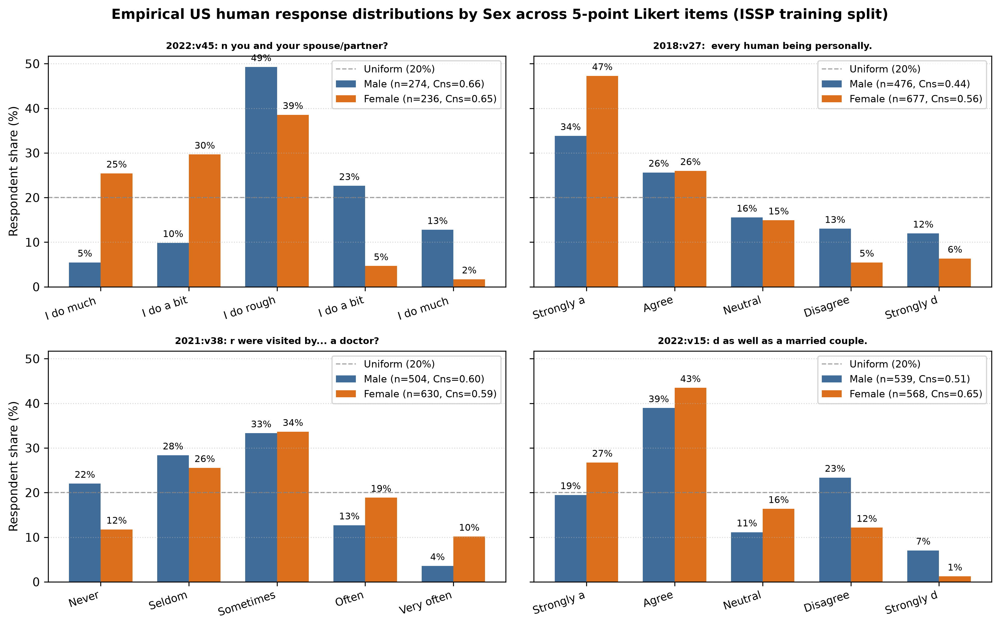
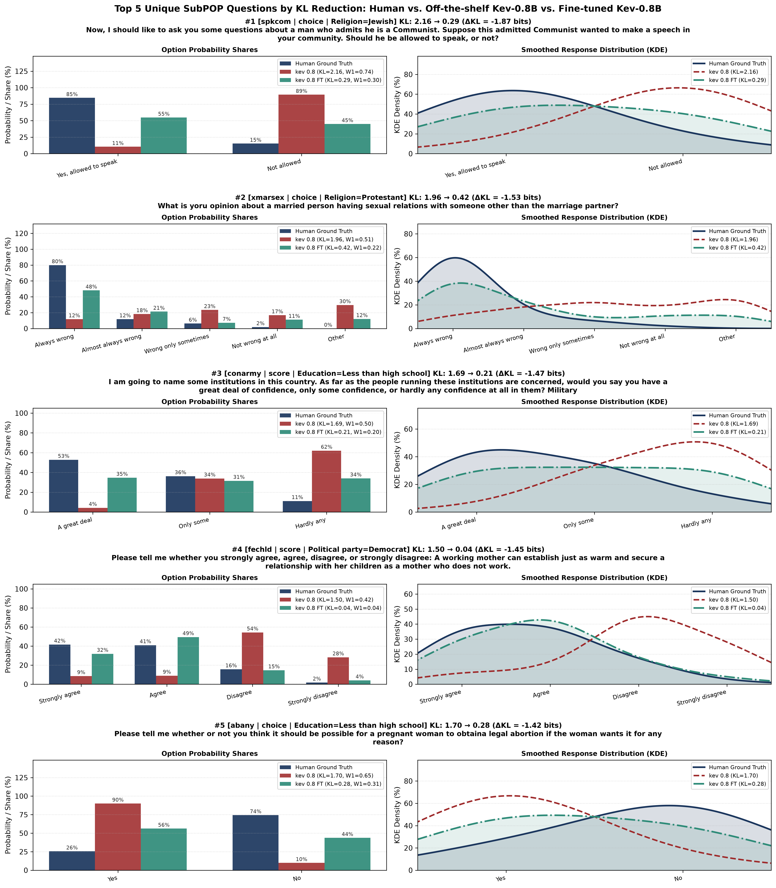

**Abstract**

**Keywords:** Decision models, Silicon sampling, Human behavior simulation, Survey distributions, Marketing research

# Introduction {#sec-intro}

Simulating human attitudes, preferences, and survey responses with foundation models, a paradigm known as silicon sampling, has attracted growing interest in marketing, public opinion, and behavioral research [@argyle2023out; @horton2023large; @brand2023using; @goli2024frontiers; @sarstedt2024using; @pmlr-v202-santurkar23a; @durmus2024towards; @zahradnickova2026ai]. In typical marketing applications, demographic marginals are already known from census records or panel quotas, and the researcher's goal is to predict the distribution of answers to Likert and multiple-choice questions conditional on a target consumer persona. Currently, researchers rely on generative large language models (LLMs) to perform silicon sampling. Because generative LLMs produce free-form text one token at a time, estimating a subpopulation response distribution requires prompting the model hundreds of times via Monte Carlo sampling [@wadi2025monte; @zahradnickova2026ai] or applying post-hoc sample calibration and statistical data augmentation to combine biased LLM outputs with human benchmark data [@leng2026reducing; @wang2026large]. This repeated text generation is slow, expensive with commercial APIs, sensitive to decoding temperature and prompt wording, and prone to mode collapse or refusals [@pmlr-v202-santurkar23a; @bhatia2025value; @liu2025badworktimecrosscultural; @zahradnickova2026ai].

Decision models, recently introduced as System One architectures [@palmer2026kev; @deusser2026evaluatingbenchmarkingmodeljev; @geuter2026releasinginnerjevsimple; @li2026llmasjevllmsjevstyledecision], offer a direct alternative for silicon sampling. Instead of generating text tokens, a decision model takes a context state (e.g., a respondent persona) and a structured question, such as an ordinal Likert scale (`score`) or a categorical multiple-choice item (`choice`), and predicts a probability distribution over the supplied answer options in a single prefill forward pass. Because a decision model outputs a normalized probability distribution over the valid answer options directly, it eliminates the need for Monte Carlo text sampling.

Despite this architectural advantage, both generative LLMs and off-the-shelf decision models share a fundamental training mismatch when applied to silicon sampling. Both model families are trained to maximize accuracy on objective tasks that have a single ground-truth answer, such as mathematics, code verification, factual question answering, and deterministic routing [@palmer2026kev; @geuter2026releasinginnerjevsimple; @gao2026choicesfewerdecisionsordinalscale]. Specifically, standard training pairs each prompt with a single integer class label and optimizes cross-entropy loss to push all probability mass onto that one winning option. This objective is poorly suited for tasks that require predicting a human response distribution. As shown in @fig-gender-mixed across representative five-point Likert questions from our US survey data, human respondents who share a demographic attribute such as sex never agree unanimously (e.g., on how partners share household work, `2022:v45`, both male respondents with $n = 274$ and female respondents with $n = 236$ spread their answers across all five rating levels). A model trained to concentrate probability mass on a single correct answer treats genuine within-group behavioral variation as classification error and cannot recover the true response distribution of a consumer segment.

{#fig-gender-mixed width=80%}

To address this training mismatch, we fine-tune decision models directly on empirical human response distributions and test whether training on a single survey dataset improves silicon sampling on unseen data. We train three open-weight pointer-head decision models of increasing size, namely Kev 0.8B, Kev 4B, and Kev 9B [@palmer2026kev], which are built on Qwen 3.5 backbones [@qwen3.5], to minimize the Kullback-Leibler (KL) divergence between predicted option distributions and empirical human response shares across 10 waves of the US International Social Survey Programme (ISSP 2015 to 2024; $14,356$ respondents and $767,484$ responses across 616 general social attitude questions). We then evaluate off-the-shelf and fine-tuned decision models across three progressively challenging out-of-sample settings without any post-hoc temperature tuning. First, we evaluate generalization to unseen questions using 72 held-out US ISSP questions ($3,199$ subpopulation-question distributions). Second, we evaluate generalization to unseen questions and demographic personas on the external SubPOP benchmark [@suh-etal-2025-language], which comprises 133 US General Social Survey questions across 22 single-attribute subpopulations ($2,926$ target distributions). Third, to evaluate generalization to an entirely new marketing domain and unseen consumer personas, we test our models on data from a randomized clinical trial of front-of-package nutrition labels and simulated food and beverage purchases [$5,636$ US grocery shoppers randomized across 6 labeling conditions and 21 choice and Likert questions\; @grummon2025nutrition]. Across all three benchmarks and all three model scales, training decision models on a single social survey dataset consistently improves distributional predictions on new questions, new personas, and a new marketing domain.

# Related work {#sec-related}

## Silicon sampling with generative LLMs

Early work in silicon sampling prompted generative LLMs with demographic backstories to simulate human responses in political, economic, and marketing surveys [@argyle2023out; @horton2023large; @brand2023using; @goli2024frontiers; @sarstedt2024using; @pmlr-v202-santurkar23a; @durmus2024towards]. Although generative LLMs often capture the direction of average preferences, prior studies document systematic discrepancies between LLM-generated samples and human populations, including mode collapse onto a single option, flattened within-group variance, demographic stereotyping, and sensitivity to prompt formatting [@pmlr-v202-santurkar23a; @shu-etal-2024-dont; @koo2024benchmarking; @kabir-etal-2025-break; @deas-mckeown-2025-artificial; @jung-etal-2026-psychometric]. Even when generative LLMs are provided with census reference distributions in context or conditioned on real respondent profiles, repeated Monte Carlo text draws still fail to match empirical response distributions on Likert scales [@wadi2025monte; @zahradnickova2026ai].

To mitigate these biases in marketing applications, recent studies have proposed post-hoc statistical corrections that combine LLM outputs with human benchmark data. In conjoint analysis, @wang2026large develop a statistical data-augmentation estimator that blends LLM-generated choices with human survey data to reduce estimation error, showing that naive substitution of human data with raw LLM responses introduces substantial bias. Similarly, @leng2026reducing propose Human Mimicry Calibration (HuMCal), a post-hoc method that learns optimal weights to combine LLM outputs across prompts, personas, or checkpoints using aggregate human calibration benchmarks. A complementary line of work in natural language processing directly fine-tunes causal language models on aggregated survey distributions to improve subpopulation alignment [@suh-etal-2025-language; @huang-etal-2026-distribution; @ku2026siliconsamplingcrosssurveytransfer]. Our work complements these approaches by shifting from autoregressive text generation to decision models that directly output probability distributions over survey options, and by demonstrating that distributional fine-tuning on one general survey transfers zero-shot to unseen personas and an unseen consumer nutrition experiment without requiring target-domain calibration data.

## Decision models and direct probability readouts

To avoid the cost and sampling variance of free-text generation, several studies extract next-token probabilities over option labels from causal LLMs [@kadavath2022language; @kuribayashi-etal-2024-psychometric; @bentegeac2025token; @wadi2026every]. Decision models formalize and extend this approach into a dedicated single-pass architecture [@palmer2026kev; @deusser2026evaluatingbenchmarkingmodeljev; @geuter2026releasinginnerjevsimple; @li2026llmasjevllmsjevstyledecision; @asseri2026calibratedwhompersonalanguage; @li2026kitescalingjevpopulation]. Built on pretrained language model backbones [@qwen3.5], decision models compile a context state and typed questions (`score` for ordered rating scales and `choice` for categorical options) into a structured prompt and compute option probabilities in one prefill pass. Open decision models such as Kev [@palmer2026kev] attach a lightweight pointer head that scores the final-layer hidden state at each option's closing token against the hidden state at the question's closing token. Unlike vocabulary-letter readouts that map options to arbitrary token symbols (e.g., "A", "B", "C") and remain susceptible to token-frequency priors, a pointer head scores each option directly from its contextualized text representation and restricts probability mass strictly to the supplied options. However, because existing decision models are trained on single-label objective benchmarks, they exhibit severe scale compression on ordinal tasks [@gao2026choicesfewerdecisionsordinalscale], motivating our distributional training framework.

# Methodology {#sec-methodology}

## Predicting subpopulation response distributions

Consider a survey dataset of human respondents indexed by $i \in \{1, \dots, N\}$. Each respondent is characterized by demographic and background attributes $\mathbf{a}_i$ (e.g., sex, age, education, income, and political party) and answers to survey questions $q \in \mathcal{Q}$. Each question $q$ presents $K_q$ discrete answer options $\mathcal{Y}_q = \{y_1, \dots, y_{K_q}\}$. For ordinal Likert (`score`) items, the options are ordered from lowest to highest as $y_1 \prec y_2 \prec \dots \prec y_{K_q}$.

A persona $\boldsymbol{\lambda}$ specifies a subset of attribute-value pairs (e.g., "Country: United States; Political party: Republican"). Let $\mathcal{I}(\boldsymbol{\lambda}, q)$ denote the set of human respondents matching persona $\boldsymbol{\lambda}$ who answered question $q$, with sample size $n_{\boldsymbol{\lambda}, q} = |\mathcal{I}(\boldsymbol{\lambda}, q)|$. The empirical human response distribution over the $K_q$ options is:
$$
P_{\mathrm{human}}(Y_{q, \boldsymbol{\lambda}} = y_k) = \frac{1}{n_{\boldsymbol{\lambda}, q}} \sum_{i \in \mathcal{I}(\boldsymbol{\lambda}, q)} \mathbb{I}(y_{i, q} = y_k), \quad k \in \{1, \dots, K_q\}.
$$ {#eq-human-pmf}

In a pointer-head decision model [@palmer2026kev], the persona $\boldsymbol{\lambda}$, question text $q$, and option texts $\mathcal{Y}_q$ are formatted into a single prompt and processed in one causal forward pass. Let $\mathbf{h}_{\mathrm{q}} \in \mathbb{R}^{d_{\mathrm{model}}}$ denote the final-layer hidden state at the closing token of the question, and let $\mathbf{h}_{\mathrm{opt}, k} \in \mathbb{R}^{d_{\mathrm{model}}}$ denote the final-layer hidden state at the closing token of option $k$. Using learned linear projections $\mathbf{W}_q, \mathbf{W}_k \in \mathbb{R}^{d_{\mathrm{head}} \times d_{\mathrm{model}}}$, the pointer head computes a score $z_{q, \boldsymbol{\lambda}, k}$ for each option $k$:
$$
z_{q, \boldsymbol{\lambda}, k} = \frac{(\mathbf{W}_q \mathbf{h}_{\mathrm{q}})^\top (\mathbf{W}_k \mathbf{h}_{\mathrm{opt}, k})}{\sqrt{d_{\mathrm{head}}}}.
$$ {#eq-pointer-head}
Applying a softmax function over the $K_q$ option scores yields the predicted response distribution in a single pass:
$$
P_{\mathrm{model}}(Y_{q, \boldsymbol{\lambda}} = y_k) = \frac{\exp(z_{q, \boldsymbol{\lambda}, k} / T)}{\sum_{j=1}^{K_q} \exp(z_{q, \boldsymbol{\lambda}, j} / T)},
$$ {#eq-model-pmf}
where $T$ is the readout temperature ($T = 1$ for all fine-tuned models, with no post-hoc temperature fitting).

## Distributional training and evaluation metrics

To train a decision model to approximate human subpopulation distributions rather than single-label classifications, we minimize the Kullback-Leibler (KL) divergence between the empirical human distribution $P_{\mathrm{human}}$ and the model's predicted distribution $P_{\mathrm{model}}$ (measured in bits):
$$
D_{\mathrm{KL}}(P_{\mathrm{human}} \,\|\, P_{\mathrm{model}}) = \sum_{k=1}^{K_q} P_{\mathrm{human}}(y_k) \log_2 \frac{P_{\mathrm{human}}(y_k)}{P_{\mathrm{model}}(y_k)}.
$$ {#eq-kl}
During training, we optimize model parameters $\theta$ via soft cross-entropy loss against the empirical subpopulation shares:
$$
\mathcal{L}(\theta) = -\sum_{k=1}^{K_q} P_{\mathrm{human}}(Y_{q, \boldsymbol{\lambda}} = y_k) \log P_{\mathrm{model}}(Y_{q, \boldsymbol{\lambda}} = y_k; \theta),
$$ {#eq-soft-ce}
which is equivalent to minimizing $D_{\mathrm{KL}}(P_{\mathrm{human}} \,\|\, P_{\mathrm{model}})$ up to a positive scaling constant and the fixed entropy of the human target distribution. Because $D_{\mathrm{KL}}$ subtracts the entropy of $P_{\mathrm{human}}$ from the cross-entropy, questions on which human respondents naturally disagree achieve $D_{\mathrm{KL}} = 0$ when the model matches that spread.

We use $D_{\mathrm{KL}}$ as our primary evaluation metric across all choice and Likert questions. Because $D_{\mathrm{KL}}$ treats categories as unordered, we also report the normalized 1-Wasserstein distance ($W_1$, or Earth Mover's distance) on ordinal Likert (`score`) items [@villani2008optimal; @batterton2017likert; @wadi2026every]:
$$
W_1(P_{\mathrm{human}}, P_{\mathrm{model}}) = \frac{1}{K_q - 1} \sum_{k=1}^{K_q - 1} \left| \sum_{j=1}^{k} P_{\mathrm{human}}(y_j) - \sum_{j=1}^{k} P_{\mathrm{model}}(y_j) \right| \in [0, 1],
$$ {#eq-wasserstein}
which measures the minimum fraction of the rating scale across which probability mass must be moved to transform $P_{\mathrm{model}}$ into $P_{\mathrm{human}}$.

# Experimental setup {#sec-experiments}

## Training dataset and question split (US ISSP)

| Split | Dataset | Questions | Likert (`score`) | Choice (`choice`) | Unique respondents | Unique responses |
|---|---|---:|---:|---:|---:|---:|
| Training | ISSP US (2015 to 2024) | 494 | 370 | 124 | 14,356 | 610,291 |
| Validation | ISSP US (2015 to 2024) | 50 | 43 | 7 | 14,305 | 64,201 |
| Held-out test | ISSP US (2015 to 2024) | 72 | 61 | 11 | 14,334 | 92,992 |
| Total | ISSP US (2015 to 2024) | 616 | 474 | 142 | 14,356 | 767,484 |

: Summary of the 10-wave US ISSP respondent-level dataset across training, validation, and held-out test splits. {#tbl-datasets}

We build our training dataset from 10 waves of US respondent-level microdata from the International Social Survey Programme (ISSP 2015 to 2024, covering work orientations, role of government, social networks, religion, social inequality, environment, health care, family and gender roles, national identity, and digital societies). As summarized in @tbl-datasets, the dataset contains $14,356$ unique US respondents and $767,484$ individual responses across 616 questions (474 ordinal `score` items and 142 categorical `choice` items), along with 15 harmonized respondent attributes, namely sex, age, education, religion, religious service attendance, political ideology, political party, past voting turnout, urban or rural residence, marital status, employment status, union membership, subjective social status, census region, ancestry, and household income.

To evaluate generalization to unseen questions without item leakage, we partition the 616 US questions into 494 training questions ($80.2\%$), 50 validation questions ($8.1\%$), and 72 held-out test questions ($11.7\%$). All cross-wave recurring questions are placed strictly in the training split so that every validation and test question is unseen during training. From the respondent-level training data, we construct empirical subpopulation distributions by conditioning on single demographic attributes ($k = 1$, $21,252$ records with $n \ge 100$) and pairs of attributes ($k = 2$, $137,331$ records with $n \ge 100$), supplemented by respondent-level profiles.

## Out-of-sample evaluation benchmarks

We evaluate our models across three benchmarks that test generalization across unseen questions, unseen personas, and an unseen marketing domain.

Our first benchmark evaluates unseen questions on the 72 held-out US ISSP test items (61 Likert `score` items and 11 `choice` items). Conditioning on each single demographic attribute with at least $n = 100$ respondents yields $3,199$ unseen subpopulation-question distributions ($2,772$ `score` records and $427$ `choice` records).

Our second benchmark evaluates unseen questions and personas on the SubPOP evaluation split [@suh-etal-2025-language], derived from the US General Social Survey (GSS). It contains 133 survey questions (64 Likert `score` items and 69 categorical `choice` items) evaluated across 22 single-attribute US demographic groups spanning region, education, income, political ideology, political party, race, religion, and sex, totaling $2,926$ subpopulation-question target distributions. None of the GSS questions or SubPOP's demographic category definitions were used during training.

Our third benchmark evaluates an unseen marketing domain and unseen consumer personas, testing whether a decision model trained only on general social surveys can generalize to an applied consumer behavior experiment. We use respondent-level data from @grummon2025nutrition, a randomized clinical trial of $N = 5,636$ US primary grocery shoppers randomized to 1 of 6 front-of-package (FOP) nutrition labeling systems, namely Positive labels, Nutrition Info labels, Positive plus Nutrition Info labels, High In warning labels, Positive plus High In labels, and Spectrum (1-to-5 star) labels. Shoppers completed 21 survey items comprising 6 three-option product healthfulness choice tasks (identifying the healthier item between paired beverages, breads, cereals, soups, snacks, and frozen meals displaying arm-specific FOP labels), 2 binary choice items on noticing and using the labels during simulated shopping, and 13 five-point Likert rating scales measuring perceived label helpfulness, understandability, trust, policy support, negative emotions (worried, scared, guilty, ashamed, and sad), health elaboration, and online store realism. We evaluate models both at the trial-arm level ($6 \text{ arms} \times 21 \text{ items} = 126$ distributions) and at the single-attribute subpopulation level across 10 shopper attributes ($5,060$ subpopulation-arm-question distributions across 42 persona levels with $n \ge 30$). Crucially, while 4 of the 10 shopper attributes overlap with demographic variables in ISSP (sex, age, education, and household income), the remaining 6 attributes are unseen during training, including race, Hispanic ethnicity, Supplemental Nutrition Assistance Program (SNAP) participation, Nutrition Facts panel usage frequency, share of groceries purchased online, and objective nutrition literacy score.

## Models compared

We compare three sizes of the open-weight Kev pointer-head decision model family [@palmer2026kev], namely Kev 0.8B (built on Qwen 3.5 0.8B), Kev 4B (built on Qwen 3.5 4B), and Kev 9B (built on Qwen 3.5 9B). For each model size, we compare the released off-the-shelf baseline model (`kev 0.8`, `kev 4B`, and `kev 9B`, evaluated at their released calibration temperatures) against our model fine-tuned on the US ISSP training split (`kev 0.8 FT`, `kev 4B FT`, and `kev 9B FT`, trained with rank-64 LoRA adapters and pointer heads and evaluated at $T = 1.0$ without post-hoc temperature tuning). As a naive reference point, we also report a `Uniform` baseline that assigns equal probability $1 / K_q$ to each answer option.

# Results {#sec-results}

## Generalization to unseen questions (ISSP test set)

| Metric | Uniform | kev 0.8 | kev 0.8 FT | kev 4B | kev 4B FT | kev 9B | kev 9B FT |
|---|---:|---:|---:|---:|---:|---:|---:|
| All questions $D_{\mathrm{KL}}$ ($\downarrow$) | 0.4797 | 0.5124 | 0.1828 | 0.3287 | 0.1152 | 0.3728 | 0.1081 |
| Likert (`score`) $D_{\mathrm{KL}}$ ($\downarrow$) | 0.4133 | 0.4222 | 0.1838 | 0.2851 | 0.1170 | 0.3381 | 0.1059 |
| Choice (`choice`) $D_{\mathrm{KL}}$ ($\downarrow$) | 0.9105 | 1.0978 | 0.1761 | 0.6115 | 0.1035 | 0.5982 | 0.1222 |
| Likert (`score`) $W_1$ ($\downarrow$) | 0.1729 | 0.1492 | 0.1096 | 0.1130 | 0.0779 | 0.1240 | 0.0750 |

: Distributional prediction error on the held-out US ISSP test set ($3,199$ subpopulation-question records across 72 unseen questions, $n \ge 100$). KL divergence is measured in bits; $W_1$ is normalized by the scale range. {#tbl-issp-test}

@tbl-issp-test reports distributional prediction performance on the 72 held-out US ISSP test questions. Off the shelf, the smallest baseline decision model (`kev 0.8`) performs worse than a uniform distribution ($\mathrm{KL} = 0.5124$ versus $0.4797$ bits), particularly on categorical `choice` questions ($\mathrm{KL} = 1.0978$ bits), because single-label pretraining causes the model to place excessive probability mass on a single option. Larger off-the-shelf models perform better (`kev 4B` at $0.3287$ bits and `kev 9B` at $0.3728$ bits), but still exhibit substantial divergence from empirical human distributions.

Fine-tuning on the ISSP training split yields large, consistent improvements across every model scale and question type. Mean KL divergence across all test records drops by $64.3\%$ for Kev 0.8B ($0.5124$ to $0.1828$ bits), by $65.0\%$ for Kev 4B ($0.3287$ to $0.1152$ bits), and by $71.0\%$ for Kev 9B ($0.3728$ to $0.1081$ bits). On ordinal Likert (`score`) items, normalized 1-Wasserstein transport error $W_1$ similarly declines from $0.1492$ to $0.1096$ for Kev 0.8B, from $0.1130$ to $0.0779$ for Kev 4B, and from $0.1240$ to $0.0750$ for Kev 9B. Remarkably, the smallest fine-tuned model (`kev 0.8 FT`, $\mathrm{KL} = 0.1828$) outperforms both the 4B and 9B off-the-shelf baselines ($0.3287$ and $0.3728$ bits) by a wide margin.

## Generalization to unseen questions and personas (SubPOP)

| Metric | Uniform | kev 0.8 | kev 0.8 FT | kev 4B | kev 4B FT | kev 9B | kev 9B FT |
|---|---:|---:|---:|---:|---:|---:|---:|
| SubPOP all $D_{\mathrm{KL}}$ ($\downarrow$) | 0.3758 | 0.4070 | 0.2930 | 0.3430 | 0.1985 | 0.3720 | 0.1895 |
| SubPOP Likert (`score`) $D_{\mathrm{KL}}$ ($\downarrow$) | 0.3391 | 0.3486 | 0.3046 | 0.3080 | 0.2154 | 0.3146 | 0.1897 |
| SubPOP choice (`choice`) $D_{\mathrm{KL}}$ ($\downarrow$) | 0.4098 | 0.4611 | 0.2822 | 0.3755 | 0.1828 | 0.4252 | 0.1894 |
| SubPOP Likert (`score`) $W_1$ ($\downarrow$) | 0.1771 | 0.1679 | 0.1591 | 0.1413 | 0.1216 | 0.1367 | 0.1097 |

: Out-of-distribution performance on the external SubPOP benchmark ($2,926$ subpopulation-question records across 133 US General Social Survey questions and 22 single-attribute subpopulations). {#tbl-subpop}

To test whether distributional training transfers across survey instruments and persona definitions, @tbl-subpop presents results on the external SubPOP benchmark [@suh-etal-2025-language]. Across all $2,926$ subpopulation-question targets, off-the-shelf decision models struggle to improve upon a simple uniform baseline ($\mathrm{KL} = 0.3758$ bits), with `kev 0.8` ($0.4070$ bits) performing worse than uniform and `kev 4B` ($0.3430$ bits) and `kev 9B` ($0.3720$ bits) offering only modest gains.

In contrast, decision models fine-tuned on ISSP generalize strongly to SubPOP without seeing any GSS questions during training. Overall KL divergence decreases from $0.4070$ to $0.2930$ bits for Kev 0.8B ($-28.0\%$), from $0.3430$ to $0.1985$ bits for Kev 4B ($-42.1\%$), and from $0.3720$ to $0.1895$ bits for Kev 9B ($-49.1\%$). Improvements occur on both Likert `score` items (where $W_1$ drops to $0.1097$ for `kev 9B FT`) and categorical `choice` items (where KL drops by more than half for the 4B and 9B models). Once again, the fine-tuned 0.8B model (`kev 0.8 FT`, $\mathrm{KL} = 0.2930$) outperforms the off-the-shelf 4B ($0.3430$) and 9B ($0.3720$) models.

{#fig-subpop-polparty width=100%}

@fig-subpop-polparty illustrates how baseline and fine-tuned models predict partisan subpopulations (Democrat versus Republican) across four unseen GSS questions in SubPOP. Two patterns stand out. First, among the off-the-shelf baselines, larger models better separate Democrat and Republican response distributions, whereas the small baseline (`kev 0.8`) collapses both parties onto nearly identical middle-heavy curves (e.g., on marriage equality and immigration). Second, after distributional fine-tuning on ISSP, `kev 0.8 FT` learns to differentiate partisan personas and closely tracks the empirical human distributions, outperforming the untuned 4B model across these items. @fig-subpop-top5 further highlights the five SubPOP questions with the largest KL divergence reductions for Kev 0.8B, showing how fine-tuning corrects the extreme single-option overconfidence of the off-the-shelf model across religious, educational, and political personas.

{#fig-subpop-top5 width=95%}

## Generalization to a new marketing domain and unseen personas (nutrition RCT)

| Evaluation level and metric | Uniform | kev 0.8 | kev 0.8 FT | kev 4B | kev 4B FT | kev 9B | kev 9B FT |
|---|---:|---:|---:|---:|---:|---:|---:|
| Trial-arm level ($126$ records, all $D_{\mathrm{KL}}$) ($\downarrow$) | 0.6778 | 0.6168 | 0.5934 | 0.5544 | 0.4839 | 0.4309 | 0.4077 |
| Trial-arm level, notice and use choice $D_{\mathrm{KL}}$ ($\downarrow$) | 0.0282 | 0.1037 | 0.0347 | 0.1057 | 0.0312 | 0.2275 | 0.0256 |
| Trial-arm level, Likert (`score`) $D_{\mathrm{KL}}$ ($\downarrow$) | 0.7735 | 0.6168 | 0.5857 | 0.6279 | 0.4592 | 0.3884 | 0.3934 |
| Subpopulation level ($5,060$ records, all $D_{\mathrm{KL}}$) ($\downarrow$) | 0.7061 | 0.6633 | 0.6231 | 0.6495 | 0.5225 | 0.4783 | 0.4385 |
| Subpopulation level, notice and use choice $D_{\mathrm{KL}}$ ($\downarrow$) | 0.0502 | 0.0949 | 0.0465 | 0.0934 | 0.0423 | 0.2871 | 0.0376 |
| Subpopulation level, Likert (`score`) $D_{\mathrm{KL}}$ ($\downarrow$) | 0.8028 | 0.7023 | 0.6231 | 0.6622 | 0.4942 | 0.4759 | 0.4346 |

: Out-of-domain performance on the front-of-package nutrition labeling randomized clinical trial [@grummon2025nutrition] at the trial-arm level ($126$ arm-question records) and single-attribute subpopulation level ($5,060$ persona-arm-question records across 10 shopper attributes, $n \ge 30$). {#tbl-grummon}

Our third experiment tests whether decision models fine-tuned on general sociopolitical surveys (ISSP) improve silicon sampling in an unseen marketing domain, namely consumer responses to front-of-package (FOP) nutrition labels in @grummon2025nutrition. None of the models were exposed to food products, nutrition panels, or FOP warning labels during training. @tbl-grummon reports results at both the aggregate trial-arm level ($126$ distributions across the 6 FOP labeling arms and 21 survey items) and the single-attribute subpopulation level ($5,060$ distributions conditioning on trial arm and 1 of 10 shopper attributes).

Across both evaluation levels and all three model sizes, ISSP fine-tuning consistently reduces overall KL divergence relative to the off-the-shelf baselines. At the trial-arm level, mean KL divergence drops from $0.6168$ to $0.5934$ bits for Kev 0.8B, from $0.5544$ to $0.4839$ bits for Kev 4B ($-12.7\%$), and from $0.4309$ to $0.4077$ bits for Kev 9B. At the subpopulation level ($5,060$ records), mean KL divergence declines from $0.6633$ to $0.6231$ bits for Kev 0.8B ($-6.1\%$), from $0.6495$ to $0.5225$ bits for Kev 4B ($-19.6\%$), and from $0.4783$ to $0.4385$ bits for Kev 9B ($-8.3\%$). Gains are especially pronounced on the 13 Likert (`score`) items measuring consumer perceptions of label helpfulness, understandability, trust, negative affect, and policy support (where subpopulation KL drops from $0.6622$ to $0.4942$ bits for Kev 4B and from $0.4759$ to $0.4346$ bits for Kev 9B) as well as binary label notice and use items.

| Persona attribute group | Attribute | Uniform | kev 0.8 | kev 0.8 FT | kev 4B | kev 4B FT | kev 9B | kev 9B FT |
|---|---|---:|---:|---:|---:|---:|---:|---:|
| Seen in ISSP training | Sex (`SEX`) | 0.6851 | 0.6512 | 0.6139 | 0.5693 | 0.4910 | 0.3966 | 0.4078 |
| Seen in ISSP training | Age (`AGE`) | 0.7142 | 0.6524 | 0.6397 | 0.6000 | 0.5200 | 0.4355 | 0.4385 |
| Seen in ISSP training | Education (`EDULEVEL`) | 0.7078 | 0.6587 | 0.6158 | 0.6352 | 0.5188 | 0.4449 | 0.4278 |
| Seen in ISSP training | Income (`US_INC`) | 0.7190 | 0.6339 | 0.6283 | 0.6637 | 0.5539 | 0.4656 | 0.4595 |
| Seen in ISSP training | Group mean | 0.7118 | 0.6456 | 0.6260 | 0.6342 | 0.5319 | 0.4474 | 0.4421 |
| Unseen in training | Race (`RACE`) | 0.7085 | 0.6572 | 0.6209 | 0.6267 | 0.5130 | 0.4283 | 0.4241 |
| Unseen in training | Hispanic (`HISPANIC`) | 0.6940 | 0.6522 | 0.6169 | 0.5903 | 0.4984 | 0.3968 | 0.4223 |
| Unseen in training | SNAP recipient (`SNAP`) | 0.6899 | 0.6832 | 0.6038 | 0.6144 | 0.5065 | 0.4414 | 0.4305 |
| Unseen in training | NFP usage (`NFPUSE`) | 0.7249 | 0.6860 | 0.6460 | 0.6791 | 0.5267 | 0.6408 | 0.4734 |
| Unseen in training | Online grocery (`ONLINEAMT`) | 0.6896 | 0.6175 | 0.5973 | 0.7825 | 0.5122 | 0.4918 | 0.4257 |
| Unseen in training | Nutrition literacy (`HEALTHLIT`) | 0.6844 | 0.7745 | 0.6231 | 0.6261 | 0.5109 | 0.5384 | 0.4192 |
| Unseen in training | Group mean | 0.7007 | 0.6805 | 0.6203 | 0.6642 | 0.5135 | 0.5082 | 0.4351 |
| All attributes | Overall mean | 0.7061 | 0.6633 | 0.6231 | 0.6495 | 0.5225 | 0.4783 | 0.4385 |

: Mean KL divergence (bits) across the $5,060$ subpopulation records in the nutrition labeling RCT, partitioned into demographic attributes present in ISSP training versus out-of-sample shopper attributes never seen during training. {#tbl-grummon-personas}

To examine whether the models merely memorize demographic attributes seen during ISSP training or learn a transferable capability to predict human response distributions for arbitrary personas, @tbl-grummon-personas and @fig-grummon-personas break down the $5,060$ subpopulation evaluations by shopper attribute. The first group comprises the 4 standard demographic attributes present in ISSP (`SEX`, `AGE`, `EDULEVEL`, and `US_INC`), while the second group comprises 6 domain-specific attributes never seen in ISSP (`RACE`, `HISPANIC`, `SNAP`, `NFPUSE`, `ONLINEAMT`, and `HEALTHLIT`).

{#fig-grummon-personas width=100%}

As shown in @tbl-grummon-personas and @fig-grummon-personas, off-the-shelf baselines degrade noticeably when conditioned on unseen behavioral and nutrition attributes such as Nutrition Facts panel usage (`NFPUSE`), online grocery share (`ONLINEAMT`), and nutrition literacy (`HEALTHLIT`). Fine-tuning on ISSP produces even larger improvements on these unseen out-of-sample persona attributes than on the in-training demographic attributes. Specifically, on the 6 unseen shopper attributes, mean KL divergence drops from $0.6805$ to $0.6203$ bits for Kev 0.8B ($-8.8\%$), from $0.6642$ to $0.5135$ bits for Kev 4B ($-22.7\%$), and from $0.5082$ to $0.4351$ bits for Kev 9B ($-14.4\%$), with particularly large gains on nutrition literacy (`HEALTHLIT`, where KL drops from $0.7745$ to $0.6231$ bits for Kev 0.8B and from $0.5384$ to $0.4192$ bits for Kev 9B). These results demonstrate that training decision models on human survey distributions recalibrates how the models express population heterogeneity across Likert and choice options in general, enabling zero-shot transfer to new consumer attributes and new marketing domains.

# Discussion and conclusion {#sec-discussion}

Silicon sampling in marketing and social science requires predicting how a population of respondents distributes its answers across survey options rather than generating a single text completion. While generative LLMs require hundreds of Monte Carlo text draws or post-hoc reweighting to approximate response distributions [@wadi2025monte; @leng2026reducing; @wang2026large; @zahradnickova2026ai], decision models output a complete probability distribution over Likert and choice options in a single forward pass [@palmer2026kev]. However, because off-the-shelf decision models and generative LLMs are trained for single-answer accuracy on objective benchmarks such as coding and mathematics, they systematically underrepresent within-group human diversity.

Our experiments show that fine-tuning decision models to minimize KL divergence on empirical human response distributions from a single social survey dataset (US ISSP) substantially improves distributional silicon sampling on unseen data. Across Kev 0.8B, Kev 4B, and Kev 9B, distributional fine-tuning reduces prediction error on held-out ISSP questions, generalizes zero-shot to unseen questions and demographic personas in the US General Social Survey (SubPOP), and transfers to an applied marketing randomized clinical trial on front-of-package nutrition labels [@grummon2025nutrition], including consumer persona attributes never observed during training. Moreover, our findings show that a compact fine-tuned decision model (Kev 0.8B FT) can outperform off-the-shelf models an order of magnitude larger on public opinion benchmarks, offering marketing researchers a fast, deterministic, and accessible tool for distributional silicon sampling.
