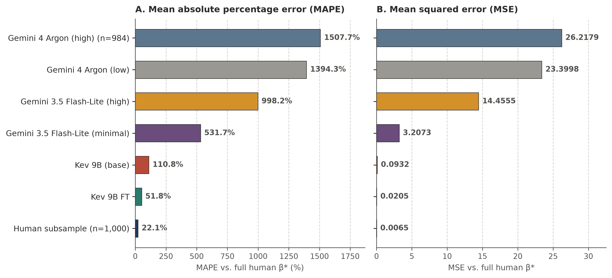
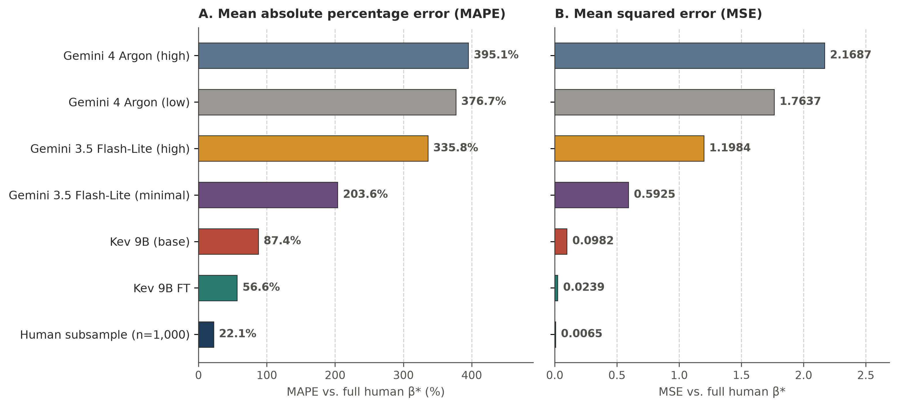

# Reviewer-proof positioning strategy for Marketing Science (`manuscript.qmd`)

## Core thesis and diplomatic framing

**Honoring their foundational contributions while answering their calls for future work.** Because @wang2026large and @leng2026reducing are both published in Marketing Science and their authors are highly likely reviewers, our positioning must simultaneously validate their core insights and establish our paper as the natural next step that they themselves called for. Both papers establish the foundational principle that raw generative LLM outputs are systematically miscalibrated and that silicon sampling must be treated as a statistical calibration problem rather than a naive one-shot prompting exercise [@leng2026reducing; @wang2026large]. When the underlying LLM is treated as a fixed black-box text generator, @wang2026large show how to correct downstream conjoint estimates using a primary target-domain human sample (AAE), and @leng2026reducing show how to calibrate the synthetic measurement variable itself by optimizing simplex weights over prompt, persona, and checkpoint ensembles against aggregate human benchmarks (HuMCal). Our paper answers the exact future work directions highlighted at the end of both studies, namely how to fix the upstream foundation model and its persona conditioning so that silicon sampling achieves calibrated respondent-level probability predictions and accurate econometric recovery even in zero-shot settings where target human calibration data are unavailable.

## Building on the stated limitations and future work of Wang et al. (2026)

**Answering their call for scarce-data domains and rich respondent personas.** In their general discussion (Section 7), @wang2026large explicitly call for two directions of future work: extending LLM-assisted preference estimation to domains where real target data are scarce, and examining the impact of incorporating detailed personas into queries so that simulated data more closely resemble specific user populations (as their baseline experiments relied on a generic random-person prompt). We directly execute both directions on their exact @kreps2020factors COVID-19 vaccine conjoint benchmark (evaluating both their random-persona prompt and actual 8-attribute respondent personas) as well as on the 6-arm nutrition labeling trial of @grummon2025nutrition (conditioning on 10 shopper attributes).

**Explaining why generative fine-tuning fell short in Wang et al. (2026) and why decision-model training succeeds.** In Sections 5.2 and 6.1, @wang2026large test fine-tuning `GPT-4o` on 50 target-domain conjoint demonstrations and find that standalone estimation from the fine-tuned model ($\hat{\boldsymbol{\beta}}^{\sf A}$) still increases MAPE by $4.83\%$ to $17.85\%$ on the vaccine dataset and by $201.95\%$ to $249.93\%$ on the sports car dataset relative to human data alone. Rather than dismissing their finding, we explain its exact mechanism and resolve it. Autoregressive fine-tuning forces a causal language model to emit discrete one-hot letter tokens (`A`, `B`, or `C`), which collapses within-respondent choice uncertainty and cannot learn calibrated probabilities from 50 task examples. When we instead replace autoregressive token generation with a single-pass decision head and train on $1,881,950$ respondent-question records from general social and behavioral surveys (US ISSP and Twin-2K-500), minimizing respondent-level cross-entropy is mathematically equivalent by the law of total expectation to minimizing the conditional Kullback-Leibler divergence $D_{\mathrm{KL}}(P_{\mathrm{human}}(Y_q \mid \mathbf{s}) \,\|\, P_{\mathrm{model}}(Y_q \mid \mathbf{s}; \theta))$. Without seeing a single vaccine or conjoint example during training, `Kev 9B FT` reduces standalone zero-shot MNL MSE by $76\%$ to $78\%$ over off-the-shelf `Kev 9B` and by orders of magnitude over generative LLMs ($\mathrm{MSE} = 0.0205$, $\mathrm{MAPE} = 51.8\%$ under random personas; $\mathrm{MSE} = 0.0239$, $\mathrm{MAPE} = 56.6\%$ under respondent personas).

**Overcoming safety-filter sample truncation.** In Section 5.1, @wang2026large note that they had to exclude all human respondents who opted out of COVID-19 vaccines (Option C) because public generative LLMs such as ChatGPT and Gemini refuse to choose vaccine opt-out options due to safety guardrails. Because a decision model scores the supplied options directly in representation space without open-ended text generation, it produces zero safety refusals across all $9,855$ choice sets and allows estimation on the full, untruncated respondent population.

**Upstream synergy with AAE.** @wang2026large prove theoretically (their Theorem 2 and Appendix D) and show empirically that AAE achieves its largest error reductions when paired with a more informative, better-aligned upstream AI generator. Thus, our fine-tuned decision model is completely synergistic with AAE: it enables standalone zero-shot econometric estimation when primary target data cannot be collected ($m = 0$), and it provides a substantially better-calibrated, continuous probability surrogate to feed into AAE when primary target data are available ($m > 0$).

## Building on the stated limitations and future work of Leng, Sang, and Agarwal (2026)

**Answering their call on subgroup scaling and bias-variance trade-offs.** @leng2026reducing make the important contribution of calibrating the synthetic response distribution itself via convex simplex weighting ($\mathbf{w} \in \Delta^{G-1}$) over $G$ elicitation variants (coarse demographic personas, prompt templates, or checkpoints). In Section 2.2.4.1 and Section 5, they explicitly highlight an open methodological trade-off: while adding more subgroup variants can reduce approximation error, estimating more simplex weights from limited calibration data increases estimation variance, and systematic guidance on subgroup construction remains an open problem. Our respondent-level decision-model training resolves this exact trade-off. Instead of fitting a separate simplex weight for each discrete subgroup cell against an aggregate marginal, we condition a shared decision model on combinatorial multi-attribute persona vectors $\mathbf{s}_i$ (17 harmonized attributes) and train on individual microdata. This amortizes calibration across attributes in representation space, scaling effortlessly to thousands of unique individual respondent profiles where each combinatorial demographic cell has sample size one.

**Escaping the convex hull when all candidate checkpoints share structural bias.** Because HuMCal forms a convex combination $\sum_{g=1}^G w_g \mathbf{Z}^L_{q,g}$, its predictions lie within the convex hull of the candidate LLM outputs. When all off-the-shelf candidate models share a common distortion, such as over-rational choice concentration on product trade-offs [@wang2026large] or probability compression on subjective scales [@gao2026choicesfewerdecisionsordinalscale], reweighting those candidates cannot move outside their convex hull. By updating the internal representations and option-scoring projections of the decision model on human microdata, our approach produces calibrated conditional distributions at unit temperature ($T = 1$) that cannot be reached by any convex combination of off-the-shelf models.

**Answering their call for out-of-sample transfer and structural econometric inference.** In Section 5, @leng2026reducing note that cross-domain transfer of simplex weights depends empirically on the stability of subgroup bias across domains, and they recommend validating transfer on a labeled target sample whenever domain shift is large. Furthermore, their empirical applications focus on descriptive aggregate agreement (brand co-purchase concordance and 1-Wasserstein distance on marginal Pew opinion distributions). We extend calibration from descriptive aggregate matching to downstream structural and causal econometric inference, showing that a decision model trained once on general social surveys (ISSP and Twin-2K-500) transfers zero-shot across completely distinct task paradigms to recover MNL part-worth utilities in conjoint analysis [@wang2026large] and participant-level OLS treatment effects in a randomized clinical trial [@grummon2025nutrition], even when conditioning on consumer nutrition attributes never seen during training.

**Upstream synergy with HuMCal.** In Section 2.3 (Proposition A-7), @leng2026reducing prove that HuMCal is compatible with model updates and that replacing candidate checkpoints with better-aligned models weakly reduces optimal calibration loss. Our respondent-level fine-tuned decision model directly fulfills Proposition A-7 by providing calibrated checkpoint candidates that dramatically lower baseline discrepancy before any post-hoc weighting is even applied.

## Section-by-section assessment of `manuscript.qmd` and proposed updates

**Overview of what to update in `manuscript.qmd`.** The current manuscript already has a strong narrative arc, so we do not need to restructure the paper. Instead, we should make targeted updates in two existing sections (Section 1 Introduction and Section 2 Related work) and build the positioning into three `[TODO]` sections as we draft them (Section 4.2 Out-of-domain benchmarks, Section 5.2 Conjoint MNL results, and Section 6 Discussion). Below is the exact plan and draft text for each location.

### 1. Section 1 (`#sec-intro`, paragraph 1): what to change and why

**Diagnosis of current `manuscript.qmd` text.** The final sentence of paragraph 1 currently states that recent studies conclude raw LLM outputs cannot directly replace human data and instead collect primary human responses in the target domain to train post-hoc estimators [@wang2026large; @leng2026reducing]. If Leng et al. review the paper, they may object that HuMCal is designed to transfer source-learned weights across related domains without always collecting fresh target data, and if Wang et al. review the paper, we miss the opportunity to note in the opening paragraph that they already tested autoregressive fine-tuning (`GPT-4o`) and explicitly called for persona-conditioned and scarce-data solutions as future work.

**Proposed replacement for `#sec-intro`, paragraph 1.** Simulating consumer choices, attitudes, and survey responses with foundation models, commonly referred to as silicon sampling, has attracted growing interest in marketing, public opinion, and behavioral research [@argyle2023out; @horton2023large; @brand2023using; @goli2024frontiers; @sarstedt2024using; @leng2026reducing; @wang2026large]. In marketing applications, the primary goal is often downstream econometric inference, such as estimating part-worth utilities in conjoint analysis or causal treatment effects in randomized experiments. Currently, researchers rely on generative large language models (LLMs) that produce text one token at a time. However, recent studies in marketing science establish that naively replacing human respondents with generative LLM outputs introduces severe bias in preference measurement and downstream regressions [@goli2024frontiers; @leng2026reducing; @wang2026large]. Because generative LLMs are post-trained for deterministic reasoning and safety compliance, scaling up model size, enabling chain-of-thought (`CoT`) reasoning, or fine-tuning autoregressive models on small task demonstrations makes their choices overly rational [@wang2026large]. This collapses human choice diversity, triggers safety refusals on sensitive options (e.g., opting out of vaccination in @wang2026large), and worsens regression parameter recovery. Furthermore, estimating choice shares from text generation requires costly Monte Carlo sampling [@wadi2025monte; @zahradnickova2026ai]. Recognizing that silicon sampling must be treated as a calibration problem rather than a one-shot prompting exercise [@leng2026reducing], pioneering studies develop post-hoc statistical methods that use human benchmark data to debias regression estimates [@wang2026large] or optimally weight ensembles of prompts, personas, and model checkpoints [@leng2026reducing]. At the same time, both studies highlight critical open directions for future research, namely how to incorporate rich individual-level personas, improve the upstream alignment of the foundation model itself, and extend LLM-based inference to settings where target-domain human calibration data are scarce or unavailable [@wang2026large; @leng2026reducing].

### 2. Section 2 (`#sec-related`, subsection 2.1, paragraph 2): what to change and why

**Diagnosis of current `manuscript.qmd` text.** Currently, paragraph 2 of Section 2.1 (`#sec-related`) devotes only two sentences to @wang2026large and one sentence to @leng2026reducing. Because both papers are published in Marketing Science and represent the closest methodological comparators, a 3-sentence summary is too brief. Expanding this passage into two focused paragraphs lets us credit their theoretical and empirical contributions, cite their exact stated limitations and future research calls, explain why our decision-model microdata training succeeds where `GPT-4o` fine-tuning in @wang2026large fell short, and frame our model as the upstream solution they called for.

**Proposed replacement for `#sec-related`, subsection 2.1, paragraph 2 (expanding into two paragraphs).** To address these discrepancies when the language model is treated as a black-box generator, recent marketing studies develop principled post-hoc calibration and data-augmentation frameworks that leverage human benchmark data. Building on prediction-powered inference [@angelopoulos2023prediction; @angelopoulos2023ppi], @wang2026large propose an AI-augmented estimator (AAE) for choice-based conjoint analysis. Using a primary sample of human conjoint responses alongside a larger auxiliary sample of LLM choices, AAE trains a correction network over product features and AI choices to achieve consistent, asymptotically normal parameter estimates and substantial survey data savings. Importantly, @wang2026large show that even when `GPT-4o` is fine-tuned on 50 target-domain conjoint demonstrations, standalone AI estimation still increases parameter error relative to the primary human sample because discrete token generation collapses choice uncertainty. They further demonstrate that downstream augmentation improves as the upstream AI generator becomes more informative, and they explicitly call for future research into incorporating multi-attribute respondent personas and extending AI-assisted estimation to domains where primary target data are scarce. Complementing downstream parameter correction, @leng2026reducing propose Human Mimicry Calibration (HuMCal), which calibrates the LLM measurement variable directly before downstream analysis. HuMCal solves a convex simplex optimization to learn nonnegative weights over a candidate set of LLM elicitation variants (e.g., demographic personas, prompt templates, or model checkpoints) against an aggregate human benchmark, guaranteeing in-sample baseline safety over fixed weighting rules and demonstrating positive empirical transfer across related time periods, regions, industries, and public opinion question clusters. In outlining directions for future research, @leng2026reducing note the bias-variance trade-off that arises when estimating simplex weights over a growing number of discrete subgroup variants, the need for reliable transfer when target calibration benchmarks are unavailable, and the benefit of upgrading the underlying model checkpoints (which their Proposition A-7 shows weakly improves calibration loss).

Our work builds directly on the insights of @wang2026large and @leng2026reducing and addresses the future research directions identified by both studies. Whereas AAE and HuMCal calibrate frozen LLM outputs downstream using target-domain or aggregate human benchmarks, we resolve the calibration problem upstream by changing both the model architecture and the training objective. In natural language processing, recent studies fine-tune causal language models on aggregated group survey distributions [@suh-etal-2025-language; @huang-etal-2026-distribution; @ku2026siliconsamplingcrosssurveytransfer]. We advance beyond both black-box post-hoc calibration and group-level language model fine-tuning in three ways. First, we shift from autoregressive text generation to single-pass decision models that directly output exact probability distributions over supplied options without Monte Carlo sampling overhead or safety refusals (allowing us, for example, to retain the vaccine opt-out respondents that @wang2026large had to exclude due to commercial LLM safety filters). Second, instead of estimating separate weights over a small grid of coarse subgroups [@leng2026reducing] or fine-tuning on a small task-specific demonstration set [@wang2026large], we train on $1.88$ million respondent-level microdata records from general surveys across 17 harmonized attributes. This amortizes calibration across combinatorial respondent personas in representation space and answers @wang2026large's call for granular persona conditioning. Third, we demonstrate that upstream respondent-level training transfers zero-shot to unseen conjoint MNL [@wang2026large] and randomized trial OLS [@grummon2025nutrition] regressions when no target-domain human data are available, while providing a strictly better-calibrated upstream probability generator to pair with AAE or HuMCal whenever target human benchmarks are collected.

### 3. Draft for Section 5.2 (`## Multinomial Logit Estimation in Conjoint Analysis`), Web Appendix Additions, and Tightly Coupled Section 4.2/4.3 Fixes

#### 3A. Proposed Main-Text Draft for Section 5.2 (`manuscript.qmd`)

```markdown
## Multinomial Logit Estimation in Conjoint Analysis

**Part-worth recovery across model families, reasoning budgets, and personas.** @tbl-wang-mnl reports Multinomial Logit (MNL) part-worth parameter recovery on the $200$-respondent COVID-19 vaccine conjoint subsample (*n* = 1,000 choice sets across $d = 11$ attribute indicators; see @appfig-wang-random and @appfig-wang-persona for visual error comparisons), benchmarked against the full-sample human ground-truth vector $\boldsymbol{\beta}^*$ (*N* = 1,971 respondents, 9,855 choice sets). Estimating the MNL model directly on the empirical choices of the $200$ sampled human respondents establishes the finite-sample benchmark of $\mathrm{MAPE} = 22.1\%$ and $\mathrm{MSE} = 0.0065$. Consistent with @wang2026large, autoregressive generative LLMs exhibit severe parameter bias under the unconditioned random-persona prompt ($\mathrm{MAPE} = 531.7\%$ to $1507.7\%$; $\mathrm{MSE} = 3.2073$ to $26.2179$). Directly testing the future-work hypothesis of @wang2026large, conditioning generative LLMs on the $8$ individual demographic and political respondent attributes reduces MSE by $81.5\%$ to $92.5\%$ ($\mathrm{MSE} = 0.5925$ to $2.1687$), confirming that respondent heterogeneity mitigates part of the aggregation distortion. Even with granular respondent personas, however, generative LLMs still exceed the MSE of the human subsample by $91$ to $334$ times ($\mathrm{MAPE} = 203.6\%$ to $395.1\%$). Furthermore, increasing reasoning effort or model capability worsens econometric recovery across both prompting regimes: raising the thinking budget on `Gemini 3.5 Flash-Lite` from `minimal` to `high` increases MSE $4.5$-fold under random personas ($3.2073$ to $14.4555$) and $2.0$-fold under respondent personas ($0.5925$ to $1.1984$), while scaling to frontier `Gemini 4 Argon` increases MSE further to $23.3998$ (`low`) and $26.2179$ (`high`) under random personas and $1.7637$ (`low`) and $2.1687$ (`high`) under respondent personas.

**Why generative LLMs fail and why continuous decision readouts succeed.** Inspection of the choice distributions and attribute-level estimates (@fig-wang-coefs, Panel B, and @apptbl-wang-coefs) isolates two mechanisms behind generative LLM distortion. First, whereas human respondents choose the no-vaccine outside option (`Option C`) in $21.0\%$ of full-sample tasks ($20.3\%$ in the subsample), unconditioned generative LLMs almost never opt out of vaccination: `Option C` share drops to $3.0\%$ for `Gemini 3.5 Flash-Lite (minimal)`, $0.3\%$ for `Gemini 4 Argon (low)`, and $0.0\%$ at `high` thinking for both models (and under respondent personas, raising `Gemini 3.5 Flash-Lite` thinking from `minimal` to `high` compresses `Option C` share from $21.9\%$ to $4.8\%$). Combined with deterministic utility maximization across paired profiles, this outside-option collapse inflates MNL log-odds coefficients by an order of magnitude (e.g., under respondent personas, `Efficacy: 90%` reaches $+1.846$ to $+3.538$ versus human $+0.746$, and `Origin: China` reaches $-1.908$ to $-3.556$ versus $-0.570$). At `high` thinking under random personas, `Gemini 4 Argon` additionally refuses to select an option on $16$ of $1,000$ tasks (*n* = 984), citing neutrality policies on politically endorsed vaccine trade-offs. Second, replacing discrete token generation with single-pass continuous probabilities from off-the-shelf `Kev 9B (base)` (evaluated at its pretrained calibration temperature $T = 2.19$) eliminates refusals across all $1,000$ tasks and lowers MNL MSE by an order of magnitude to $0.0932$ ($\mathrm{MAPE} = 110.8\%$) under random personas and $0.0982$ ($\mathrm{MAPE} = 87.4\%$) under respondent personas. Notably, discretizing `Kev 9B (base)` predictions into one-hot argmax choices degrades its respondent-persona MSE nearly eightfold ($0.0982$ to $0.7761$), demonstrating that plugging continuous within-respondent probabilities directly into the MNL log-likelihood (@eq-mnl-mle) is essential for preserving choice uncertainty.

**Zero-shot gains and attribute-level alignment from respondent fine-tuning.** Fine-tuning on general social and behavioral survey microdata (`US ISSP` and `Twin-2K-500`), without exposing the model to any vaccine or conjoint examples and evaluating at unit temperature ($T = 1.00$), substantially improves zero-shot conjoint estimation (@tbl-wang-mnl). Relative to off-the-shelf `Kev 9B (base)`, `Kev 9B FT` reduces MNL MSE by $78.0\%$ under random personas ($0.0932$ to $0.0205$; $\mathrm{MAPE} = 51.8\%$) and by $75.7\%$ under respondent personas ($0.0982$ to $0.0239$; $\mathrm{MAPE} = 56.6\%$), while reducing respondent-level choice cross-entropy from $1.1388$ to $1.0390$ nats ($-8.8\%$) and $1.1505$ to $1.0426$ nats ($-9.4\%$) and maintaining realistic aggregate `Option C` probability mass ($24.8\%$ and $32.2\%$). As shown in Panel A of @fig-wang-coefs (@apptbl-wang-coefs), off-the-shelf `Kev 9B (base)` still overstates high-salience attributes (`Efficacy: 90%` $= +1.399$ vs. $+0.746$; `Origin: China` $= -0.808$ vs. $-0.570$; `Endorsed: US CDC` $= +0.722$ vs. $+0.416$), reverses the sign on `FDA: Emergency Use Authorization` ($+0.024$ vs. $-0.115$), and places only $4$ of $11$ point estimates within the $95\%$ confidence intervals of the $200$-respondent human subsample. By contrast, `Kev 9B FT` places $9$ of $11$ point estimates inside the human subsample's $95\%$ confidence intervals, closely matching human part-worths on efficacy ($+0.296$ and $+0.627$ vs. $+0.361$ and $+0.746$), Emergency Use Authorization ($-0.195$ vs. $-0.115$), country of origin ($-0.180$ and $-0.439$ vs. $-0.140$ and $-0.570$), and institutional endorsements (`US CDC` $+0.415$ vs. $+0.416$; `WHO` $+0.249$ vs. $+0.273$; `Biden` $+0.036$ vs. $+0.095$). The remaining error is concentrated in conservative attenuation toward zero on two clinical risk-horizon attributes (`Duration: 5 years` $= -0.037$ vs. $+0.261$ and `Major side effects: 1 in 1,000,000` $= -0.027$ vs. $+0.304$), indicating that general survey training calibrates overall preference scale, origin, and institutional trust without inducing the extreme coefficient inflation of generative LLMs.

| Estimator | Random persona MAPE (%) | Random persona MSE | Respondent persona MAPE (%) | Respondent persona MSE |
|:---|---:|---:|---:|---:|
| Human subsample (*n* = 1,000) | — | — | 22.1% | 0.0065 |
| Kev 9B FT | 51.8% | 0.0205 | 56.6% | 0.0239 |
| Kev 9B (base) | 110.8% | 0.0932 | 87.4% | 0.0982 |
| Gemini 3.5 Flash-Lite (minimal) | 531.7% | 3.2073 | 203.6% | 0.5925 |
| Gemini 3.5 Flash-Lite (high) | 998.2% | 14.4555 | 335.8% | 1.1984 |
| Gemini 4 Argon (low) | 1394.3% | 23.3998 | 376.7% | 1.7637 |
| Gemini 4 Argon (high) (random *n* = 984) | 1507.7% | 26.2179 | 395.1% | 2.1687 |

: Multinomial logit (MNL) part-worth parameter recovery on the COVID-19 vaccine conjoint benchmark [@kreps2020factors; @wang2026large] across the 200-respondent evaluation subsample (*n* = 1,000 choice sets, *d* = 11 attribute levels), evaluated against the full-sample human benchmark (*N* = 1,971 respondents, 9,855 choice sets). {#tbl-wang-mnl}

{#fig-wang-coefs width=95%}
```

#### 3B. Proposed Web Appendix Additions (`# Web Appendix` in `manuscript.qmd`, referencing figures in place)

```markdown
::: {#apptbl-wang-coefs size="scriptsize"}

| Vaccine attribute level | Full human (*N* = 9,855) | Human subsample (*n* = 1,000) | Kev 9B FT | Kev 9B (base) | Gemini 3.5 Flash-Lite (high) | Gemini 3.5 Flash-Lite (minimal) | Gemini 4 Argon (high) | Gemini 4 Argon (low) |
|:---|---:|---:|---:|---:|---:|---:|---:|---:|
| Efficacy: 70% (vs. 50%) | +0.361 (0.035) | +0.280 (0.112) | +0.296 (0.113) | +0.634 (0.119) | +1.344 (0.158) | +0.688 (0.135) | +1.940 (0.176) | +1.671 (0.163) |
| Efficacy: 90% (vs. 50%) | +0.746 (0.035) | +0.679 (0.110) | +0.627 (0.112) | +1.399 (0.120) | +2.764 (0.188) | +1.846 (0.145) | +3.538 (0.218) | +3.148 (0.196) |
| Duration: 5 years (vs. 1 year) | +0.261 (0.029) | +0.277 (0.092) | -0.037 (0.093) | -0.298 (0.098) | +0.940 (0.131) | +0.592 (0.114) | +0.948 (0.140) | +0.830 (0.133) |
| Major side effects: 1 in 1,000,000 (vs. 1 in 10,000) | +0.304 (0.029) | +0.389 (0.091) | -0.027 (0.092) | +0.068 (0.095) | +2.353 (0.154) | +1.103 (0.114) | +1.647 (0.146) | +1.634 (0.140) |
| Minor side effects: 1 in 30 (vs. 1 in 10) | +0.076 (0.029) | +0.085 (0.090) | -0.056 (0.092) | -0.018 (0.095) | +0.341 (0.124) | +0.051 (0.109) | +0.282 (0.128) | +0.389 (0.124) |
| FDA: Emergency Use Authorization (vs. Full approval) | -0.115 (0.029) | -0.113 (0.092) | -0.195 (0.093) | +0.024 (0.096) | -1.089 (0.136) | -0.978 (0.115) | -1.223 (0.141) | -1.329 (0.137) |
| Origin: United Kingdom (vs. United States) | -0.140 (0.035) | -0.026 (0.109) | -0.180 (0.110) | -0.303 (0.114) | -0.234 (0.151) | -0.402 (0.127) | -0.527 (0.157) | -0.710 (0.151) |
| Origin: China (vs. United States) | -0.570 (0.036) | -0.425 (0.113) | -0.439 (0.113) | -0.808 (0.121) | -1.908 (0.179) | -2.449 (0.164) | -3.556 (0.227) | -3.341 (0.210) |
| Endorsed: Joe Biden (vs. Donald Trump) | +0.095 (0.040) | +0.100 (0.123) | +0.036 (0.126) | +0.090 (0.130) | +0.600 (0.171) | +0.325 (0.148) | +0.531 (0.178) | +0.385 (0.170) |
| Endorsed: US CDC (vs. Donald Trump) | +0.416 (0.039) | +0.287 (0.123) | +0.415 (0.124) | +0.722 (0.128) | +1.045 (0.172) | +0.635 (0.148) | +1.175 (0.179) | +0.784 (0.169) |
| Endorsed: WHO (vs. Donald Trump) | +0.273 (0.040) | +0.327 (0.124) | +0.249 (0.126) | +0.205 (0.131) | +0.166 (0.173) | +0.334 (0.152) | +0.699 (0.181) | +0.411 (0.173) |

Estimated multinomial logit (MNL) part-worth coefficients and asymptotic standard errors (in parentheses) across the 11 COVID-19 vaccine attribute levels under respondent-persona conditioning.

:::

::: {#appfig-wang-random}

{width=90%}

Multinomial logit (MNL) part-worth estimation error (Panel A: MAPE; Panel B: MSE) under the unconditioned random-persona prompt (*n* = 1,000 choice sets; *n* = 984 for `Gemini 4 Argon (high)` after 16 neutrality refusals) relative to full-sample human $\boldsymbol{\beta}^*$ (*N* = 9,855).

:::

::: {#appfig-wang-persona}

{width=90%}

Multinomial logit (MNL) part-worth estimation error (Panel A: MAPE; Panel B: MSE) under 8-attribute respondent-persona conditioning (*n* = 1,000 choice sets) relative to full-sample human $\boldsymbol{\beta}^*$ (*N* = 9,855).

:::
```

#### 3C. Tightly Coupled Accuracy Fixes in Existing Sections 4.2 and 4.3 (`manuscript.qmd`)

While verifying `code/analysis/wang2026/wang_mnl.py`, `kev_eval.py`, and `code/proprietary-llms/gemini/data/*.jsonl`, three minor text discrepancies in Sections 4.2–4.3 should be aligned when applying Section 5.2:

1. **Section 4.2 (vaccine reference levels, line 209):** Update `regulatory authorization (full FDA approval relative to an emergency use authorization)` $\to$ `regulatory authorization (emergency use authorization relative to full FDA approval)`, and `institutional endorsement (President Trump, the Centers for Disease Control and Prevention, and the World Health Organization relative to Vice President Biden)` $\to$ `institutional endorsement (Vice President Biden, the US Centers for Disease Control and Prevention, and the World Health Organization relative to President Trump)`, matching Stata baseline code `1` in `wang_mnl.py`.
2. **Section 4.3 (readout temperature, line 215):** Clarify that off-the-shelf checkpoints use their released pretrained calibration temperature (`T = 2.19` for `Kev 9B (base)`), whereas fine-tuned decision models (`Kev FT`) are evaluated at unit temperature (`T = 1.00`) with no post-hoc temperature fitting.
3. **Section 4.3 (Gemini thinking budgets, line 217):** Align the listed reasoning budgets with the evaluated datasets (`minimal` and `high` for `Gemini 3.5 Flash-Lite`; `low` and `high` for `Gemini 4 Argon`).

### 4. Section 6 (`#sec-discussion`, `[TODO]` discussion and conclusion): points to weave in when drafting

**Upstream versus downstream calibration as a unified toolkit for marketing science.** In the Discussion section, we should include a dedicated subsection or paragraph synthesizing our upstream approach with the downstream frameworks of @wang2026large and @leng2026reducing. Specifically, we can organize the researcher's workflow by data availability. In zero-shot pre-launch prototyping, exploratory survey design, or policy pre-testing where no target-domain human responses exist ($m = 0$), post-hoc estimators cannot be estimated, and our microdata-trained decision model provides calibrated respondent-level choice probabilities that can be plugged directly into MNL and OLS regressions. Conversely, when researchers subsequently collect a primary target-domain human sample ($m > 0$) or an aggregate calibration benchmark, upstream decision-model training and downstream statistical calibration are complementary rather than competing: plugging continuous, refusal-free choice probabilities from `Kev 9B FT` into AAE [@wang2026large] or HuMCal [@leng2026reducing] directly satisfies the theoretical conditions for reduced estimation error in @wang2026large (Theorem 2) and @leng2026reducing (Proposition A-7).
