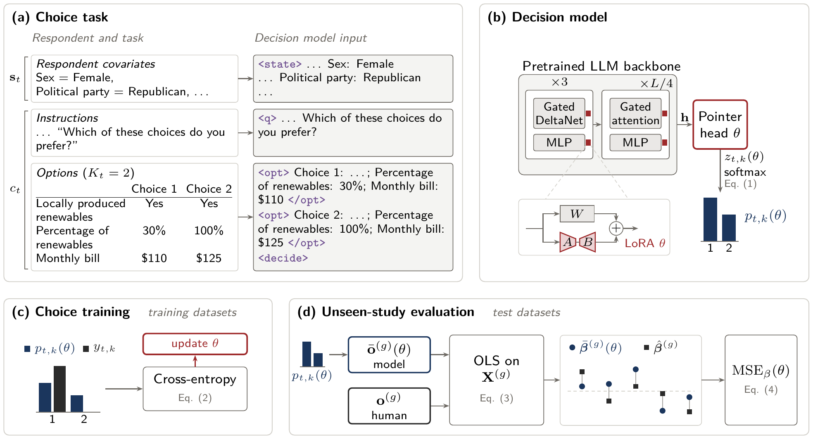
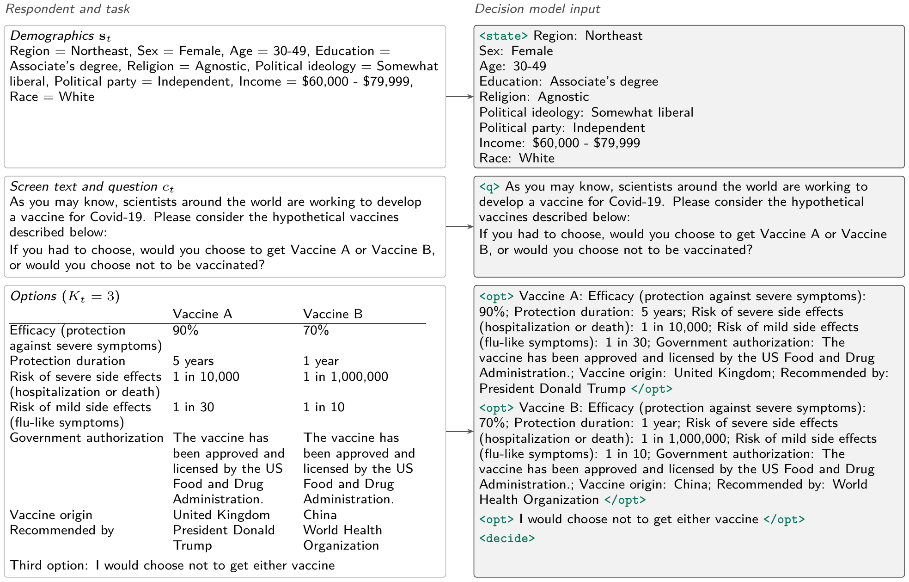

<!-- To submit to Marketing Science: Frontiers track -->

<!-- **** Strictly 6,000 words total (including references, tables, figures; online appendix excluded). -->

<!--
TERMINOLOGY GUIDE (enforce strictly across all sections, tables, figures, and notes; do not bounce between synonyms):
1. Weight updates on human choice data -> "training" and "choice training" (verb: "train"; adjective: "trained" or "choice-trained"). Use "training" aggressively to distinguish our pre-inference weight updates from post-inference adjustment/reweighting methods (Wang et al. 2026; Leng et al. 2026). Never use "fine-tuning" or "fine-tune" (marketing readers conflate it with tuning prompts or sampling parameters). Avoid "post-training" (collides with "post-inference") and avoid "calibration" for weight updates (associated in marketing with post-inference reweighting). Clarify on first use that training updates neural network weights (LoRA backbone adapters and decision head) via respondent-level cross-entropy, equivalent to conditional maximum likelihood estimation (MLE).
2. Models prior to choice training (both generative LLMs and released KEV checkpoints) -> "off-the-shelf" (e.g., "off-the-shelf generative LLMs", "off-the-shelf decision models", "off-the-shelf baseline"; table/figure label: "Off-the-shelf"). Never use "untrained" or bare "base" as the baseline regime label.
3. Evaluation on held-out studies excluded from training -> "unseen-study" (e.g., "unseen-study transfer", "unseen-study evaluation", "transfer to unseen studies"). Avoid bare "zero-shot" (marketing readers associate it with zero-shot prompting); state explicitly that no target-study training data is used.
4. Pre-inference intervention verb -> "train" (e.g., "we train decision models before inference"). Never use "align" or "alignment" for econometric choice training.
5. Generative LLM thinking/reasoning knobs -> "reasoning effort" (e.g., "higher reasoning effort", "lower (off, min, low) and higher (on, high) reasoning effort"). Avoid "reasoning settings" or "reasoning budgets".
6. Contrast with Wang et al. (2026) and Leng et al. (2026) -> describe their methods as "post-inference adjustment" or "post-inference reweighting" of fixed model outputs using target-study human data, contrasted directly with our pre-inference "training" / "choice training" of model weights on historical studies.
7. Field and data naming -> use "synthetic respondents" for general use and "synthetic choice data" for choice experiments in particular. Never use "silicon sampling" or "silicon samples" (non-Marketing Science terminology).
8. Our seven empirical data collections -> "dataset" / "datasets" and "study" / "studies" are both allowed (e.g., "training datasets", "two training studies", "held-out test datasets"). Never call test datasets "test benchmarks", "benchmark studies", or "benchmark designs", and never call the validation dataset a "validation set". Reserve "benchmark" for the full-sample human slope benchmark and pretrained objective single-label benchmarks.
-->

**Abstract.**  
Researchers increasingly use large language models (LLMs) as synthetic respondents in market research, conjoint analysis, and randomized experiments.
However, synthetic choice data from off-the-shelf generative LLMs bias downstream econometric inference. 
Neither proprietary models nor higher reasoning effort reliably reduces this bias.
We investigate decision models (System One architectures) for silicon sampling.
Using choice training, we update KEV model weights on historical respondent-level choice microdata by conditional maximum likelihood, before inference and without target-study data.
Across three model scales, training on two discrete choice experiments lowers treatment-effect error by 22% to 89% on four held-out studies from new domains (vaccines, nutrition labels, consumer rights, and AI) and new response formats.
A small choice-trained model outperforms a much larger off-the-shelf model on three of the four studies.
Although training on single studies lowers cross-entropy, it can exacerbate treatment-effect error.
Choice training thus complements post-inference calibration by providing a stronger starting point for estimating human preferences.

**Keywords.** decision models, large language models, synthetic respondents, econometric inference, marketing research

# Introduction {#sec-intro}

Using foundation models as synthetic respondents has attracted growing interest in marketing and behavioral research.
In marketing, a primary goal is downstream econometric inference, such as estimating attribute slopes in conjoint analysis or recovering causal treatment effects in randomized experiments.
Most studies on synthetic respondents generate synthetic choice data with off-the-shelf generative large language models (LLMs), yet substituting these outputs for human responses severely biases downstream analyses [@goli2024frontiers; @leng2026reducing; @wang2026large].
A likely source of this bias is how LLMs are trained. 
During training, LLMs are rewarded for producing a single correct answer on single-label objective benchmarks (e.g., mathematics, factual questions) and for complying with safety rules. 
In these tasks, any probability placed on other answers is considered error to be minimized. 
In contrast, simulating human choices requires a probability distribution over all plausible responses, because respondents with the same observed characteristics can differ in their preferences. 
Therefore, off-the-shelf LLMs tend to collapse their response distribution onto a single answer and, because of their safety training, sometimes refuse to answer.
For instance, on a vaccine conjoint subsample [@kreps2020factors], off-the-shelf models incur large ordinary least squares (OLS) treatment-effect error ($\mathrm{MSE}_\beta$) relative to human respondents [@wang2026large].
Contrary to common expectation, using proprietary models or increasing reasoning effort can exacerbate this error (@fig-intro-off-the-shelf).

Moreover, generative LLMs are slow and expensive because generating text tokens requires costly Monte Carlo sampling to approximate choice probabilities.
To avoid these costs, we study decision models. 
Decision models replace a language model's text-generation head with a pointer head that scores candidate options directly [@deusser2026evaluatingbenchmarkingmodeljev; @geuter2026releasinginnerjevsimple; @palmer2026kev].
Unlike LLMs that produce a probability distributions over all tokens in the vocabulary, decision models produce a probability distributions over only the valid options in a task. 
These probabilities eliminate Monte Carlo sampling cost and yield exact expected OLS treatment effects.
Despite this architectural advantage, off-the-shelf decision models still incur high treatment-effect error (@fig-intro-off-the-shelf).
Because they are trained on similar single-label objective benchmarks, they treat disagreement among respondents with the same persona as classification error [@gao2026choicesfewerdecisionsordinalscale].

In this research, we train decision models by updating their weights on historical human choice microdata. 
We call this procedure choice training.
Specifically, we minimize respondent-level cross-entropy (CE), which is equivalent to conditional maximum likelihood estimation.
Unlike post-inference calibration methods that keep model weights fixed and require human data from the target study [@wang2026large; @leng2026reducing], choice training occurs before inference and uses no target-study human data.
We therefore ask whether choice training on a small set of historical datasets can reduce error on held-out test datasets that never enter training.

{#fig-intro-off-the-shelf width=90%}

::: {custom-style="Table Note"}
*Note.* 
Bars report OLS $\mathrm{MSE}_\beta \times 10^3$ (@eq-eval-mse) across 11 vaccine attribute levels on a 200-respondent Vaccines conjoint subsample [$n = 1,000$ choice tasks\; @wang2026large]. 
Errors are measured relative to full-sample human estimates ($N = 1,971$ respondents; 9,855 choice tasks). 
:::

We evaluate choice training across three open-weight decision-model scales [0.8B, 4B, and 9B parameters\; @palmer2026kev]. 
We train on two historical choice datasets and select the best checkpoint on a separate validation dataset.
We use four held-out test datasets: a nutrition-labeling trial [@grummon2025nutrition], a vaccine conjoint [@kreps2020factors], a consumer-rights conjoint [@kantorowicz2026consumers], and a rating conjoint on AI and offshoring [@magistro2026attitudes].
Compared to off-the-shelf decision models, we find that choice training on two studies lowers both $\mathrm{MSE}_\beta$ (by 22% to 89%) and $CE$ (by 10% to 51%) on every held-out test dataset and model scale. 
These gains extend to unseen studies with attributes and response formats absent from training. 
We also find that a small choice-trained model can outperform a much larger off-the-shelf model on three of the four test datasets.

Our research makes the following contributions to synthetic respondents in marketing and behavioral research.
First, we show that choice training lowers treatment-effect error on unseen studies without any target-study human data, complementing existing post-inference calibration methods [@hullman2026human].
Second, we show that training decision models on just two studies with binary choices transfers to new domains (vaccines, nutrition labels, consumer rights, AI, and offshoring) and new response formats (three-option choices and five-point ratings). 
Unlike prior research, where training on human choices failed to generalize to new domains [@brand2023using] or even within the same study [@wang2026large; @wang2025can], our training regime transfers to unseen studies.
Third, we show that training models to minimize cross-entropy loss does not guarantee improvements in treatment effect recovery. 
Models trained on only one of our training studies did lower the CE loss on every test dataset, yet sometimes led to worse treatment-effect error. 
On the other hand, training on both studies mitigated these failures. 
This finding motivates novel training objectives that target treatment effects directly.

# Literature review {#sec-lit}

Early work on synthetic respondents prompted off-the-shelf generative LLMs with demographic profiles to simulate human responses in political, economic, and marketing surveys [@argyle2023out; @horton2023large; @goli2024frontiers; @pmlr-v202-santurkar23a].
Although these models can capture average preference directions, systematic discrepancies from human populations severely bias downstream econometric estimates [@pmlr-v202-santurkar23a; @wadi2025monte; @leng2026reducing; @wang2026large].
Common distortions include mode collapse (i.e., producing nearly the same answer every time a question is asked) and prompt sensitivity.
<!-- In choice-based conjoint analysis, using more advanced LLMs or prompting techniques does not improve preference-estimation error [@wang2026large]. -->
Recent marketing research addresses these biases while keeping model weights fixed, relying on human data from the target study or target individuals.
These methods include post-inference econometric debiasing [@wang2026large], optimal post-inference reweighting across prompts and checkpoints [@leng2026reducing], and individual digital twins conditioned on hundreds of responses per person [@toubia2025database].
Post-inference calibration uses a sample of human responses from the same study to correct model outputs. 
Therefore, the final estimates remain statistically valid even when the model itself is biased. 
However, how much these methods gain over human data alone depends on how closely the underlying model approximates the target human population [@hullman2026human].

A growing literature instead updates LLM weights directly on human microdata, either from the target study itself, from a different study in the same product category, or from many unrelated studies.
Training LLMs on a small sample (e.g., 50 tasks) from the same study cannot remove the bias in regression parameters [@wang2026large; @wang2025can; @ye2025fine] and still requires human data for the same study. 
Moreover, research has shown that WTP estimates from a separate study can transfer to a new study within the same product category, but fail to generalize to new product categories [@brand2023using]. 
Outside marketing, large-scale behavioral training improves out-of-study prediction across cognitive psychology [10 million choices across 160 experiments\; @binz2025foundation], social-science experiments [2.9 million responses across 210 studies\; @kolluri2025finetuning], and public-opinion surveys [@suh-etal-2025-language; @huang-etal-2026-distribution; @ku2026siliconsamplingcrosssurveytransfer].
Yet these cross-study efforts rely on large multi-hundred-study corpora and autoregressive text generation.
Moreover, they evaluate predictive log-likelihood, marginal distributions, or cell-level distributional distance rather than econometric treatment-effect recovery.

A third stream of research tackles the sampling variance of repeated text generation by using choice probabilities in a single forward pass. Early studies extract next-token probabilities over option symbols (e.g., A, B, and C) from LLMs, yet those probabilities remain sensitive to vocabulary and token-frequency priors [@kadavath2022language; @wadi2026every]. 
Dedicated decision models address this sensitivity by scoring candidate options outside the vocabulary head [@palmer2026kev; @wadi2026whom]. 
However, because this architecture is new, it remains open whether pre-inference choice training can adapt decision models for unseen-study econometric inference without using target-study human data. 
In the following section, we formalize our training and evaluation methodology for these models.

# Methodology {#sec-methodology}

{#fig-pipeline width=90%}

**Decision model parameterization.**
Consider a choice study composed of discrete-choice tasks indexed by $t$ (@fig-pipeline, panel a).
Each task pairs observed respondent covariates $\mathbf{s}_t$ (e.g., sex, age, education, income, political affiliation, and race), which vary by dataset, with a task context $c_t$ specifying the instructions and $K_t \ge 2$ discrete options.
Let $y_{t,k} \in \{0, 1\}$ indicate whether the human respondent selects option $k \in \{1, \dots, K_t\}$ on task $t$, with $\sum_{k=1}^{K_t} y_{t,k} = 1$.

Unlike LLMs that generate tokens autoregressively, a decision model replaces the vocabulary head of a pretrained language model with a pointer head that scores all $K_t$ options in one forward pass (@fig-pipeline, panel b).
For each option $k$, the model computes a real-valued score $z_{t,k}(\theta)$ from $(\mathbf{s}_t, c_t)$. 
$\theta$ consists of trainable low-rank adaptation (LoRA) weights [@hu2021lora] on the backbone and the pointer-head parameters.
Applying a softmax transformation with unit temperature produces the conditional choice probabilities:
$$
p_{t,k}(\theta) = P\big(y_{t,k} = 1 \mid \mathbf{s}_t, c_t; \theta\big) = \frac{\exp\!\big(z_{t,k}(\theta)\big)}{\sum_{m=1}^{K_t} \exp\!\big(z_{t,m}(\theta)\big)}.
$$ {#eq-model-pmf}
Formally, @eq-model-pmf has the multinomial logit form, with $z_{t,k}(\theta)$ entering in place of systematic utility.
Because @eq-model-pmf normalizes directly over $\{1, \dots, K_t\}$ without text decoding, out-of-set outputs have zero probability by construction.

**Choice training.**
Off-the-shelf decision models are trained on deterministic tasks with single-label answers. 
Therefore, the true conditional distribution of labels places all probability mass on one option. 
Minimizing cross-entropy on such data pushes predicted probabilities $p_{t,k}(\theta)$ toward zero and one.
In contrast, in human choice studies, respondents with identical observed covariates, $\mathbf{s}_t$, still differ in unobserved preferences.
Therefore, the true conditional choice distribution $\mathbf{q}_t = (q_{t,1}, \dots, q_{t,K_t})$, with $q_{t,k} = P(y_{t,k} = 1 \mid \mathbf{s}_t, c_t)$, spreads probability mass across options rather than collapsing onto a single mode.

Choice training updates $\theta$ before inference on historical respondent-level choice microdata (@fig-pipeline, panel c).
Starting from the off-the-shelf model checkpoint, we treat each task as an independent observation given the respondent's covariates (i.e., a pooled likelihood), although each respondent may complete several tasks. 
We minimize empirical cross-entropy over mini-batches $S$ of historical tasks:
$$
\mathcal{L}_{\mathrm{CE}}(\theta; S) = -\frac{1}{|S|} \sum_{t \in S} \sum_{k=1}^{K_t} y_{t,k} \log p_{t,k}(\theta).
$$ {#eq-resp-ce}
Minimizing @eq-resp-ce is equivalent to pooled conditional maximum likelihood estimation of @eq-model-pmf [@mcfadden1972conditional; @train2009discrete].
This objective is respondent-level because each term uses an individual respondent's observed choice vector $\mathbf{y}_t = (y_{t,1}, \dots, y_{t,K_t})$.
Taking expectations over $\mathbf{y}_t \sim \mathbf{q}_t$ conditional on $(\mathbf{s}_t, c_t)$ decomposes the expected task loss as

$$
\begin{aligned}
\mathbb{E}_{\mathbf{y}_t \sim \mathbf{q}_t}\!\left[-\sum_{k=1}^{K_t} y_{t,k} \log p_{t,k}(\theta)\right]
&= -\sum_{k=1}^{K_t} q_{t,k} \log p_{t,k}(\theta) \\
&= H(\mathbf{q}_t) + D_{\mathrm{KL}}\!\big(\mathbf{q}_t \,\|\, \mathbf{p}_t(\theta)\big),
\end{aligned}
$$ {#eq-ce-kl}

where $\mathbf{p}_t(\theta) = (p_{t,1}(\theta), \dots, p_{t,K_t}(\theta))$ is the predicted choice distribution from @eq-model-pmf, $H(\mathbf{q}_t) = -\sum_{k=1}^{K_t} q_{t,k} \log q_{t,k}$ is the Shannon entropy of human choices, and $D_{\mathrm{KL}}(\mathbf{q}_t \,\|\, \mathbf{p}_t(\theta)) = \sum_{k=1}^{K_t} q_{t,k} \log\big(q_{t,k} / p_{t,k}(\theta)\big)$ is the Kullback-Leibler (KL) divergence.
Because $H(\mathbf{q}_t)$ does not depend on $\theta$ and $D_{\mathrm{KL}}(\mathbf{q}_t \,\|\, \mathbf{p}_t(\theta)) \ge 0$ with equality if and only if $\mathbf{p}_t(\theta) = \mathbf{q}_t$, cross-entropy is a strictly proper scoring rule (i.e., its expected value is minimized only by the true choice distribution).

@eq-ce-kl resolves an apparent tension in our objective function. 
Choice training minimizes the same cross-entropy loss on the same one-hot label format as training regimes that have a single correct answer.
What separates the two is the distribution of $\mathbf{q}_t$.
On objective tasks, $\mathbf{q}_t$ places all probability mass on the correct option ($H(\mathbf{q}_t) = 0$), so minimizing the KL term pushes $\mathbf{p}_t(\theta)$ toward zero and one.
On human choice data, if respondents with identical $(\mathbf{s}_t, c_t)$ choose differently, $\mathbf{q}_t$ becomes interior ($H(\mathbf{q}_t) > 0$). 
Thus, the same loss function drives $\mathbf{p}_t(\theta)$ toward interior probabilities rather than the most common option.
Each one-hot choice is a single draw from $\mathbf{q}_t$, hence training requires no aggregate choice shares.
This property is essential in randomized designs with sparse respondent covariates and task attributes, where each unique combination $(\mathbf{s}_t, c_t)$ is typically observed only once and, thus, empirical choice shares cannot be estimated cell by cell.
In such cases, the model recovers $\mathbf{q}_t$ by sharing parameters across respondents and tasks with similar covariates and attributes.
Because this argument holds in expectation, a sufficiently flexible model could still memorize individual choices. 
Therefore, choice training should still select the best checkpoint on held-out validation data.
Importantly, no target-study data enters @eq-resp-ce, so downstream econometric evaluation measures genuine generalizability to unseen studies.

**Econometric evaluation.**
On a held-out evaluation dataset, we hold $\theta$ fixed and evaluate treatment-effect recovery using ordinary least squares (OLS) regressions defined by the dataset's experimental design (@fig-pipeline, panel d).
Applying the same linear specification symmetrically to both human responses and model-implied expected outcomes places the human benchmark and synthetic choice data on a common estimator.
Consider each regression $g \in \{1, \dots, G\}$ in the dataset, with full-column-rank design matrix $\mathbf{X}^{(g)}$ and human outcome vector $\mathbf{o}^{(g)}$.
The matrix $\mathbf{X}^{(g)}$ contains an intercept and $d_g$ treatment or attribute indicators from the experiment design.
Across our evaluation designs, each entry of the regression outcome $\mathbf{o}^{(g)}$ is a linear function of the choice indicators $y_{t,k}$. 
It is either a binary indicator $y_{t,k}$ for choosing a given profile or target option (zero across profiles when the outside option is chosen) or the numeric rating $\sum_{k=1}^{K_t} k\,y_{t,k}$ on an ordinal scale.
By linearity of expectation, replacing each realized indicator $y_{t,k}$ with its predicted probability $p_{t,k}(\theta)$ from @eq-model-pmf yields the exact expected outcome vector $\bar{\mathbf{o}}^{(g)}(\theta)$ that would result from averaging over synthetic choices drawn from $\mathbf{p}_t(\theta)$.

Applying the OLS operator $\mathbf{A}^{(g)} = (\mathbf{X}^{(g)\top}\mathbf{X}^{(g)})^{-1}\mathbf{X}^{(g)\top}$ to the human and model-predicted outcome vectors defines the intercepts and slopes:

$$
\begin{pmatrix}
\hat{\alpha}^{(g)} \\
\hat{\boldsymbol{\beta}}^{(g)}
\end{pmatrix}
= \mathbf{A}^{(g)}\mathbf{o}^{(g)},
\qquad
\begin{pmatrix}
\bar{\alpha}^{(g)}(\theta) \\
\bar{\boldsymbol{\beta}}^{(g)}(\theta)
\end{pmatrix}
= \mathbf{A}^{(g)}\bar{\mathbf{o}}^{(g)}(\theta),
$$ {#eq-pop-ols}

where $\hat{\alpha}^{(g)}$ and $\bar{\alpha}^{(g)}(\theta)$ are the intercepts, $\hat{\boldsymbol{\beta}}^{(g)}$ is the full-sample human slope benchmark, and $\bar{\boldsymbol{\beta}}^{(g)}(\theta)$ is the vector of $d_g$ synthetic treatment or attribute slopes.
Because $\mathbf{X}^{(g)}$ is fixed and OLS is linear in the outcome vector, $\bar{\boldsymbol{\beta}}^{(g)}(\theta)$ equals the exact expectation of the OLS slope estimator over synthetic choices drawn from $p_{t,k}(\theta)$, with zero Monte Carlo variance.[^standard-errors]

[^standard-errors]: Note that @eq-pop-ols evaluates point estimates rather than OLS standard errors, because replacing random choices with expected outcomes removes choice-level variance.

Because all $G$ regressions within a dataset share identical outcome units, we measure aggregate slope recovery across all $d = \sum_{g=1}^G d_g$ slopes via mean squared error [@wang2026large]:

$$
\mathrm{MSE}_{\beta}(\theta) = \frac{1}{d} \sum_{g=1}^G \left\lVert \bar{\boldsymbol{\beta}}^{(g)}(\theta) - \hat{\boldsymbol{\beta}}^{(g)} \right\rVert_2^2.
$$ {#eq-eval-mse}

Alongside @eq-eval-mse, we evaluate @eq-resp-ce across all tasks in each dataset to report held-out cross-entropy in nats (@tbl-results-mse).
Whereas @eq-eval-mse measures aggregate slope recovery, cross-entropy captures how accurately $\mathbf{p}_t(\theta)$ predicts conditional choice distributions given $(\mathbf{s}_t, c_t)$ (@eq-ce-kl).

# Experimental setup {#sec-setup}

## Datasets

For choice training, we use seven datasets from distinct product and policy domains (@tbl-datasets).
Two datasets provide the respondent-level training microdata: a paired electricity-plan conjoint [`Electricity`\; @wu2025partisan] and a discrete-choice experiment on drone versus ground delivery across four vendor contexts [`Drones`\; @berke2023drone].
Both training datasets vary price (monthly bill or delivery fee) alongside non-price attributes.
A separate airline conjoint [`Flights`\; @goldfarb2026comfort] dataset serves as our validation set, which we use to tune hyper-parameters and select the best checkpoint (lowest $\mathrm{MSE}_\beta$). 
Finally, we use four held-out test datasets to evaluate generalizability to new studies, domains, and choice format.

Two test datasets include prices on products with price ranges absent from training (`Consumer rights` and `AI & offshoring`), whereas the other two share no attributes with the training datasets (`Food labels` and `Vaccines`).
Response formats in the test sets are also different from the binary choices used in training (@tbl-datasets). 
The test datasets have a three-option conjoint with an outside option (`Vaccines`), a three-option identification task (`Food labels`), and a five-point ordinal rating (`AI & offshoring`).
Across all seven datasets, each choice task conditions on the respondent's observed covariates $\mathbf{s}_t$ in a standardized text format (@fig-pipeline, panel a).



: Summary of training, validation, and held-out test datasets {#tbl-datasets}

::: {custom-style="Table Note"}
*Note.* 
Shorthand labels in the Dataset column are used throughout the paper. 
$K$ is the number of response options per choice task. 
$N$ is the number of respondents. 
$d$ reports the total number of non-reference treatment or attribute slopes across each dataset's experimental design (@sec-methodology). 
Specifically, `Consumer rights` spans two product conjoints of 19 slopes each (38 total), and `AI & offshoring` spans four country-by-arm regressions of 8 slopes each (32 total) on a five-point support scale (1 to 5). 
:::

## Choice-training regimes and protocol

At each model scale, we use a $2 \times 2$ design crossing the inclusion of `Electricity` (excluded vs. included) with the inclusion of `Drones` (excluded vs. included) studies.
This forms four choice-training regimes: `Off-the-shelf` (neither dataset), `Electricity` (18,591 tasks), `Drones` (36,297 tasks), and `Drones + Electricity` (54,888 tasks).
`Off-the-shelf` evaluates the unmodified decision model without choice training.
This design tests whether single-dataset training transfers to unseen datasets and whether pooling both choice datasets improves the model beyond each individual dataset.

We evaluate the `KEV-0.8B`, `KEV-4B`, and `KEV-9B` open-weight decision models [@palmer2026kev], each loaded in `bfloat16` precision with unit temperature.
Choice training updates LoRA adapters (rank $r = 64$, scaling $\alpha_{\mathrm{LoRA}} = 128$, dropout $0.05$) across all linear backbone projections jointly with the trainable pointer head via @eq-resp-ce.
Every trained run uses AdamW with a $5 \times 10^{-6}$ peak learning rate, a OneCycle schedule ($10\%$ warmup and cosine decay), weight decay $0.01$, and gradient-norm clipping at $1.0$, for $3$ epochs with mini-batch size $|S| = 40$ and random seed $42$.
Within each epoch, tasks are shuffled by dataset (and by vendor context in `Drones`), partitioned into single-dataset mini-batches, and interleaved randomly.

The Web Appendix details the off-the-shelf generative LLM protocol behind @fig-intro-off-the-shelf (@apptbl-llm-baseline), choice-training hyperparameters (@apptbl-hyperparameters), training curves (@appfig-training-curves), and attribute-level tables and diagnostics (@appfig-flights-slopes; @apptbl-vaccines-slopes through @apptbl-magistro-subsets).

# Results {#sec-results}

## Unseen-study transfer across domains and model scales

Relative to the off-the-shelf checkpoints, pooled choice training (`Drones + Electricity`) lowers both $\mathrm{MSE}_\beta$ and CE in all 12 held-out test cells, reducing $\mathrm{MSE}_\beta$ by 22% to 89% (@tbl-results-mse).
Notably, these gains extend both to datasets that share no attributes with the training studies (`Food labels` and `Vaccines`) and to response formats absent from training (@fig-results-overall).[^large-offshoring-mse]
In particular, although the training data contain only binary choices, pooled models still transfer to three-option choices and five-point ordinal ratings.

[^large-offshoring-mse]: In the table, the larger raw $\mathrm{MSE}_\beta$ values on `AI & offshoring` reflect its 1 to 5 ordinal scale rather than a binary indicator.

{#fig-results-overall width=100%}

Training on a single dataset, however, transfers to unseen studies less reliably.
Training on `Electricity` alone and `Drones` alone each reduces $\mathrm{MSE}_\beta$ on three test datasets, yet raises $\mathrm{MSE}_\beta$ above off-the-shelf levels in four of six cells in `AI & offshoring` (@fig-results-overall). `AI & offshoring` is the test dataset that has a five-point rating scale for its outcome variable.
These failures arise even though single-dataset training lowers CE in all 24 held-out test cells.
A closer approximation of individual choices (i.e., lower CE) therefore does not guarantee more accurate treatment effects.
Pooling both training datasets eliminates these failures, making unseen-study transfer more robust than training on either dataset alone.

Choice training also reduces error more reliably than scaling model parameters.
Similar to the pattern seen for generative LLMs (@fig-intro-off-the-shelf), scaling off-the-shelf decision models fails to improve treatment-effect recovery consistently.
Interestingly, choice-trained `KEV-0.8B` outperforms off-the-shelf `KEV-9B` on three of the four test datasets, despite having an order of magnitude fewer parameters.

::: {#tbl-results-mse size="scriptsize"}



OLS treatment-effect error and empirical cross-entropy across datasets and choice-training regimes

:::

::: {custom-style="Table Note"}
*Note.* $\mathrm{MSE}_\beta$ reports population OLS treatment-effect error $\times 10^3$ (@eq-eval-mse).
CE reports mean empirical cross-entropy (negative log-likelihood per choice task, in nats; @eq-resp-ce). 
Lower is better for both metrics. 
Bold marks the lowest value per model, dataset, and metric. 
:::

## Attribute-level transfer across shared and unseen attributes

Because both training datasets include price, aggregate gains for the `Consumer rights` and `AI & offshoring` datasets could indicate that the models have learned only price-related information.
However, attribute-level estimates rule out this explanation.
On `Consumer rights`, pooled choice training lowers $\mathrm{MSE}_\beta$ across the 34 non-price slopes by 23% to 41% at every model scale (@fig-results-laptops-slopes and @apptbl-consumer-rights-slopes).
Similarly, it reduces error across the 24 non-price job slopes on `AI & offshoring`, by 33% to 34% at every scale (@apptbl-ai-offshoring-slopes).
Because `Food labels` and `Vaccines` share no attributes with training, their gains likewise cannot stem from price information learned during training.

Despite these improvements, pooled choice training narrows but does not close the gap to human estimates. 
Some of the largest human effects remain attenuated or over-estimated at every model scale (@fig-results-laptops-slopes and @fig-results-vaccines-slopes).
Full attribute-level estimates for the remaining datasets appear in the Web Appendix (@apptbl-food-slopes, @apptbl-magistro-subsets, @appfig-flights-slopes, and @apptbl-flights-slopes).

{#fig-results-laptops-slopes width=100%}

{#fig-results-vaccines-slopes width=100%}

# Conclusion {#sec-conclusion}

Off-the-shelf foundation models, whether generative LLMs or decision models, struggle to recover human treatment effects in unseen choice studies. 
Neither larger parameter counts nor higher reasoning effort reliably mitigates regression estimates.
In this research, we show that pre-inference choice training of compact open-weight decision models provides consistent improvements.
Training on only two historical choice studies lowers both OLS treatment-effect error and cross-entropy across every held-out test dataset and model scale.
These gains extend to unseen attributes and new response formats without any target-study human data calibration.

Our results show how choice training fits alongside existing approaches for using AI models as synthetic respondents.
Unlike post-inference calibration methods that require human data from the target study [@wang2026large; @leng2026reducing], choice training relies strictly on historical datasets and can serve as a stronger starting point before any statistical calibration [@hullman2026human].
It also generalizes beyond the domain of the training datasets and transfers across new domains and response formats.
Finally, whereas large-scale behavioral models depend on hundreds of studies and autoregressive text generation [@binz2025foundation; @kolluri2025finetuning], our approach achieves unseen-study transfer from two datasets using a compact model architecture.

For marketing researchers, these findings carry the following practical implications.
Before any human data is collected, choice-trained decision models offer a stronger starting point that can support exploratory pre-testing and experimental design while potentially reducing the residual bias left for post-inference calibration.
In addition, pooling various training datasets yields more dependable transfer than single-dataset training. 
Also, choice training reduces error more consistently than scaling model parameters.
Because decision models also return exact choice probabilities without Monte Carlo sampling cost, these gains require far less compute than generative LLMs.

Our results also expose a limitation of training on cross-entropy alone.
Single-dataset training lowers cross-entropy on every held-out test cell, yet, for some test datasets, it raises treatment-effect error.
Lower cross-entropy therefore does not guarantee more accurate experimental slope estimation.
One plausible reason is that cross-entropy weights every choice task equally without directly penalizing bias in treatment-versus-control contrasts.
Because decision models yield exact, differentiable expected OLS slopes (@eq-pop-ols), future research can train jointly on respondent-level cross-entropy and a direct treatment-effect loss.

Moreover, because pooled training combines two datasets and more choice tasks than either single-dataset run, matched-volume ablations are needed to separate dataset diversity from data volume.
Similarly, choice-training generative LLMs and comparing with decision models would isolate architectural advantages of decision models from training-data gains.
On the estimation side, choice-trained models still attenuate or overshoot some of the largest human effects at every scale. 
Extending choice training to ordinal scales, non-US samples, and richer respondent covariates therefore offers a natural next step toward generating more general synthetic respondents.

# Declarations {.unnumbered}

## Funding and competing interests {.unnumbered}

All authors certify that they have no affiliations with or involvement in any organization or entity with any financial interest or non-financial interest in the subject matter or materials discussed in this manuscript. The authors have no funding to report.

# References {.unnumbered}

::: {#refs}
:::



# Web Appendix {.unnumbered}

## Token serialization, query-key readout, and covariate mappings {.unnumbered}

**Serialization.** For each respondent, the covariates $\mathbf{s}_t$ are rendered as a state block of "Label: Value" lines (@apptbl-covariates), opened by a state marker. Each task context $c_t$ then appears as a branch that begins with a question marker and the task instructions, places each of the $K_t$ options between an option-start and an option-end marker, and ends with a decision marker (@appfig-input-vaccines). The five markers reuse reserved tokens from the backbone vocabulary, so the serialization introduces no new embeddings. Because every task branch attends to the same shared state block, several tasks for one respondent can be scored against a single encoded state.

**Query-key readout.** 
Let $\mathbf{h}_t^{\mathrm{dec}}$ be the final-layer hidden state at the decision marker of task $t$, and $\mathbf{h}_{t,k}$ the hidden state at the option-end marker of option $k$. 
The pointer head projects both into a $d_p$-dimensional space,

$$
\mathbf{a}_t = \mathbf{W}_Q \mathbf{h}_t^{\mathrm{dec}} + \mathbf{c}_Q, \qquad
\mathbf{b}_{t,k} = \mathbf{W}_K \mathbf{h}_{t,k} + \mathbf{c}_K, \qquad
z_{t,k}(\theta) = \frac{\mathbf{b}_{t,k}^{\top} \mathbf{a}_t}{\sqrt{d_p}},
$$ {#eq-pointer-readout}

with $d_p = 256$, and @eq-model-pmf turns the scores into choice probabilities. 
Because the same projections score each option-end marker separately and @eq-model-pmf normalizes over the listed options, the head handles any number of options $K_t$.

::: {#apptbl-covariates size="footnotesize"}



Respondent covariates in the decision model input by dataset

:::

::: {custom-style="Table Note"}
*Note.* Each covariate enters the input as one "Label: Value" line (@appfig-input-vaccines); covariates a respondent did not report are omitted. Country is not included.
:::

::: {#appfig-input-vaccines}

{width=100%}

Full decision model input for one unseen-study task (Vaccines)

:::

## Off-the-shelf generative LLM baseline protocol {.unnumbered}

We compare off-the-shelf generative LLMs and decision models on a random subsample of 200 `Vaccines` respondents (seed 42; 1,000 three-option tasks), matching the AI-only sample size of @wang2026large.
Each model's choices enter the same OLS operator as the main analysis, and errors are computed against the full-sample human slopes ($N = 1,971$; 11 slopes).

**Prompt.** Generative LLMs receive the prompt of @wang2026large [Section 5.2.1].
The system prompt reads "You should act like a person with the following characteristics deciding whether or not to receive a COVID-19 vaccination:", followed by one line per respondent covariate (e.g., "Age: 18-29").
The user prompt lists options A and B by efficacy, protective duration, major and minor side effects, authorization, origin, and endorsement, adds "C: You choose neither A nor B.", and asks "Which option would you choose as this person? Your response should be a single letter A, B, or C."
Gemini prompts omit the respondent's region, which the covariate mapping added after those runs.

**Generation.** We query Gemini 3.5 Flash-Lite (minimal and high thinking) and Gemini 4 Argon (low and high thinking) through the Gemini API with default sampling.
We serve Qwen3.5-0.8B, 4B, and 9B with vLLM in `bfloat16`, toggling reasoning through the chat template and using Qwen's official recommended sampling settings (reasoning off: temperature 0.7, top-$p$ 0.8; reasoning on: temperature 1.0, top-$p$ 0.95; both top-$k$ 20 and presence penalty 1.5) without an output-length limit.
Each generative LLM produces one response per task.

**Parsing.** A response counts as a choice only if, after removing surrounding whitespace, it is exactly "A", "B", or "C"; all other responses are counted as refusals and excluded from the regression.
Valid responses enter the regression as one-hot choice vectors.

**Decision models.** Off-the-shelf `KEV-0.8B`, `KEV-4B`, and `KEV-9B` receive the same respondent covariates and choice task in their native serialization and return a probability over the three options in one forward pass, which enters the regression directly.
Following the released model cards, these baseline evaluations apply each checkpoint's shipped calibration temperature (2.35, 2.41, and 2.19, respectively).

::: {#apptbl-llm-baseline size="footnotesize"}



Off-the-shelf generative LLMs and decision models on the 200-respondent Vaccines subsample

:::

::: {custom-style="Table Note"}
*Note.* All models condition on respondent demographics over the same 200-respondent, 1,000-task subsample of `Vaccines` [@kreps2020factors], evaluated against the full-sample human OLS benchmark ($N = 1,971$). Refusals count tasks where a generative LLM failed to return a valid choice option. Opt-out reports the share (or expected probability for decision models) of selecting neither vaccine. Values back @fig-intro-off-the-shelf.
:::

## Choice-training hyperparameters {.unnumbered}

::: {#apptbl-hyperparameters size="footnotesize"}



Choice-training hyperparameters shared by all trained runs

:::

::: {custom-style="Table Note"}
*Note.* Settings are identical across the three model scales and three choice-training regimes. 
Revision hashes uniquely identify the base checkpoints of @palmer2026kev. 
Steps count single-dataset mini-batches. 
Selected steps report the checkpoint with the lowest `Flights` $\mathrm{MSE}_\beta$ for `KEV-0.8B`, `KEV-4B`, and `KEV-9B`, respectively.
:::

{#appfig-training-curves width=100%}

::: {custom-style="Table Note"}
*Note.* 
Training CE is a moving average over 0.1 epoch of the per-mini-batch loss. 
Validation metrics are evaluated on `Flights` every 32 steps, starting from the off-the-shelf model at epoch 0. 
Dots mark the checkpoint with the lowest `Flights` $\mathrm{MSE}_\beta$, which is used for all test evaluations.
:::

## Attribute-level treatment-effect tables and diagnostics {.unnumbered}

::: {#appfig-flights-slopes}

{width=100%}

Flights (validation) OLS treatment effects by attribute for off-the-shelf and pooled choice-trained models

:::

::: {#apptbl-vaccines-slopes size="scriptsize"}



Vaccines (held-out test) OLS treatment effects by attribute

:::

::: {custom-style="Table Note"}
*Note.* Human reports full-sample OLS slopes on observed respondent choices in `Vaccines` [@kreps2020factors]. Base denotes the off-the-shelf decision model; Pooled denotes choice training on `Drones + Electricity`. Values back @fig-results-vaccines-slopes.
:::

::: {#apptbl-food-slopes size="scriptsize"}



Food labels (held-out test) OLS treatment effects by arm

:::

::: {custom-style="Table Note"}
*Note.* Human reports full-sample OLS slopes on observed choices in `Food labels` [@grummon2025nutrition]. Base denotes the off-the-shelf decision model; Pooled denotes choice training on `Drones + Electricity`.
:::

::: {#apptbl-consumer-rights-slopes size="scriptsize"}



Consumer rights (held-out test) OLS treatment effects by attribute

:::

::: {custom-style="Table Note"}
*Note.* Human reports full-sample OLS slopes across the 19 laptop (`Computers`) and 19 laundry-machine (`Laundry`) attribute levels in `Consumer rights` [@kantorowicz2026consumers]. Base denotes the off-the-shelf decision model; Pooled denotes choice training on `Drones + Electricity`. Laptop slopes back @fig-results-laptops-slopes.
:::

::: {#apptbl-ai-offshoring-slopes size="scriptsize"}



AI & offshoring (held-out test) OLS treatment effects by attribute

:::

::: {custom-style="Table Note"}
*Note.* Human reports full-sample OLS slopes on the five-point ordinal support scale across four country-by-arm regressions (8 slopes each, 32 total) in `AI & offshoring` [@magistro2026attitudes]. Base denotes the off-the-shelf decision model; Pooled denotes choice training on `Drones + Electricity`.
:::

::: {#apptbl-flights-slopes size="scriptsize"}



Flights (validation) OLS treatment effects by attribute

:::

::: {custom-style="Table Note"}
*Note.* Human reports full-sample OLS slopes on observed respondent choices in `Flights` [@goldfarb2026comfort], the validation dataset used to select each run's checkpoint. Base denotes the off-the-shelf decision model; Pooled denotes choice training on `Drones + Electricity`. Values back @appfig-flights-slopes.
:::

::: {#apptbl-magistro-subsets size="scriptsize"}



AI & offshoring OLS treatment-effect error ($\mathrm{MSE}_\beta \times 10^3$) by country, arm, and attribute type

:::

::: {custom-style="Table Note"}
*Note.* Values report $\mathrm{MSE}_\beta \times 10^3$ on `AI & offshoring` [@magistro2026attitudes]; lower is better. Bold marks the lowest value per model and subset. Pooled choice training (`Drones + Electricity`) improves every country and arm subset across all three models, whereas single-dataset training on `Electricity` degrades both US and Canada subsets on `KEV-4B` and `KEV-9B`.
:::
